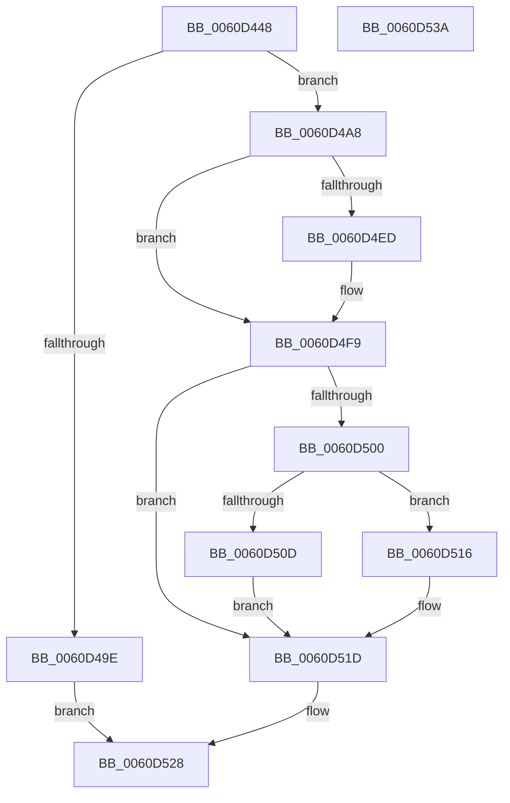

# ST_STORE&lt;SM_TRAITS&gt;::StDmEtaPerformIo

- RVA: `0x0060D448`–`0x0060D53B` (길이 `243` bytes)
- VA: `0x000000014060D448`
- 실행 섹션: `.text`
- PDB 이름 있음: `예`; PDB Function 태그: `아니요`
- unwind 정보 RVA: `0x0007F83C`
- 디코드: `66`개 명령, `243/243` bytes 표시
- 미해석 바이트: `0` (있으면 어셈블리에 `.byte`로 보존)

> 이 문서는 커널 이미지의 기계어와 PDB 기호를 분석해 생성했습니다. 4번과 5번은 함수 원형과 자료형을 바이너리 사용 방식에서 추정한 C 해석이며 원본 소스 복구 결과는 아닙니다.

## 1. Dependencies

- 직접 호출 지점: **4**; 고유 호출 대상: **4**
- 직접 호출자로 확인된 함수: **1**
- RIP 상대 이미지 참조: **0**

### Outgoing calls
- `0x0060D48F` → [ST_STORE<SM_TRAITS>::StDeviceIoBuild](ST_STORE_SM_TRAITS_StDeviceIoBuild_function_0060CDEC.md) (function, `0x0060CDEC`)
- `0x0060D4E4` → [ST_STORE<SM_TRAITS>::StDeviceIoIssue](ST_STORE_SM_TRAITS_StDeviceIoIssue_function_0060CFD0.md) (function, `0x0060CFD0`)
- `0x0060D4F4` → [SmWaitForSyncIo](../61/SmWaitForSyncIo_function_00611478.md) (function, `0x00611478`)
- `0x0060D523` → [ST_STORE<SM_TRAITS>::StDmDeviceIoCompletion](../4B/ST_STORE_SM_TRAITS_StDmDeviceIoCompletion_function_004BBB70.md) (function, `0x004BBB70`)

### Direct callers
- [ST_STORE&lt;SM_TRAITS&gt;::StDmEtaRefresh](../4D/ST_STORE_SM_TRAITS_StDmEtaRefresh_function_004D71BC.md) at `0x004D7264`

### Static image references
- 디코드된 RIP-relative 메모리 참조가 없습니다.

## 2. Other-region calls and transfers

- 다른 실행 섹션으로 향하는 call: **0**
- 별도 외부 분기/꼬리 이동을 확인하지 못했습니다.

## 3. Assembly (complete function range)

```asm
0060D448  4C 8B DC                        mov r11, rsp
0060D44B  49 89 5B 08                     mov qword ptr [r11 + 8], rbx
0060D44F  49 89 73 10                     mov qword ptr [r11 + 0x10], rsi
0060D453  57                              push rdi
0060D454  48 83 EC 50                     sub rsp, 0x50
0060D458  48 8B F1                        mov rsi, rcx
0060D45B  0F 57 C0                        xorps xmm0, xmm0
0060D45E  8B 89 2C 03 00 00               mov ecx, dword ptr [rcx + 0x32c]
0060D464  33 C0                           xor eax, eax
0060D466  0F 11 44 24 30                  movups xmmword ptr [rsp + 0x30], xmm0
0060D46B  D3 E2                           shl edx, cl
0060D46D  41 B9 AD DE 00 00               mov r9d, 0xdead
0060D473  66 44 2B 86 38 03 00 00         sub r8w, word ptr [rsi + 0x338]
0060D47B  48 8B CE                        mov rcx, rsi
0060D47E  49 89 43 E8                     mov qword ptr [r11 - 0x18], rax
0060D482  89 54 24 30                     mov dword ptr [rsp + 0x30], edx
0060D486  49 8D 53 D8                     lea rdx, [r11 - 0x28]
0060D48A  66 45 89 43 DC                  mov word ptr [r11 - 0x24], r8w
0060D48F  E8 58 F9 FF FF                  call 0x14060cdec
0060D494  33 FF                           xor edi, edi
0060D496  48 8B D8                        mov rbx, rax
0060D499  48 85 C0                        test rax, rax
0060D49C  75 0A                           jne 0x14060d4a8
0060D49E  BF 9A 00 00 C0                  mov edi, 0xc000009a
0060D4A3  E9 80 00 00 00                  jmp 0x14060d528
0060D4A8  83 48 1C 0C                     or dword ptr [rax + 0x1c], 0xc
0060D4AC  48 8D 54 24 20                  lea rdx, [rsp + 0x20]
0060D4B1  48 89 7C 24 20                  mov qword ptr [rsp + 0x20], rdi
0060D4B6  48 8D 44 24 20                  lea rax, [rsp + 0x20]
0060D4BB  48 89 44 24 28                  mov qword ptr [rsp + 0x28], rax
0060D4C0  8B 03                           mov eax, dword ptr [rbx]
0060D4C2  83 E0 07                        and eax, 7
0060D4C5  48 83 C8 08                     or rax, 8
0060D4C9  48 89 03                        mov qword ptr [rbx], rax
0060D4CC  48 8B 4C 24 28                  mov rcx, qword ptr [rsp + 0x28]
0060D4D1  8B 01                           mov eax, dword ptr [rcx]
0060D4D3  83 E0 07                        and eax, 7
0060D4D6  48 0B C3                        or rax, rbx
0060D4D9  48 89 01                        mov qword ptr [rcx], rax
0060D4DC  48 8B CE                        mov rcx, rsi
0060D4DF  48 89 5C 24 28                  mov qword ptr [rsp + 0x28], rbx
0060D4E4  E8 E7 FA FF FF                  call 0x14060cfd0
0060D4E9  85 C0                           test eax, eax
0060D4EB  78 0C                           js 0x14060d4f9
0060D4ED  48 8B 8E 20 03 00 00            mov rcx, qword ptr [rsi + 0x320]
0060D4F4  E8 7F 3F 00 00                  call 0x140611478
0060D4F9  8B 43 1C                        mov eax, dword ptr [rbx + 0x1c]
0060D4FC  A8 01                           test al, 1
0060D4FE  75 1D                           jne 0x14060d51d
0060D500  83 4B 1C 01                     or dword ptr [rbx + 0x1c], 1
0060D504  48 8B 43 10                     mov rax, qword ptr [rbx + 0x10]
0060D508  48 85 C0                        test rax, rax
0060D50B  74 09                           je 0x14060d516
0060D50D  C7 40 04 85 00 00 C0            mov dword ptr [rax + 4], 0xc0000085
0060D514  EB 07                           jmp 0x14060d51d
0060D516  C7 43 08 85 00 00 C0            mov dword ptr [rbx + 8], 0xc0000085
0060D51D  48 8B D3                        mov rdx, rbx
0060D520  48 8B CE                        mov rcx, rsi
0060D523  E8 48 E6 EA FF                  call 0x1404bbb70
0060D528  48 8B 5C 24 60                  mov rbx, qword ptr [rsp + 0x60]
0060D52D  8B C7                           mov eax, edi
0060D52F  48 8B 74 24 68                  mov rsi, qword ptr [rsp + 0x68]
0060D534  48 83 C4 50                     add rsp, 0x50
0060D538  5F                              pop rdi
0060D539  C3                              ret
0060D53A  CC                              int3
```

## 4. C-style interpretation (structured pseudocode)

```c
__int64 __fastcall ST_STORE_SM_TRAITS___StDmEtaPerformIo(__int64 a1, int a2, unsigned __int16 a3)
{
    __int64 result;
    __int64 v_rdi;
    __int64 v_rsp;
    unsigned __int64 v_stack_m28;
    unsigned __int64 v_stack_m30;
    unsigned __int64 v_stack_m38;
    unsigned __int64 v_stack_p10;
    unsigned __int64 v_stack_p8;

    *(unsigned __int64 *)(v_rsp + 8) = v_rbx;
    *(unsigned __int64 *)(v_rsp + 16) = v_rsi;
    v_rsp = (v_rsp) - (80);
    result = 0;
    v_stack_m28 = v_xmm0;
    a2 = (unsigned int)((a2) << ((unsigned __int8)((unsigned int)(*(unsigned int *)(a1 + 812)))));
    a3 = (unsigned __int16)((a3) - (*(unsigned __int16 *)(a1 + 824)));
    *(unsigned __int64 *)(v_rsp - 24) = 0;
    v_stack_m28 = a2;
    *(unsigned __int16 *)(v_rsp - 36) = a3;
    result = ST_STORE_SM_TRAITS___StDeviceIoBuild(a1, v_rsp - 40, a3, (unsigned int)(0xDEADULL));
    v_rdi = 0;
    if (result != 0) goto loc_0060D4A8;
    goto loc_0060D528;
loc_0060D4A8:
    v_stack_m38 = (unsigned int)(0xC000009AULL);
    v_stack_m30 = v_stack_m38;
    result = (unsigned int)(((unsigned int)(*(unsigned int *)(result))) & (7));
    result = (result) | (8);
    *(unsigned __int64 *)(result) = result;
    result = (unsigned int)(((unsigned int)(*(unsigned int *)(v_stack_m30))) & (7));
    result = (result) | (result);
    *(unsigned __int64 *)(v_stack_m30) = result;
    v_stack_m30 = result;
    result = ST_STORE_SM_TRAITS___StDeviceIoIssue(a1, v_stack_m38, a3, (unsigned int)(0xDEADULL));
    if (!(sign_flag)) {
        a1 = *(unsigned __int64 *)(a1 + 800);
        result = SmWaitForSyncIo(a1, v_stack_m38, a3, (unsigned int)(0xDEADULL));
    }
    if ((((unsigned __int8)((unsigned int)(*(unsigned int *)(result + 28)))) & (1)) != 0) goto loc_0060D51D;
    if (*(unsigned __int64 *)(result + 16) == 0) goto loc_0060D516;
    *(unsigned int *)(*(unsigned __int64 *)(result + 16) + 4) = 0xC0000085ULL;
    goto loc_0060D51D;
loc_0060D516:
    *(unsigned int *)(result + 8) = 0xC0000085ULL;
loc_0060D51D:
    result = ST_STORE_SM_TRAITS___StDmDeviceIoCompletion(a1, result, a3, (unsigned int)(0xDEADULL));
loc_0060D528:
    v_rsp = (v_rsp) + (80);
    return (unsigned int)((unsigned int)((unsigned int)(0xC000009AULL)));
}
```

## 5. (Beta) C Style

```c
int64_t ST_STORE_SM_TRAITS___StDmEtaPerformIo(void *Arg1, int32_t Arg2, uint16_t Arg3)
{
    uint8_t *arg1 = (uint8_t *)Arg1;

    int64_t result;
    int64_t local_rdi;
    int64_t local_rsp;
    uint64_t v_stack_m28;
    uint64_t v_stack_m30;
    uint64_t v_stack_m38;
    uint64_t v_stack_p10;
    uint64_t v_stack_p8;

    *(uint64_t *)(local_rsp + 0x8) = local_rbx;
    *(uint64_t *)(local_rsp + 0x10) = local_rsi;
    local_rsp = (local_rsp) - (80);
    result = 0;
    v_stack_m28 = v_xmm0;
    Arg2 = (uint32_t)((Arg2) << ((uint8_t)((uint32_t)(*(uint32_t *)(arg1 + 0x32C)))));
    Arg3 = (uint16_t)((Arg3) - (*(uint16_t *)(arg1 + 0x338)));
    *(uint64_t *)(local_rsp - 0x18) = 0;
    v_stack_m28 = Arg2;
    *(uint16_t *)(local_rsp - 0x24) = Arg3;
    result = ST_STORE_SM_TRAITS___StDeviceIoBuild(Arg1, local_rsp - 40, Arg3, (uint32_t)(0xDEADULL));
    local_rdi = 0;
    if (result != 0) goto loc_0060D4A8;
    goto loc_0060D528;
loc_0060D4A8:
    v_stack_m38 = (uint32_t)(0xC000009AULL);
    v_stack_m30 = v_stack_m38;
    result = (uint32_t)(((uint32_t)(*(uint32_t *)(result))) & (7));
    result = (result) | (8);
    *(uint64_t *)(result) = result;
    result = (uint32_t)(((uint32_t)(*(uint32_t *)(v_stack_m30))) & (7));
    result = (result) | (result);
    *(uint64_t *)(v_stack_m30) = result;
    v_stack_m30 = result;
    result = ST_STORE_SM_TRAITS___StDeviceIoIssue(Arg1, v_stack_m38, Arg3, (uint32_t)(0xDEADULL));
    if (!(sign_flag)) {
        Arg1 = *(uint64_t *)(arg1 + 0x320);
        result = SmWaitForSyncIo(Arg1, v_stack_m38, Arg3, (uint32_t)(0xDEADULL));
    }
    if ((((uint8_t)((uint32_t)(*(uint32_t *)(result + 0x1C)))) & (1)) != 0) goto loc_0060D51D;
    if (*(uint64_t *)(result + 0x10) == 0) goto loc_0060D516;
    *(uint32_t *)(*(uint64_t *)(result + 0x10) + 0x4) = 0xC0000085ULL;
    goto loc_0060D51D;
loc_0060D516:
    *(uint32_t *)(result + 0x8) = 0xC0000085ULL;
loc_0060D51D:
    result = ST_STORE_SM_TRAITS___StDmDeviceIoCompletion(Arg1, result, Arg3, (uint32_t)(0xDEADULL));
loc_0060D528:
    local_rsp = (local_rsp) + (80);
    return (uint32_t)((uint32_t)((uint32_t)(0xC000009AULL)));
}
```

### 관측된 메모리 오프셋

구조체 형식이 확인되지 않은 접근은 인자 기준의 오프셋으로만 기록했습니다.

| 기준 인자 | 오프셋 표현 | 폭 (bit) | 접근 |
|---|---:|---:|---|
| `Arg1` | `+ 0x320` | `64` | `R` |
| `Arg1` | `+ 0x32C` | `32` | `R` |
| `Arg1` | `+ 0x338` | `16` | `R` |

## 6. Execution-region graph

[열기: 2D/3D 그래프와 함수 탐색 컨트롤 패널](../../../control-panel.html?section=text&rva=0x0060D448&view=graph)

- 2D 그래프는 위에서 아래로 흐르고, 3D 그래프는 빈 공간을 드래그해 회전합니다. Shift+드래그는 이동, 휠은 확대·축소, 함수 노드 선택은 대상 보고서 이동입니다.

### Static fallback


