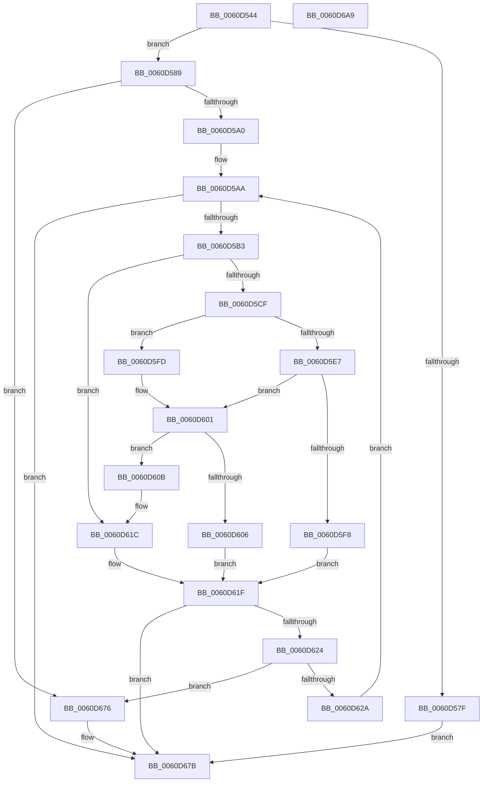

# ST_STORE&lt;SM_TRAITS&gt;::StDmEtwPageRundown

- RVA: `0x0060D544`–`0x0060D6AA` (길이 `358` bytes)
- VA: `0x000000014060D544`
- 실행 섹션: `.text`
- PDB 이름 있음: `예`; PDB Function 태그: `아니요`
- unwind 정보 RVA: `0x0007FF48`
- 디코드: `101`개 명령, `358/358` bytes 표시
- 미해석 바이트: `0` (있으면 어셈블리에 `.byte`로 보존)

> 이 문서는 커널 이미지의 기계어와 PDB 기호를 분석해 생성했습니다. 4번과 5번은 함수 원형과 자료형을 바이너리 사용 방식에서 추정한 C 해석이며 원본 소스 복구 결과는 아닙니다.

## 1. Dependencies

- 직접 호출 지점: **7**; 고유 호출 대상: **6**
- 직접 호출자로 확인된 함수: **1**
- RIP 상대 이미지 참조: **0**

### Outgoing calls
- `0x0060D570` → [SmEtwEnabled](../3A/SmEtwEnabled_function_003AF2D0.md) (function, `0x003AF2D0`)
- `0x0060D591` → [B_TREE<_SM_PAGE_KEY,ST_STORE<SM_TRAITS>::_ST_PAGE_ENTRY,4096,NP_CONTEXT,B_TREE_KEY_COMPARATOR<_SM_PAGE_KEY> >::BTreeIteratorAttachEx](../41/B_TREE__SM_PAGE_KEY_ST_STORE_SM_TRAITS__ST_PAGE_ENTRY_4096_NP_CONTEXT_B_TREE_KEY_COMPARATOR__SM_PAGE_function_004110A0.md) (function, `0x004110A0`)
- `0x0060D5ED` → [B_TREE<_SM_PAGE_KEY,ST_STORE<SM_TRAITS>::_ST_PAGE_ENTRY,4096,NP_CONTEXT,B_TREE_KEY_COMPARATOR<_SM_PAGE_KEY> >::BTreeFindLeafSibling](../41/B_TREE__SM_PAGE_KEY_ST_STORE_SM_TRAITS__ST_PAGE_ENTRY_4096_NP_CONTEXT_B_TREE_KEY_COMPARATOR__SM_PAGE_function_00410EF0.md) (function, `0x00410EF0`)
- `0x0060D630` → [ST_STORE<SM_TRAITS>::ST_PAGE_RECORD_GET](../43/ST_STORE_SM_TRAITS_ST_PAGE_RECORD_GET_function_0043E840.md) (function, `0x0043E840`)
- `0x0060D647` → [ST_STORE<SM_TRAITS>::ST_PAGE_RECORD_GET](../43/ST_STORE_SM_TRAITS_ST_PAGE_RECORD_GET_function_0043E840.md) (function, `0x0043E840`)
- `0x0060D66C` → [SmEtwLogStoreOp](SmEtwLogStoreOp_function_0060F584.md) (function, `0x0060F584`)
- `0x0060D683` → [B_TREE<_SM_PAGE_KEY,ST_STORE<SM_TRAITS>::_ST_PAGE_ENTRY,4096,NP_CONTEXT,B_TREE_KEY_COMPARATOR<_SM_PAGE_KEY> >::BTreeIteratorCleanup](../41/B_TREE__SM_PAGE_KEY_ST_STORE_SM_TRAITS__ST_PAGE_ENTRY_4096_NP_CONTEXT_B_TREE_KEY_COMPARATOR__SM_PAGE_function_00411010.md) (function, `0x00411010`)

### Direct callers
- [ST_STORE&lt;SM_TRAITS&gt;::StGetStats](../4F/ST_STORE_SM_TRAITS_StGetStats_function_004FA058.md) at `0x004FA0BC`
- [ST_STORE&lt;SM_TRAITS&gt;::StGetStats](../4F/ST_STORE_SM_TRAITS_StGetStats_function_004FA058.md) at `0x004FA0CF`

### Static image references
- 디코드된 RIP-relative 메모리 참조가 없습니다.

## 2. Other-region calls and transfers

- 다른 실행 섹션으로 향하는 call: **0**
- 별도 외부 분기/꼬리 이동을 확인하지 못했습니다.

## 3. Assembly (complete function range)

```asm
0060D544  48 8B C4                        mov rax, rsp
0060D547  48 89 58 08                     mov qword ptr [rax + 8], rbx
0060D54B  48 89 68 10                     mov qword ptr [rax + 0x10], rbp
0060D54F  48 89 70 18                     mov qword ptr [rax + 0x18], rsi
0060D553  48 89 78 20                     mov qword ptr [rax + 0x20], rdi
0060D557  41 54                           push r12
0060D559  41 56                           push r14
0060D55B  41 57                           push r15
0060D55D  48 83 EC 50                     sub rsp, 0x50
0060D561  4C 8B F9                        mov r15, rcx
0060D564  0F 57 C0                        xorps xmm0, xmm0
0060D567  B9 03 00 00 00                  mov ecx, 3
0060D56C  0F 11 40 D8                     movups xmmword ptr [rax - 0x28], xmm0
0060D570  E8 5B 1D DA FF                  call 0x1403af2d0
0060D575  33 FF                           xor edi, edi
0060D577  4C 8B E0                        mov r12, rax
0060D57A  48 85 C0                        test rax, rax
0060D57D  75 0A                           jne 0x14060d589
0060D57F  BF BB 00 00 C0                  mov edi, 0xc00000bb
0060D584  E9 F2 00 00 00                  jmp 0x14060d67b
0060D589  49 8B D7                        mov rdx, r15
0060D58C  48 8D 4C 24 40                  lea rcx, [rsp + 0x40]
0060D591  E8 0A 3B E0 FF                  call 0x1404110a0
0060D596  48 83 F8 FF                     cmp rax, -1
0060D59A  0F 84 D6 00 00 00               je 0x14060d676
0060D5A0  48 8B 74 24 48                  mov rsi, qword ptr [rsp + 0x48]
0060D5A5  4C 8B 74 24 40                  mov r14, qword ptr [rsp + 0x40]
0060D5AA  4D 85 F6                        test r14, r14
0060D5AD  0F 84 C8 00 00 00               je 0x14060d67b
0060D5B3  41 8B 06                        mov eax, dword ptr [r14]
0060D5B6  48 83 C6 08                     add rsi, 8
0060D5BA  0F B7 C0                        movzx eax, ax
0060D5BD  48 83 C0 02                     add rax, 2
0060D5C1  48 89 74 24 48                  mov qword ptr [rsp + 0x48], rsi
0060D5C6  49 8D 04 C6                     lea rax, [r14 + rax*8]
0060D5CA  48 3B F0                        cmp rsi, rax
0060D5CD  72 4D                           jb 0x14060d61c
0060D5CF  49 8B C7                        mov rax, r15
0060D5D2  49 8D 4F 10                     lea rcx, [r15 + 0x10]
0060D5D6  48 F7 D8                        neg rax
0060D5D9  48 1B C0                        sbb rax, rax
0060D5DC  48 23 C1                        and rax, rcx
0060D5DF  48 8B 00                        mov rax, qword ptr [rax]
0060D5E2  83 38 FF                        cmp dword ptr [rax], -1
0060D5E5  74 16                           je 0x14060d5fd
0060D5E7  49 8B D6                        mov rdx, r14
0060D5EA  49 8B CF                        mov rcx, r15
0060D5ED  E8 FE 38 E0 FF                  call 0x140410ef0
0060D5F2  48 83 F8 FF                     cmp rax, -1
0060D5F6  75 09                           jne 0x14060d601
0060D5F8  48 0B E8                        or rbp, rax
0060D5FB  EB 22                           jmp 0x14060d61f
0060D5FD  49 8B 46 08                     mov rax, qword ptr [r14 + 8]
0060D601  48 85 C0                        test rax, rax
0060D604  75 05                           jne 0x14060d60b
0060D606  48 8B EF                        mov rbp, rdi
0060D609  EB 14                           jmp 0x14060d61f
0060D60B  48 8D 70 10                     lea rsi, [rax + 0x10]
0060D60F  48 89 44 24 40                  mov qword ptr [rsp + 0x40], rax
0060D614  48 89 74 24 48                  mov qword ptr [rsp + 0x48], rsi
0060D619  4C 8B F0                        mov r14, rax
0060D61C  48 8B EE                        mov rbp, rsi
0060D61F  48 85 ED                        test rbp, rbp
0060D622  74 57                           je 0x14060d67b
0060D624  48 83 FD FF                     cmp rbp, -1
0060D628  74 4C                           je 0x14060d676
0060D62A  48 8B D5                        mov rdx, rbp
0060D62D  49 8B CF                        mov rcx, r15
0060D630  E8 0B 12 E3 FF                  call 0x14043e840
0060D635  48 8B D5                        mov rdx, rbp
0060D638  49 8B CF                        mov rcx, r15
0060D63B  0F B7 58 04                     movzx ebx, word ptr [rax + 4]
0060D63F  B8 FF 0F 00 00                  mov eax, 0xfff
0060D644  66 23 D8                        and bx, ax
0060D647  E8 F4 11 E3 FF                  call 0x14043e840
0060D64C  66 89 7C 24 38                  mov word ptr [rsp + 0x38], di
0060D651  4C 8B C5                        mov r8, rbp
0060D654  66 89 5C 24 30                  mov word ptr [rsp + 0x30], bx
0060D659  BA 02 00 00 00                  mov edx, 2
0060D65E  4C 89 7C 24 28                  mov qword ptr [rsp + 0x28], r15
0060D663  8B 08                           mov ecx, dword ptr [rax]
0060D665  89 4C 24 20                     mov dword ptr [rsp + 0x20], ecx
0060D669  49 8B CC                        mov rcx, r12
0060D66C  E8 13 1F 00 00                  call 0x14060f584
0060D671  E9 34 FF FF FF                  jmp 0x14060d5aa
0060D676  BF 06 00 00 C0                  mov edi, 0xc0000006
0060D67B  49 8B D7                        mov rdx, r15
0060D67E  48 8D 4C 24 40                  lea rcx, [rsp + 0x40]
0060D683  E8 88 39 E0 FF                  call 0x140411010
0060D688  4C 8D 5C 24 50                  lea r11, [rsp + 0x50]
0060D68D  8B C7                           mov eax, edi
0060D68F  49 8B 5B 20                     mov rbx, qword ptr [r11 + 0x20]
0060D693  49 8B 6B 28                     mov rbp, qword ptr [r11 + 0x28]
0060D697  49 8B 73 30                     mov rsi, qword ptr [r11 + 0x30]
0060D69B  49 8B 7B 38                     mov rdi, qword ptr [r11 + 0x38]
0060D69F  49 8B E3                        mov rsp, r11
0060D6A2  41 5F                           pop r15
0060D6A4  41 5E                           pop r14
0060D6A6  41 5C                           pop r12
0060D6A8  C3                              ret
0060D6A9  CC                              int3
```

## 4. C-style interpretation (structured pseudocode)

```c
__int64 __fastcall ST_STORE_SM_TRAITS___StDmEtwPageRundown(__int64 a1)
{
    __int64 result;
    __int64 v_rbp;
    __int64 v_rbx;
    __int64 v_rdi;
    __int64 v_rsi;
    __int64 v_rsp;
    unsigned __int64 v_stack_m18;
    unsigned __int64 v_stack_m20;
    unsigned __int64 v_stack_m28;
    unsigned __int16 v_stack_m30;
    unsigned __int16 v_stack_m38;
    unsigned __int64 v_stack_m40;
    unsigned int v_stack_m48;

    *(unsigned __int64 *)(v_rsp + 8) = v_rbx;
    *(unsigned __int64 *)(v_rsp + 16) = v_rbp;
    *(unsigned __int64 *)(v_rsp + 24) = v_rsi;
    *(unsigned __int64 *)(v_rsp + 32) = v_rdi;
    v_rsp = (v_rsp) - (80);
    *(unsigned __int64 *)(v_rsp - 40) = v_xmm0;
    result = SmEtwEnabled(3, a2, a3, a4);
    v_rdi = 0;
    if (result != 0) goto loc_0060D589;
    goto loc_0060D67B;
loc_0060D589:
    result = B_TREE__SM_PAGE_KEY_ST_STORE_SM_TRAITS____ST_PAGE_ENTRY_4096_NP_CONTEXT_B_TREE_KEY_COMPARATOR__SM_PA(v_stack_m28, a1, a3, a4);
    if (result == -1) goto loc_0060D676;
loc_0060D5AA:
    if (v_stack_m28 == 0) goto loc_0060D67B;
    v_rsi = (v_stack_m20) + (8);
    result = ((unsigned __int16)((unsigned int)(*(unsigned int *)(v_stack_m28)))) + (2);
    v_stack_m20 = v_rsi;
    if (v_rsi < (v_stack_m28 + result * 8)) goto loc_0060D61C;
    result = -(a1);
    result = (result) & (a1 + 16);
    if ((*(unsigned int *)(*(unsigned __int64 *)(result))) == -1) goto loc_0060D5FD;
    result = B_TREE__SM_PAGE_KEY_ST_STORE_SM_TRAITS____ST_PAGE_ENTRY_4096_NP_CONTEXT_B_TREE_KEY_COMPARATOR__SM_PA(a1, v_stack_m28, a3, a4);
    if (result != -1) goto loc_0060D601;
    v_rbp = (v_rbp) | (result);
    goto loc_0060D61F;
loc_0060D5FD:
loc_0060D601:
    if (*(unsigned __int64 *)(v_stack_m28 + 8) != 0) goto loc_0060D60B;
    goto loc_0060D61F;
loc_0060D60B:
    v_stack_m28 = *(unsigned __int64 *)(v_stack_m28 + 8);
    v_stack_m20 = *(unsigned __int64 *)(v_stack_m28 + 8) + 16;
loc_0060D61C:
loc_0060D61F:
    if (*(unsigned __int64 *)(v_stack_m28 + 8) + 16 == 0) goto loc_0060D67B;
    if ((*(unsigned __int64 *)(v_stack_m28 + 8) + 16) == -1) goto loc_0060D676;
    result = ST_STORE_SM_TRAITS___ST_PAGE_RECORD_GET(a1, *(unsigned __int64 *)(v_stack_m28 + 8) + 16, a3, a4);
    v_rbx = (unsigned __int16)((*(unsigned __int16 *)(result + 4)) & ((unsigned __int16)((unsigned int)(0xFFFULL))));
    result = ST_STORE_SM_TRAITS___ST_PAGE_RECORD_GET(a1, *(unsigned __int64 *)(v_stack_m28 + 8) + 16, a3, a4);
    v_stack_m30 = (unsigned __int16)((unsigned int)(0xC00000BBULL));
    v_stack_m38 = (unsigned __int16)(v_rbx);
    v_stack_m40 = a1;
    v_stack_m48 = (unsigned int)((unsigned int)(*(unsigned int *)(result)));
    result = SmEtwLogStoreOp(result, 2, *(unsigned __int64 *)(v_stack_m28 + 8) + 16, a4);
    goto loc_0060D5AA;
loc_0060D676:
loc_0060D67B:
    result = B_TREE__SM_PAGE_KEY_ST_STORE_SM_TRAITS____ST_PAGE_ENTRY_4096_NP_CONTEXT_B_TREE_KEY_COMPARATOR__SM_PA(v_stack_m28, a1, *(unsigned __int64 *)(v_stack_m28 + 8) + 16, a4);
    return (unsigned int)((unsigned int)((unsigned int)(0xC0000006ULL)));
}
```

## 5. (Beta) C Style

```c
int64_t ST_STORE_SM_TRAITS___StDmEtwPageRundown(void *Arg1)
{
    uint8_t *arg1 = (uint8_t *)Arg1;

    int64_t result;
    int64_t local_rbp;
    int64_t local_rbx;
    int64_t local_rdi;
    int64_t local_rsi;
    int64_t local_rsp;
    uint64_t v_stack_m18;
    uint64_t v_stack_m20;
    uint64_t v_stack_m28;
    uint16_t v_stack_m30;
    uint16_t v_stack_m38;
    uint64_t v_stack_m40;
    uint32_t v_stack_m48;

    *(uint64_t *)(local_rsp + 0x8) = local_rbx;
    *(uint64_t *)(local_rsp + 0x10) = local_rbp;
    *(uint64_t *)(local_rsp + 0x18) = local_rsi;
    *(uint64_t *)(local_rsp + 0x20) = local_rdi;
    local_rsp = (local_rsp) - (80);
    *(uint64_t *)(local_rsp - 0x28) = v_xmm0;
    result = SmEtwEnabled(3, a2, a3, a4);
    local_rdi = 0;
    if (result != 0) goto loc_0060D589;
    goto loc_0060D67B;
loc_0060D589:
    result = B_TREE__SM_PAGE_KEY_ST_STORE_SM_TRAITS____ST_PAGE_ENTRY_4096_NP_CONTEXT_B_TREE_KEY_COMPARATOR__SM_PA(v_stack_m28, Arg1, a3, a4);
    if (result == -1) goto loc_0060D676;
loc_0060D5AA:
    if (v_stack_m28 == 0) goto loc_0060D67B;
    local_rsi = (v_stack_m20) + (8);
    result = ((uint16_t)((uint32_t)(*(uint32_t *)(v_stack_m28)))) + (2);
    v_stack_m20 = local_rsi;
    if (local_rsi < (v_stack_m28 + result * 8)) goto loc_0060D61C;
    result = -(Arg1);
    result = (result) & (Arg1 + 16);
    if ((*(uint32_t *)(*(uint64_t *)(result))) == -1) goto loc_0060D5FD;
    result = B_TREE__SM_PAGE_KEY_ST_STORE_SM_TRAITS____ST_PAGE_ENTRY_4096_NP_CONTEXT_B_TREE_KEY_COMPARATOR__SM_PA(Arg1, v_stack_m28, a3, a4);
    if (result != -1) goto loc_0060D601;
    local_rbp = (local_rbp) | (result);
    goto loc_0060D61F;
loc_0060D5FD:
loc_0060D601:
    if (*(uint64_t *)(v_stack_m28 + 0x8) != 0) goto loc_0060D60B;
    goto loc_0060D61F;
loc_0060D60B:
    v_stack_m28 = *(uint64_t *)(v_stack_m28 + 0x8);
    v_stack_m20 = *(uint64_t *)(v_stack_m28 + 0x8) + 16;
loc_0060D61C:
loc_0060D61F:
    if (*(uint64_t *)(v_stack_m28 + 0x8) + 16 == 0) goto loc_0060D67B;
    if ((*(uint64_t *)(v_stack_m28 + 0x8) + 16) == -1) goto loc_0060D676;
    result = ST_STORE_SM_TRAITS___ST_PAGE_RECORD_GET(Arg1, *(uint64_t *)(v_stack_m28 + 0x8) + 16, a3, a4);
    local_rbx = (uint16_t)((*(uint16_t *)(result + 0x4)) & ((uint16_t)((uint32_t)(0xFFFULL))));
    result = ST_STORE_SM_TRAITS___ST_PAGE_RECORD_GET(Arg1, *(uint64_t *)(v_stack_m28 + 0x8) + 16, a3, a4);
    v_stack_m30 = (uint16_t)((uint32_t)(0xC00000BBULL));
    v_stack_m38 = (uint16_t)(local_rbx);
    v_stack_m40 = Arg1;
    v_stack_m48 = (uint32_t)((uint32_t)(*(uint32_t *)(result)));
    result = SmEtwLogStoreOp(result, 2, *(uint64_t *)(v_stack_m28 + 0x8) + 16, a4);
    goto loc_0060D5AA;
loc_0060D676:
loc_0060D67B:
    result = B_TREE__SM_PAGE_KEY_ST_STORE_SM_TRAITS____ST_PAGE_ENTRY_4096_NP_CONTEXT_B_TREE_KEY_COMPARATOR__SM_PA(v_stack_m28, Arg1, *(uint64_t *)(v_stack_m28 + 0x8) + 16, a4);
    return (uint32_t)((uint32_t)((uint32_t)(0xC0000006ULL)));
}
```

### 관측된 메모리 오프셋

구조체 형식이 확인되지 않은 접근은 인자 기준의 오프셋으로만 기록했습니다.

| 기준 인자 | 오프셋 표현 | 폭 (bit) | 접근 |
|---|---:|---:|---|
| `Arg1` | `+ 0x10` | `64` | `R` |

## 6. Execution-region graph

[열기: 2D/3D 그래프와 함수 탐색 컨트롤 패널](../../../control-panel.html?section=text&rva=0x0060D544&view=graph)

- 2D 그래프는 위에서 아래로 흐르고, 3D 그래프는 빈 공간을 드래그해 회전합니다. Shift+드래그는 이동, 휠은 확대·축소, 함수 노드 선택은 대상 보고서 이동입니다.

### Static fallback


