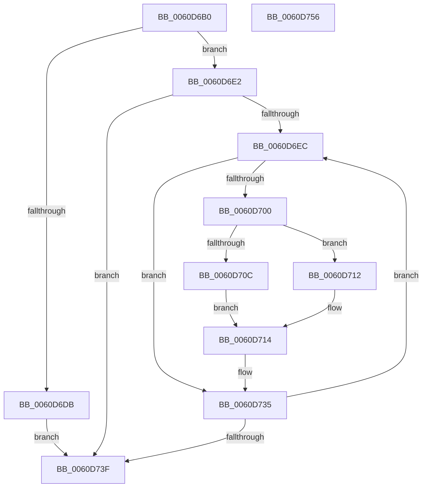

# ST_STORE&lt;SM_TRAITS&gt;::StDmEtwRegionRundown

- RVA: `0x0060D6B0`–`0x0060D757` (길이 `167` bytes)
- VA: `0x000000014060D6B0`
- 실행 섹션: `.text`
- PDB 이름 있음: `예`; PDB Function 태그: `아니요`
- unwind 정보 RVA: `0x0007D3C0`
- 디코드: `47`개 명령, `167/167` bytes 표시
- 미해석 바이트: `0` (있으면 어셈블리에 `.byte`로 보존)

> 이 문서는 커널 이미지의 기계어와 PDB 기호를 분석해 생성했습니다. 4번과 5번은 함수 원형과 자료형을 바이너리 사용 방식에서 추정한 C 해석이며 원본 소스 복구 결과는 아닙니다.

## 1. Dependencies

- 직접 호출 지점: **2**; 고유 호출 대상: **2**
- 직접 호출자로 확인된 함수: **1**
- RIP 상대 이미지 참조: **0**

### Outgoing calls
- `0x0060D6CC` → [SmEtwEnabled](../3A/SmEtwEnabled_function_003AF2D0.md) (function, `0x003AF2D0`)
- `0x0060D730` → [SmEtwLogRegionOp](SmEtwLogRegionOp_function_0060F38C.md) (function, `0x0060F38C`)

### Direct callers
- [ST_STORE&lt;SM_TRAITS&gt;::StGetStats](../4F/ST_STORE_SM_TRAITS_StGetStats_function_004FA058.md) at `0x004FA09E`
- [ST_STORE&lt;SM_TRAITS&gt;::StGetStats](../4F/ST_STORE_SM_TRAITS_StGetStats_function_004FA058.md) at `0x004FA0B3`

### Static image references
- 디코드된 RIP-relative 메모리 참조가 없습니다.

## 2. Other-region calls and transfers

- 다른 실행 섹션으로 향하는 call: **0**
- 별도 외부 분기/꼬리 이동을 확인하지 못했습니다.

## 3. Assembly (complete function range)

```asm
0060D6B0  48 89 5C 24 08                  mov qword ptr [rsp + 8], rbx
0060D6B5  48 89 6C 24 10                  mov qword ptr [rsp + 0x10], rbp
0060D6BA  48 89 74 24 18                  mov qword ptr [rsp + 0x18], rsi
0060D6BF  57                              push rdi
0060D6C0  48 83 EC 40                     sub rsp, 0x40
0060D6C4  48 8B F1                        mov rsi, rcx
0060D6C7  B9 03 00 00 00                  mov ecx, 3
0060D6CC  E8 FF 1B DA FF                  call 0x1403af2d0
0060D6D1  33 DB                           xor ebx, ebx
0060D6D3  48 8B E8                        mov rbp, rax
0060D6D6  48 85 C0                        test rax, rax
0060D6D9  75 07                           jne 0x14060d6e2
0060D6DB  BB BB 00 00 C0                  mov ebx, 0xc00000bb
0060D6E0  EB 5D                           jmp 0x14060d73f
0060D6E2  8B FB                           mov edi, ebx
0060D6E4  39 9E 14 03 00 00               cmp dword ptr [rsi + 0x314], ebx
0060D6EA  74 53                           je 0x14060d73f
0060D6EC  48 8B 86 78 05 00 00            mov rax, qword ptr [rsi + 0x578]
0060D6F3  B9 FF 1F 00 00                  mov ecx, 0x1fff
0060D6F8  8B D7                           mov edx, edi
0060D6FA  66 23 0C 50                     and cx, word ptr [rax + rdx*2]
0060D6FE  74 35                           je 0x14060d735
0060D700  48 8B 86 88 05 00 00            mov rax, qword ptr [rsi + 0x588]
0060D707  48 85 C0                        test rax, rax
0060D70A  74 06                           je 0x14060d712
0060D70C  0F B6 14 10                     movzx edx, byte ptr [rax + rdx]
0060D710  EB 02                           jmp 0x14060d714
0060D712  8B D3                           mov edx, ebx
0060D714  66 89 54 24 30                  mov word ptr [rsp + 0x30], dx
0060D719  44 8B CF                        mov r9d, edi
0060D71C  66 89 4C 24 28                  mov word ptr [rsp + 0x28], cx
0060D721  4C 8B C6                        mov r8, rsi
0060D724  48 8B CD                        mov rcx, rbp
0060D727  89 5C 24 20                     mov dword ptr [rsp + 0x20], ebx
0060D72B  BA 0A 00 00 00                  mov edx, 0xa
0060D730  E8 57 1C 00 00                  call 0x14060f38c
0060D735  FF C7                           inc edi
0060D737  3B BE 14 03 00 00               cmp edi, dword ptr [rsi + 0x314]
0060D73D  75 AD                           jne 0x14060d6ec
0060D73F  48 8B 6C 24 58                  mov rbp, qword ptr [rsp + 0x58]
0060D744  8B C3                           mov eax, ebx
0060D746  48 8B 5C 24 50                  mov rbx, qword ptr [rsp + 0x50]
0060D74B  48 8B 74 24 60                  mov rsi, qword ptr [rsp + 0x60]
0060D750  48 83 C4 40                     add rsp, 0x40
0060D754  5F                              pop rdi
0060D755  C3                              ret
0060D756  CC                              int3
```

## 4. C-style interpretation (structured pseudocode)

```c
__int64 __fastcall ST_STORE_SM_TRAITS___StDmEtwRegionRundown(__int64 a1)
{
    __int64 result;
    __int64 v_rbx;
    __int64 v_rdi;
    __int64 v_rsp;
    unsigned __int16 v_stack_m18;
    unsigned __int16 v_stack_m20;
    unsigned int v_stack_m28;
    unsigned __int64 v_stack_p10;
    unsigned __int64 v_stack_p18;
    unsigned __int64 v_stack_p8;

    v_stack_p8 = v_rbx;
    v_stack_p10 = v_rbp;
    v_stack_p18 = v_rsi;
    v_rsp = (v_rsp) - (64);
    result = SmEtwEnabled(3, a2, a3, a4);
    v_rbx = 0;
    if (result != 0) goto loc_0060D6E2;
    goto loc_0060D73F;
loc_0060D6E2:
    if ((*(unsigned int *)(a1 + 788)) == ((unsigned int)((unsigned int)(0xC00000BBULL)))) goto loc_0060D73F;
loc_0060D6EC:
    a1 = (unsigned __int16)(((unsigned int)(0x1FFFULL)) & (*(unsigned __int16 *)(*(unsigned __int64 *)(a1 + 1400) + (unsigned int)((unsigned int)((unsigned int)((unsigned int)((unsigned int)(0xC00000BBULL))))) * 2)));
    if (condition_is_equal) goto loc_0060D735;
    if (*(unsigned __int64 *)(a1 + 1416) == 0) goto loc_0060D712;
    goto loc_0060D714;
loc_0060D712:
loc_0060D714:
    v_stack_m18 = (unsigned __int16)((unsigned int)((unsigned int)((unsigned int)(0xC00000BBULL))));
    v_stack_m20 = (unsigned __int16)(a1);
    v_stack_m28 = (unsigned int)((unsigned int)(0xC00000BBULL));
    result = SmEtwLogRegionOp(result, 10, a1, (unsigned int)((unsigned int)((unsigned int)((unsigned int)((unsigned int)(0xC00000BBULL))))));
loc_0060D735:
    v_rdi = (unsigned int)(((unsigned int)((unsigned int)((unsigned int)(0xC00000BBULL)))) + 1);
    if (((unsigned int)(v_rdi)) != (*(unsigned int *)(a1 + 788))) goto loc_0060D6EC;
loc_0060D73F:
    v_rsp = (v_rsp) + (64);
    return (unsigned int)((unsigned int)((unsigned int)(0xC00000BBULL)));
}
```

## 5. (Beta) C Style

```c
int64_t ST_STORE_SM_TRAITS___StDmEtwRegionRundown(void *Arg1)
{
    uint8_t *arg1 = (uint8_t *)Arg1;

    int64_t result;
    int64_t local_rbx;
    int64_t local_rdi;
    int64_t local_rsp;
    uint16_t v_stack_m18;
    uint16_t v_stack_m20;
    uint32_t v_stack_m28;
    uint64_t v_stack_p10;
    uint64_t v_stack_p18;
    uint64_t v_stack_p8;

    v_stack_p8 = local_rbx;
    v_stack_p10 = local_rbp;
    v_stack_p18 = local_rsi;
    local_rsp = (local_rsp) - (64);
    result = SmEtwEnabled(3, a2, a3, a4);
    local_rbx = 0;
    if (result != 0) goto loc_0060D6E2;
    goto loc_0060D73F;
loc_0060D6E2:
    if ((*(uint32_t *)(arg1 + 0x314)) == ((uint32_t)((uint32_t)(0xC00000BBULL)))) goto loc_0060D73F;
loc_0060D6EC:
    Arg1 = (uint16_t)(((uint32_t)(0x1FFFULL)) & (*(uint16_t *)(*(uint64_t *)(arg1 + 0x578) + (uint32_t)((uint32_t)((uint32_t)((uint32_t)((uint32_t)(0xC00000BBULL))))) * 2)));
    if (condition_is_equal) goto loc_0060D735;
    if (*(uint64_t *)(arg1 + 0x588) == 0) goto loc_0060D712;
    goto loc_0060D714;
loc_0060D712:
loc_0060D714:
    v_stack_m18 = (uint16_t)((uint32_t)((uint32_t)((uint32_t)(0xC00000BBULL))));
    v_stack_m20 = (uint16_t)(Arg1);
    v_stack_m28 = (uint32_t)((uint32_t)(0xC00000BBULL));
    result = SmEtwLogRegionOp(result, 10, Arg1, (uint32_t)((uint32_t)((uint32_t)((uint32_t)((uint32_t)(0xC00000BBULL))))));
loc_0060D735:
    local_rdi = (uint32_t)(((uint32_t)((uint32_t)((uint32_t)(0xC00000BBULL)))) + 1);
    if (((uint32_t)(local_rdi)) != (*(uint32_t *)(arg1 + 0x314))) goto loc_0060D6EC;
loc_0060D73F:
    local_rsp = (local_rsp) + (64);
    return (uint32_t)((uint32_t)((uint32_t)(0xC00000BBULL)));
}
```

### 관측된 메모리 오프셋

구조체 형식이 확인되지 않은 접근은 인자 기준의 오프셋으로만 기록했습니다.

| 기준 인자 | 오프셋 표현 | 폭 (bit) | 접근 |
|---|---:|---:|---|
| `Arg1` | `+ 0x314` | `32` | `R` |
| `Arg1` | `+ 0x578` | `64` | `R` |
| `Arg1` | `+ 0x588` | `64` | `R` |

## 6. Execution-region graph

[열기: 2D/3D 그래프와 함수 탐색 컨트롤 패널](../../../control-panel.html?section=text&rva=0x0060D6B0&view=graph)

- 2D 그래프는 위에서 아래로 흐르고, 3D 그래프는 빈 공간을 드래그해 회전합니다. Shift+드래그는 이동, 휠은 확대·축소, 함수 노드 선택은 대상 보고서 이동입니다.

### Static fallback


