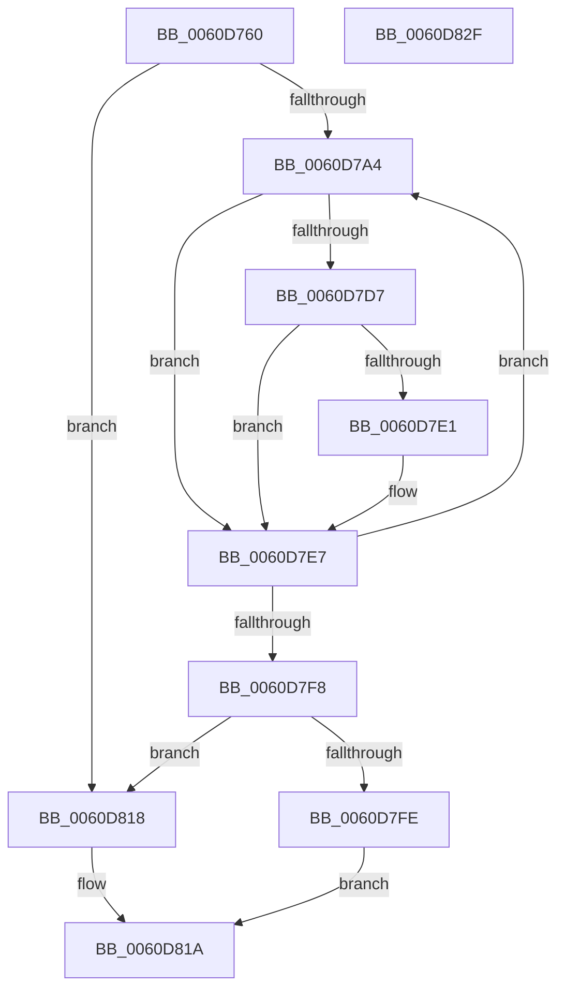

# ST_STORE&lt;SM_TRAITS&gt;::StDmFixSingleBitCorruption

- RVA: `0x0060D760`–`0x0060D830` (길이 `208` bytes)
- VA: `0x000000014060D760`
- 실행 섹션: `.text`
- PDB 이름 있음: `예`; PDB Function 태그: `아니요`
- unwind 정보 RVA: `0x00075D80`
- 디코드: `71`개 명령, `208/208` bytes 표시
- 미해석 바이트: `0` (있으면 어셈블리에 `.byte`로 보존)

> 이 문서는 커널 이미지의 기계어와 PDB 기호를 분석해 생성했습니다. 4번과 5번은 함수 원형과 자료형을 바이너리 사용 방식에서 추정한 C 해석이며 원본 소스 복구 결과는 아닙니다.

## 1. Dependencies

- 직접 호출 지점: **1**; 고유 호출 대상: **1**
- 직접 호출자로 확인된 함수: **1**
- RIP 상대 이미지 참조: **0**

### Outgoing calls
- `0x0060D7CE` → [ST_STORE<SM_TRAITS>::StDmpHashBytes](../4F/ST_STORE_SM_TRAITS_StDmpHashBytes_function_004F68D8.md) (function, `0x004F68D8`)

### Direct callers
- [ST_STORE&lt;SM_TRAITS&gt;::StDmHandleDecompressionFailure](ST_STORE_SM_TRAITS_StDmHandleDecompressionFailure_function_0060DA74.md) at `0x0060DC64`

### Static image references
- 디코드된 RIP-relative 메모리 참조가 없습니다.

## 2. Other-region calls and transfers

- 다른 실행 섹션으로 향하는 call: **0**
- 별도 외부 분기/꼬리 이동을 확인하지 못했습니다.

## 3. Assembly (complete function range)

```asm
0060D760  48 8B C4                        mov rax, rsp
0060D763  48 89 58 10                     mov qword ptr [rax + 0x10], rbx
0060D767  44 89 48 20                     mov dword ptr [rax + 0x20], r9d
0060D76B  48 89 48 08                     mov qword ptr [rax + 8], rcx
0060D76F  55                              push rbp
0060D770  56                              push rsi
0060D771  57                              push rdi
0060D772  41 54                           push r12
0060D774  41 55                           push r13
0060D776  41 56                           push r14
0060D778  41 57                           push r15
0060D77A  48 83 EC 20                     sub rsp, 0x20
0060D77E  83 60 18 00                     and dword ptr [rax + 0x18], 0
0060D782  48 8D 6A FF                     lea rbp, [rdx - 1]
0060D786  42 8D 04 C5 00 00 00 00         lea eax, [r8*8]
0060D78E  33 F6                           xor esi, esi
0060D790  33 DB                           xor ebx, ebx
0060D792  44 8B F8                        mov r15d, eax
0060D795  33 FF                           xor edi, edi
0060D797  45 8B E8                        mov r13d, r8d
0060D79A  4C 8B F2                        mov r14, rdx
0060D79D  4C 8B D1                        mov r10, rcx
0060D7A0  85 C0                           test eax, eax
0060D7A2  74 74                           je 0x14060d818
0060D7A4  8B CF                           mov ecx, edi
0060D7A6  48 8D 45 01                     lea rax, [rbp + 1]
0060D7AA  83 E1 07                        and ecx, 7
0060D7AD  4C 8D 4C 24 70                  lea r9, [rsp + 0x70]
0060D7B2  41 BC 01 00 00 00               mov r12d, 1
0060D7B8  45 8B C5                        mov r8d, r13d
0060D7BB  48 0F 45 C5                     cmovne rax, rbp
0060D7BF  49 8B D6                        mov rdx, r14
0060D7C2  41 D2 E4                        shl r12b, cl
0060D7C5  48 8B E8                        mov rbp, rax
0060D7C8  49 8B CA                        mov rcx, r10
0060D7CB  44 30 20                        xor byte ptr [rax], r12b
0060D7CE  E8 05 91 EE FF                  call 0x1404f68d8
0060D7D3  85 C0                           test eax, eax
0060D7D5  78 10                           js 0x14060d7e7
0060D7D7  8B 44 24 78                     mov eax, dword ptr [rsp + 0x78]
0060D7DB  39 44 24 70                     cmp dword ptr [rsp + 0x70], eax
0060D7DF  75 06                           jne 0x14060d7e7
0060D7E1  48 FF C6                        inc rsi
0060D7E4  48 8B DF                        mov rbx, rdi
0060D7E7  44 30 65 00                     xor byte ptr [rbp], r12b
0060D7EB  48 FF C7                        inc rdi
0060D7EE  4C 8B 54 24 60                  mov r10, qword ptr [rsp + 0x60]
0060D7F3  49 3B FF                        cmp rdi, r15
0060D7F6  72 AC                           jb 0x14060d7a4
0060D7F8  48 83 FE 01                     cmp rsi, 1
0060D7FC  75 1A                           jne 0x14060d818
0060D7FE  48 8B D3                        mov rdx, rbx
0060D801  8B C6                           mov eax, esi
0060D803  48 C1 EA 03                     shr rdx, 3
0060D807  83 E3 07                        and ebx, 7
0060D80A  42 0F BE 0C 32                  movsx ecx, byte ptr [rdx + r14]
0060D80F  0F BB D9                        btc ecx, ebx
0060D812  42 88 0C 32                     mov byte ptr [rdx + r14], cl
0060D816  EB 02                           jmp 0x14060d81a
0060D818  33 C0                           xor eax, eax
0060D81A  48 8B 5C 24 68                  mov rbx, qword ptr [rsp + 0x68]
0060D81F  48 83 C4 20                     add rsp, 0x20
0060D823  41 5F                           pop r15
0060D825  41 5E                           pop r14
0060D827  41 5D                           pop r13
0060D829  41 5C                           pop r12
0060D82B  5F                              pop rdi
0060D82C  5E                              pop rsi
0060D82D  5D                              pop rbp
0060D82E  C3                              ret
0060D82F  CC                              int3
```

## 4. C-style interpretation (structured pseudocode)

```c
__int64 __fastcall ST_STORE_SM_TRAITS___StDmFixSingleBitCorruption(__int64 a1, __int64 a2, __int64 a3, int a4)
{
    __int64 result;
    __int64 v_r12;
    __int64 v_rbx;
    __int64 v_rdi;
    __int64 v_rsi;
    __int64 v_rsp;
    unsigned __int64 v_stack_p10;
    unsigned __int64 v_stack_p18;
    unsigned int v_stack_p20;
    unsigned __int64 v_stack_p8;

    *(unsigned __int64 *)(v_rsp + 16) = v_rbx;
    *(unsigned int *)(v_rsp + 32) = a4;
    *(unsigned __int64 *)(v_rsp + 8) = a1;
    v_rsp = (v_rsp) - (32);
    v_rsi = 0;
    v_rbx = 0;
    v_rdi = 0;
    if ((unsigned int)(a3 * 8) == 0) goto loc_0060D818;
loc_0060D7A4:
    a1 = (unsigned int)((0) & (7));
    result = a2 - 1 + 1;
    if (condition_is_not_equal) { result = a2 - 1; }
    v_r12 = (unsigned __int8)((1) << ((unsigned __int8)(a1)));
    result = ST_STORE_SM_TRAITS___StDmpHashBytes(a1, a2, (unsigned int)((unsigned int)((unsigned int)((unsigned int)(a3)))), v_stack_p18);
    if (sign_flag) goto loc_0060D7E7;
    if (v_stack_p18 == ((unsigned int)((unsigned int)(v_stack_p20)))) {
        v_rsi = (v_rsi) + 1;
        v_rbx = 0;
    }
    v_rdi = (v_rdi) + 1;
    if (v_rdi < ((unsigned int)((unsigned int)(a3 * 8)))) goto loc_0060D7A4;
    if (v_rsi != 1) goto loc_0060D818;
    a2 = (v_rbx) >> (3);
    v_rbx = (unsigned int)((v_rbx) & (7));
    *(unsigned __int8 *)(a2 + a2 * 1) = (unsigned __int8)((__int8)(*(unsigned __int8 *)(a2 + a2 * 1)));
    goto loc_0060D81A;
loc_0060D818:
    result = 0;
loc_0060D81A:
    v_rsp = (v_rsp) + (32);
    return result;
}
```

## 5. (Beta) C Style

```c
int64_t ST_STORE_SM_TRAITS___StDmFixSingleBitCorruption(int64_t Arg1, void *Arg2, int64_t Arg3, int32_t Arg4)
{
    uint8_t *arg2 = (uint8_t *)Arg2;

    int64_t result;
    int64_t local_r12;
    int64_t local_rbx;
    int64_t local_rdi;
    int64_t local_rsi;
    int64_t local_rsp;
    uint64_t v_stack_p10;
    uint64_t v_stack_p18;
    uint32_t v_stack_p20;
    uint64_t v_stack_p8;

    *(uint64_t *)(local_rsp + 0x10) = local_rbx;
    *(uint32_t *)(local_rsp + 0x20) = Arg4;
    *(uint64_t *)(local_rsp + 0x8) = Arg1;
    local_rsp = (local_rsp) - (32);
    local_rsi = 0;
    local_rbx = 0;
    local_rdi = 0;
    if ((uint32_t)(Arg3 * 8) == 0) goto loc_0060D818;
loc_0060D7A4:
    Arg1 = (uint32_t)((0) & (7));
    result = Arg2 - 1 + 1;
    if (condition_is_not_equal) { result = Arg2 - 1; }
    local_r12 = (uint8_t)((1) << ((uint8_t)(Arg1)));
    result = ST_STORE_SM_TRAITS___StDmpHashBytes(Arg1, Arg2, (uint32_t)((uint32_t)((uint32_t)((uint32_t)(Arg3)))), v_stack_p18);
    if (sign_flag) goto loc_0060D7E7;
    if (v_stack_p18 == ((uint32_t)((uint32_t)(v_stack_p20)))) {
        local_rsi = (local_rsi) + 1;
        local_rbx = 0;
    }
    local_rdi = (local_rdi) + 1;
    if (local_rdi < ((uint32_t)((uint32_t)(Arg3 * 8)))) goto loc_0060D7A4;
    if (local_rsi != 1) goto loc_0060D818;
    Arg2 = (local_rbx) >> (3);
    local_rbx = (uint32_t)((local_rbx) & (7));
    *(uint8_t *)(arg2 + arg2 * 1) = (uint8_t)((int8_t)(*(uint8_t *)(arg2 + arg2 * 1)));
    goto loc_0060D81A;
loc_0060D818:
    result = 0;
loc_0060D81A:
    local_rsp = (local_rsp) + (32);
    return result;
}
```

### 관측된 메모리 오프셋

구조체 형식이 확인되지 않은 접근은 인자 기준의 오프셋으로만 기록했습니다.

| 기준 인자 | 오프셋 표현 | 폭 (bit) | 접근 |
|---|---:|---:|---|
| `Arg2` | `- 0x1` | `64` | `R` |

## 6. Execution-region graph

[열기: 2D/3D 그래프와 함수 탐색 컨트롤 패널](../../../control-panel.html?section=text&rva=0x0060D760&view=graph)

- 2D 그래프는 위에서 아래로 흐르고, 3D 그래프는 빈 공간을 드래그해 회전합니다. Shift+드래그는 이동, 휠은 확대·축소, 함수 노드 선택은 대상 보고서 이동입니다.

### Static fallback


