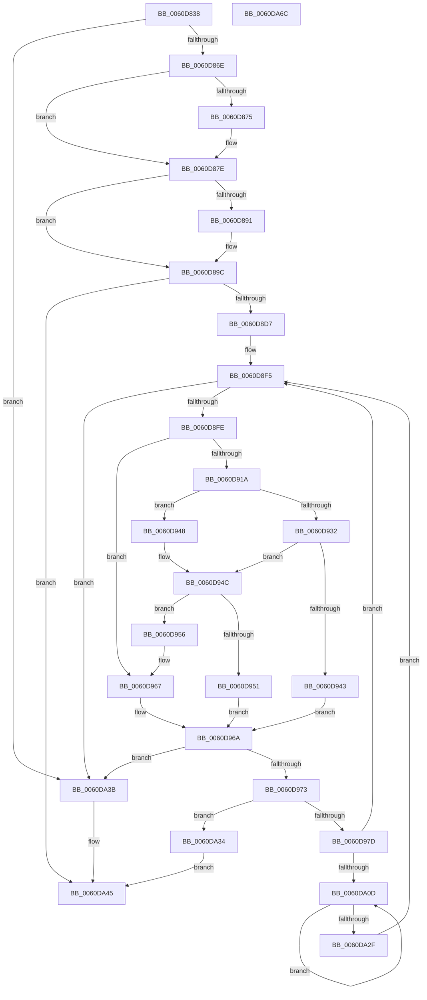

# ST_STORE&lt;SM_TRAITS&gt;::StDmGetStatsBitmap

- RVA: `0x0060D838`–`0x0060DA6D` (길이 `565` bytes)
- VA: `0x000000014060D838`
- 실행 섹션: `.text`
- PDB 이름 있음: `예`; PDB Function 태그: `아니요`
- unwind 정보 RVA: `0x00099E84`
- 디코드: `157`개 명령, `565/565` bytes 표시
- 미해석 바이트: `0` (있으면 어셈블리에 `.byte`로 보존)

> 이 문서는 커널 이미지의 기계어와 PDB 기호를 분석해 생성했습니다. 4번과 5번은 함수 원형과 자료형을 바이너리 사용 방식에서 추정한 C 해석이며 원본 소스 복구 결과는 아닙니다.

## 1. Dependencies

- 직접 호출 지점: **7**; 고유 호출 대상: **7**
- 직접 호출자로 확인된 함수: **1**
- RIP 상대 이미지 참조: **0**

### Outgoing calls
- `0x0060D879` → [B_TREE<_SM_PAGE_KEY,ST_STORE<SM_TRAITS>::_ST_PAGE_ENTRY,4096,NP_CONTEXT,B_TREE_KEY_COMPARATOR<_SM_PAGE_KEY> >::BTreeSearchResultDeref](../3A/B_TREE__SM_PAGE_KEY_ST_STORE_SM_TRAITS__ST_PAGE_ENTRY_4096_NP_CONTEXT_B_TREE_KEY_COMPARATOR__SM_PAGE_function_003AC5D0.md) (function, `0x003AC5D0`)
- `0x0060D897` → [B_TREE<unsigned long,ST_STORE<SM_TRAITS>::_ST_REGION_ENTRY,4096,NP_CONTEXT,ST_STORE<SM_TRAITS>::ST_REGION_ENTRY_COMPARATOR>::BTreeSearchResultDeref](../3A/B_TREE_unsigned_long_ST_STORE_SM_TRAITS__ST_REGION_ENTRY_4096_NP_CONTEXT_ST_STORE_SM_TRAITS_ST_REGIO_function_003AD260.md) (function, `0x003AD260`)
- `0x0060D8AA` → [ST_STORE<SM_TRAITS>::StDmPageRecordUnprotect](../26/ST_STORE_SM_TRAITS_StDmPageRecordUnprotect_function_00268B30.md) (function, `0x00268B30`)
- `0x0060D8C5` → [B_TREE<unsigned long,ST_STORE<SM_TRAITS>::_ST_REGION_ENTRY,4096,NP_CONTEXT,ST_STORE<SM_TRAITS>::ST_REGION_ENTRY_COMPARATOR>::BTreeSearchKey](../3A/B_TREE_unsigned_long_ST_STORE_SM_TRAITS__ST_REGION_ENTRY_4096_NP_CONTEXT_ST_STORE_SM_TRAITS_ST_REGIO_function_003ACD20.md) (function, `0x003ACD20`)
- `0x0060D8E2` → [B_TREE<unsigned long,ST_STORE<SM_TRAITS>::_ST_REGION_ENTRY,4096,NP_CONTEXT,ST_STORE<SM_TRAITS>::ST_REGION_ENTRY_COMPARATOR>::BTreeIteratorFromSearchResult](../44/B_TREE_unsigned_long_ST_STORE_SM_TRAITS__ST_REGION_ENTRY_4096_NP_CONTEXT_ST_STORE_SM_TRAITS_ST_REGIO_function_004483D0.md) (function, `0x004483D0`)
- `0x0060D938` → [B_TREE<unsigned long,ST_STORE<SM_TRAITS>::_ST_REGION_ENTRY,4096,NP_CONTEXT,ST_STORE<SM_TRAITS>::ST_REGION_ENTRY_COMPARATOR>::BTreeFindLeafSibling](../45/B_TREE_unsigned_long_ST_STORE_SM_TRAITS__ST_REGION_ENTRY_4096_NP_CONTEXT_ST_STORE_SM_TRAITS_ST_REGIO_function_00450FB8.md) (function, `0x00450FB8`)
- `0x0060DA4D` → [B_TREE<unsigned long,ST_STORE<SM_TRAITS>::_ST_REGION_ENTRY,4096,NP_CONTEXT,ST_STORE<SM_TRAITS>::ST_REGION_ENTRY_COMPARATOR>::BTreeIteratorCleanup](../44/B_TREE_unsigned_long_ST_STORE_SM_TRAITS__ST_REGION_ENTRY_4096_NP_CONTEXT_ST_STORE_SM_TRAITS_ST_REGIO_function_00445970.md) (function, `0x00445970`)

### Direct callers
- [sub_006EEAD8](../6E/Unknown_function_006EEAD8.md) at `0x006EEBD2`
- [sub_006EEAD8](../6E/Unknown_function_006EEAD8.md) at `0x006EEBF4`

### Static image references
- 디코드된 RIP-relative 메모리 참조가 없습니다.

## 2. Other-region calls and transfers

- 다른 실행 섹션으로 향하는 call: **0**
- 별도 외부 분기/꼬리 이동을 확인하지 못했습니다.

## 3. Assembly (complete function range)

```asm
0060D838  48 89 5C 24 18                  mov qword ptr [rsp + 0x18], rbx
0060D83D  89 54 24 10                     mov dword ptr [rsp + 0x10], edx
0060D841  55                              push rbp
0060D842  56                              push rsi
0060D843  57                              push rdi
0060D844  41 54                           push r12
0060D846  41 55                           push r13
0060D848  41 56                           push r14
0060D84A  41 57                           push r15
0060D84C  48 83 EC 30                     sub rsp, 0x30
0060D850  45 33 E4                        xor r12d, r12d
0060D853  0F 57 C0                        xorps xmm0, xmm0
0060D856  4D 8B E9                        mov r13, r9
0060D859  4D 8B F8                        mov r15, r8
0060D85C  48 8B F9                        mov rdi, rcx
0060D85F  0F 11 44 24 20                  movups xmmword ptr [rsp + 0x20], xmm0
0060D864  4C 39 61 48                     cmp qword ptr [rcx + 0x48], r12
0060D868  0F 84 CD 01 00 00               je 0x14060da3b
0060D86E  8B 41 38                        mov eax, dword ptr [rcx + 0x38]
0060D871  A8 01                           test al, 1
0060D873  75 09                           jne 0x14060d87e
0060D875  48 8D 51 18                     lea rdx, [rcx + 0x18]
0060D879  E8 52 ED D9 FF                  call 0x1403ac5d0
0060D87E  83 4F 38 01                     or dword ptr [rdi + 0x38], 1
0060D882  48 8D 77 58                     lea rsi, [rdi + 0x58]
0060D886  8B 46 20                        mov eax, dword ptr [rsi + 0x20]
0060D889  48 8D 5F 40                     lea rbx, [rdi + 0x40]
0060D88D  A8 01                           test al, 1
0060D88F  75 0B                           jne 0x14060d89c
0060D891  48 8B D6                        mov rdx, rsi
0060D894  48 8B CB                        mov rcx, rbx
0060D897  E8 C4 F9 D9 FF                  call 0x1403ad260
0060D89C  83 4E 20 01                     or dword ptr [rsi + 0x20], 1
0060D8A0  48 8B CF                        mov rcx, rdi
0060D8A3  48 8B 97 F8 02 00 00            mov rdx, qword ptr [rdi + 0x2f8]
0060D8AA  E8 81 B2 C5 FF                  call 0x140268b30
0060D8AF  48 8B 87 F8 02 00 00            mov rax, qword ptr [rdi + 0x2f8]
0060D8B6  4C 8B C6                        mov r8, rsi
0060D8B9  48 8B CB                        mov rcx, rbx
0060D8BC  44 21 20                        and dword ptr [rax], r12d
0060D8BF  8B 97 00 03 00 00               mov edx, dword ptr [rdi + 0x300]
0060D8C5  E8 56 F4 D9 FF                  call 0x1403acd20
0060D8CA  8B E8                           mov ebp, eax
0060D8CC  3D 06 00 00 C0                  cmp eax, 0xc0000006
0060D8D1  0F 84 6E 01 00 00               je 0x14060da45
0060D8D7  4C 8B C6                        mov r8, rsi
0060D8DA  48 8D 54 24 20                  lea rdx, [rsp + 0x20]
0060D8DF  48 8B CB                        mov rcx, rbx
0060D8E2  E8 E9 AA E3 FF                  call 0x1404483d0
0060D8E7  48 8B 74 24 28                  mov rsi, qword ptr [rsp + 0x28]
0060D8EC  4C 8B 74 24 20                  mov r14, qword ptr [rsp + 0x20]
0060D8F1  8B 6C 24 78                     mov ebp, dword ptr [rsp + 0x78]
0060D8F5  4D 85 F6                        test r14, r14
0060D8F8  0F 84 3D 01 00 00               je 0x14060da3b
0060D8FE  41 8B 06                        mov eax, dword ptr [r14]
0060D901  48 83 C6 04                     add rsi, 4
0060D905  0F B7 C0                        movzx eax, ax
0060D908  48 83 C0 04                     add rax, 4
0060D90C  48 89 74 24 28                  mov qword ptr [rsp + 0x28], rsi
0060D911  49 8D 04 86                     lea rax, [r14 + rax*4]
0060D915  48 3B F0                        cmp rsi, rax
0060D918  72 4D                           jb 0x14060d967
0060D91A  48 8B C3                        mov rax, rbx
0060D91D  48 8D 4B 10                     lea rcx, [rbx + 0x10]
0060D921  48 F7 D8                        neg rax
0060D924  48 1B C0                        sbb rax, rax
0060D927  48 23 C1                        and rax, rcx
0060D92A  48 8B 00                        mov rax, qword ptr [rax]
0060D92D  83 38 FF                        cmp dword ptr [rax], -1
0060D930  74 16                           je 0x14060d948
0060D932  49 8B D6                        mov rdx, r14
0060D935  48 8B CB                        mov rcx, rbx
0060D938  E8 7B 36 E4 FF                  call 0x140450fb8
0060D93D  48 83 F8 FF                     cmp rax, -1
0060D941  75 09                           jne 0x14060d94c
0060D943  4C 0B C8                        or r9, rax
0060D946  EB 22                           jmp 0x14060d96a
0060D948  49 8B 46 08                     mov rax, qword ptr [r14 + 8]
0060D94C  48 85 C0                        test rax, rax
0060D94F  75 05                           jne 0x14060d956
0060D951  45 33 C9                        xor r9d, r9d
0060D954  EB 14                           jmp 0x14060d96a
0060D956  48 8D 70 10                     lea rsi, [rax + 0x10]
0060D95A  48 89 44 24 20                  mov qword ptr [rsp + 0x20], rax
0060D95F  48 89 74 24 28                  mov qword ptr [rsp + 0x28], rsi
0060D964  4C 8B F0                        mov r14, rax
0060D967  4C 8B CE                        mov r9, rsi
0060D96A  4D 85 C9                        test r9, r9
0060D96D  0F 84 C8 00 00 00               je 0x14060da3b
0060D973  49 83 F9 FF                     cmp r9, -1
0060D977  0F 84 B7 00 00 00               je 0x14060da34
0060D97D  45 8B 09                        mov r9d, dword ptr [r9]
0060D980  41 B8 01 00 00 00               mov r8d, 1
0060D986  8B 8F C8 01 00 00               mov ecx, dword ptr [rdi + 0x1c8]
0060D98C  41 8B D1                        mov edx, r9d
0060D98F  8B 87 CC 01 00 00               mov eax, dword ptr [rdi + 0x1cc]
0060D995  41 BA 00 10 00 00               mov r10d, 0x1000
0060D99B  83 64 24 70 00                  and dword ptr [rsp + 0x70], 0
0060D9A0  41 23 C1                        and eax, r9d
0060D9A3  0F AF 87 D0 01 00 00            imul eax, dword ptr [rdi + 0x1d0]
0060D9AA  D3 EA                           shr edx, cl
0060D9AC  0F BD CA                        bsr ecx, edx
0060D9AF  41 D3 E0                        shl r8d, cl
0060D9B2  4C 33 C2                        xor r8, rdx
0060D9B5  4D 03 C0                        add r8, r8
0060D9B8  48 8B 8C CF C0 00 00 00         mov rcx, qword ptr [rdi + rcx*8 + 0xc0]
0060D9C0  4E 8B 0C C1                     mov r9, qword ptr [rcx + r8*8]
0060D9C4  B9 00 10 00 00                  mov ecx, 0x1000
0060D9C9  4C 03 C8                        add r9, rax
0060D9CC  8B 87 D8 01 00 00               mov eax, dword ptr [rdi + 0x1d8]
0060D9D2  45 8B 44 01 04                  mov r8d, dword ptr [r9 + rax + 4]
0060D9D7  41 8B 04 01                     mov eax, dword ptr [r9 + rax]
0060D9DB  41 81 E0 FF 0F 00 00            and r8d, 0xfff
0060D9E2  41 0F 47 C8                     cmova ecx, r8d
0060D9E6  4C 03 E1                        add r12, rcx
0060D9E9  8B 8F 38 03 00 00               mov ecx, dword ptr [rdi + 0x338]
0060D9EF  45 85 C0                        test r8d, r8d
0060D9F2  45 0F 45 D0                     cmovne r10d, r8d
0060D9F6  83 C1 0F                        add ecx, 0xf
0060D9F9  44 03 D1                        add r10d, ecx
0060D9FC  33 D2                           xor edx, edx
0060D9FE  41 C1 EA 04                     shr r10d, 4
0060DA02  F7 F5                           div ebp
0060DA04  45 85 D2                        test r10d, r10d
0060DA07  0F 84 E8 FE FF FF               je 0x14060d8f5
0060DA0D  44 8B C0                        mov r8d, eax
0060DA10  8B C8                           mov ecx, eax
0060DA12  49 C1 E8 03                     shr r8, 3
0060DA16  83 E1 07                        and ecx, 7
0060DA19  FF C0                           inc eax
0060DA1B  44 2B D5                        sub r10d, ebp
0060DA1E  43 0F B6 14 38                  movzx edx, byte ptr [r8 + r15]
0060DA23  0F AB CA                        bts edx, ecx
0060DA26  43 88 14 38                     mov byte ptr [r8 + r15], dl
0060DA2A  45 85 D2                        test r10d, r10d
0060DA2D  7F DE                           jg 0x14060da0d
0060DA2F  E9 C1 FE FF FF                  jmp 0x14060d8f5
0060DA34  BD 06 00 00 C0                  mov ebp, 0xc0000006
0060DA39  EB 0A                           jmp 0x14060da45
0060DA3B  4D 89 65 00                     mov qword ptr [r13], r12
0060DA3F  48 8D 5F 40                     lea rbx, [rdi + 0x40]
0060DA43  33 ED                           xor ebp, ebp
0060DA45  48 8B D3                        mov rdx, rbx
0060DA48  48 8D 4C 24 20                  lea rcx, [rsp + 0x20]
0060DA4D  E8 1E 7F E3 FF                  call 0x140445970
0060DA52  48 8B 9C 24 80 00 00 00         mov rbx, qword ptr [rsp + 0x80]
0060DA5A  8B C5                           mov eax, ebp
0060DA5C  48 83 C4 30                     add rsp, 0x30
0060DA60  41 5F                           pop r15
0060DA62  41 5E                           pop r14
0060DA64  41 5D                           pop r13
0060DA66  41 5C                           pop r12
0060DA68  5F                              pop rdi
0060DA69  5E                              pop rsi
0060DA6A  5D                              pop rbp
0060DA6B  C3                              ret
0060DA6C  CC                              int3
```

## 4. C-style interpretation (structured pseudocode)

```c
__int64 __fastcall ST_STORE_SM_TRAITS___StDmGetStatsBitmap(__int64 a1, int a2, __int64 a3, __int64 a4)
{
    __int64 result;
    __int64 v_r10;
    __int64 v_r12;
    __int64 v_rbp;
    __int64 v_rsi;
    __int64 v_rsp;
    unsigned __int64 v_stack_m40;
    unsigned __int64 v_stack_m48;
    unsigned int v_stack_p10;
    unsigned __int64 v_stack_p18;
    unsigned int v_stack_p8;

    v_stack_p18 = v_rbx;
    v_stack_p10 = a2;
    v_rsp = (v_rsp) - (48);
    v_r12 = 0;
    v_stack_m48 = v_xmm0;
    if ((*(unsigned __int64 *)(a1 + 72)) == 0) goto loc_0060DA3B;
    result = (unsigned int)(*(unsigned int *)(a1 + 56));
    if ((((unsigned __int8)((unsigned int)(*(unsigned int *)(a1 + 56)))) & (1)) == 0) {
        a2 = a1 + 24;
        result = B_TREE__SM_PAGE_KEY_ST_STORE_SM_TRAITS____ST_PAGE_ENTRY_4096_NP_CONTEXT_B_TREE_KEY_COMPARATOR__SM_PA(a1, a2, a3, a4);
    }
    result = (unsigned int)(*(unsigned int *)(a1 + 88 + 32));
    if ((((unsigned __int8)((unsigned int)(*(unsigned int *)(a1 + 88 + 32)))) & (1)) == 0) {
        a2 = a1 + 88;
        a1 = a1 + 64;
        result = B_TREE_unsigned_long_ST_STORE_SM_TRAITS____ST_REGION_ENTRY_4096_NP_CONTEXT_ST_STORE_SM_TRAITS___ST_R(a1, a2, a3, a4);
    }
    result = ST_STORE_SM_TRAITS___StDmPageRecordUnprotect(a1, *(unsigned __int64 *)(a1 + 760), a3, a4);
    result = B_TREE_unsigned_long_ST_STORE_SM_TRAITS____ST_REGION_ENTRY_4096_NP_CONTEXT_ST_STORE_SM_TRAITS___ST_R(a1 + 64, (unsigned int)(*(unsigned int *)(a1 + 768)), a1 + 88, a4);
    if (((unsigned int)(result)) == 0xC0000006ULL) goto loc_0060DA45;
    result = B_TREE_unsigned_long_ST_STORE_SM_TRAITS____ST_REGION_ENTRY_4096_NP_CONTEXT_ST_STORE_SM_TRAITS___ST_R(a1 + 64, v_stack_m48, a1 + 88, a4);
loc_0060D8F5:
    if (v_stack_m48 == 0) goto loc_0060DA3B;
    v_rsi = (v_stack_m40) + (4);
    result = ((unsigned __int16)((unsigned int)(*(unsigned int *)(v_stack_m48)))) + (4);
    v_stack_m40 = v_rsi;
    if (v_rsi < (v_stack_m48 + result * 4)) goto loc_0060D967;
    result = -(a1 + 64);
    result = (result) & (a1 + 64 + 16);
    if ((*(unsigned int *)(*(unsigned __int64 *)(result))) == -1) goto loc_0060D948;
    result = B_TREE_unsigned_long_ST_STORE_SM_TRAITS____ST_REGION_ENTRY_4096_NP_CONTEXT_ST_STORE_SM_TRAITS___ST_R(a1 + 64, v_stack_m48, a1 + 88, a4);
    if (result != -1) goto loc_0060D94C;
    a4 = (a4) | (result);
    goto loc_0060D96A;
loc_0060D948:
loc_0060D94C:
    if (*(unsigned __int64 *)(v_stack_m48 + 8) != 0) goto loc_0060D956;
    a4 = 0;
    goto loc_0060D96A;
loc_0060D956:
    v_stack_m48 = *(unsigned __int64 *)(v_stack_m48 + 8);
    v_stack_m40 = *(unsigned __int64 *)(v_stack_m48 + 8) + 16;
loc_0060D967:
loc_0060D96A:
    if (*(unsigned __int64 *)(v_stack_m48 + 8) + 16 == 0) goto loc_0060DA3B;
    if ((*(unsigned __int64 *)(v_stack_m48 + 8) + 16) == -1) goto loc_0060DA34;
    result = (unsigned int)(((unsigned int)(*(unsigned int *)(a1 + 460))) & ((unsigned int)((unsigned int)(*(unsigned int *)(*(unsigned __int64 *)(v_stack_m48 + 8) + 16)))));
    result = (unsigned int)((result) * (*(unsigned int *)(a1 + 464)));
    a2 = (unsigned int)(((unsigned int)((unsigned int)((unsigned int)(*(unsigned int *)(*(unsigned __int64 *)(v_stack_m48 + 8) + 16))))) >> ((unsigned __int8)((unsigned int)(*(unsigned int *)(a1 + 456)))));
    a3 = (unsigned int)((1) << ((unsigned __int8)((unsigned int)(*(unsigned int *)(a1 + 456)))));
    a3 = (a3) ^ (a2);
    a3 = (a3) + (a3);
    a4 = (*(unsigned __int64 *)(*(unsigned __int64 *)(a1 + (unsigned int)(*(unsigned int *)(a1 + 456)) * 8 + 192) + a3 * 8)) + (result);
    a3 = (unsigned int)(((unsigned int)(*(unsigned int *)(a4 + (unsigned int)(*(unsigned int *)(a1 + 472)) * 1 + 4))) & (0xFFFULL));
    a1 = (unsigned int)(0x1000ULL);
    if (condition_is_above) { a1 = (unsigned int)(a3); }
    v_r12 = (v_r12) + (a1);
    v_r10 = (unsigned int)(0x1000ULL);
    if ((unsigned int)(a3) != 0) { v_r10 = (unsigned int)(a3); }
    a1 = (unsigned int)(((unsigned int)(*(unsigned int *)(a1 + 824))) + (15));
    v_r10 = (unsigned int)((v_r10) + ((unsigned int)(a1)));
    a2 = 0;
    v_r10 = (unsigned int)((v_r10) >> (4));
    if ((unsigned int)(v_r10) == 0) goto loc_0060D8F5;
loc_0060DA0D:
    a3 = ((unsigned int)((unsigned int)((unsigned int)(*(unsigned int *)(a4 + (unsigned int)(*(unsigned int *)(a1 + 472)) * 1))))) >> (3);
    a1 = (unsigned int)(((unsigned int)((unsigned int)((unsigned int)(*(unsigned int *)(a4 + (unsigned int)(*(unsigned int *)(a1 + 472)) * 1))))) & (7));
    result = (unsigned int)(((unsigned int)(*(unsigned int *)(a4 + (unsigned int)(*(unsigned int *)(a1 + 472)) * 1))) + 1);
    v_r10 = (unsigned int)((v_r10) - ((unsigned int)((unsigned int)(v_stack_p10))));
    *(unsigned __int8 *)(a3 + a3 * 1) = (unsigned __int8)(*(unsigned __int8 *)(a3 + a3 * 1));
    if (condition_is_greater) goto loc_0060DA0D;
    goto loc_0060D8F5;
loc_0060DA34:
    goto loc_0060DA45;
loc_0060DA3B:
    *(unsigned __int64 *)(a4) = v_r12;
    v_rbp = 0;
loc_0060DA45:
    result = B_TREE_unsigned_long_ST_STORE_SM_TRAITS____ST_REGION_ENTRY_4096_NP_CONTEXT_ST_STORE_SM_TRAITS___ST_R(v_stack_m48, a1 + 64, a3, a4);
    v_rsp = (v_rsp) + (48);
    return 0;
}
```

## 5. (Beta) C Style

```c
int64_t ST_STORE_SM_TRAITS___StDmGetStatsBitmap(void *Arg1, int32_t Arg2, int64_t Arg3, void *Arg4)
{
    uint8_t *arg1 = (uint8_t *)Arg1;
    uint8_t *arg4 = (uint8_t *)Arg4;

    int64_t result;
    int64_t local_r10;
    int64_t local_r12;
    int64_t local_rbp;
    int64_t local_rsi;
    int64_t local_rsp;
    uint64_t v_stack_m40;
    uint64_t v_stack_m48;
    uint32_t v_stack_p10;
    uint64_t v_stack_p18;
    uint32_t v_stack_p8;

    v_stack_p18 = local_rbx;
    v_stack_p10 = Arg2;
    local_rsp = (local_rsp) - (48);
    local_r12 = 0;
    v_stack_m48 = v_xmm0;
    if ((*(uint64_t *)(arg1 + 0x48)) == 0) goto loc_0060DA3B;
    result = (uint32_t)(*(uint32_t *)(arg1 + 0x38));
    if ((((uint8_t)((uint32_t)(*(uint32_t *)(arg1 + 0x38)))) & (1)) == 0) {
        Arg2 = Arg1 + 24;
        result = B_TREE__SM_PAGE_KEY_ST_STORE_SM_TRAITS____ST_PAGE_ENTRY_4096_NP_CONTEXT_B_TREE_KEY_COMPARATOR__SM_PA(Arg1, Arg2, Arg3, Arg4);
    }
    result = (uint32_t)(*(uint32_t *)(arg1 + 0x58 + 0x20));
    if ((((uint8_t)((uint32_t)(*(uint32_t *)(arg1 + 0x58 + 0x20)))) & (1)) == 0) {
        Arg2 = Arg1 + 88;
        Arg1 = Arg1 + 64;
        result = B_TREE_unsigned_long_ST_STORE_SM_TRAITS____ST_REGION_ENTRY_4096_NP_CONTEXT_ST_STORE_SM_TRAITS___ST_R(Arg1, Arg2, Arg3, Arg4);
    }
    result = ST_STORE_SM_TRAITS___StDmPageRecordUnprotect(Arg1, *(uint64_t *)(arg1 + 0x2F8), Arg3, Arg4);
    result = B_TREE_unsigned_long_ST_STORE_SM_TRAITS____ST_REGION_ENTRY_4096_NP_CONTEXT_ST_STORE_SM_TRAITS___ST_R(Arg1 + 64, (uint32_t)(*(uint32_t *)(arg1 + 0x300)), Arg1 + 88, Arg4);
    if (((uint32_t)(result)) == 0xC0000006ULL) goto loc_0060DA45;
    result = B_TREE_unsigned_long_ST_STORE_SM_TRAITS____ST_REGION_ENTRY_4096_NP_CONTEXT_ST_STORE_SM_TRAITS___ST_R(Arg1 + 64, v_stack_m48, Arg1 + 88, Arg4);
loc_0060D8F5:
    if (v_stack_m48 == 0) goto loc_0060DA3B;
    local_rsi = (v_stack_m40) + (4);
    result = ((uint16_t)((uint32_t)(*(uint32_t *)(v_stack_m48)))) + (4);
    v_stack_m40 = local_rsi;
    if (local_rsi < (v_stack_m48 + result * 4)) goto loc_0060D967;
    result = -(Arg1 + 64);
    result = (result) & (Arg1 + 64 + 16);
    if ((*(uint32_t *)(*(uint64_t *)(result))) == -1) goto loc_0060D948;
    result = B_TREE_unsigned_long_ST_STORE_SM_TRAITS____ST_REGION_ENTRY_4096_NP_CONTEXT_ST_STORE_SM_TRAITS___ST_R(Arg1 + 64, v_stack_m48, Arg1 + 88, Arg4);
    if (result != -1) goto loc_0060D94C;
    Arg4 = (Arg4) | (result);
    goto loc_0060D96A;
loc_0060D948:
loc_0060D94C:
    if (*(uint64_t *)(v_stack_m48 + 0x8) != 0) goto loc_0060D956;
    Arg4 = 0;
    goto loc_0060D96A;
loc_0060D956:
    v_stack_m48 = *(uint64_t *)(v_stack_m48 + 0x8);
    v_stack_m40 = *(uint64_t *)(v_stack_m48 + 0x8) + 16;
loc_0060D967:
loc_0060D96A:
    if (*(uint64_t *)(v_stack_m48 + 0x8) + 16 == 0) goto loc_0060DA3B;
    if ((*(uint64_t *)(v_stack_m48 + 0x8) + 16) == -1) goto loc_0060DA34;
    result = (uint32_t)(((uint32_t)(*(uint32_t *)(arg1 + 0x1CC))) & ((uint32_t)((uint32_t)(*(uint32_t *)(*(uint64_t *)(v_stack_m48 + 0x8) + 0x10)))));
    result = (uint32_t)((result) * (*(uint32_t *)(arg1 + 0x1D0)));
    Arg2 = (uint32_t)(((uint32_t)((uint32_t)((uint32_t)(*(uint32_t *)(*(uint64_t *)(v_stack_m48 + 0x8) + 0x10))))) >> ((uint8_t)((uint32_t)(*(uint32_t *)(arg1 + 0x1C8)))));
    Arg3 = (uint32_t)((1) << ((uint8_t)((uint32_t)(*(uint32_t *)(arg1 + 0x1C8)))));
    Arg3 = (Arg3) ^ (Arg2);
    Arg3 = (Arg3) + (Arg3);
    Arg4 = (*(uint64_t *)(*(uint64_t *)(arg1 + (uint32_t)(*(uint32_t *)(arg1 + 0x1C8)) * 8 + 0xC0) + Arg3 * 8)) + (result);
    Arg3 = (uint32_t)(((uint32_t)(*(uint32_t *)(arg4 + (uint32_t)(*(uint32_t *)(arg1 + 0x1D8)) * 1 + 0x4))) & (0xFFFULL));
    Arg1 = (uint32_t)(0x1000ULL);
    if (condition_is_above) { Arg1 = (uint32_t)(Arg3); }
    local_r12 = (local_r12) + (Arg1);
    local_r10 = (uint32_t)(0x1000ULL);
    if ((uint32_t)(Arg3) != 0) { local_r10 = (uint32_t)(Arg3); }
    Arg1 = (uint32_t)(((uint32_t)(*(uint32_t *)(arg1 + 0x338))) + (15));
    local_r10 = (uint32_t)((local_r10) + ((uint32_t)(Arg1)));
    Arg2 = 0;
    local_r10 = (uint32_t)((local_r10) >> (4));
    if ((uint32_t)(local_r10) == 0) goto loc_0060D8F5;
loc_0060DA0D:
    Arg3 = ((uint32_t)((uint32_t)((uint32_t)(*(uint32_t *)(arg4 + (uint32_t)(*(uint32_t *)(arg1 + 0x1D8)) * 1))))) >> (3);
    Arg1 = (uint32_t)(((uint32_t)((uint32_t)((uint32_t)(*(uint32_t *)(arg4 + (uint32_t)(*(uint32_t *)(arg1 + 0x1D8)) * 1))))) & (7));
    result = (uint32_t)(((uint32_t)(*(uint32_t *)(arg4 + (uint32_t)(*(uint32_t *)(arg1 + 0x1D8)) * 1))) + 1);
    local_r10 = (uint32_t)((local_r10) - ((uint32_t)((uint32_t)(v_stack_p10))));
    *(uint8_t *)(Arg3 + Arg3 * 1) = (uint8_t)(*(uint8_t *)(Arg3 + Arg3 * 1));
    if (condition_is_greater) goto loc_0060DA0D;
    goto loc_0060D8F5;
loc_0060DA34:
    goto loc_0060DA45;
loc_0060DA3B:
    *(uint64_t *)(arg4) = local_r12;
    local_rbp = 0;
loc_0060DA45:
    result = B_TREE_unsigned_long_ST_STORE_SM_TRAITS____ST_REGION_ENTRY_4096_NP_CONTEXT_ST_STORE_SM_TRAITS___ST_R(v_stack_m48, Arg1 + 64, Arg3, Arg4);
    local_rsp = (local_rsp) + (48);
    return 0;
}
```

### 관측된 메모리 오프셋

구조체 형식이 확인되지 않은 접근은 인자 기준의 오프셋으로만 기록했습니다.

| 기준 인자 | 오프셋 표현 | 폭 (bit) | 접근 |
|---|---:|---:|---|
| `Arg1` | `+ 0x10` | `64` | `R` |
| `Arg1` | `+ 0x18` | `64` | `R` |
| `Arg1` | `+ 0x20` | `32` | `R` |
| `Arg1` | `+ 0x20` | `32` | `R/W` |
| `Arg1` | `+ 0x38` | `32` | `R` |
| `Arg1` | `+ 0x38` | `32` | `R/W` |
| `Arg1` | `+ 0x40` | `64` | `R` |
| `Arg1` | `+ 0x48` | `64` | `R` |
| `Arg1` | `+ 0x58` | `64` | `R` |
| `Arg1` | `+ 0xC0 + rcx*8` | `64` | `R` |
| `Arg1` | `+ 0x1C8` | `32` | `R` |
| `Arg1` | `+ 0x1CC` | `32` | `R` |
| `Arg1` | `+ 0x1D0` | `32` | `R` |
| `Arg1` | `+ 0x1D8` | `32` | `R` |
| `Arg1` | `+ 0x2F8` | `64` | `R` |
| `Arg1` | `+ 0x300` | `32` | `R` |
| `Arg1` | `+ 0x338` | `32` | `R` |
| `Arg4` | `+ 0x0` | `64` | `W` |

## 6. Execution-region graph

[열기: 2D/3D 그래프와 함수 탐색 컨트롤 패널](../../../control-panel.html?section=text&rva=0x0060D838&view=graph)

- 2D 그래프는 위에서 아래로 흐르고, 3D 그래프는 빈 공간을 드래그해 회전합니다. Shift+드래그는 이동, 휠은 확대·축소, 함수 노드 선택은 대상 보고서 이동입니다.

### Static fallback


