# ST_STORE&lt;SM_TRAITS&gt;::StDmHandleDecompressionFailure

- RVA: `0x0060DA74`–`0x0060DDD4` (길이 `864` bytes)
- VA: `0x000000014060DA74`
- 실행 섹션: `.text`
- PDB 이름 있음: `예`; PDB Function 태그: `아니요`
- unwind 정보 RVA: `0x000D17DC`
- 디코드: `208`개 명령, `864/864` bytes 표시
- 미해석 바이트: `0` (있으면 어셈블리에 `.byte`로 보존)

> 이 문서는 커널 이미지의 기계어와 PDB 기호를 분석해 생성했습니다. 4번과 5번은 함수 원형과 자료형을 바이너리 사용 방식에서 추정한 C 해석이며 원본 소스 복구 결과는 아닙니다.

## 1. Dependencies

- 직접 호출 지점: **14**; 고유 호출 대상: **13**
- 직접 호출자로 확인된 함수: **1**
- RIP 상대 이미지 참조: **4**

### Outgoing calls
- `0x0060DB08` → [StLockAcquireShared](../34/StLockAcquireShared_function_0034C728.md) (function, `0x0034C728`)
- `0x0060DB27` → [B_TREE<_SM_PAGE_KEY,ST_STORE<SM_TRAITS>::_ST_PAGE_ENTRY,4096,NP_CONTEXT,B_TREE_KEY_COMPARATOR<_SM_PAGE_KEY> >::BTreeSearchKey](../3A/B_TREE__SM_PAGE_KEY_ST_STORE_SM_TRAITS__ST_PAGE_ENTRY_4096_NP_CONTEXT_B_TREE_KEY_COMPARATOR__SM_PAGE_function_003AC3C0.md) (function, `0x003AC3C0`)
- `0x0060DB5A` → [ST_STORE<SM_TRAITS>::ST_PAGE_RECORD_GET](../43/ST_STORE_SM_TRAITS_ST_PAGE_RECORD_GET_function_0043E840.md) (function, `0x0043E840`)
- `0x0060DB6D` → [B_TREE<_SM_PAGE_KEY,ST_STORE<SM_TRAITS>::_ST_PAGE_ENTRY,4096,NP_CONTEXT,B_TREE_KEY_COMPARATOR<_SM_PAGE_KEY> >::BTreeSearchResultCleanup](../3A/B_TREE__SM_PAGE_KEY_ST_STORE_SM_TRAITS__ST_PAGE_ENTRY_4096_NP_CONTEXT_B_TREE_KEY_COMPARATOR__SM_PAGE_function_003AFC70.md) (function, `0x003AFC70`)
- `0x0060DBB0` → [SmHpChunkUnprotect](../26/SmHpChunkUnprotect_function_002687A0.md) (function, `0x002687A0`)
- `0x0060DBC9` → [StLockReleaseShared](../2E/StLockReleaseShared_function_002E0320.md) (function, `0x002E0320`)
- `0x0060DBF8` → [memcpy](../6C/memcpy_function_006C6840.md) (function, `0x006C6840`)
- `0x0060DC3A` → [ST_STORE<SM_TRAITS>::StDmPageError](ST_STORE_SM_TRAITS_StDmPageError_function_0060DDDC.md) (function, `0x0060DDDC`)
- `0x0060DC64` → [ST_STORE<SM_TRAITS>::StDmFixSingleBitCorruption](ST_STORE_SM_TRAITS_StDmFixSingleBitCorruption_function_0060D760.md) (function, `0x0060D760`)
- `0x0060DCC7` → [SmStoreDecompressBuffer](../3A/SmStoreDecompressBuffer_function_003A4B6C.md) (function, `0x003A4B6C`)
- `0x0060DCE0` → [memcpy](../6C/memcpy_function_006C6840.md) (function, `0x006C6840`)
- `0x0060DD3E` → [MmStoreLogDecompressionFailure](../69/MmStoreLogDecompressionFailure_function_00693208.md) (function, `0x00693208`)
- `0x0060DD8C` → [SmRecordDecompressionFailureDumpPayload](../61/SmRecordDecompressionFailureDumpPayload_function_00611120.md) (function, `0x00611120`)
- `0x0060DDCE` → [SmBugCheck](../49/SmBugCheck_function_00491D6C.md) (function, `0x00491D6C`)

### Direct callers
- [ST_STORE&lt;SM_TRAITS&gt;::StDmPageError](ST_STORE_SM_TRAITS_StDmPageError_function_0060DDDC.md) at `0x0060DEBB`

### Static image references
- `0x0060DD0D` → RVA `0x00E288FC` (`.data`; read/write)
- `0x0060DD18` → RVA `0x00E288F8` (`.data`; read/write)
- `0x0060DD1F` → RVA `0x00E288FC` (`.data`; read)
- `0x0060DD29` → RVA `0x00E288F8` (`.data`; read)

## 2. Other-region calls and transfers

- 다른 실행 섹션으로 향하는 call: **0**
- 별도 외부 분기/꼬리 이동을 확인하지 못했습니다.

## 3. Assembly (complete function range)

```asm
0060DA74  4C 8B DC                        mov r11, rsp
0060DA77  4D 89 4B 20                     mov qword ptr [r11 + 0x20], r9
0060DA7B  4D 89 43 18                     mov qword ptr [r11 + 0x18], r8
0060DA7F  49 89 53 10                     mov qword ptr [r11 + 0x10], rdx
0060DA83  49 89 4B 08                     mov qword ptr [r11 + 8], rcx
0060DA87  53                              push rbx
0060DA88  56                              push rsi
0060DA89  57                              push rdi
0060DA8A  41 54                           push r12
0060DA8C  41 55                           push r13
0060DA8E  41 56                           push r14
0060DA90  41 57                           push r15
0060DA92  48 81 EC A0 00 00 00            sub rsp, 0xa0
0060DA99  4D 8B E1                        mov r12, r9
0060DA9C  48 8B F9                        mov rdi, rcx
0060DA9F  49 8B D9                        mov rbx, r9
0060DAA2  48 89 9C 24 90 00 00 00         mov qword ptr [rsp + 0x90], rbx
0060DAAA  33 F6                           xor esi, esi
0060DAAC  45 8B 11                        mov r10d, dword ptr [r9]
0060DAAF  41 8B C2                        mov eax, r10d
0060DAB2  8B 89 2C 03 00 00               mov ecx, dword ptr [rcx + 0x32c]
0060DAB8  D3 E8                           shr eax, cl
0060DABA  89 44 24 58                     mov dword ptr [rsp + 0x58], eax
0060DABE  8B 87 28 03 00 00               mov eax, dword ptr [rdi + 0x328]
0060DAC4  41 23 C2                        and eax, r10d
0060DAC7  C1 E0 04                        shl eax, 4
0060DACA  48 8B CA                        mov rcx, rdx
0060DACD  48 2B C8                        sub rcx, rax
0060DAD0  48 89 4C 24 60                  mov qword ptr [rsp + 0x60], rcx
0060DAD5  45 33 F6                        xor r14d, r14d
0060DAD8  0F 57 C0                        xorps xmm0, xmm0
0060DADB  33 C0                           xor eax, eax
0060DADD  0F 11 44 24 68                  movups xmmword ptr [rsp + 0x68], xmm0
0060DAE2  0F 11 44 24 78                  movups xmmword ptr [rsp + 0x78], xmm0
0060DAE7  49 89 43 B0                     mov qword ptr [r11 - 0x50], rax
0060DAEB  41 83 CD FF                     or r13d, 0xffffffff
0060DAEF  45 89 6B A8                     mov dword ptr [r11 - 0x58], r13d
0060DAF3  83 C8 01                        or eax, 1
0060DAF6  41 89 43 B0                     mov dword ptr [r11 - 0x50], eax
0060DAFA  48 8B 8F 20 03 00 00            mov rcx, qword ptr [rdi + 0x320]
0060DB01  48 81 C1 B0 1A 00 00            add rcx, 0x1ab0
0060DB08  E8 1B EC D3 FF                  call 0x14034c728
0060DB0D  4C 8B BC 24 00 01 00 00         mov r15, qword ptr [rsp + 0x100]
0060DB15  49 8B 97 A0 01 00 00            mov rdx, qword ptr [r15 + 0x1a0]
0060DB1C  4C 8D 44 24 68                  lea r8, [rsp + 0x68]
0060DB21  8B 52 10                        mov edx, dword ptr [rdx + 0x10]
0060DB24  48 8B CF                        mov rcx, rdi
0060DB27  E8 94 E8 D9 FF                  call 0x1403ac3c0
0060DB2C  85 C0                           test eax, eax
0060DB2E  78 32                           js 0x14060db62
0060DB30  8B 84 24 80 00 00 00            mov eax, dword ptr [rsp + 0x80]
0060DB37  41 3B C5                        cmp eax, r13d
0060DB3A  74 12                           je 0x14060db4e
0060DB3C  85 C0                           test eax, eax
0060DB3E  74 0E                           je 0x14060db4e
0060DB40  8D 50 FF                        lea edx, [rax - 1]
0060DB43  48 C1 E2 04                     shl rdx, 4
0060DB47  48 03 54 24 68                  add rdx, qword ptr [rsp + 0x68]
0060DB4C  EB 05                           jmp 0x14060db53
0060DB4E  48 8D 54 24 70                  lea rdx, [rsp + 0x70]
0060DB53  48 8B 52 08                     mov rdx, qword ptr [rdx + 8]
0060DB57  48 8B CF                        mov rcx, rdi
0060DB5A  E8 E1 0C E3 FF                  call 0x14043e840
0060DB5F  4C 8B F0                        mov r14, rax
0060DB62  45 33 C0                        xor r8d, r8d
0060DB65  48 8D 54 24 68                  lea rdx, [rsp + 0x68]
0060DB6A  48 8B CF                        mov rcx, rdi
0060DB6D  E8 FE 20 DA FF                  call 0x1403afc70
0060DB72  41 BD 00 10 00 00               mov r13d, 0x1000
0060DB78  4D 85 F6                        test r14, r14
0060DB7B  74 3A                           je 0x14060dbb7
0060DB7D  41 8B 4E 04                     mov ecx, dword ptr [r14 + 4]
0060DB81  81 E1 FF 0F 00 00               and ecx, 0xfff
0060DB87  41 8B D5                        mov edx, r13d
0060DB8A  0F 47 D1                        cmova edx, ecx
0060DB8D  49 8D 5C 24 04                  lea rbx, [r12 + 4]
0060DB92  0F B7 03                        movzx eax, word ptr [rbx]
0060DB95  3B C2                           cmp eax, edx
0060DB97  0F 85 1C 02 00 00               jne 0x14060ddb9
0060DB9D  48 8D 8F C0 00 00 00            lea rcx, [rdi + 0xc0]
0060DBA4  41 B9 02 00 00 00               mov r9d, 2
0060DBAA  45 8B C1                        mov r8d, r9d
0060DBAD  49 8B D6                        mov rdx, r14
0060DBB0  E8 EB AB C5 FF                  call 0x1402687a0
0060DBB5  EB 04                           jmp 0x14060dbbb
0060DBB7  48 83 C3 04                     add rbx, 4
0060DBBB  48 8B 8F 20 03 00 00            mov rcx, qword ptr [rdi + 0x320]
0060DBC2  48 81 C1 B0 1A 00 00            add rcx, 0x1ab0
0060DBC9  E8 52 27 CD FF                  call 0x1402e0320
0060DBCE  F7 87 08 03 00 00 00 00 20 00   test dword ptr [rdi + 0x308], 0x200000
0060DBD8  0F 84 25 01 00 00               je 0x14060dd03
0060DBDE  4D 8B BF 98 01 00 00            mov r15, qword ptr [r15 + 0x198]
0060DBE5  21 74 24 50                     and dword ptr [rsp + 0x50], esi
0060DBE9  44 0F B7 03                     movzx r8d, word ptr [rbx]
0060DBED  48 8B 94 24 E8 00 00 00         mov rdx, qword ptr [rsp + 0xe8]
0060DBF5  49 8B CF                        mov rcx, r15
0060DBF8  E8 43 8C 0B 00                  call 0x1406c6840
0060DBFD  EB 4C                           jmp 0x14060dc4b
0060DBFF  8B 44 24 50                     mov eax, dword ptr [rsp + 0x50]
0060DC03  89 44 24 28                     mov dword ptr [rsp + 0x28], eax
0060DC07  48 8B 84 24 00 01 00 00         mov rax, qword ptr [rsp + 0x100]
0060DC0F  48 89 44 24 20                  mov qword ptr [rsp + 0x20], rax
0060DC14  4C 8B A4 24 F8 00 00 00         mov r12, qword ptr [rsp + 0xf8]
0060DC1C  4D 8B CC                        mov r9, r12
0060DC1F  4C 8B 84 24 F0 00 00 00         mov r8, qword ptr [rsp + 0xf0]
0060DC27  48 8B 94 24 E8 00 00 00         mov rdx, qword ptr [rsp + 0xe8]
0060DC2F  48 8B BC 24 E0 00 00 00         mov rdi, qword ptr [rsp + 0xe0]
0060DC37  48 8B CF                        mov rcx, rdi
0060DC3A  E8 9D 01 00 00                  call 0x14060dddc
0060DC3F  45 33 FF                        xor r15d, r15d
0060DC42  41 BD 00 10 00 00               mov r13d, 0x1000
0060DC48  41 8B F7                        mov esi, r15d
0060DC4B  4D 85 FF                        test r15, r15
0060DC4E  74 20                           je 0x14060dc70
0060DC50  4D 8D 74 24 04                  lea r14, [r12 + 4]
0060DC55  45 0F B7 06                     movzx r8d, word ptr [r14]
0060DC59  45 8B 4C 24 10                  mov r9d, dword ptr [r12 + 0x10]
0060DC5E  49 8B D7                        mov rdx, r15
0060DC61  48 8B CF                        mov rcx, rdi
0060DC64  E8 F7 FA FF FF                  call 0x14060d760
0060DC69  8B F0                           mov esi, eax
0060DC6B  83 E6 01                        and esi, 1
0060DC6E  EB 0C                           jmp 0x14060dc7c
0060DC70  4C 8B B4 24 90 00 00 00         mov r14, qword ptr [rsp + 0x90]
0060DC78  49 83 C6 04                     add r14, 4
0060DC7C  49 8B DE                        mov rbx, r14
0060DC7F  85 F6                           test esi, esi
0060DC81  74 78                           je 0x14060dcfb
0060DC83  41 0F B7 06                     movzx eax, word ptr [r14]
0060DC87  66 41 3B C5                     cmp ax, r13w
0060DC8B  73 45                           jae 0x14060dcd2
0060DC8D  49 8D 5C 24 08                  lea rbx, [r12 + 8]
0060DC92  48 C7 03 02 00 00 00            mov qword ptr [rbx], 2
0060DC99  8B C8                           mov ecx, eax
0060DC9B  48 89 5C 24 30                  mov qword ptr [rsp + 0x30], rbx
0060DCA0  48 8B 84 24 00 01 00 00         mov rax, qword ptr [rsp + 0x100]
0060DCA8  48 8B 40 10                     mov rax, qword ptr [rax + 0x10]
0060DCAC  48 89 44 24 28                  mov qword ptr [rsp + 0x28], rax
0060DCB1  89 4C 24 20                     mov dword ptr [rsp + 0x20], ecx
0060DCB5  4D 8B CF                        mov r9, r15
0060DCB8  48 8B 94 24 F0 00 00 00         mov rdx, qword ptr [rsp + 0xf0]
0060DCC0  48 8B 8F 20 03 00 00            mov rcx, qword ptr [rdi + 0x320]
0060DCC7  E8 A0 6E D9 FF                  call 0x1403a4b6c
0060DCCC  48 83 23 00                     and qword ptr [rbx], 0
0060DCD0  EB 15                           jmp 0x14060dce7
0060DCD2  4D 8B C5                        mov r8, r13
0060DCD5  49 8B D7                        mov rdx, r15
0060DCD8  48 8B 8C 24 F0 00 00 00         mov rcx, qword ptr [rsp + 0xf0]
0060DCE0  E8 5B 8B 0B 00                  call 0x1406c6840
0060DCE5  33 C0                           xor eax, eax
0060DCE7  49 8B DE                        mov rbx, r14
0060DCEA  4C 8B BC 24 00 01 00 00         mov r15, qword ptr [rsp + 0x100]
0060DCF2  85 C0                           test eax, eax
0060DCF4  78 0D                           js 0x14060dd03
0060DCF6  83 CE 02                        or esi, 2
0060DCF9  EB 08                           jmp 0x14060dd03
0060DCFB  4C 8B BC 24 00 01 00 00         mov r15, qword ptr [rsp + 0x100]
0060DD03  F0 FF 87 04 09 00 00            lock inc dword ptr [rdi + 0x904]
0060DD0A  0F B7 13                        movzx edx, word ptr [rbx]
0060DD0D  F0 FF 05 E8 AB 81 00            lock inc dword ptr [rip + 0x81abe8]
0060DD14  D1 EE                           shr esi, 1
0060DD16  74 07                           je 0x14060dd1f
0060DD18  F0 FF 05 D9 AB 81 00            lock inc dword ptr [rip + 0x81abd9]
0060DD1F  8B 05 D7 AB 81 00               mov eax, dword ptr [rip + 0x81abd7]
0060DD25  89 44 24 20                     mov dword ptr [rsp + 0x20], eax
0060DD29  44 8B 0D C8 AB 81 00            mov r9d, dword ptr [rip + 0x81abc8]
0060DD30  44 8B C6                        mov r8d, esi
0060DD33  4C 8B B4 24 E8 00 00 00         mov r14, qword ptr [rsp + 0xe8]
0060DD3B  49 8B CE                        mov rcx, r14
0060DD3E  E8 C5 54 08 00                  call 0x140693208
0060DD43  49 8B 87 A0 01 00 00            mov rax, qword ptr [r15 + 0x1a0]
0060DD4A  48 83 C0 10                     add rax, 0x10
0060DD4E  44 0F B7 03                     movzx r8d, word ptr [rbx]
0060DD52  48 89 44 24 40                  mov qword ptr [rsp + 0x40], rax
0060DD57  48 8B 84 24 F0 00 00 00         mov rax, qword ptr [rsp + 0xf0]
0060DD5F  48 89 44 24 38                  mov qword ptr [rsp + 0x38], rax
0060DD64  4C 89 74 24 30                  mov qword ptr [rsp + 0x30], r14
0060DD69  41 8B 44 24 10                  mov eax, dword ptr [r12 + 0x10]
0060DD6E  89 44 24 28                     mov dword ptr [rsp + 0x28], eax
0060DD72  8B 87 50 05 00 00               mov eax, dword ptr [rdi + 0x550]
0060DD78  89 44 24 20                     mov dword ptr [rsp + 0x20], eax
0060DD7C  44 8B 4C 24 58                  mov r9d, dword ptr [rsp + 0x58]
0060DD81  8B 97 10 03 00 00               mov edx, dword ptr [rdi + 0x310]
0060DD87  48 8B 4C 24 60                  mov rcx, qword ptr [rsp + 0x60]
0060DD8C  E8 8F 33 00 00                  call 0x140611120
0060DD91  85 F6                           test esi, esi
0060DD93  74 0B                           je 0x14060dda0
0060DD95  F0 FF 87 00 09 00 00            lock inc dword ptr [rdi + 0x900]
0060DD9C  33 C0                           xor eax, eax
0060DD9E  EB 05                           jmp 0x14060dda5
0060DDA0  B8 E0 04 00 C0                  mov eax, 0xc00004e0
0060DDA5  48 81 C4 A0 00 00 00            add rsp, 0xa0
0060DDAC  41 5F                           pop r15
0060DDAE  41 5E                           pop r14
0060DDB0  41 5D                           pop r13
0060DDB2  41 5C                           pop r12
0060DDB4  5F                              pop rdi
0060DDB5  5E                              pop rsi
0060DDB6  5B                              pop rbx
0060DDB7  C3                              ret
0060DDB8  CC                              int3
0060DDB9  48 21 74 24 20                  and qword ptr [rsp + 0x20], rsi
0060DDBE  4D 8B CE                        mov r9, r14
0060DDC1  4D 8B C4                        mov r8, r12
0060DDC4  BA 03 00 00 00                  mov edx, 3
0060DDC9  B9 C7 01 00 00                  mov ecx, 0x1c7
0060DDCE  E8 99 3F E8 FF                  call 0x140491d6c
0060DDD3  90                              nop
```

## 4. C-style interpretation (structured pseudocode)

```c
__int64 __fastcall ST_STORE_SM_TRAITS___StDmHandleDecompressionFailure(__int64 a1, __int64 a2, __int64 a3, __int64 a4, __int64 a5)
{
    __int64 result;
    __int64 v_r13;
    __int64 v_r14;
    __int64 v_rbx;
    __int64 v_rsi;
    __int64 v_rsp;
    unsigned __int64 v_stack_m48;
    unsigned int v_stack_m58;
    unsigned __int64 v_stack_m60;
    unsigned __int64 v_stack_m68;
    unsigned __int64 v_stack_m70;
    unsigned __int64 v_stack_m78;
    unsigned int v_stack_m80;
    unsigned int v_stack_m88;
    unsigned __int64 v_stack_m98;
    unsigned __int64 v_stack_mA0;
    unsigned __int64 v_stack_mA8;
    unsigned int v_stack_mB0;
    unsigned __int64 v_stack_mB8;
    unsigned __int64 v_stack_p10;
    unsigned __int64 v_stack_p18;
    unsigned __int64 v_stack_p20;
    unsigned __int64 v_stack_p28;
    unsigned __int64 v_stack_p8;

    *(unsigned __int64 *)(v_rsp + 32) = a4;
    *(unsigned __int64 *)(v_rsp + 24) = a3;
    *(unsigned __int64 *)(v_rsp + 16) = a2;
    *(unsigned __int64 *)(v_rsp + 8) = a1;
    v_rsp = (v_rsp) - (160);
    v_stack_m48 = a4;
    v_rsi = 0;
    result = (unsigned int)(((unsigned int)((unsigned int)((unsigned int)(*(unsigned int *)(a4))))) >> ((unsigned __int8)((unsigned int)(*(unsigned int *)(a1 + 812)))));
    v_stack_m80 = (unsigned int)(result);
    result = (unsigned int)(((unsigned int)(*(unsigned int *)(a1 + 808))) & ((unsigned int)((unsigned int)(*(unsigned int *)(a4)))));
    result = (unsigned int)((result) << (4));
    a1 = (a2) - (result);
    v_stack_m78 = a1;
    v_r14 = 0;
    result = 0;
    v_stack_m70 = v_xmm0;
    v_stack_m60 = v_xmm0;
    *(unsigned __int64 *)(v_rsp - 80) = 0;
    v_r13 = (unsigned int)((v_r13) | (0xFFFFFFFFULL));
    *(unsigned int *)(v_rsp - 88) = (unsigned int)(v_r13);
    result = (unsigned int)((result) | (1));
    *(unsigned int *)(v_rsp - 80) = (unsigned int)(result);
    a1 = (*(unsigned __int64 *)(a1 + 800)) + (0x1AB0ULL);
    result = StLockAcquireShared(a1, a2, a3, a4);
    result = B_TREE__SM_PAGE_KEY_ST_STORE_SM_TRAITS____ST_PAGE_ENTRY_4096_NP_CONTEXT_B_TREE_KEY_COMPARATOR__SM_PA(a1, (unsigned int)(*(unsigned int *)(*(unsigned __int64 *)(a5 + 416) + 16)), v_stack_m70, a4);
    if (sign_flag) goto loc_0060DB62;
    if (((unsigned int)((unsigned int)(v_stack_m58))) == ((unsigned int)(v_r13))) goto loc_0060DB4E;
    if ((unsigned int)((unsigned int)(v_stack_m58)) == 0) goto loc_0060DB4E;
    a2 = ((unsigned int)(v_stack_m58) - 1) << (4);
    a2 = (a2) + (v_stack_m70);
    goto loc_0060DB53;
loc_0060DB4E:
loc_0060DB53:
    result = ST_STORE_SM_TRAITS___ST_PAGE_RECORD_GET(a1, *(unsigned __int64 *)(v_stack_m68 + 8), v_stack_m70, a4);
loc_0060DB62:
    a3 = 0;
    result = B_TREE__SM_PAGE_KEY_ST_STORE_SM_TRAITS____ST_PAGE_ENTRY_4096_NP_CONTEXT_B_TREE_KEY_COMPARATOR__SM_PA(a1, v_stack_m70, a3, a4);
    if (result == 0) goto loc_0060DBB7;
    a1 = (unsigned int)(((unsigned int)(*(unsigned int *)(result + 4))) & (0xFFFULL));
    a2 = (unsigned int)((unsigned int)((unsigned int)(0x1000ULL)));
    if (condition_is_above) { a2 = (unsigned int)(a1); }
    if (((unsigned int)(*(unsigned __int16 *)(a4 + 4))) != ((unsigned int)(a2))) goto loc_0060DDB9;
    result = SmHpChunkUnprotect(a1 + 192, result, 2, 2);
    goto loc_0060DBBB;
loc_0060DBB7:
    v_rbx = (a4 + 4) + (4);
loc_0060DBBB:
    a1 = (*(unsigned __int64 *)(a1 + 800)) + (0x1AB0ULL);
    result = StLockReleaseShared(a1, result, 2, 2);
    if (((*(unsigned int *)(a1 + 776)) & (0x200000ULL)) == 0) goto loc_0060DD03;
    result = memcpy(*(unsigned __int64 *)(a5 + 408), v_stack_p10, *(unsigned __int16 *)(v_rbx), 2);
    goto loc_0060DC4B;
loc_0060DC4B:
    if (*(unsigned __int64 *)(a5 + 408) == 0) goto loc_0060DC70;
    result = ST_STORE_SM_TRAITS___StDmFixSingleBitCorruption(a1, *(unsigned __int64 *)(a5 + 408), *(unsigned __int16 *)(a4 + 4), (unsigned int)(*(unsigned int *)(a4 + 16)));
    v_rsi = (unsigned int)(((unsigned int)((unsigned int)(result))) & (1));
    goto loc_0060DC7C;
loc_0060DC70:
    v_r14 = (v_stack_m48) + (4);
loc_0060DC7C:
    if ((unsigned int)(v_rsi) == 0) goto loc_0060DCFB;
    if (((unsigned __int16)(*(unsigned __int16 *)(v_r14))) >= ((unsigned __int16)((unsigned int)(0x1000ULL)))) goto loc_0060DCD2;
    *(unsigned __int64 *)(a4 + 8) = 2;
    v_stack_mA8 = a4 + 8;
    v_stack_mB0 = *(unsigned __int64 *)(a5 + 16);
    v_stack_mB8 = (unsigned int)((unsigned int)((unsigned int)(*(unsigned __int16 *)(v_r14))));
    result = SmStoreDecompressBuffer(*(unsigned __int64 *)(a1 + 800), v_stack_p18, *(unsigned __int16 *)(a4 + 4), *(unsigned __int64 *)(a5 + 408));
    goto loc_0060DCE7;
loc_0060DCD2:
    result = memcpy(v_stack_p18, *(unsigned __int64 *)(a5 + 408), (unsigned int)(0x1000ULL), *(unsigned __int64 *)(a5 + 408));
    result = 0;
loc_0060DCE7:
    if (sign_flag) goto loc_0060DD03;
    v_rsi = (unsigned int)((v_rsi) | (2));
    goto loc_0060DD03;
loc_0060DCFB:
loc_0060DD03:
    v_rsi = (unsigned int)((v_rsi) >> (1));
    if (!(condition_is_equal)) {
    }
    v_stack_mB8 = (unsigned int)((unsigned int)(*(unsigned int *)(v_rip + 8498135)));
    result = MmStoreLogDecompressionFailure(v_stack_p10, *(unsigned __int16 *)(v_r14), (unsigned int)((unsigned int)(v_rsi)), (unsigned int)(*(unsigned int *)(v_rip + 8498120)));
    result = (*(unsigned __int64 *)(a5 + 416)) + (16);
    v_stack_m98 = result;
    v_stack_mA0 = v_stack_p18;
    v_stack_mA8 = v_stack_p10;
    v_stack_mB0 = (unsigned int)((unsigned int)(*(unsigned int *)(a4 + 16)));
    v_stack_mB8 = (unsigned int)((unsigned int)(*(unsigned int *)(a1 + 1360)));
    result = SmRecordDecompressionFailureDumpPayload(v_stack_m78, (unsigned int)(*(unsigned int *)(a1 + 784)), *(unsigned __int16 *)(v_r14), (unsigned int)(v_stack_m80));
    if ((unsigned int)(v_rsi) == 0) goto loc_0060DDA0;
    result = 0;
    goto loc_0060DDA5;
loc_0060DDA0:
loc_0060DDA5:
    v_rsp = (v_rsp) + (160);
    return (unsigned int)(0xC00004E0ULL);
loc_0060DDB9:
    result = SmBugCheck(455, 3, a4, v_stack_p10);
    return result;
}
```

## 5. (Beta) C Style

```c
int64_t ST_STORE_SM_TRAITS___StDmHandleDecompressionFailure(void *Arg1, int64_t Arg2, int64_t Arg3, void *Arg4, void *Arg5)
{
    uint8_t *arg1 = (uint8_t *)Arg1;
    uint8_t *arg4 = (uint8_t *)Arg4;
    uint8_t *arg5 = (uint8_t *)Arg5;

    int64_t result;
    int64_t local_r13;
    int64_t local_r14;
    int64_t local_rbx;
    int64_t local_rsi;
    int64_t local_rsp;
    uint64_t v_stack_m48;
    uint32_t v_stack_m58;
    uint64_t v_stack_m60;
    uint64_t v_stack_m68;
    uint64_t v_stack_m70;
    uint64_t v_stack_m78;
    uint32_t v_stack_m80;
    uint32_t v_stack_m88;
    uint64_t v_stack_m98;
    uint64_t v_stack_mA0;
    uint64_t v_stack_mA8;
    uint32_t v_stack_mB0;
    uint64_t v_stack_mB8;
    uint64_t v_stack_p10;
    uint64_t v_stack_p18;
    uint64_t v_stack_p20;
    uint64_t v_stack_p28;
    uint64_t v_stack_p8;

    *(void **)(local_rsp + 0x20) = Arg4;
    *(uint64_t *)(local_rsp + 0x18) = Arg3;
    *(uint64_t *)(local_rsp + 0x10) = Arg2;
    *(void **)(local_rsp + 0x8) = Arg1;
    local_rsp = (local_rsp) - (160);
    v_stack_m48 = Arg4;
    local_rsi = 0;
    result = (uint32_t)(((uint32_t)((uint32_t)((uint32_t)(*(uint32_t *)(arg4))))) >> ((uint8_t)((uint32_t)(*(uint32_t *)(arg1 + 0x32C)))));
    v_stack_m80 = (uint32_t)(result);
    result = (uint32_t)(((uint32_t)(*(uint32_t *)(arg1 + 0x328))) & ((uint32_t)((uint32_t)(*(uint32_t *)(arg4)))));
    result = (uint32_t)((result) << (4));
    Arg1 = (Arg2) - (result);
    v_stack_m78 = Arg1;
    local_r14 = 0;
    result = 0;
    v_stack_m70 = v_xmm0;
    v_stack_m60 = v_xmm0;
    *(uint64_t *)(local_rsp - 0x50) = 0;
    local_r13 = (uint32_t)((local_r13) | (0xFFFFFFFFULL));
    *(uint32_t *)(local_rsp - 0x58) = (uint32_t)(local_r13);
    result = (uint32_t)((result) | (1));
    *(uint32_t *)(local_rsp - 0x50) = (uint32_t)(result);
    Arg1 = (*(uint64_t *)(arg1 + 0x320)) + (0x1AB0ULL);
    result = StLockAcquireShared(Arg1, Arg2, Arg3, Arg4);
    result = B_TREE__SM_PAGE_KEY_ST_STORE_SM_TRAITS____ST_PAGE_ENTRY_4096_NP_CONTEXT_B_TREE_KEY_COMPARATOR__SM_PA(Arg1, (uint32_t)(*(uint32_t *)(*(uint64_t *)(arg5 + 0x1A0) + 0x10)), v_stack_m70, Arg4);
    if (sign_flag) goto loc_0060DB62;
    if (((uint32_t)((uint32_t)(v_stack_m58))) == ((uint32_t)(local_r13))) goto loc_0060DB4E;
    if ((uint32_t)((uint32_t)(v_stack_m58)) == 0) goto loc_0060DB4E;
    Arg2 = ((uint32_t)(v_stack_m58) - 1) << (4);
    Arg2 = (Arg2) + (v_stack_m70);
    goto loc_0060DB53;
loc_0060DB4E:
loc_0060DB53:
    result = ST_STORE_SM_TRAITS___ST_PAGE_RECORD_GET(Arg1, *(uint64_t *)(v_stack_m68 + 0x8), v_stack_m70, Arg4);
loc_0060DB62:
    Arg3 = 0;
    result = B_TREE__SM_PAGE_KEY_ST_STORE_SM_TRAITS____ST_PAGE_ENTRY_4096_NP_CONTEXT_B_TREE_KEY_COMPARATOR__SM_PA(Arg1, v_stack_m70, Arg3, Arg4);
    if (result == 0) goto loc_0060DBB7;
    Arg1 = (uint32_t)(((uint32_t)(*(uint32_t *)(result + 0x4))) & (0xFFFULL));
    Arg2 = (uint32_t)((uint32_t)((uint32_t)(0x1000ULL)));
    if (condition_is_above) { Arg2 = (uint32_t)(Arg1); }
    if (((uint32_t)(*(uint16_t *)(arg4 + 0x4))) != ((uint32_t)(Arg2))) goto loc_0060DDB9;
    result = SmHpChunkUnprotect(Arg1 + 192, result, 2, 2);
    goto loc_0060DBBB;
loc_0060DBB7:
    local_rbx = (Arg4 + 4) + (4);
loc_0060DBBB:
    Arg1 = (*(uint64_t *)(arg1 + 0x320)) + (0x1AB0ULL);
    result = StLockReleaseShared(Arg1, result, 2, 2);
    if (((*(uint32_t *)(arg1 + 0x308)) & (0x200000ULL)) == 0) goto loc_0060DD03;
    result = memcpy(*(uint64_t *)(arg5 + 0x198), v_stack_p10, *(uint16_t *)(local_rbx), 2);
    goto loc_0060DC4B;
loc_0060DC4B:
    if (*(uint64_t *)(arg5 + 0x198) == 0) goto loc_0060DC70;
    result = ST_STORE_SM_TRAITS___StDmFixSingleBitCorruption(Arg1, *(uint64_t *)(arg5 + 0x198), *(uint16_t *)(arg4 + 0x4), (uint32_t)(*(uint32_t *)(arg4 + 0x10)));
    local_rsi = (uint32_t)(((uint32_t)((uint32_t)(result))) & (1));
    goto loc_0060DC7C;
loc_0060DC70:
    local_r14 = (v_stack_m48) + (4);
loc_0060DC7C:
    if ((uint32_t)(local_rsi) == 0) goto loc_0060DCFB;
    if (((uint16_t)(*(uint16_t *)(local_r14))) >= ((uint16_t)((uint32_t)(0x1000ULL)))) goto loc_0060DCD2;
    *(uint64_t *)(arg4 + 0x8) = 2;
    v_stack_mA8 = Arg4 + 8;
    v_stack_mB0 = *(uint64_t *)(arg5 + 0x10);
    v_stack_mB8 = (uint32_t)((uint32_t)((uint32_t)(*(uint16_t *)(local_r14))));
    result = SmStoreDecompressBuffer(*(uint64_t *)(arg1 + 0x320), v_stack_p18, *(uint16_t *)(arg4 + 0x4), *(uint64_t *)(arg5 + 0x198));
    goto loc_0060DCE7;
loc_0060DCD2:
    result = memcpy(v_stack_p18, *(uint64_t *)(arg5 + 0x198), (uint32_t)(0x1000ULL), *(uint64_t *)(arg5 + 0x198));
    result = 0;
loc_0060DCE7:
    if (sign_flag) goto loc_0060DD03;
    local_rsi = (uint32_t)((local_rsi) | (2));
    goto loc_0060DD03;
loc_0060DCFB:
loc_0060DD03:
    local_rsi = (uint32_t)((local_rsi) >> (1));
    if (!(condition_is_equal)) {
    }
    v_stack_mB8 = (uint32_t)((uint32_t)(*(uint32_t *)(v_rip + 0x81ABD7)));
    result = MmStoreLogDecompressionFailure(v_stack_p10, *(uint16_t *)(local_r14), (uint32_t)((uint32_t)(local_rsi)), (uint32_t)(*(uint32_t *)(v_rip + 0x81ABC8)));
    result = (*(uint64_t *)(arg5 + 0x1A0)) + (16);
    v_stack_m98 = result;
    v_stack_mA0 = v_stack_p18;
    v_stack_mA8 = v_stack_p10;
    v_stack_mB0 = (uint32_t)((uint32_t)(*(uint32_t *)(arg4 + 0x10)));
    v_stack_mB8 = (uint32_t)((uint32_t)(*(uint32_t *)(arg1 + 0x550)));
    result = SmRecordDecompressionFailureDumpPayload(v_stack_m78, (uint32_t)(*(uint32_t *)(arg1 + 0x310)), *(uint16_t *)(local_r14), (uint32_t)(v_stack_m80));
    if ((uint32_t)(local_rsi) == 0) goto loc_0060DDA0;
    result = 0;
    goto loc_0060DDA5;
loc_0060DDA0:
loc_0060DDA5:
    local_rsp = (local_rsp) + (160);
    return (uint32_t)(0xC00004E0ULL);
loc_0060DDB9:
    result = SmBugCheck(455, 3, Arg4, v_stack_p10);
    return result;
}
```

### 관측된 메모리 오프셋

구조체 형식이 확인되지 않은 접근은 인자 기준의 오프셋으로만 기록했습니다.

| 기준 인자 | 오프셋 표현 | 폭 (bit) | 접근 |
|---|---:|---:|---|
| `Arg1` | `+ 0xC0` | `64` | `R` |
| `Arg1` | `+ 0x308` | `32` | `R` |
| `Arg1` | `+ 0x310` | `32` | `R` |
| `Arg1` | `+ 0x320` | `64` | `R` |
| `Arg1` | `+ 0x328` | `32` | `R` |
| `Arg1` | `+ 0x32C` | `32` | `R` |
| `Arg1` | `+ 0x550` | `32` | `R` |
| `Arg1` | `+ 0x900` | `32` | `R/W` |
| `Arg1` | `+ 0x904` | `32` | `R/W` |
| `Arg4` | `+ 0x0` | `16` | `R` |
| `Arg4` | `+ 0x0` | `32` | `R` |
| `Arg4` | `+ 0x0` | `64` | `R/W` |
| `Arg4` | `+ 0x0` | `64` | `W` |
| `Arg4` | `+ 0x4` | `64` | `R` |
| `Arg4` | `+ 0x8` | `64` | `R` |
| `Arg4` | `+ 0x10` | `32` | `R` |
| `Arg5` | `+ 0x10` | `64` | `R` |
| `Arg5` | `+ 0x198` | `64` | `R` |
| `Arg5` | `+ 0x1A0` | `64` | `R` |

## 6. Execution-region graph

[열기: 2D/3D 그래프와 함수 탐색 컨트롤 패널](../../../control-panel.html?section=text&rva=0x0060DA74&view=graph)

- 2D 그래프는 위에서 아래로 흐르고, 3D 그래프는 빈 공간을 드래그해 회전합니다. Shift+드래그는 이동, 휠은 확대·축소, 함수 노드 선택은 대상 보고서 이동입니다.

### Static fallback

```mermaid
flowchart TD
  bb_0060DA74[BB_0060DA74]
  bb_0060DB30[BB_0060DB30]
  bb_0060DB3C[BB_0060DB3C]
  bb_0060DB40[BB_0060DB40]
  bb_0060DB4E[BB_0060DB4E]
  bb_0060DB53[BB_0060DB53]
  bb_0060DB62[BB_0060DB62]
  bb_0060DB7D[BB_0060DB7D]
  bb_0060DB9D[BB_0060DB9D]
  bb_0060DBB7[BB_0060DBB7]
  bb_0060DBBB[BB_0060DBBB]
  bb_0060DBDE[BB_0060DBDE]
  bb_0060DBFF[BB_0060DBFF]
  bb_0060DC4B[BB_0060DC4B]
  bb_0060DC50[BB_0060DC50]
  bb_0060DC70[BB_0060DC70]
  bb_0060DC7C[BB_0060DC7C]
  bb_0060DC83[BB_0060DC83]
  bb_0060DC8D[BB_0060DC8D]
  bb_0060DCD2[BB_0060DCD2]
  bb_0060DCE7[BB_0060DCE7]
  bb_0060DCF6[BB_0060DCF6]
  bb_0060DCFB[BB_0060DCFB]
  bb_0060DD03[BB_0060DD03]
  bb_0060DD18[BB_0060DD18]
  bb_0060DD1F[BB_0060DD1F]
  bb_0060DD95[BB_0060DD95]
  bb_0060DDA0[BB_0060DDA0]
  bb_0060DDA5[BB_0060DDA5]
  bb_0060DDB8[BB_0060DDB8]
  bb_0060DDB9[BB_0060DDB9]
  bb_0060DA74 -->|branch| bb_0060DB62
  bb_0060DA74 -->|fallthrough| bb_0060DB30
  bb_0060DB30 -->|branch| bb_0060DB4E
  bb_0060DB30 -->|fallthrough| bb_0060DB3C
  bb_0060DB3C -->|branch| bb_0060DB4E
  bb_0060DB3C -->|fallthrough| bb_0060DB40
  bb_0060DB40 -->|branch| bb_0060DB53
  bb_0060DB4E -->|flow| bb_0060DB53
  bb_0060DB53 -->|flow| bb_0060DB62
  bb_0060DB62 -->|branch| bb_0060DBB7
  bb_0060DB62 -->|fallthrough| bb_0060DB7D
  bb_0060DB7D -->|branch| bb_0060DDB9
  bb_0060DB7D -->|fallthrough| bb_0060DB9D
  bb_0060DB9D -->|branch| bb_0060DBBB
  bb_0060DBB7 -->|flow| bb_0060DBBB
  bb_0060DBBB -->|branch| bb_0060DD03
  bb_0060DBBB -->|fallthrough| bb_0060DBDE
  bb_0060DBDE -->|branch| bb_0060DC4B
  bb_0060DBFF -->|flow| bb_0060DC4B
  bb_0060DC4B -->|branch| bb_0060DC70
  bb_0060DC4B -->|fallthrough| bb_0060DC50
  bb_0060DC50 -->|branch| bb_0060DC7C
  bb_0060DC70 -->|flow| bb_0060DC7C
  bb_0060DC7C -->|branch| bb_0060DCFB
  bb_0060DC7C -->|fallthrough| bb_0060DC83
  bb_0060DC83 -->|branch| bb_0060DCD2
  bb_0060DC83 -->|fallthrough| bb_0060DC8D
  bb_0060DC8D -->|branch| bb_0060DCE7
  bb_0060DCD2 -->|flow| bb_0060DCE7
  bb_0060DCE7 -->|branch| bb_0060DD03
  bb_0060DCE7 -->|fallthrough| bb_0060DCF6
  bb_0060DCF6 -->|branch| bb_0060DD03
  bb_0060DCFB -->|flow| bb_0060DD03
  bb_0060DD03 -->|branch| bb_0060DD1F
  bb_0060DD03 -->|fallthrough| bb_0060DD18
  bb_0060DD18 -->|flow| bb_0060DD1F
  bb_0060DD1F -->|branch| bb_0060DDA0
  bb_0060DD1F -->|fallthrough| bb_0060DD95
  bb_0060DD95 -->|branch| bb_0060DDA5
  bb_0060DDA0 -->|flow| bb_0060DDA5
  bb_0060DDB8 -->|flow| bb_0060DDB9
```


