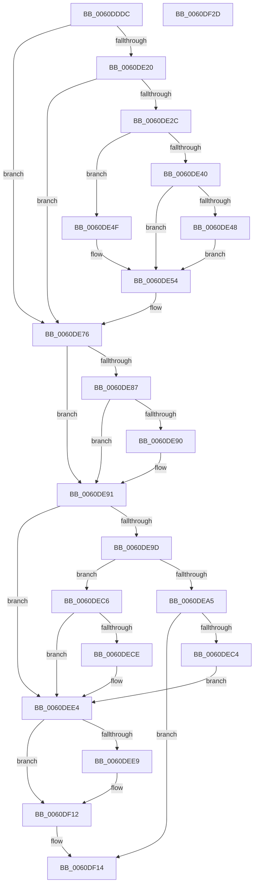

# ST_STORE&lt;SM_TRAITS&gt;::StDmPageError

- RVA: `0x0060DDDC`–`0x0060DF2E` (길이 `338` bytes)
- VA: `0x000000014060DDDC`
- 실행 섹션: `.text`
- PDB 이름 있음: `예`; PDB Function 태그: `아니요`
- unwind 정보 RVA: `0x0009F048`
- 디코드: `93`개 명령, `338/338` bytes 표시
- 미해석 바이트: `0` (있으면 어셈블리에 `.byte`로 보존)

> 이 문서는 커널 이미지의 기계어와 PDB 기호를 분석해 생성했습니다. 4번과 5번은 함수 원형과 자료형을 바이너리 사용 방식에서 추정한 C 해석이며 원본 소스 복구 결과는 아닙니다.

## 1. Dependencies

- 직접 호출 지점: **5**; 고유 호출 대상: **5**
- 직접 호출자로 확인된 함수: **2**
- RIP 상대 이미지 참조: **1**

### Outgoing calls
- `0x0060DE13` → [SmEtwEnabled](../3A/SmEtwEnabled_function_003AF2D0.md) (function, `0x003AF2D0`)
- `0x0060DE71` → [SmEtwLogStoreCorruption](SmEtwLogStoreCorruption_function_0060F458.md) (function, `0x0060F458`)
- `0x0060DEBB` → [ST_STORE<SM_TRAITS>::StDmHandleDecompressionFailure](ST_STORE_SM_TRAITS_StDmHandleDecompressionFailure_function_0060DA74.md) (function, `0x0060DA74`)
- `0x0060DEDF` → [SmLogConsumedPoison](../4C/SmLogConsumedPoison_function_004C6ADC.md) (function, `0x004C6ADC`)
- `0x0060DF0C` → [KeBugCheckEx](../4F/KeBugCheckEx_function_004FD660.md) (function, `0x004FD660`)

### Direct callers
- [ST_STORE&lt;SM_TRAITS&gt;::StDmHandleDecompressionFailure](ST_STORE_SM_TRAITS_StDmHandleDecompressionFailure_function_0060DA74.md) at `0x0060DC3A`
- [sub_006E224E](../6E/Unknown_function_006E224E.md) at `0x006E226E`

### Static image references
- `0x0060DE87` → RVA `0x00F475F8` (`.data`; read)

## 2. Other-region calls and transfers

- 다른 실행 섹션으로 향하는 call: **0**
- 별도 외부 분기/꼬리 이동을 확인하지 못했습니다.

## 3. Assembly (complete function range)

```asm
0060DDDC  48 89 5C 24 10                  mov qword ptr [rsp + 0x10], rbx
0060DDE1  48 89 6C 24 18                  mov qword ptr [rsp + 0x18], rbp
0060DDE6  48 89 74 24 20                  mov qword ptr [rsp + 0x20], rsi
0060DDEB  57                              push rdi
0060DDEC  41 56                           push r14
0060DDEE  41 57                           push r15
0060DDF0  48 83 EC 30                     sub rsp, 0x30
0060DDF4  8B 81 08 03 00 00               mov eax, dword ptr [rcx + 0x308]
0060DDFA  48 8B F1                        mov rsi, rcx
0060DDFD  8B 5C 24 78                     mov ebx, dword ptr [rsp + 0x78]
0060DE01  F6 D8                           neg al
0060DE03  49 8B E9                        mov rbp, r9
0060DE06  4D 8B F8                        mov r15, r8
0060DE09  1B C9                           sbb ecx, ecx
0060DE0B  4C 8B F2                        mov r14, rdx
0060DE0E  F7 D1                           not ecx
0060DE10  83 E1 02                        and ecx, 2
0060DE13  E8 B8 14 DA FF                  call 0x1403af2d0
0060DE18  4C 8B D0                        mov r10, rax
0060DE1B  48 85 C0                        test rax, rax
0060DE1E  74 56                           je 0x14060de76
0060DE20  41 8B 49 14                     mov ecx, dword ptr [r9 + 0x14]
0060DE24  83 E1 0C                        and ecx, 0xc
0060DE27  80 F9 0C                        cmp cl, 0xc
0060DE2A  74 4A                           je 0x14060de76
0060DE2C  48 83 64 24 50 00               and qword ptr [rsp + 0x50], 0
0060DE32  8D 8B 20 FB FF 3F               lea ecx, [rbx + 0x3ffffb20]
0060DE38  F7 C1 FD FF FF FF               test ecx, 0xfffffffd
0060DE3E  74 0F                           je 0x14060de4f
0060DE40  81 FB 3F 00 00 C0               cmp ebx, 0xc000003f
0060DE46  75 0C                           jne 0x14060de54
0060DE48  C6 44 24 51 01                  mov byte ptr [rsp + 0x51], 1
0060DE4D  EB 05                           jmp 0x14060de54
0060DE4F  C6 44 24 51 02                  mov byte ptr [rsp + 0x51], 2
0060DE54  48 8D 44 24 50                  lea rax, [rsp + 0x50]
0060DE59  4C 8B C6                        mov r8, rsi
0060DE5C  48 89 44 24 28                  mov qword ptr [rsp + 0x28], rax
0060DE61  49 8B CA                        mov rcx, r10
0060DE64  41 0F B7 41 04                  movzx eax, word ptr [r9 + 4]
0060DE69  4D 8B CE                        mov r9, r14
0060DE6C  66 89 44 24 20                  mov word ptr [rsp + 0x20], ax
0060DE71  E8 E2 15 00 00                  call 0x14060f458
0060DE76  8B BE 40 03 00 00               mov edi, dword ptr [rsi + 0x340]
0060DE7C  C1 EF 05                        shr edi, 5
0060DE7F  83 E7 03                        and edi, 3
0060DE82  83 FF 02                        cmp edi, 2
0060DE85  72 0A                           jb 0x14060de91
0060DE87  80 3D 6A 97 93 00 00            cmp byte ptr [rip + 0x93976a], 0
0060DE8E  74 01                           je 0x14060de91
0060DE90  CC                              int3
0060DE91  F7 86 08 03 00 00 00 00 02 00   test dword ptr [rsi + 0x308], 0x20000
0060DE9B  74 47                           je 0x14060dee4
0060DE9D  81 FB E0 04 00 C0               cmp ebx, 0xc00004e0
0060DEA3  75 21                           jne 0x14060dec6
0060DEA5  48 8B 44 24 70                  mov rax, qword ptr [rsp + 0x70]
0060DEAA  4C 8B CD                        mov r9, rbp
0060DEAD  4D 8B C7                        mov r8, r15
0060DEB0  48 89 44 24 20                  mov qword ptr [rsp + 0x20], rax
0060DEB5  49 8B D6                        mov rdx, r14
0060DEB8  48 8B CE                        mov rcx, rsi
0060DEBB  E8 B4 FB FF FF                  call 0x14060da74
0060DEC0  85 C0                           test eax, eax
0060DEC2  79 50                           jns 0x14060df14
0060DEC4  EB 1E                           jmp 0x14060dee4
0060DEC6  81 FB E2 04 00 C0               cmp ebx, 0xc00004e2
0060DECC  75 16                           jne 0x14060dee4
0060DECE  F0 FF 86 08 09 00 00            lock inc dword ptr [rsi + 0x908]
0060DED5  0F B7 55 04                     movzx edx, word ptr [rbp + 4]
0060DED9  45 33 C0                        xor r8d, r8d
0060DEDC  49 8B CE                        mov rcx, r14
0060DEDF  E8 F8 8B EB FF                  call 0x1404c6adc
0060DEE4  83 FF 03                        cmp edi, 3
0060DEE7  72 29                           jb 0x14060df12
0060DEE9  44 0F B7 45 04                  movzx r8d, word ptr [rbp + 4]
0060DEEE  81 FB E0 04 00 C0               cmp ebx, 0xc00004e0
0060DEF4  B8 C4 02 00 C0                  mov eax, 0xc00002c4
0060DEF9  4C 89 7C 24 20                  mov qword ptr [rsp + 0x20], r15
0060DEFE  0F 45 C3                        cmovne eax, ebx
0060DF01  4D 8B CE                        mov r9, r14
0060DF04  48 63 D0                        movsxd rdx, eax
0060DF07  B9 2B 01 00 00                  mov ecx, 0x12b
0060DF0C  E8 4F F7 EE FF                  call 0x1404fd660
0060DF11  CC                              int3
0060DF12  8B C3                           mov eax, ebx
0060DF14  48 8B 5C 24 58                  mov rbx, qword ptr [rsp + 0x58]
0060DF19  48 8B 6C 24 60                  mov rbp, qword ptr [rsp + 0x60]
0060DF1E  48 8B 74 24 68                  mov rsi, qword ptr [rsp + 0x68]
0060DF23  48 83 C4 30                     add rsp, 0x30
0060DF27  41 5F                           pop r15
0060DF29  41 5E                           pop r14
0060DF2B  5F                              pop rdi
0060DF2C  C3                              ret
0060DF2D  CC                              int3
```

## 4. C-style interpretation (structured pseudocode)

```c
__int64 __fastcall ST_STORE_SM_TRAITS___StDmPageError(__int64 a1, __int64 a2, __int64 a3, __int64 a4, __int64 a5, unsigned int a6)
{
    __int64 result;
    __int64 v_rdi;
    __int64 v_rsp;
    unsigned __int64 v_stack_m20;
    unsigned __int16 v_stack_m28;
    unsigned __int64 v_stack_p10;
    unsigned __int64 v_stack_p18;
    unsigned __int64 v_stack_p20;
    unsigned __int64 v_stack_p8;
    unsigned __int8 v_stack_p9;

    v_stack_p10 = v_rbx;
    v_stack_p18 = v_rbp;
    v_stack_p20 = v_rsi;
    v_rsp = (v_rsp) - (48);
    result = (unsigned __int8)(-((unsigned int)(*(unsigned int *)(a1 + 776))));
    a1 = (unsigned int)(~(a1));
    a1 = (unsigned int)((a1) & (2));
    result = SmEtwEnabled(a1, a2, a3, a4);
    if (result == 0) goto loc_0060DE76;
    a1 = (unsigned int)(((unsigned int)(*(unsigned int *)(a4 + 20))) & (12));
    if (((unsigned __int8)(a1)) == 12) goto loc_0060DE76;
    if ((((unsigned int)((unsigned int)(a6) + 1073740576)) & (0xFFFFFFFDULL)) == 0) goto loc_0060DE4F;
    if (((unsigned int)((unsigned int)(a6))) != 0xC000003FULL) goto loc_0060DE54;
    v_stack_p9 = 1;
    goto loc_0060DE54;
loc_0060DE4F:
    v_stack_p9 = 2;
loc_0060DE54:
    v_stack_m20 = v_stack_p8;
    v_stack_m28 = (unsigned __int16)(*(unsigned __int16 *)(a4 + 4));
    result = SmEtwLogStoreCorruption(result, a2, a1, a2);
loc_0060DE76:
    v_rdi = (unsigned int)(((unsigned int)(*(unsigned int *)(a1 + 832))) >> (5));
    v_rdi = (unsigned int)((v_rdi) & (3));
    if (((unsigned int)(v_rdi)) < 2) goto loc_0060DE91;
    if ((*(unsigned __int8 *)(v_rip + 9672554)) != 0) {
    }
    if (((*(unsigned int *)(a1 + 776)) & (0x20000ULL)) == 0) goto loc_0060DEE4;
    if (((unsigned int)((unsigned int)(a6))) != 0xC00004E0ULL) goto loc_0060DEC6;
    v_stack_m28 = a5;
    result = ST_STORE_SM_TRAITS___StDmHandleDecompressionFailure(a1, a2, a3, a4);
    if (!sign_flag) goto loc_0060DF14;
    goto loc_0060DEE4;
loc_0060DEC6:
    if (((unsigned int)((unsigned int)(a6))) == 0xC00004E2ULL) {
        a2 = *(unsigned __int16 *)(a4 + 4);
        a3 = 0;
        a1 = a2;
        result = SmLogConsumedPoison(a1, a2, a3, a4);
    }
    if (((unsigned int)(v_rdi)) >= 3) {
        a3 = *(unsigned __int16 *)(a4 + 4);
        result = 0xC00002C4ULL;
        v_stack_m28 = a3;
        if (((unsigned int)((unsigned int)(a6))) != 0xC00004E0ULL) { result = (unsigned int)((unsigned int)(a6)); }
        a4 = a2;
        a2 = (int)((unsigned int)(result));
        a1 = 299;
        result = KeBugCheckEx(a1, a2, a3, a4);
    }
loc_0060DF14:
    v_rsp = (v_rsp) + (48);
    return (unsigned int)((unsigned int)((unsigned int)(a6)));
}
```

## 5. (Beta) C Style

```c
int64_t ST_STORE_SM_TRAITS___StDmPageError(void *Arg1, int64_t Arg2, int64_t Arg3, void *Arg4, int64_t Arg5, void *Arg6)
{
    uint8_t *arg1 = (uint8_t *)Arg1;
    uint8_t *arg4 = (uint8_t *)Arg4;
    uint8_t *arg6 = (uint8_t *)Arg6;

    int64_t result;
    int64_t local_rdi;
    int64_t local_rsp;
    uint64_t v_stack_m20;
    uint16_t v_stack_m28;
    uint64_t v_stack_p10;
    uint64_t v_stack_p18;
    uint64_t v_stack_p20;
    uint64_t v_stack_p8;
    uint8_t v_stack_p9;

    v_stack_p10 = local_rbx;
    v_stack_p18 = local_rbp;
    v_stack_p20 = local_rsi;
    local_rsp = (local_rsp) - (48);
    result = (uint8_t)(-((uint32_t)(*(uint32_t *)(arg1 + 0x308))));
    Arg1 = (uint32_t)(~(Arg1));
    Arg1 = (uint32_t)((Arg1) & (2));
    result = SmEtwEnabled(Arg1, Arg2, Arg3, Arg4);
    if (result == 0) goto loc_0060DE76;
    Arg1 = (uint32_t)(((uint32_t)(*(uint32_t *)(arg4 + 0x14))) & (12));
    if (((uint8_t)(Arg1)) == 12) goto loc_0060DE76;
    if ((((uint32_t)((uint32_t)(Arg6) + 1073740576)) & (0xFFFFFFFDULL)) == 0) goto loc_0060DE4F;
    if (((uint32_t)((uint32_t)(Arg6))) != 0xC000003FULL) goto loc_0060DE54;
    v_stack_p9 = 1;
    goto loc_0060DE54;
loc_0060DE4F:
    v_stack_p9 = 2;
loc_0060DE54:
    v_stack_m20 = v_stack_p8;
    v_stack_m28 = (uint16_t)(*(uint16_t *)(arg4 + 0x4));
    result = SmEtwLogStoreCorruption(result, Arg2, Arg1, Arg2);
loc_0060DE76:
    local_rdi = (uint32_t)(((uint32_t)(*(uint32_t *)(arg1 + 0x340))) >> (5));
    local_rdi = (uint32_t)((local_rdi) & (3));
    if (((uint32_t)(local_rdi)) < 2) goto loc_0060DE91;
    if ((*(uint8_t *)(v_rip + 0x93976A)) != 0) {
    }
    if (((*(uint32_t *)(arg1 + 0x308)) & (0x20000ULL)) == 0) goto loc_0060DEE4;
    if (((uint32_t)((uint32_t)(Arg6))) != 0xC00004E0ULL) goto loc_0060DEC6;
    v_stack_m28 = Arg5;
    result = ST_STORE_SM_TRAITS___StDmHandleDecompressionFailure(Arg1, Arg2, Arg3, Arg4);
    if (!sign_flag) goto loc_0060DF14;
    goto loc_0060DEE4;
loc_0060DEC6:
    if (((uint32_t)((uint32_t)(Arg6))) == 0xC00004E2ULL) {
        Arg2 = *(uint16_t *)(arg4 + 0x4);
        Arg3 = 0;
        Arg1 = Arg2;
        result = SmLogConsumedPoison(Arg1, Arg2, Arg3, Arg4);
    }
    if (((uint32_t)(local_rdi)) >= 3) {
        Arg3 = *(uint16_t *)(arg4 + 0x4);
        result = 0xC00002C4ULL;
        v_stack_m28 = Arg3;
        if (((uint32_t)((uint32_t)(Arg6))) != 0xC00004E0ULL) { result = (uint32_t)((uint32_t)(Arg6)); }
        Arg4 = Arg2;
        Arg2 = (int32_t)((uint32_t)(result));
        Arg1 = 299;
        result = KeBugCheckEx(Arg1, Arg2, Arg3, Arg4);
    }
loc_0060DF14:
    local_rsp = (local_rsp) + (48);
    return (uint32_t)((uint32_t)((uint32_t)(Arg6)));
}
```

### 관측된 메모리 오프셋

구조체 형식이 확인되지 않은 접근은 인자 기준의 오프셋으로만 기록했습니다.

| 기준 인자 | 오프셋 표현 | 폭 (bit) | 접근 |
|---|---:|---:|---|
| `Arg1` | `+ 0x308` | `32` | `R` |
| `Arg1` | `+ 0x340` | `32` | `R` |
| `Arg1` | `+ 0x908` | `32` | `R/W` |
| `Arg4` | `+ 0x4` | `16` | `R` |
| `Arg6` | `+ 0x3FFFFB20` | `32` | `R` |

## 6. Execution-region graph

[열기: 2D/3D 그래프와 함수 탐색 컨트롤 패널](../../../control-panel.html?section=text&rva=0x0060DDDC&view=graph)

- 2D 그래프는 위에서 아래로 흐르고, 3D 그래프는 빈 공간을 드래그해 회전합니다. Shift+드래그는 이동, 휠은 확대·축소, 함수 노드 선택은 대상 보고서 이동입니다.

### Static fallback


