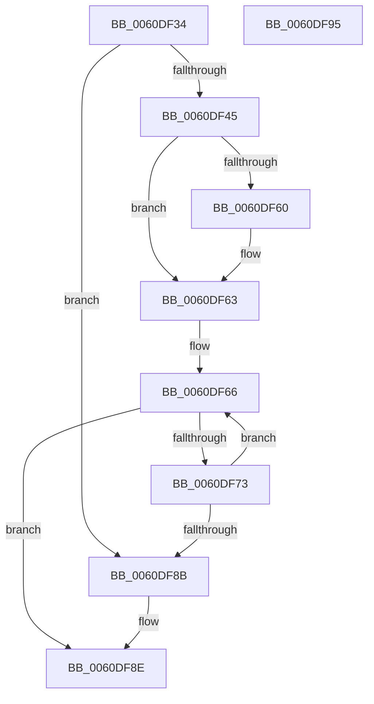

# ST_STORE&lt;SM_TRAITS&gt;::StDmPickRandomRegion

- RVA: `0x0060DF34`–`0x0060DF96` (길이 `98` bytes)
- VA: `0x000000014060DF34`
- 실행 섹션: `.text`
- PDB 이름 있음: `예`; PDB Function 태그: `아니요`
- unwind 정보 RVA: `0x0005C788`
- 디코드: `33`개 명령, `98/98` bytes 표시
- 미해석 바이트: `0` (있으면 어셈블리에 `.byte`로 보존)

> 이 문서는 커널 이미지의 기계어와 PDB 기호를 분석해 생성했습니다. 4번과 5번은 함수 원형과 자료형을 바이너리 사용 방식에서 추정한 C 해석이며 원본 소스 복구 결과는 아닙니다.

## 1. Dependencies

- 직접 호출 지점: **1**; 고유 호출 대상: **1**
- 직접 호출자로 확인된 함수: **1**
- RIP 상대 이미지 참조: **0**

### Outgoing calls
- `0x0060DF69` → [ST_STORE<SM_TRAITS>::StStagingRegionFind](ST_STORE_SM_TRAITS_StStagingRegionFind_function_0060EA2C.md) (function, `0x0060EA2C`)

### Direct callers
- [ST_STORE&lt;SM_TRAITS&gt;::StDmEtaRefresh](../4D/ST_STORE_SM_TRAITS_StDmEtaRefresh_function_004D71BC.md) at `0x004D7252`

### Static image references
- 디코드된 RIP-relative 메모리 참조가 없습니다.

## 2. Other-region calls and transfers

- 다른 실행 섹션으로 향하는 call: **0**
- 별도 외부 분기/꼬리 이동을 확인하지 못했습니다.

## 3. Assembly (complete function range)

```asm
0060DF34  48 83 EC 28                     sub rsp, 0x28
0060DF38  4C 8B C1                        mov r8, rcx
0060DF3B  8B 89 58 03 00 00               mov ecx, dword ptr [rcx + 0x358]
0060DF41  85 C9                           test ecx, ecx
0060DF43  74 46                           je 0x14060df8b
0060DF45  0F 31                           rdtsc
0060DF47  48 C1 E2 20                     shl rdx, 0x20
0060DF4B  48 0B C2                        or rax, rdx
0060DF4E  33 D2                           xor edx, edx
0060DF50  48 C1 E8 04                     shr rax, 4
0060DF54  F7 F1                           div ecx
0060DF56  8D 42 01                        lea eax, [rdx + 1]
0060DF59  83 CA FF                        or edx, 0xffffffff
0060DF5C  85 C0                           test eax, eax
0060DF5E  74 03                           je 0x14060df63
0060DF60  8D 50 FF                        lea edx, [rax - 1]
0060DF63  45 33 C9                        xor r9d, r9d
0060DF66  49 8B C8                        mov rcx, r8
0060DF69  E8 BE 0A 00 00                  call 0x14060ea2c
0060DF6E  48 85 C0                        test rax, rax
0060DF71  74 1B                           je 0x14060df8e
0060DF73  8D 42 01                        lea eax, [rdx + 1]
0060DF76  41 FF C1                        inc r9d
0060DF79  33 D2                           xor edx, edx
0060DF7B  41 3B 80 14 03 00 00            cmp eax, dword ptr [r8 + 0x314]
0060DF82  0F 45 D0                        cmovne edx, eax
0060DF85  41 83 F9 07                     cmp r9d, 7
0060DF89  72 DB                           jb 0x14060df66
0060DF8B  83 CA FF                        or edx, 0xffffffff
0060DF8E  8B C2                           mov eax, edx
0060DF90  48 83 C4 28                     add rsp, 0x28
0060DF94  C3                              ret
0060DF95  CC                              int3
```

## 4. C-style interpretation (structured pseudocode)

```c
__int64 __fastcall ST_STORE_SM_TRAITS___StDmPickRandomRegion(__int64 a1, __int64 a2, __int64 a3, int a4)
{
    __int64 result;
    __int64 v_rsp;

    v_rsp = (v_rsp) - (40);
    if ((unsigned int)((unsigned int)(*(unsigned int *)(a1 + 856))) == 0) goto loc_0060DF8B;
    a2 = (a2) << (32);
    result = (result) | (a2);
    a2 = 0;
    result = (result) >> (4);
    a2 = (unsigned int)((a2) | (0xFFFFFFFFULL));
    if ((unsigned int)(a2 + 1) != 0) {
        a2 = a2 + 1 - 1;
    }
    a4 = 0;
loc_0060DF66:
    result = ST_STORE_SM_TRAITS___StStagingRegionFind(a1, a2, a1, a4);
    if (result == 0) goto loc_0060DF8E;
    a4 = (unsigned int)((a4) + 1);
    a2 = 0;
    if (((unsigned int)(a2 + 1)) != (*(unsigned int *)(a1 + 788))) { a2 = (unsigned int)(a2 + 1); }
    if (a4 < 7) goto loc_0060DF66;
loc_0060DF8B:
    a2 = (unsigned int)((a2) | (0xFFFFFFFFULL));
loc_0060DF8E:
    v_rsp = (v_rsp) + (40);
    return (unsigned int)((unsigned int)(a2));
}
```

## 5. (Beta) C Style

```c
int64_t ST_STORE_SM_TRAITS___StDmPickRandomRegion(void *Arg1, int64_t Arg2, int64_t Arg3, int32_t Arg4)
{
    uint8_t *arg1 = (uint8_t *)Arg1;

    int64_t result;
    int64_t local_rsp;

    local_rsp = (local_rsp) - (40);
    if ((uint32_t)((uint32_t)(*(uint32_t *)(arg1 + 0x358))) == 0) goto loc_0060DF8B;
    Arg2 = (Arg2) << (32);
    result = (result) | (Arg2);
    Arg2 = 0;
    result = (result) >> (4);
    Arg2 = (uint32_t)((Arg2) | (0xFFFFFFFFULL));
    if ((uint32_t)(Arg2 + 1) != 0) {
        Arg2 = Arg2 + 1 - 1;
    }
    Arg4 = 0;
loc_0060DF66:
    result = ST_STORE_SM_TRAITS___StStagingRegionFind(Arg1, Arg2, Arg1, Arg4);
    if (result == 0) goto loc_0060DF8E;
    Arg4 = (uint32_t)((Arg4) + 1);
    Arg2 = 0;
    if (((uint32_t)(Arg2 + 1)) != (*(uint32_t *)(arg1 + 0x314))) { Arg2 = (uint32_t)(Arg2 + 1); }
    if (Arg4 < 7) goto loc_0060DF66;
loc_0060DF8B:
    Arg2 = (uint32_t)((Arg2) | (0xFFFFFFFFULL));
loc_0060DF8E:
    local_rsp = (local_rsp) + (40);
    return (uint32_t)((uint32_t)(Arg2));
}
```

### 관측된 메모리 오프셋

구조체 형식이 확인되지 않은 접근은 인자 기준의 오프셋으로만 기록했습니다.

| 기준 인자 | 오프셋 표현 | 폭 (bit) | 접근 |
|---|---:|---:|---|
| `Arg1` | `+ 0x358` | `32` | `R` |

## 6. Execution-region graph

[열기: 2D/3D 그래프와 함수 탐색 컨트롤 패널](../../../control-panel.html?section=text&rva=0x0060DF34&view=graph)

- 2D 그래프는 위에서 아래로 흐르고, 3D 그래프는 빈 공간을 드래그해 회전합니다. Shift+드래그는 이동, 휠은 확대·축소, 함수 노드 선택은 대상 보고서 이동입니다.

### Static fallback


