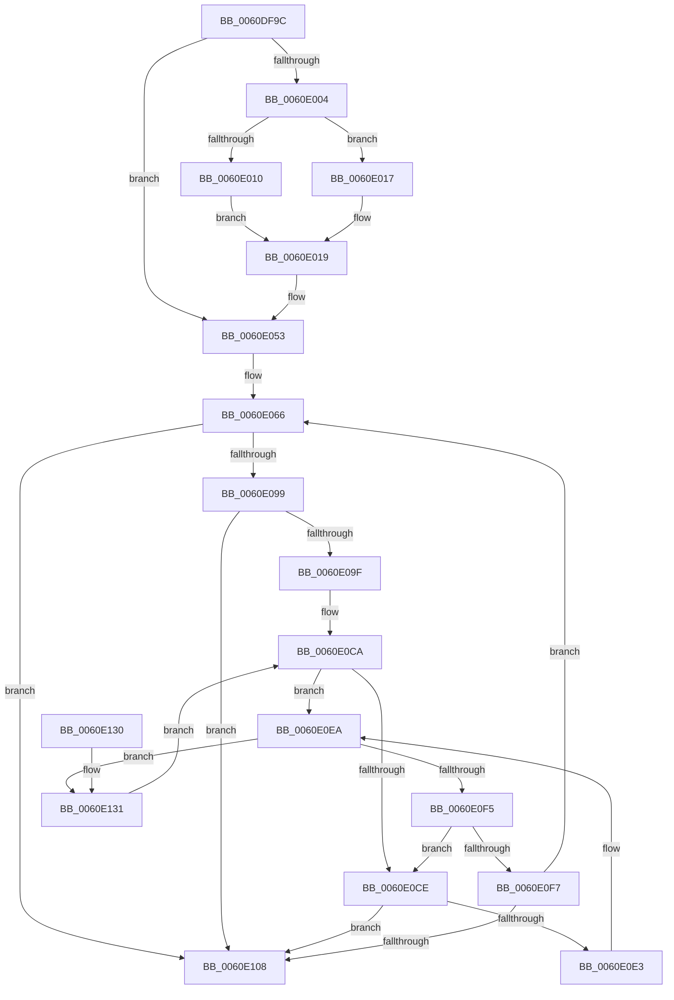

# ST_STORE&lt;SM_TRAITS&gt;::StDmRegionEvict

- RVA: `0x0060DF9C`–`0x0060E137` (길이 `411` bytes)
- VA: `0x000000014060DF9C`
- 실행 섹션: `.text`
- PDB 이름 있음: `예`; PDB Function 태그: `아니요`
- unwind 정보 RVA: `0x000D1898`
- 디코드: `116`개 명령, `411/411` bytes 표시
- 미해석 바이트: `0` (있으면 어셈블리에 `.byte`로 보존)

> 이 문서는 커널 이미지의 기계어와 PDB 기호를 분석해 생성했습니다. 4번과 5번은 함수 원형과 자료형을 바이너리 사용 방식에서 추정한 C 해석이며 원본 소스 복구 결과는 아닙니다.

## 1. Dependencies

- 직접 호출 지점: **6**; 고유 호출 대상: **6**
- 직접 호출자로 확인된 함수: **1**
- RIP 상대 이미지 참조: **2**

### Outgoing calls
- `0x0060DFF7` → [SmEtwEnabled](../3A/SmEtwEnabled_function_003AF2D0.md) (function, `0x003AF2D0`)
- `0x0060E04A` → [SmEtwLogRegionOp](SmEtwLogRegionOp_function_0060F38C.md) (function, `0x0060F38C`)
- `0x0060E08E` → [ST_STORE<SM_TRAITS>::StDmRegionGetKeys](ST_STORE_SM_TRAITS_StDmRegionGetKeys_function_0060E140.md) (function, `0x0060E140`)
- `0x0060E0B4` → [qsort](../50/qsort_function_005009F0.md) (function, `0x005009F0`)
- `0x0060E0D8` → [ST_STORE<SM_TRAITS>::StDmPageRemove](../20/ST_STORE_SM_TRAITS_StDmPageRemove_function_002049A0.md) (function, `0x002049A0`)
- `0x0060E111` → [_security_check_cookie](../6A/_security_check_cookie_function_006AC640.md) (function, `0x006AC640`)

### Direct callers
- [ST_STORE&lt;SM_TRAITS&gt;::StDmRegionRemove](ST_STORE_SM_TRAITS_StDmRegionRemove_function_0060E314.md) at `0x0060E37F`

### Static image references
- `0x0060DFBE` → RVA `0x00E0A740` (`.data`; read)
- `0x0060E0A2` → RVA `0x0060EA60` (`ST_STORE<SM_TRAITS>::StpKeyCompare`; read)

## 2. Other-region calls and transfers

- 다른 실행 섹션으로 향하는 call: **0**
- 별도 외부 분기/꼬리 이동을 확인하지 못했습니다.

## 3. Assembly (complete function range)

```asm
0060DF9C  40 55                           push rbp
0060DF9E  41 56                           push r14
0060DFA0  41 57                           push r15
0060DFA2  48 81 EC 80 00 00 00            sub rsp, 0x80
0060DFA9  48 8D 6C 24 40                  lea rbp, [rsp + 0x40]
0060DFAE  48 89 5D 60                     mov qword ptr [rbp + 0x60], rbx
0060DFB2  48 89 75 68                     mov qword ptr [rbp + 0x68], rsi
0060DFB6  48 89 7D 70                     mov qword ptr [rbp + 0x70], rdi
0060DFBA  4C 89 6D 78                     mov qword ptr [rbp + 0x78], r13
0060DFBE  48 8B 05 7B C7 7F 00            mov rax, qword ptr [rip + 0x7fc77b]
0060DFC5  48 33 C5                        xor rax, rbp
0060DFC8  48 89 45 30                     mov qword ptr [rbp + 0x30], rax
0060DFCC  0F 57 C0                        xorps xmm0, xmm0
0060DFCF  45 8B E8                        mov r13d, r8d
0060DFD2  66 0F 7E C0                     movd eax, xmm0
0060DFD6  4C 8B F1                        mov r14, rcx
0060DFD9  0F 11 45 10                     movups xmmword ptr [rbp + 0x10], xmm0
0060DFDD  33 C9                           xor ecx, ecx
0060DFDF  4C 8B CA                        mov r9, rdx
0060DFE2  83 C8 01                        or eax, 1
0060DFE5  48 89 55 08                     mov qword ptr [rbp + 8], rdx
0060DFE9  0F 11 45 20                     movups xmmword ptr [rbp + 0x20], xmm0
0060DFED  89 45 20                        mov dword ptr [rbp + 0x20], eax
0060DFF0  C7 45 10 01 00 00 00            mov dword ptr [rbp + 0x10], 1
0060DFF7  E8 D4 12 DA FF                  call 0x1403af2d0
0060DFFC  4C 8B D0                        mov r10, rax
0060DFFF  48 85 C0                        test rax, rax
0060E002  74 4F                           je 0x14060e053
0060E004  49 8B 8E 88 05 00 00            mov rcx, qword ptr [r14 + 0x588]
0060E00B  48 85 C9                        test rcx, rcx
0060E00E  74 07                           je 0x14060e017
0060E010  42 0F B6 14 29                  movzx edx, byte ptr [rcx + r13]
0060E015  EB 02                           jmp 0x14060e019
0060E017  33 D2                           xor edx, edx
0060E019  49 8B 86 78 05 00 00            mov rax, qword ptr [r14 + 0x578]
0060E020  45 8B CD                        mov r9d, r13d
0060E023  66 89 54 24 30                  mov word ptr [rsp + 0x30], dx
0060E028  4D 8B C6                        mov r8, r14
0060E02B  BA 03 00 00 00                  mov edx, 3
0060E030  42 0F B7 0C 68                  movzx ecx, word ptr [rax + r13*2]
0060E035  B8 FF 1F 00 00                  mov eax, 0x1fff
0060E03A  66 23 C8                        and cx, ax
0060E03D  66 89 4C 24 28                  mov word ptr [rsp + 0x28], cx
0060E042  49 8B CA                        mov rcx, r10
0060E045  83 64 24 20 00                  and dword ptr [rsp + 0x20], 0
0060E04A  E8 3D 13 00 00                  call 0x14060f38c
0060E04F  4C 8B 4D 08                     mov r9, qword ptr [rbp + 8]
0060E053  8B 04 24                        mov eax, dword ptr [rsp]
0060E056  B8 00 04 00 00                  mov eax, 0x400
0060E05B  48 2B E0                        sub rsp, rax
0060E05E  4C 8D 7C 24 40                  lea r15, [rsp + 0x40]
0060E063  41 8B 07                        mov eax, dword ptr [r15]
0060E066  48 8D 45 00                     lea rax, [rbp]
0060E06A  C7 45 00 00 01 00 00            mov dword ptr [rbp], 0x100
0060E071  48 89 44 24 30                  mov qword ptr [rsp + 0x30], rax
0060E076  45 8B C5                        mov r8d, r13d
0060E079  8B 85 80 00 00 00               mov eax, dword ptr [rbp + 0x80]
0060E07F  49 8B D1                        mov rdx, r9
0060E082  4C 89 7C 24 28                  mov qword ptr [rsp + 0x28], r15
0060E087  49 8B CE                        mov rcx, r14
0060E08A  89 44 24 20                     mov dword ptr [rsp + 0x20], eax
0060E08E  E8 AD 00 00 00                  call 0x14060e140
0060E093  8B F0                           mov esi, eax
0060E095  85 C0                           test eax, eax
0060E097  78 6F                           js 0x14060e108
0060E099  83 7D 00 00                     cmp dword ptr [rbp], 0
0060E09D  74 69                           je 0x14060e108
0060E09F  8B 5D 00                        mov ebx, dword ptr [rbp]
0060E0A2  4C 8D 0D B7 09 00 00            lea r9, [rip + 0x9b7]
0060E0A9  8B D3                           mov edx, ebx
0060E0AB  41 B8 04 00 00 00               mov r8d, 4
0060E0B1  49 8B CF                        mov rcx, r15
0060E0B4  E8 37 29 EF FF                  call 0x1405009f0
0060E0B9  41 8B 07                        mov eax, dword ptr [r15]
0060E0BC  49 8D 1C 9F                     lea rbx, [r15 + rbx*4]
0060E0C0  89 45 18                        mov dword ptr [rbp + 0x18], eax
0060E0C3  8B D0                           mov edx, eax
0060E0C5  49 8B FF                        mov rdi, r15
0060E0C8  33 C9                           xor ecx, ecx
0060E0CA  3B C2                           cmp eax, edx
0060E0CC  74 1C                           je 0x14060e0ea
0060E0CE  89 4D 1C                        mov dword ptr [rbp + 0x1c], ecx
0060E0D1  48 8D 55 10                     lea rdx, [rbp + 0x10]
0060E0D5  49 8B CE                        mov rcx, r14
0060E0D8  E8 C3 68 BF FF                  call 0x1402049a0
0060E0DD  8B F0                           mov esi, eax
0060E0DF  85 C0                           test eax, eax
0060E0E1  78 25                           js 0x14060e108
0060E0E3  8B 07                           mov eax, dword ptr [rdi]
0060E0E5  33 C9                           xor ecx, ecx
0060E0E7  89 45 18                        mov dword ptr [rbp + 0x18], eax
0060E0EA  FF C1                           inc ecx
0060E0EC  48 83 C7 04                     add rdi, 4
0060E0F0  48 3B FB                        cmp rdi, rbx
0060E0F3  72 3C                           jb 0x14060e131
0060E0F5  74 D7                           je 0x14060e0ce
0060E0F7  81 7D 00 00 01 00 00            cmp dword ptr [rbp], 0x100
0060E0FE  4C 8B 4D 08                     mov r9, qword ptr [rbp + 8]
0060E102  0F 83 5E FF FF FF               jae 0x14060e066
0060E108  8B C6                           mov eax, esi
0060E10A  48 8B 4D 30                     mov rcx, qword ptr [rbp + 0x30]
0060E10E  48 33 CD                        xor rcx, rbp
0060E111  E8 2A E5 09 00                  call 0x1406ac640
0060E116  48 8B 5D 60                     mov rbx, qword ptr [rbp + 0x60]
0060E11A  48 8B 75 68                     mov rsi, qword ptr [rbp + 0x68]
0060E11E  48 8B 7D 70                     mov rdi, qword ptr [rbp + 0x70]
0060E122  4C 8B 6D 78                     mov r13, qword ptr [rbp + 0x78]
0060E126  48 8D 65 40                     lea rsp, [rbp + 0x40]
0060E12A  41 5F                           pop r15
0060E12C  41 5E                           pop r14
0060E12E  5D                              pop rbp
0060E12F  C3                              ret
0060E130  CC                              int3
0060E131  8B 17                           mov edx, dword ptr [rdi]
0060E133  FF C0                           inc eax
0060E135  EB 93                           jmp 0x14060e0ca
```

## 4. C-style interpretation (structured pseudocode)

```c
__int64 __fastcall ST_STORE_SM_TRAITS___StDmRegionEvict(__int64 a1, __int64 a2, int a3, __int64 a4, unsigned int a5)
{
    __int64 result;
    __int64 v_rdi;
    __int64 v_rsp;
    unsigned __int64 v_stack_m18;
    unsigned __int64 v_stack_m28;
    unsigned __int64 v_stack_m38;
    unsigned int v_stack_m3C;
    unsigned int v_stack_m40;
    unsigned __int64 v_stack_m48;
    unsigned __int64 v_stack_m50;
    unsigned __int64 v_stack_m58;
    unsigned __int16 v_stack_m68;
    unsigned __int16 v_stack_m70;
    unsigned int v_stack_m78;
    unsigned int v_stack_m98;
    unsigned __int64 v_stack_p10;
    unsigned __int64 v_stack_p18;
    unsigned __int64 v_stack_p20;
    unsigned __int64 v_stack_p8;

    v_rsp = (v_rsp) - (128);
    v_stack_p8 = v_rbx;
    v_stack_p10 = v_rsi;
    v_stack_p18 = v_rdi;
    v_stack_p20 = v_r13;
    result = (*(unsigned __int64 *)(v_rip + 8374139)) ^ (v_stack_m58);
    v_stack_m28 = result;
    v_stack_m48 = v_xmm0;
    a1 = 0;
    result = (unsigned int)((result) | (1));
    v_stack_m50 = a2;
    v_stack_m38 = v_xmm0;
    v_stack_m38 = (unsigned int)(result);
    v_stack_m48 = 1;
    result = SmEtwEnabled(a1, a2, a3, a2);
    if (result == 0) goto loc_0060E053;
    if (*(unsigned __int64 *)(a1 + 1416) == 0) goto loc_0060E017;
    goto loc_0060E019;
loc_0060E017:
    a2 = 0;
loc_0060E019:
    v_stack_m68 = 0;
    a1 = (unsigned __int16)((*(unsigned __int16 *)(*(unsigned __int64 *)(a1 + 1400) + (unsigned int)(a3) * 2)) & ((unsigned __int16)((unsigned int)(0x1FFFULL))));
    v_stack_m70 = (unsigned __int16)(a1);
    result = SmEtwLogRegionOp(result, 3, 0, (unsigned int)((unsigned int)((unsigned int)(a3))));
loc_0060E053:
    v_rsp = (v_rsp) - ((unsigned int)(0x400ULL));
loc_0060E066:
    v_stack_m58 = 256;
    v_stack_m68 = v_stack_m58;
    v_stack_m70 = v_stack_m58;
    v_stack_m78 = (unsigned int)((unsigned int)(a5));
    result = ST_STORE_SM_TRAITS___StDmRegionGetKeys(a1, v_stack_m50, (unsigned int)((unsigned int)((unsigned int)(a3))), v_stack_m50);
    if (sign_flag) goto loc_0060E108;
    if (v_stack_m58 == 0) goto loc_0060E108;
    result = qsort(v_stack_m58, (unsigned int)((unsigned int)((unsigned int)(v_stack_m58))), 4, v_rip + 2487);
    v_stack_m40 = (unsigned int)((unsigned int)(*(unsigned int *)(v_stack_m58)));
    a1 = 0;
loc_0060E0CA:
    if (((unsigned int)((unsigned int)(*(unsigned int *)(v_stack_m58)))) == ((unsigned int)((unsigned int)((unsigned int)((unsigned int)(*(unsigned int *)(v_stack_m58))))))) goto loc_0060E0EA;
loc_0060E0CE:
    v_stack_m3C = 0;
    result = ST_STORE_SM_TRAITS___StDmPageRemove(0, v_stack_m48, 4, v_rip + 2487);
    if (sign_flag) goto loc_0060E108;
    a1 = 0;
    v_stack_m40 = (unsigned int)((unsigned int)(*(unsigned int *)(v_stack_m58)));
loc_0060E0EA:
    a1 = (unsigned int)((a1) + 1);
    v_rdi = (v_stack_m58) + (4);
    if (v_rdi < (v_stack_m58 + (unsigned int)(v_stack_m58) * 4)) goto loc_0060E131;
    if (v_rdi == (v_stack_m58 + (unsigned int)(v_stack_m58) * 4)) goto loc_0060E0CE;
    if (v_stack_m58 >= 256) goto loc_0060E066;
loc_0060E108:
    a1 = (v_stack_m28) ^ (v_stack_m58);
    result = _security_check_cookie(a1, v_stack_m48, 4, v_stack_m50);
    return result;
loc_0060E131:
    result = (unsigned int)((result) + 1);
    goto loc_0060E0CA;
}
```

## 5. (Beta) C Style

```c
int64_t ST_STORE_SM_TRAITS___StDmRegionEvict(void *Arg1, int64_t Arg2, int32_t Arg3, int64_t Arg4, uint32_t Arg5)
{
    uint8_t *arg1 = (uint8_t *)Arg1;

    int64_t result;
    int64_t local_rdi;
    int64_t local_rsp;
    uint64_t v_stack_m18;
    uint64_t v_stack_m28;
    uint64_t v_stack_m38;
    uint32_t v_stack_m3C;
    uint32_t v_stack_m40;
    uint64_t v_stack_m48;
    uint64_t v_stack_m50;
    uint64_t v_stack_m58;
    uint16_t v_stack_m68;
    uint16_t v_stack_m70;
    uint32_t v_stack_m78;
    uint32_t v_stack_m98;
    uint64_t v_stack_p10;
    uint64_t v_stack_p18;
    uint64_t v_stack_p20;
    uint64_t v_stack_p8;

    local_rsp = (local_rsp) - (128);
    v_stack_p8 = local_rbx;
    v_stack_p10 = local_rsi;
    v_stack_p18 = local_rdi;
    v_stack_p20 = local_r13;
    result = (*(uint64_t *)(v_rip + 0x7FC77B)) ^ (v_stack_m58);
    v_stack_m28 = result;
    v_stack_m48 = v_xmm0;
    Arg1 = 0;
    result = (uint32_t)((result) | (1));
    v_stack_m50 = Arg2;
    v_stack_m38 = v_xmm0;
    v_stack_m38 = (uint32_t)(result);
    v_stack_m48 = 1;
    result = SmEtwEnabled(Arg1, Arg2, Arg3, Arg2);
    if (result == 0) goto loc_0060E053;
    if (*(uint64_t *)(arg1 + 0x588) == 0) goto loc_0060E017;
    goto loc_0060E019;
loc_0060E017:
    Arg2 = 0;
loc_0060E019:
    v_stack_m68 = 0;
    Arg1 = (uint16_t)((*(uint16_t *)(*(uint64_t *)(arg1 + 0x578) + (uint32_t)(Arg3) * 2)) & ((uint16_t)((uint32_t)(0x1FFFULL))));
    v_stack_m70 = (uint16_t)(Arg1);
    result = SmEtwLogRegionOp(result, 3, 0, (uint32_t)((uint32_t)((uint32_t)(Arg3))));
loc_0060E053:
    local_rsp = (local_rsp) - ((uint32_t)(0x400ULL));
loc_0060E066:
    v_stack_m58 = 256;
    v_stack_m68 = v_stack_m58;
    v_stack_m70 = v_stack_m58;
    v_stack_m78 = (uint32_t)((uint32_t)(Arg5));
    result = ST_STORE_SM_TRAITS___StDmRegionGetKeys(Arg1, v_stack_m50, (uint32_t)((uint32_t)((uint32_t)(Arg3))), v_stack_m50);
    if (sign_flag) goto loc_0060E108;
    if (v_stack_m58 == 0) goto loc_0060E108;
    result = qsort(v_stack_m58, (uint32_t)((uint32_t)((uint32_t)(v_stack_m58))), 4, v_rip + 2487);
    v_stack_m40 = (uint32_t)((uint32_t)(*(uint32_t *)(v_stack_m58)));
    Arg1 = 0;
loc_0060E0CA:
    if (((uint32_t)((uint32_t)(*(uint32_t *)(v_stack_m58)))) == ((uint32_t)((uint32_t)((uint32_t)((uint32_t)(*(uint32_t *)(v_stack_m58))))))) goto loc_0060E0EA;
loc_0060E0CE:
    v_stack_m3C = 0;
    result = ST_STORE_SM_TRAITS___StDmPageRemove(0, v_stack_m48, 4, v_rip + 2487);
    if (sign_flag) goto loc_0060E108;
    Arg1 = 0;
    v_stack_m40 = (uint32_t)((uint32_t)(*(uint32_t *)(v_stack_m58)));
loc_0060E0EA:
    Arg1 = (uint32_t)((Arg1) + 1);
    local_rdi = (v_stack_m58) + (4);
    if (local_rdi < (v_stack_m58 + (uint32_t)(v_stack_m58) * 4)) goto loc_0060E131;
    if (local_rdi == (v_stack_m58 + (uint32_t)(v_stack_m58) * 4)) goto loc_0060E0CE;
    if (v_stack_m58 >= 256) goto loc_0060E066;
loc_0060E108:
    Arg1 = (v_stack_m28) ^ (v_stack_m58);
    result = _security_check_cookie(Arg1, v_stack_m48, 4, v_stack_m50);
    return result;
loc_0060E131:
    result = (uint32_t)((result) + 1);
    goto loc_0060E0CA;
}
```

### 관측된 메모리 오프셋

구조체 형식이 확인되지 않은 접근은 인자 기준의 오프셋으로만 기록했습니다.

| 기준 인자 | 오프셋 표현 | 폭 (bit) | 접근 |
|---|---:|---:|---|
| `Arg1` | `+ 0x578` | `64` | `R` |
| `Arg1` | `+ 0x588` | `64` | `R` |

## 6. Execution-region graph

[열기: 2D/3D 그래프와 함수 탐색 컨트롤 패널](../../../control-panel.html?section=text&rva=0x0060DF9C&view=graph)

- 2D 그래프는 위에서 아래로 흐르고, 3D 그래프는 빈 공간을 드래그해 회전합니다. Shift+드래그는 이동, 휠은 확대·축소, 함수 노드 선택은 대상 보고서 이동입니다.

### Static fallback


