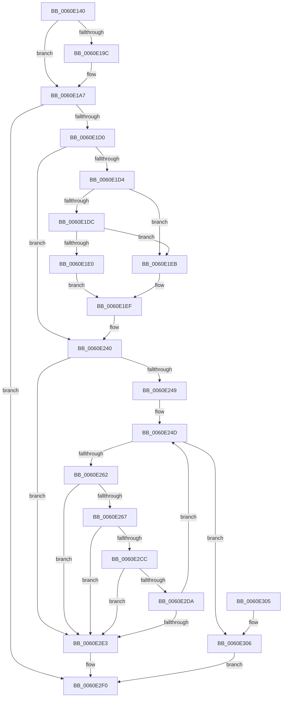

# ST_STORE&lt;SM_TRAITS&gt;::StDmRegionGetKeys

- RVA: `0x0060E140`–`0x0060E30D` (길이 `461` bytes)
- VA: `0x000000014060E140`
- 실행 섹션: `.text`
- PDB 이름 있음: `예`; PDB Function 태그: `아니요`
- unwind 정보 RVA: `0x000D185C`
- 디코드: `129`개 명령, `461/461` bytes 표시
- 미해석 바이트: `0` (있으면 어셈블리에 `.byte`로 보존)

> 이 문서는 커널 이미지의 기계어와 PDB 기호를 분석해 생성했습니다. 4번과 5번은 함수 원형과 자료형을 바이너리 사용 방식에서 추정한 C 해석이며 원본 소스 복구 결과는 아닙니다.

## 1. Dependencies

- 직접 호출 지점: **3**; 고유 호출 대상: **3**
- 직접 호출자로 확인된 함수: **1**
- RIP 상대 이미지 참조: **0**

### Outgoing calls
- `0x0060E1A2` → [B_TREE<unsigned long,ST_STORE<SM_TRAITS>::_ST_REGION_ENTRY,4096,NP_CONTEXT,ST_STORE<SM_TRAITS>::ST_REGION_ENTRY_COMPARATOR>::BTreeSearchResultDeref](../3A/B_TREE_unsigned_long_ST_STORE_SM_TRAITS__ST_REGION_ENTRY_4096_NP_CONTEXT_ST_STORE_SM_TRAITS_ST_REGIO_function_003AD260.md) (function, `0x003AD260`)
- `0x0060E1C0` → [B_TREE<unsigned long,ST_STORE<SM_TRAITS>::_ST_REGION_ENTRY,4096,NP_CONTEXT,ST_STORE<SM_TRAITS>::ST_REGION_ENTRY_COMPARATOR>::BTreeSearchKey](../3A/B_TREE_unsigned_long_ST_STORE_SM_TRAITS__ST_REGION_ENTRY_4096_NP_CONTEXT_ST_STORE_SM_TRAITS_ST_REGIO_function_003ACD20.md) (function, `0x003ACD20`)
- `0x0060E253` → [B_TREE<unsigned long,ST_STORE<SM_TRAITS>::_ST_REGION_ENTRY,4096,NP_CONTEXT,ST_STORE<SM_TRAITS>::ST_REGION_ENTRY_COMPARATOR>::BTreeFindPreviousEntry](../3A/B_TREE_unsigned_long_ST_STORE_SM_TRAITS__ST_REGION_ENTRY_4096_NP_CONTEXT_ST_STORE_SM_TRAITS_ST_REGIO_function_003A9B40.md) (function, `0x003A9B40`)

### Direct callers
- [ST_STORE&lt;SM_TRAITS&gt;::StDmRegionEvict](ST_STORE_SM_TRAITS_StDmRegionEvict_function_0060DF9C.md) at `0x0060E08E`

### Static image references
- 디코드된 RIP-relative 메모리 참조가 없습니다.

## 2. Other-region calls and transfers

- 다른 실행 섹션으로 향하는 call: **0**
- 별도 외부 분기/꼬리 이동을 확인하지 못했습니다.

## 3. Assembly (complete function range)

```asm
0060E140  48 89 5C 24 08                  mov qword ptr [rsp + 8], rbx
0060E145  44 89 44 24 18                  mov dword ptr [rsp + 0x18], r8d
0060E14A  55                              push rbp
0060E14B  56                              push rsi
0060E14C  57                              push rdi
0060E14D  41 54                           push r12
0060E14F  41 55                           push r13
0060E151  41 56                           push r14
0060E153  41 57                           push r15
0060E155  48 83 EC 20                     sub rsp, 0x20
0060E159  4C 8B B4 24 88 00 00 00         mov r14, qword ptr [rsp + 0x88]
0060E161  48 8B F1                        mov rsi, rcx
0060E164  4C 8B AC 24 90 00 00 00         mov r13, qword ptr [rsp + 0x90]
0060E16C  41 8B E8                        mov ebp, r8d
0060E16F  8B 89 2C 03 00 00               mov ecx, dword ptr [rcx + 0x32c]
0060E175  49 8B DE                        mov rbx, r14
0060E178  48 8B 7A 08                     mov rdi, qword ptr [rdx + 8]
0060E17C  D3 E5                           shl ebp, cl
0060E17E  4C 8D 7E 40                     lea r15, [rsi + 0x40]
0060E182  41 8B 45 00                     mov eax, dword ptr [r13]
0060E186  4D 8D 24 86                     lea r12, [r14 + rax*4]
0060E18A  8B 84 24 80 00 00 00            mov eax, dword ptr [rsp + 0x80]
0060E191  FF C8                           dec eax
0060E193  0B E8                           or ebp, eax
0060E195  8B 47 20                        mov eax, dword ptr [rdi + 0x20]
0060E198  A8 01                           test al, 1
0060E19A  75 0B                           jne 0x14060e1a7
0060E19C  48 8B D7                        mov rdx, rdi
0060E19F  49 8B CF                        mov rcx, r15
0060E1A2  E8 B9 F0 D9 FF                  call 0x1403ad260
0060E1A7  83 4F 20 01                     or dword ptr [rdi + 0x20], 1
0060E1AB  4C 8B C7                        mov r8, rdi
0060E1AE  48 8B 86 F8 02 00 00            mov rax, qword ptr [rsi + 0x2f8]
0060E1B5  49 8B CF                        mov rcx, r15
0060E1B8  89 28                           mov dword ptr [rax], ebp
0060E1BA  8B 96 00 03 00 00               mov edx, dword ptr [rsi + 0x300]
0060E1C0  E8 5B EB D9 FF                  call 0x1403acd20
0060E1C5  3D 06 00 00 C0                  cmp eax, 0xc0000006
0060E1CA  0F 84 20 01 00 00               je 0x14060e2f0
0060E1D0  85 C0                           test eax, eax
0060E1D2  75 6C                           jne 0x14060e240
0060E1D4  8B 47 18                        mov eax, dword ptr [rdi + 0x18]
0060E1D7  83 F8 FF                        cmp eax, -1
0060E1DA  74 0F                           je 0x14060e1eb
0060E1DC  85 C0                           test eax, eax
0060E1DE  74 0B                           je 0x14060e1eb
0060E1E0  FF C8                           dec eax
0060E1E2  48 C1 E0 04                     shl rax, 4
0060E1E6  48 03 07                        add rax, qword ptr [rdi]
0060E1E9  EB 04                           jmp 0x14060e1ef
0060E1EB  48 8D 47 08                     lea rax, [rdi + 8]
0060E1EF  8B 8E C8 01 00 00               mov ecx, dword ptr [rsi + 0x1c8]
0060E1F5  49 8D 5E 04                     lea rbx, [r14 + 4]
0060E1F9  48 8B 40 08                     mov rax, qword ptr [rax + 8]
0060E1FD  41 B8 01 00 00 00               mov r8d, 1
0060E203  44 8B 08                        mov r9d, dword ptr [rax]
0060E206  41 8B D1                        mov edx, r9d
0060E209  8B 86 D8 01 00 00               mov eax, dword ptr [rsi + 0x1d8]
0060E20F  D3 EA                           shr edx, cl
0060E211  0F BD CA                        bsr ecx, edx
0060E214  41 D3 E0                        shl r8d, cl
0060E217  4C 33 C2                        xor r8, rdx
0060E21A  4D 03 C0                        add r8, r8
0060E21D  48 8B 94 CE C0 00 00 00         mov rdx, qword ptr [rsi + rcx*8 + 0xc0]
0060E225  8B 8E CC 01 00 00               mov ecx, dword ptr [rsi + 0x1cc]
0060E22B  41 23 C9                        and ecx, r9d
0060E22E  0F AF 8E D0 01 00 00            imul ecx, dword ptr [rsi + 0x1d0]
0060E235  4A 03 0C C2                     add rcx, qword ptr [rdx + r8*8]
0060E239  8B 4C 01 08                     mov ecx, dword ptr [rcx + rax + 8]
0060E23D  41 89 0E                        mov dword ptr [r14], ecx
0060E240  49 3B DC                        cmp rbx, r12
0060E243  0F 83 9A 00 00 00               jae 0x14060e2e3
0060E249  8B 6C 24 70                     mov ebp, dword ptr [rsp + 0x70]
0060E24D  48 8B D7                        mov rdx, rdi
0060E250  49 8B CF                        mov rcx, r15
0060E253  E8 E8 B8 D9 FF                  call 0x1403a9b40
0060E258  48 83 F8 FF                     cmp rax, -1
0060E25C  0F 84 A4 00 00 00               je 0x14060e306
0060E262  48 85 C0                        test rax, rax
0060E265  74 7C                           je 0x14060e2e3
0060E267  44 8B 08                        mov r9d, dword ptr [rax]
0060E26A  41 B8 01 00 00 00               mov r8d, 1
0060E270  8B 8E C8 01 00 00               mov ecx, dword ptr [rsi + 0x1c8]
0060E276  41 8B D1                        mov edx, r9d
0060E279  8B 86 CC 01 00 00               mov eax, dword ptr [rsi + 0x1cc]
0060E27F  83 64 24 70 00                  and dword ptr [rsp + 0x70], 0
0060E284  41 23 C1                        and eax, r9d
0060E287  0F AF 86 D0 01 00 00            imul eax, dword ptr [rsi + 0x1d0]
0060E28E  D3 EA                           shr edx, cl
0060E290  0F BD CA                        bsr ecx, edx
0060E293  41 D3 E0                        shl r8d, cl
0060E296  4C 33 C2                        xor r8, rdx
0060E299  4D 03 C0                        add r8, r8
0060E29C  48 8B 8C CE C0 00 00 00         mov rcx, qword ptr [rsi + rcx*8 + 0xc0]
0060E2A4  4A 8B 14 C1                     mov rdx, qword ptr [rcx + r8*8]
0060E2A8  44 8B 86 28 03 00 00            mov r8d, dword ptr [rsi + 0x328]
0060E2AF  48 03 D0                        add rdx, rax
0060E2B2  8B 86 D8 01 00 00               mov eax, dword ptr [rsi + 0x1d8]
0060E2B8  8B 8E 2C 03 00 00               mov ecx, dword ptr [rsi + 0x32c]
0060E2BE  48 03 D0                        add rdx, rax
0060E2C1  8B 02                           mov eax, dword ptr [rdx]
0060E2C3  44 23 C0                        and r8d, eax
0060E2C6  D3 E8                           shr eax, cl
0060E2C8  3B C5                           cmp eax, ebp
0060E2CA  75 17                           jne 0x14060e2e3
0060E2CC  8B 42 08                        mov eax, dword ptr [rdx + 8]
0060E2CF  89 03                           mov dword ptr [rbx], eax
0060E2D1  48 83 C3 04                     add rbx, 4
0060E2D5  45 85 C0                        test r8d, r8d
0060E2D8  74 09                           je 0x14060e2e3
0060E2DA  49 3B DC                        cmp rbx, r12
0060E2DD  0F 82 6A FF FF FF               jb 0x14060e24d
0060E2E3  49 2B DE                        sub rbx, r14
0060E2E6  48 C1 FB 02                     sar rbx, 2
0060E2EA  41 89 5D 00                     mov dword ptr [r13], ebx
0060E2EE  33 C0                           xor eax, eax
0060E2F0  48 8B 5C 24 60                  mov rbx, qword ptr [rsp + 0x60]
0060E2F5  48 83 C4 20                     add rsp, 0x20
0060E2F9  41 5F                           pop r15
0060E2FB  41 5E                           pop r14
0060E2FD  41 5D                           pop r13
0060E2FF  41 5C                           pop r12
0060E301  5F                              pop rdi
0060E302  5E                              pop rsi
0060E303  5D                              pop rbp
0060E304  C3                              ret
0060E305  CC                              int3
0060E306  B8 06 00 00 C0                  mov eax, 0xc0000006
0060E30B  EB E3                           jmp 0x14060e2f0
```

## 4. C-style interpretation (structured pseudocode)

```c
__int64 __fastcall ST_STORE_SM_TRAITS___StDmRegionGetKeys(__int64 a1, __int64 a2, int a3, __int64 a4, unsigned int a5, __int64 a6, __int64 a7)
{
    __int64 result;
    __int64 v_rbp;
    __int64 v_rbx;
    __int64 v_rsp;
    unsigned int v_stack_p18;
    unsigned __int64 v_stack_p8;

    v_stack_p8 = v_rbx;
    v_stack_p18 = a3;
    v_rsp = (v_rsp) - (32);
    v_rbp = (unsigned int)(((unsigned int)(a3)) << ((unsigned __int8)((unsigned int)(*(unsigned int *)(a1 + 812)))));
    result = (unsigned int)(((unsigned int)(a5)) - 1);
    v_rbp = (unsigned int)((v_rbp) | ((unsigned int)(result)));
    result = (unsigned int)(*(unsigned int *)(*(unsigned __int64 *)(a2 + 8) + 32));
    if ((((unsigned __int8)((unsigned int)(*(unsigned int *)(*(unsigned __int64 *)(a2 + 8) + 32)))) & (1)) == 0) {
        a2 = *(unsigned __int64 *)(a2 + 8);
        a1 = a1 + 64;
        result = B_TREE_unsigned_long_ST_STORE_SM_TRAITS____ST_REGION_ENTRY_4096_NP_CONTEXT_ST_STORE_SM_TRAITS___ST_R(a1, a2, a3, a4);
    }
    *(unsigned int *)(*(unsigned __int64 *)(a1 + 760)) = (unsigned int)(v_rbp);
    result = B_TREE_unsigned_long_ST_STORE_SM_TRAITS____ST_REGION_ENTRY_4096_NP_CONTEXT_ST_STORE_SM_TRAITS___ST_R(a1 + 64, (unsigned int)(*(unsigned int *)(a1 + 768)), *(unsigned __int64 *)(a2 + 8), a4);
    if (((unsigned int)(result)) == 0xC0000006ULL) goto loc_0060E2F0;
    if ((unsigned int)(result) != 0) goto loc_0060E240;
    if (((unsigned int)((unsigned int)(*(unsigned int *)(*(unsigned __int64 *)(a2 + 8) + 24)))) == -1) goto loc_0060E1EB;
    if ((unsigned int)((unsigned int)(*(unsigned int *)(*(unsigned __int64 *)(a2 + 8) + 24))) == 0) goto loc_0060E1EB;
    result = (unsigned int)(((unsigned int)(*(unsigned int *)(*(unsigned __int64 *)(a2 + 8) + 24))) - 1);
    result = (result) << (4);
    result = (result) + (*(unsigned __int64 *)(*(unsigned __int64 *)(a2 + 8)));
    goto loc_0060E1EF;
loc_0060E1EB:
loc_0060E1EF:
    a2 = (unsigned int)(((unsigned int)((unsigned int)((unsigned int)(*(unsigned int *)(*(unsigned __int64 *)(*(unsigned __int64 *)(a2 + 8) + 8 + 8)))))) >> ((unsigned __int8)((unsigned int)(*(unsigned int *)(a1 + 456)))));
    a3 = (unsigned int)((1) << ((unsigned __int8)((unsigned int)(*(unsigned int *)(a1 + 456)))));
    a3 = (a3) ^ (a2);
    a3 = (a3) + (a3);
    a1 = (unsigned int)(((unsigned int)(*(unsigned int *)(a1 + 460))) & ((unsigned int)((unsigned int)(*(unsigned int *)(*(unsigned __int64 *)(*(unsigned __int64 *)(a2 + 8) + 8 + 8))))));
    a1 = (unsigned int)((a1) * (*(unsigned int *)(a1 + 464)));
    a1 = (a1) + (*(unsigned __int64 *)(*(unsigned __int64 *)(a1 + (unsigned int)(*(unsigned int *)(a1 + 456)) * 8 + 192) + a3 * 8));
    *(unsigned int *)(a6) = (unsigned int)((unsigned int)(*(unsigned int *)(a1 + (unsigned int)(*(unsigned int *)(a1 + 472)) * 1 + 8)));
loc_0060E240:
    if ((a6 + 4) >= (a6 + (unsigned int)(*(unsigned int *)(a7)) * 4)) goto loc_0060E2E3;
loc_0060E24D:
    result = B_TREE_unsigned_long_ST_STORE_SM_TRAITS____ST_REGION_ENTRY_4096_NP_CONTEXT_ST_STORE_SM_TRAITS___ST_R(a1 + 64, *(unsigned __int64 *)(a2 + 8), a3, (unsigned int)(*(unsigned int *)(*(unsigned __int64 *)(*(unsigned __int64 *)(a2 + 8) + 8 + 8))));
    if (result == -1) goto loc_0060E306;
    if (result == 0) goto loc_0060E2E3;
    result = (unsigned int)(((unsigned int)(*(unsigned int *)(a1 + 460))) & ((unsigned int)((unsigned int)(*(unsigned int *)(result)))));
    result = (unsigned int)((result) * (*(unsigned int *)(a1 + 464)));
    a2 = (unsigned int)(((unsigned int)((unsigned int)((unsigned int)(*(unsigned int *)(result))))) >> ((unsigned __int8)((unsigned int)(*(unsigned int *)(a1 + 456)))));
    a3 = (unsigned int)((1) << ((unsigned __int8)((unsigned int)(*(unsigned int *)(a1 + 456)))));
    a3 = (a3) ^ (a2);
    a3 = (a3) + (a3);
    a2 = (*(unsigned __int64 *)(*(unsigned __int64 *)(a1 + (unsigned int)(*(unsigned int *)(a1 + 456)) * 8 + 192) + a3 * 8)) + (result);
    a2 = (a2) + ((unsigned int)(*(unsigned int *)(a1 + 472)));
    a3 = (unsigned int)(((unsigned int)(*(unsigned int *)(a1 + 808))) & ((unsigned int)((unsigned int)(*(unsigned int *)(a2)))));
    result = (unsigned int)(((unsigned int)(*(unsigned int *)(a2))) >> ((unsigned __int8)((unsigned int)(*(unsigned int *)(a1 + 812)))));
    if (((unsigned int)(result)) != ((unsigned int)((unsigned int)(v_stack_p18)))) goto loc_0060E2E3;
    *(unsigned int *)(a6 + 4) = (unsigned int)((unsigned int)(*(unsigned int *)(a2 + 8)));
    v_rbx = (a6 + 4) + (4);
    if (a3 == 0) goto loc_0060E2E3;
    if (v_rbx < (a6 + (unsigned int)(*(unsigned int *)(a7)) * 4)) goto loc_0060E24D;
loc_0060E2E3:
    v_rbx = (v_rbx) - (a6);
    v_rbx = (v_rbx) >> (2);
    *(unsigned int *)(a7) = (unsigned int)(v_rbx);
    result = 0;
loc_0060E2F0:
    v_rsp = (v_rsp) + (32);
    return result;
loc_0060E306:
    goto loc_0060E2F0;
}
```

## 5. (Beta) C Style

```c
int64_t ST_STORE_SM_TRAITS___StDmRegionGetKeys(void *Arg1, void *Arg2, int32_t Arg3, int64_t Arg4, uint32_t Arg5, void *Arg6, void *Arg7)
{
    uint8_t *arg1 = (uint8_t *)Arg1;
    uint8_t *arg2 = (uint8_t *)Arg2;
    uint8_t *arg6 = (uint8_t *)Arg6;
    uint8_t *arg7 = (uint8_t *)Arg7;

    int64_t result;
    int64_t local_rbp;
    int64_t local_rbx;
    int64_t local_rsp;
    uint32_t v_stack_p18;
    uint64_t v_stack_p8;

    v_stack_p8 = local_rbx;
    v_stack_p18 = Arg3;
    local_rsp = (local_rsp) - (32);
    local_rbp = (uint32_t)(((uint32_t)(Arg3)) << ((uint8_t)((uint32_t)(*(uint32_t *)(arg1 + 0x32C)))));
    result = (uint32_t)(((uint32_t)(Arg5)) - 1);
    local_rbp = (uint32_t)((local_rbp) | ((uint32_t)(result)));
    result = (uint32_t)(*(uint32_t *)(*(uint64_t *)(arg2 + 0x8) + 0x20));
    if ((((uint8_t)((uint32_t)(*(uint32_t *)(*(uint64_t *)(arg2 + 0x8) + 0x20)))) & (1)) == 0) {
        Arg2 = *(uint64_t *)(arg2 + 0x8);
        Arg1 = Arg1 + 64;
        result = B_TREE_unsigned_long_ST_STORE_SM_TRAITS____ST_REGION_ENTRY_4096_NP_CONTEXT_ST_STORE_SM_TRAITS___ST_R(Arg1, Arg2, Arg3, Arg4);
    }
    *(uint32_t *)(*(uint64_t *)(arg1 + 0x2F8)) = (uint32_t)(local_rbp);
    result = B_TREE_unsigned_long_ST_STORE_SM_TRAITS____ST_REGION_ENTRY_4096_NP_CONTEXT_ST_STORE_SM_TRAITS___ST_R(Arg1 + 64, (uint32_t)(*(uint32_t *)(arg1 + 0x300)), *(uint64_t *)(arg2 + 0x8), Arg4);
    if (((uint32_t)(result)) == 0xC0000006ULL) goto loc_0060E2F0;
    if ((uint32_t)(result) != 0) goto loc_0060E240;
    if (((uint32_t)((uint32_t)(*(uint32_t *)(*(uint64_t *)(arg2 + 0x8) + 0x18)))) == -1) goto loc_0060E1EB;
    if ((uint32_t)((uint32_t)(*(uint32_t *)(*(uint64_t *)(arg2 + 0x8) + 0x18))) == 0) goto loc_0060E1EB;
    result = (uint32_t)(((uint32_t)(*(uint32_t *)(*(uint64_t *)(arg2 + 0x8) + 0x18))) - 1);
    result = (result) << (4);
    result = (result) + (*(uint64_t *)(*(uint64_t *)(arg2 + 0x8)));
    goto loc_0060E1EF;
loc_0060E1EB:
loc_0060E1EF:
    Arg2 = (uint32_t)(((uint32_t)((uint32_t)((uint32_t)(*(uint32_t *)(*(uint64_t *)(*(uint64_t *)(arg2 + 0x8) + 0x8 + 0x8)))))) >> ((uint8_t)((uint32_t)(*(uint32_t *)(arg1 + 0x1C8)))));
    Arg3 = (uint32_t)((1) << ((uint8_t)((uint32_t)(*(uint32_t *)(arg1 + 0x1C8)))));
    Arg3 = (Arg3) ^ (Arg2);
    Arg3 = (Arg3) + (Arg3);
    Arg1 = (uint32_t)(((uint32_t)(*(uint32_t *)(arg1 + 0x1CC))) & ((uint32_t)((uint32_t)(*(uint32_t *)(*(uint64_t *)(*(uint64_t *)(arg2 + 0x8) + 0x8 + 0x8))))));
    Arg1 = (uint32_t)((Arg1) * (*(uint32_t *)(arg1 + 0x1D0)));
    Arg1 = (Arg1) + (*(uint64_t *)(*(uint64_t *)(arg1 + (uint32_t)(*(uint32_t *)(arg1 + 0x1C8)) * 8 + 0xC0) + Arg3 * 8));
    *(uint32_t *)(arg6) = (uint32_t)((uint32_t)(*(uint32_t *)(arg1 + (uint32_t)(*(uint32_t *)(arg1 + 0x1D8)) * 1 + 0x8)));
loc_0060E240:
    if ((Arg6 + 4) >= (Arg6 + (uint32_t)(*(uint32_t *)(arg7)) * 4)) goto loc_0060E2E3;
loc_0060E24D:
    result = B_TREE_unsigned_long_ST_STORE_SM_TRAITS____ST_REGION_ENTRY_4096_NP_CONTEXT_ST_STORE_SM_TRAITS___ST_R(Arg1 + 64, *(uint64_t *)(arg2 + 0x8), Arg3, (uint32_t)(*(uint32_t *)(*(uint64_t *)(*(uint64_t *)(arg2 + 0x8) + 0x8 + 0x8))));
    if (result == -1) goto loc_0060E306;
    if (result == 0) goto loc_0060E2E3;
    result = (uint32_t)(((uint32_t)(*(uint32_t *)(arg1 + 0x1CC))) & ((uint32_t)((uint32_t)(*(uint32_t *)(result)))));
    result = (uint32_t)((result) * (*(uint32_t *)(arg1 + 0x1D0)));
    Arg2 = (uint32_t)(((uint32_t)((uint32_t)((uint32_t)(*(uint32_t *)(result))))) >> ((uint8_t)((uint32_t)(*(uint32_t *)(arg1 + 0x1C8)))));
    Arg3 = (uint32_t)((1) << ((uint8_t)((uint32_t)(*(uint32_t *)(arg1 + 0x1C8)))));
    Arg3 = (Arg3) ^ (Arg2);
    Arg3 = (Arg3) + (Arg3);
    Arg2 = (*(uint64_t *)(*(uint64_t *)(arg1 + (uint32_t)(*(uint32_t *)(arg1 + 0x1C8)) * 8 + 0xC0) + Arg3 * 8)) + (result);
    Arg2 = (Arg2) + ((uint32_t)(*(uint32_t *)(arg1 + 0x1D8)));
    Arg3 = (uint32_t)(((uint32_t)(*(uint32_t *)(arg1 + 0x328))) & ((uint32_t)((uint32_t)(*(uint32_t *)(arg2)))));
    result = (uint32_t)(((uint32_t)(*(uint32_t *)(arg2))) >> ((uint8_t)((uint32_t)(*(uint32_t *)(arg1 + 0x32C)))));
    if (((uint32_t)(result)) != ((uint32_t)((uint32_t)(v_stack_p18)))) goto loc_0060E2E3;
    *(uint32_t *)(arg6 + 0x4) = (uint32_t)((uint32_t)(*(uint32_t *)(arg2 + 0x8)));
    local_rbx = (Arg6 + 4) + (4);
    if (Arg3 == 0) goto loc_0060E2E3;
    if (local_rbx < (Arg6 + (uint32_t)(*(uint32_t *)(arg7)) * 4)) goto loc_0060E24D;
loc_0060E2E3:
    local_rbx = (local_rbx) - (Arg6);
    local_rbx = (local_rbx) >> (2);
    *(uint32_t *)(arg7) = (uint32_t)(local_rbx);
    result = 0;
loc_0060E2F0:
    local_rsp = (local_rsp) + (32);
    return result;
loc_0060E306:
    goto loc_0060E2F0;
}
```

### 관측된 메모리 오프셋

구조체 형식이 확인되지 않은 접근은 인자 기준의 오프셋으로만 기록했습니다.

| 기준 인자 | 오프셋 표현 | 폭 (bit) | 접근 |
|---|---:|---:|---|
| `Arg1` | `+ 0x40` | `64` | `R` |
| `Arg1` | `+ 0xC0 + rcx*8` | `64` | `R` |
| `Arg1` | `+ 0x1C8` | `32` | `R` |
| `Arg1` | `+ 0x1CC` | `32` | `R` |
| `Arg1` | `+ 0x1D0` | `32` | `R` |
| `Arg1` | `+ 0x1D8` | `32` | `R` |
| `Arg1` | `+ 0x2F8` | `64` | `R` |
| `Arg1` | `+ 0x300` | `32` | `R` |
| `Arg1` | `+ 0x328` | `32` | `R` |
| `Arg1` | `+ 0x32C` | `32` | `R` |
| `Arg2` | `+ 0x8` | `64` | `R` |
| `Arg6` | `+ 0x0` | `32` | `W` |
| `Arg6` | `+ 0x0 + rax*4` | `64` | `R` |
| `Arg6` | `+ 0x4` | `64` | `R` |
| `Arg7` | `+ 0x0` | `32` | `R` |
| `Arg7` | `+ 0x0` | `32` | `W` |

## 6. Execution-region graph

[열기: 2D/3D 그래프와 함수 탐색 컨트롤 패널](../../../control-panel.html?section=text&rva=0x0060E140&view=graph)

- 2D 그래프는 위에서 아래로 흐르고, 3D 그래프는 빈 공간을 드래그해 회전합니다. Shift+드래그는 이동, 휠은 확대·축소, 함수 노드 선택은 대상 보고서 이동입니다.

### Static fallback


