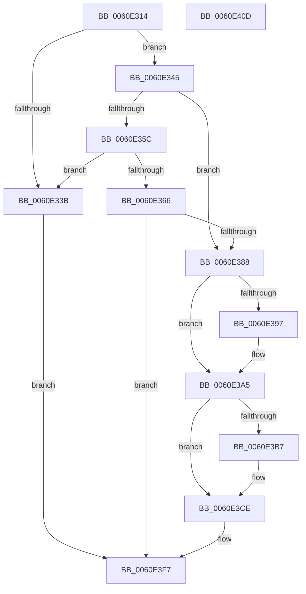

# ST_STORE&lt;SM_TRAITS&gt;::StDmRegionRemove

- RVA: `0x0060E314`–`0x0060E40E` (길이 `250` bytes)
- VA: `0x000000014060E314`
- 실행 섹션: `.text`
- PDB 이름 있음: `예`; PDB Function 태그: `아니요`
- unwind 정보 RVA: `0x0009B270`
- 디코드: `71`개 명령, `250/250` bytes 표시
- 미해석 바이트: `0` (있으면 어셈블리에 `.byte`로 보존)

> 이 문서는 커널 이미지의 기계어와 PDB 기호를 분석해 생성했습니다. 4번과 5번은 함수 원형과 자료형을 바이너리 사용 방식에서 추정한 C 해석이며 원본 소스 복구 결과는 아닙니다.

## 1. Dependencies

- 직접 호출 지점: **6**; 고유 호출 대상: **6**
- 직접 호출자로 확인된 함수: **2**
- RIP 상대 이미지 참조: **0**

### Outgoing calls
- `0x0060E331` → [ST_STORE<SM_TRAITS>::StRegionFindRepurpose](ST_STORE_SM_TRAITS_StRegionFindRepurpose_function_0060E878.md) (function, `0x0060E878`)
- `0x0060E37F` → [ST_STORE<SM_TRAITS>::StDmRegionEvict](ST_STORE_SM_TRAITS_StDmRegionEvict_function_0060DF9C.md) (function, `0x0060DF9C`)
- `0x0060E38D` → [ST_STORE<SM_TRAITS>::StDmIsCurrentRegion](../4D/ST_STORE_SM_TRAITS_StDmIsCurrentRegion_function_004D3684.md) (function, `0x004D3684`)
- `0x0060E3A0` → [ST_STORE<SM_TRAITS>::StDmCurrentRegionSet](../3B/ST_STORE_SM_TRAITS_StDmCurrentRegionSet_function_003B1130.md) (function, `0x003B1130`)
- `0x0060E3AA` → [ST_STORE<SM_TRAITS>::StStagingRegionFind](ST_STORE_SM_TRAITS_StStagingRegionFind_function_0060EA2C.md) (function, `0x0060EA2C`)
- `0x0060E3BA` → [ST_STORE<SM_TRAITS>::StStagingRegionCleanup](../3A/ST_STORE_SM_TRAITS_StStagingRegionCleanup_function_003AFC3C.md) (function, `0x003AFC3C`)

### Direct callers
- [ST_STORE&lt;SM_TRAITS&gt;::StAddRemoveRegions](../4B/ST_STORE_SM_TRAITS_StAddRemoveRegions_function_004B53CC.md) at `0x004B554E`
- [ST_STORE&lt;SM_TRAITS&gt;::StMetaRegionsUpdate](../4C/ST_STORE_SM_TRAITS_StMetaRegionsUpdate_function_004C1DFC.md) at `0x004C1EA8`

### Static image references
- 디코드된 RIP-relative 메모리 참조가 없습니다.

## 2. Other-region calls and transfers

- 다른 실행 섹션으로 향하는 call: **0**
- 별도 외부 분기/꼬리 이동을 확인하지 못했습니다.

## 3. Assembly (complete function range)

```asm
0060E314  48 89 5C 24 08                  mov qword ptr [rsp + 8], rbx
0060E319  48 89 74 24 10                  mov qword ptr [rsp + 0x10], rsi
0060E31E  48 89 7C 24 18                  mov qword ptr [rsp + 0x18], rdi
0060E323  41 56                           push r14
0060E325  48 83 EC 30                     sub rsp, 0x30
0060E329  4C 8B F2                        mov r14, rdx
0060E32C  48 8B D9                        mov rbx, rcx
0060E32F  8B 12                           mov edx, dword ptr [rdx]
0060E331  E8 42 05 00 00                  call 0x14060e878
0060E336  48 85 C0                        test rax, rax
0060E339  75 0A                           jne 0x14060e345
0060E33B  B8 25 02 00 C0                  mov eax, 0xc0000225
0060E340  E9 B2 00 00 00                  jmp 0x14060e3f7
0060E345  48 8B F8                        mov rdi, rax
0060E348  B9 FF 1F 00 00                  mov ecx, 0x1fff
0060E34D  48 2B BB 78 05 00 00            sub rdi, qword ptr [rbx + 0x578]
0060E354  48 D1 FF                        sar rdi, 1
0060E357  66 85 08                        test word ptr [rax], cx
0060E35A  76 2C                           jbe 0x14060e388
0060E35C  8B 83 40 03 00 00               mov eax, dword ptr [rbx + 0x340]
0060E362  A8 02                           test al, 2
0060E364  75 D5                           jne 0x14060e33b
0060E366  8B 83 28 03 00 00               mov eax, dword ptr [rbx + 0x328]
0060E36C  48 8D 93 38 05 00 00            lea rdx, [rbx + 0x538]
0060E373  FF C0                           inc eax
0060E375  44 8B C7                        mov r8d, edi
0060E378  48 8B CB                        mov rcx, rbx
0060E37B  89 44 24 20                     mov dword ptr [rsp + 0x20], eax
0060E37F  E8 18 FC FF FF                  call 0x14060df9c
0060E384  85 C0                           test eax, eax
0060E386  78 6F                           js 0x14060e3f7
0060E388  8B D7                           mov edx, edi
0060E38A  48 8B CB                        mov rcx, rbx
0060E38D  E8 F2 52 EC FF                  call 0x1404d3684
0060E392  83 F8 08                        cmp eax, 8
0060E395  74 0E                           je 0x14060e3a5
0060E397  41 83 C8 FF                     or r8d, 0xffffffff
0060E39B  8B D0                           mov edx, eax
0060E39D  48 8B CB                        mov rcx, rbx
0060E3A0  E8 8B 2D DA FF                  call 0x1403b1130
0060E3A5  8B D7                           mov edx, edi
0060E3A7  48 8B CB                        mov rcx, rbx
0060E3AA  E8 7D 06 00 00                  call 0x14060ea2c
0060E3AF  48 8B F0                        mov rsi, rax
0060E3B2  48 85 C0                        test rax, rax
0060E3B5  74 17                           je 0x14060e3ce
0060E3B7  48 8B D0                        mov rdx, rax
0060E3BA  E8 7D 18 DA FF                  call 0x1403afc3c
0060E3BF  33 C0                           xor eax, eax
0060E3C1  0F 57 C0                        xorps xmm0, xmm0
0060E3C4  0F 11 06                        movups xmmword ptr [rsi], xmm0
0060E3C7  48 89 46 10                     mov qword ptr [rsi + 0x10], rax
0060E3CB  83 0E FF                        or dword ptr [rsi], 0xffffffff
0060E3CE  4C 8B 83 50 03 00 00            mov r8, qword ptr [rbx + 0x350]
0060E3D5  8B C7                           mov eax, edi
0060E3D7  83 E0 07                        and eax, 7
0060E3DA  8B D7                           mov edx, edi
0060E3DC  48 C1 EA 03                     shr rdx, 3
0060E3E0  41 89 3E                        mov dword ptr [r14], edi
0060E3E3  42 0F B6 0C 02                  movzx ecx, byte ptr [rdx + r8]
0060E3E8  0F B3 C1                        btr ecx, eax
0060E3EB  42 88 0C 02                     mov byte ptr [rdx + r8], cl
0060E3EF  FF 8B 58 03 00 00               dec dword ptr [rbx + 0x358]
0060E3F5  33 C0                           xor eax, eax
0060E3F7  48 8B 5C 24 40                  mov rbx, qword ptr [rsp + 0x40]
0060E3FC  48 8B 74 24 48                  mov rsi, qword ptr [rsp + 0x48]
0060E401  48 8B 7C 24 50                  mov rdi, qword ptr [rsp + 0x50]
0060E406  48 83 C4 30                     add rsp, 0x30
0060E40A  41 5E                           pop r14
0060E40C  C3                              ret
0060E40D  CC                              int3
```

## 4. C-style interpretation (structured pseudocode)

```c
__int64 __fastcall ST_STORE_SM_TRAITS___StDmRegionRemove(__int64 a1, __int64 a2)
{
    __int64 result;
    __int64 v_rdi;
    __int64 v_rsp;
    unsigned int v_stack_m18;
    unsigned __int64 v_stack_p10;
    unsigned __int64 v_stack_p18;
    unsigned __int64 v_stack_p8;

    v_stack_p8 = v_rbx;
    v_stack_p10 = v_rsi;
    v_stack_p18 = v_rdi;
    v_rsp = (v_rsp) - (48);
    result = ST_STORE_SM_TRAITS___StRegionFindRepurpose(a1, (unsigned int)(*(unsigned int *)(a2)), a3, a4);
    if (result != 0) goto loc_0060E345;
loc_0060E33B:
    goto loc_0060E3F7;
loc_0060E345:
    v_rdi = ((unsigned int)(0xC0000225ULL)) - (*(unsigned __int64 *)(a1 + 1400));
    v_rdi = (v_rdi) >> (1);
    if (condition_is_below_or_equal) goto loc_0060E388;
    if ((((unsigned __int8)((unsigned int)(*(unsigned int *)(a1 + 832)))) & (2)) != 0) goto loc_0060E33B;
    result = (unsigned int)(((unsigned int)(*(unsigned int *)(a1 + 808))) + 1);
    v_stack_m18 = (unsigned int)(result);
    result = ST_STORE_SM_TRAITS___StDmRegionEvict(a1, a1 + 1336, (unsigned int)((unsigned int)(v_rdi)), a4);
    if (sign_flag) goto loc_0060E3F7;
loc_0060E388:
    result = ST_STORE_SM_TRAITS___StDmIsCurrentRegion(a1, (unsigned int)((unsigned int)(v_rdi)), (unsigned int)((unsigned int)(v_rdi)), a4);
    if (((unsigned int)(result)) != 8) {
        a3 = (unsigned int)(((unsigned int)((unsigned int)(v_rdi))) | (0xFFFFFFFFULL));
        a2 = (unsigned int)(result);
        a1 = a1;
        result = ST_STORE_SM_TRAITS___StDmCurrentRegionSet(a1, a2, a3, a4);
    }
    result = ST_STORE_SM_TRAITS___StStagingRegionFind(a1, (unsigned int)((unsigned int)(v_rdi)), a3, a4);
    if (result != 0) {
        a2 = result;
        result = ST_STORE_SM_TRAITS___StStagingRegionCleanup(a1, a2, a3, a4);
        result = 0;
        *(unsigned __int64 *)(result) = v_xmm0;
        *(unsigned __int64 *)(result + 16) = 0;
    }
    result = (unsigned int)(((unsigned int)((unsigned int)(v_rdi))) & (7));
    a2 = ((unsigned int)((unsigned int)(v_rdi))) >> (3);
    *(unsigned int *)(a2) = (unsigned int)(v_rdi);
    *(unsigned __int8 *)(a2 + *(unsigned __int64 *)(a1 + 848) * 1) = (unsigned __int8)(*(unsigned __int8 *)(a2 + *(unsigned __int64 *)(a1 + 848) * 1));
    result = 0;
loc_0060E3F7:
    v_rsp = (v_rsp) + (48);
    return result;
}
```

## 5. (Beta) C Style

```c
int64_t ST_STORE_SM_TRAITS___StDmRegionRemove(void *Arg1, void *Arg2)
{
    uint8_t *arg1 = (uint8_t *)Arg1;
    uint8_t *arg2 = (uint8_t *)Arg2;

    int64_t result;
    int64_t local_rdi;
    int64_t local_rsp;
    uint32_t v_stack_m18;
    uint64_t v_stack_p10;
    uint64_t v_stack_p18;
    uint64_t v_stack_p8;

    v_stack_p8 = local_rbx;
    v_stack_p10 = local_rsi;
    v_stack_p18 = local_rdi;
    local_rsp = (local_rsp) - (48);
    result = ST_STORE_SM_TRAITS___StRegionFindRepurpose(Arg1, (uint32_t)(*(uint32_t *)(arg2)), a3, a4);
    if (result != 0) goto loc_0060E345;
loc_0060E33B:
    goto loc_0060E3F7;
loc_0060E345:
    local_rdi = ((uint32_t)(0xC0000225ULL)) - (*(uint64_t *)(arg1 + 0x578));
    local_rdi = (local_rdi) >> (1);
    if (condition_is_below_or_equal) goto loc_0060E388;
    if ((((uint8_t)((uint32_t)(*(uint32_t *)(arg1 + 0x340)))) & (2)) != 0) goto loc_0060E33B;
    result = (uint32_t)(((uint32_t)(*(uint32_t *)(arg1 + 0x328))) + 1);
    v_stack_m18 = (uint32_t)(result);
    result = ST_STORE_SM_TRAITS___StDmRegionEvict(Arg1, Arg1 + 1336, (uint32_t)((uint32_t)(local_rdi)), a4);
    if (sign_flag) goto loc_0060E3F7;
loc_0060E388:
    result = ST_STORE_SM_TRAITS___StDmIsCurrentRegion(Arg1, (uint32_t)((uint32_t)(local_rdi)), (uint32_t)((uint32_t)(local_rdi)), a4);
    if (((uint32_t)(result)) != 8) {
        a3 = (uint32_t)(((uint32_t)((uint32_t)(local_rdi))) | (0xFFFFFFFFULL));
        Arg2 = (uint32_t)(result);
        Arg1 = Arg1;
        result = ST_STORE_SM_TRAITS___StDmCurrentRegionSet(Arg1, Arg2, a3, a4);
    }
    result = ST_STORE_SM_TRAITS___StStagingRegionFind(Arg1, (uint32_t)((uint32_t)(local_rdi)), a3, a4);
    if (result != 0) {
        Arg2 = result;
        result = ST_STORE_SM_TRAITS___StStagingRegionCleanup(Arg1, Arg2, a3, a4);
        result = 0;
        *(uint64_t *)(result) = v_xmm0;
        *(uint64_t *)(result + 0x10) = 0;
    }
    result = (uint32_t)(((uint32_t)((uint32_t)(local_rdi))) & (7));
    Arg2 = ((uint32_t)((uint32_t)(local_rdi))) >> (3);
    *(uint32_t *)(arg2) = (uint32_t)(local_rdi);
    *(uint8_t *)(arg2 + *(uint64_t *)(arg1 + 0x350) * 1) = (uint8_t)(*(uint8_t *)(arg2 + *(uint64_t *)(arg1 + 0x350) * 1));
    result = 0;
loc_0060E3F7:
    local_rsp = (local_rsp) + (48);
    return result;
}
```

### 관측된 메모리 오프셋

구조체 형식이 확인되지 않은 접근은 인자 기준의 오프셋으로만 기록했습니다.

| 기준 인자 | 오프셋 표현 | 폭 (bit) | 접근 |
|---|---:|---:|---|
| `Arg1` | `+ 0x328` | `32` | `R` |
| `Arg1` | `+ 0x340` | `32` | `R` |
| `Arg1` | `+ 0x350` | `64` | `R` |
| `Arg1` | `+ 0x358` | `32` | `R/W` |
| `Arg1` | `+ 0x538` | `64` | `R` |
| `Arg1` | `+ 0x578` | `64` | `R` |
| `Arg2` | `+ 0x0` | `32` | `R` |
| `Arg2` | `+ 0x0` | `32` | `W` |

## 6. Execution-region graph

[열기: 2D/3D 그래프와 함수 탐색 컨트롤 패널](../../../control-panel.html?section=text&rva=0x0060E314&view=graph)

- 2D 그래프는 위에서 아래로 흐르고, 3D 그래프는 빈 공간을 드래그해 회전합니다. Shift+드래그는 이동, 휠은 확대·축소, 함수 노드 선택은 대상 보고서 이동입니다.

### Static fallback


