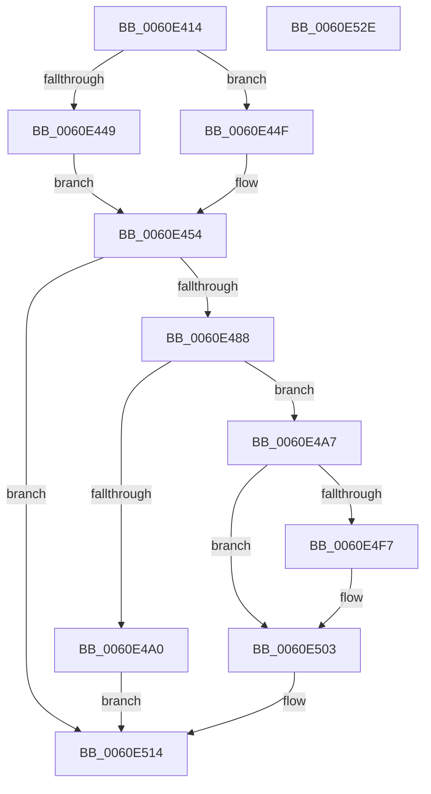

# ST_STORE&lt;SM_TRAITS&gt;::StDmSinglePageRetrieveSync

- RVA: `0x0060E414`–`0x0060E52F` (길이 `283` bytes)
- VA: `0x000000014060E414`
- 실행 섹션: `.text`
- PDB 이름 있음: `예`; PDB Function 태그: `아니요`
- unwind 정보 RVA: `0x00083BEC`
- 디코드: `83`개 명령, `283/283` bytes 표시
- 미해석 바이트: `0` (있으면 어셈블리에 `.byte`로 보존)

> 이 문서는 커널 이미지의 기계어와 PDB 기호를 분석해 생성했습니다. 4번과 5번은 함수 원형과 자료형을 바이너리 사용 방식에서 추정한 C 해석이며 원본 소스 복구 결과는 아닙니다.

## 1. Dependencies

- 직접 호출 지점: **5**; 고유 호출 대상: **5**
- 직접 호출자로 확인된 함수: **1**
- RIP 상대 이미지 참조: **0**

### Outgoing calls
- `0x0060E47A` → [ST_STORE<SM_TRAITS>::StDmpSinglePageRetrieve](../42/ST_STORE_SM_TRAITS_StDmpSinglePageRetrieve_function_00420170.md) (function, `0x00420170`)
- `0x0060E493` → [ST_STORE<SM_TRAITS>::StDeviceIoBuild](ST_STORE_SM_TRAITS_StDeviceIoBuild_function_0060CDEC.md) (function, `0x0060CDEC`)
- `0x0060E4EE` → [ST_STORE<SM_TRAITS>::StDeviceIoIssue](ST_STORE_SM_TRAITS_StDeviceIoIssue_function_0060CFD0.md) (function, `0x0060CFD0`)
- `0x0060E4FE` → [SmWaitForSyncIo](../61/SmWaitForSyncIo_function_00611478.md) (function, `0x00611478`)
- `0x0060E509` → [ST_STORE<SM_TRAITS>::StDmDeviceIoCompletion](../4B/ST_STORE_SM_TRAITS_StDmDeviceIoCompletion_function_004BBB70.md) (function, `0x004BBB70`)

### Direct callers
- [ST_STORE&lt;SM_TRAITS&gt;::StNpLeafPageIn](ST_STORE_SM_TRAITS_StNpLeafPageIn_function_0060E610.md) at `0x0060E645`

### Static image references
- 디코드된 RIP-relative 메모리 참조가 없습니다.

## 2. Other-region calls and transfers

- 다른 실행 섹션으로 향하는 call: **0**
- 별도 외부 분기/꼬리 이동을 확인하지 못했습니다.

## 3. Assembly (complete function range)

```asm
0060E414  48 8B C4                        mov rax, rsp
0060E417  48 89 58 08                     mov qword ptr [rax + 8], rbx
0060E41B  48 89 70 10                     mov qword ptr [rax + 0x10], rsi
0060E41F  48 89 78 18                     mov qword ptr [rax + 0x18], rdi
0060E423  4C 89 70 20                     mov qword ptr [rax + 0x20], r14
0060E427  55                              push rbp
0060E428  48 8B EC                        mov rbp, rsp
0060E42B  48 83 EC 60                     sub rsp, 0x60
0060E42F  45 33 F6                        xor r14d, r14d
0060E432  4C 89 45 D8                     mov qword ptr [rbp - 0x28], r8
0060E436  41 8B F1                        mov esi, r9d
0060E439  4C 89 75 D0                     mov qword ptr [rbp - 0x30], r14
0060E43D  44 89 75 E4                     mov dword ptr [rbp - 0x1c], r14d
0060E441  48 8B D9                        mov rbx, rcx
0060E444  83 E6 02                        and esi, 2
0060E447  74 06                           je 0x14060e44f
0060E449  48 89 55 E0                     mov qword ptr [rbp - 0x20], rdx
0060E44D  EB 05                           jmp 0x14060e454
0060E44F  8B 02                           mov eax, dword ptr [rdx]
0060E451  89 45 E0                        mov dword ptr [rbp - 0x20], eax
0060E454  33 C0                           xor eax, eax
0060E456  45 8B C1                        mov r8d, r9d
0060E459  48 89 45 F8                     mov qword ptr [rbp - 8], rax
0060E45D  48 8D 91 90 03 00 00            lea rdx, [rcx + 0x390]
0060E464  48 8D 45 D0                     lea rax, [rbp - 0x30]
0060E468  0F 57 C0                        xorps xmm0, xmm0
0060E46B  4C 8D 4D E8                     lea r9, [rbp - 0x18]
0060E46F  48 89 81 30 05 00 00            mov qword ptr [rcx + 0x530], rax
0060E476  0F 11 45 E8                     movups xmmword ptr [rbp - 0x18], xmm0
0060E47A  E8 F1 1C E1 FF                  call 0x140420170
0060E47F  83 F8 01                        cmp eax, 1
0060E482  0F 8C 8C 00 00 00               jl 0x14060e514
0060E488  4C 8B 4D D8                     mov r9, qword ptr [rbp - 0x28]
0060E48C  48 8D 55 E8                     lea rdx, [rbp - 0x18]
0060E490  48 8B CB                        mov rcx, rbx
0060E493  E8 54 E9 FF FF                  call 0x14060cdec
0060E498  48 8B F8                        mov rdi, rax
0060E49B  48 85 C0                        test rax, rax
0060E49E  75 07                           jne 0x14060e4a7
0060E4A0  B8 9A 00 00 C0                  mov eax, 0xc000009a
0060E4A5  EB 6D                           jmp 0x14060e514
0060E4A7  8B 40 1C                        mov eax, dword ptr [rax + 0x1c]
0060E4AA  48 8D 55 C0                     lea rdx, [rbp - 0x40]
0060E4AE  F7 DE                           neg esi
0060E4B0  1B C9                           sbb ecx, ecx
0060E4B2  83 E0 EF                        and eax, 0xffffffef
0060E4B5  83 E1 10                        and ecx, 0x10
0060E4B8  0B C8                           or ecx, eax
0060E4BA  48 8D 45 C0                     lea rax, [rbp - 0x40]
0060E4BE  83 C9 0C                        or ecx, 0xc
0060E4C1  89 4F 1C                        mov dword ptr [rdi + 0x1c], ecx
0060E4C4  48 89 45 C8                     mov qword ptr [rbp - 0x38], rax
0060E4C8  4C 89 75 C0                     mov qword ptr [rbp - 0x40], r14
0060E4CC  8B 07                           mov eax, dword ptr [rdi]
0060E4CE  83 E0 07                        and eax, 7
0060E4D1  48 83 C8 08                     or rax, 8
0060E4D5  48 89 07                        mov qword ptr [rdi], rax
0060E4D8  48 8B 4D C8                     mov rcx, qword ptr [rbp - 0x38]
0060E4DC  8B 01                           mov eax, dword ptr [rcx]
0060E4DE  83 E0 07                        and eax, 7
0060E4E1  48 0B C7                        or rax, rdi
0060E4E4  48 89 01                        mov qword ptr [rcx], rax
0060E4E7  48 8B CB                        mov rcx, rbx
0060E4EA  48 89 7D C8                     mov qword ptr [rbp - 0x38], rdi
0060E4EE  E8 DD EA FF FF                  call 0x14060cfd0
0060E4F3  85 C0                           test eax, eax
0060E4F5  78 0C                           js 0x14060e503
0060E4F7  48 8B 8B 20 03 00 00            mov rcx, qword ptr [rbx + 0x320]
0060E4FE  E8 75 2F 00 00                  call 0x140611478
0060E503  48 8B D7                        mov rdx, rdi
0060E506  48 8B CB                        mov rcx, rbx
0060E509  E8 62 D6 EA FF                  call 0x1404bbb70
0060E50E  85 C0                           test eax, eax
0060E510  41 0F 49 C6                     cmovns eax, r14d
0060E514  4C 8D 5C 24 60                  lea r11, [rsp + 0x60]
0060E519  49 8B 5B 10                     mov rbx, qword ptr [r11 + 0x10]
0060E51D  49 8B 73 18                     mov rsi, qword ptr [r11 + 0x18]
0060E521  49 8B 7B 20                     mov rdi, qword ptr [r11 + 0x20]
0060E525  4D 8B 73 28                     mov r14, qword ptr [r11 + 0x28]
0060E529  49 8B E3                        mov rsp, r11
0060E52C  5D                              pop rbp
0060E52D  C3                              ret
0060E52E  CC                              int3
```

## 4. C-style interpretation (structured pseudocode)

```c
__int64 __fastcall ST_STORE_SM_TRAITS___StDmSinglePageRetrieveSync(__int64 a1, __int64 a2, __int64 a3, int a4)
{
    __int64 result;
    __int64 v_r14;
    __int64 v_rsi;
    __int64 v_rsp;
    unsigned __int64 v_stack_m10;
    unsigned __int64 v_stack_m20;
    unsigned int v_stack_m24;
    unsigned __int64 v_stack_m28;
    unsigned __int64 v_stack_m30;
    unsigned __int64 v_stack_m38;
    unsigned __int64 v_stack_m40;
    unsigned __int64 v_stack_m48;
    unsigned __int64 v_stack_m8;

    *(unsigned __int64 *)(v_rsp + 8) = v_rbx;
    *(unsigned __int64 *)(v_rsp + 16) = v_rsi;
    *(unsigned __int64 *)(v_rsp + 24) = v_rdi;
    *(unsigned __int64 *)(v_rsp + 32) = v_r14;
    v_rsp = (v_rsp) - (96);
    v_r14 = 0;
    v_stack_m30 = a3;
    v_stack_m38 = 0;
    v_stack_m24 = 0;
    v_rsi = (unsigned int)(((unsigned int)(a4)) & (2));
    if (condition_is_equal) goto loc_0060E44F;
    v_stack_m28 = a2;
    goto loc_0060E454;
loc_0060E44F:
    v_stack_m28 = (unsigned int)((unsigned int)(*(unsigned int *)(a2)));
loc_0060E454:
    result = 0;
    v_stack_m10 = 0;
    *(unsigned __int64 *)(a1 + 1328) = v_stack_m38;
    v_stack_m20 = v_xmm0;
    result = ST_STORE_SM_TRAITS___StDmpSinglePageRetrieve(a1, a1 + 912, (unsigned int)(a4), v_stack_m20);
    if (((unsigned int)(result)) < 1) goto loc_0060E514;
    result = ST_STORE_SM_TRAITS___StDeviceIoBuild(a1, v_stack_m20, (unsigned int)(a4), v_stack_m30);
    if (result != 0) goto loc_0060E4A7;
    goto loc_0060E514;
loc_0060E4A7:
    v_rsi = (unsigned int)(-(v_rsi));
    result = (unsigned int)(((unsigned int)(*(unsigned int *)((unsigned int)(0xC000009AULL) + 28))) & (0xFFFFFFEFULL));
    a1 = (unsigned int)((a1) & (16));
    a1 = (unsigned int)((a1) | ((unsigned int)(result)));
    a1 = (unsigned int)((a1) | (12));
    *(unsigned int *)(result + 28) = (unsigned int)(a1);
    v_stack_m40 = v_stack_m48;
    v_stack_m48 = 0;
    result = (unsigned int)(((unsigned int)(*(unsigned int *)(result))) & (7));
    result = (result) | (8);
    *(unsigned __int64 *)(result) = result;
    result = (unsigned int)(((unsigned int)(*(unsigned int *)(v_stack_m40))) & (7));
    result = (result) | (result);
    *(unsigned __int64 *)(v_stack_m40) = result;
    v_stack_m40 = result;
    result = ST_STORE_SM_TRAITS___StDeviceIoIssue(a1, v_stack_m48, (unsigned int)(a4), v_stack_m30);
    if (!(sign_flag)) {
        a1 = *(unsigned __int64 *)(a1 + 800);
        result = SmWaitForSyncIo(a1, v_stack_m48, (unsigned int)(a4), v_stack_m30);
    }
    result = ST_STORE_SM_TRAITS___StDmDeviceIoCompletion(a1, result, (unsigned int)(a4), v_stack_m30);
    if (!sign_flag) { result = 0; }
loc_0060E514:
    return result;
}
```

## 5. (Beta) C Style

```c
int64_t ST_STORE_SM_TRAITS___StDmSinglePageRetrieveSync(void *Arg1, void *Arg2, int64_t Arg3, int32_t Arg4)
{
    uint8_t *arg1 = (uint8_t *)Arg1;
    uint8_t *arg2 = (uint8_t *)Arg2;

    int64_t result;
    int64_t local_r14;
    int64_t local_rsi;
    int64_t local_rsp;
    uint64_t v_stack_m10;
    uint64_t v_stack_m20;
    uint32_t v_stack_m24;
    uint64_t v_stack_m28;
    uint64_t v_stack_m30;
    uint64_t v_stack_m38;
    uint64_t v_stack_m40;
    uint64_t v_stack_m48;
    uint64_t v_stack_m8;

    *(uint64_t *)(local_rsp + 0x8) = local_rbx;
    *(uint64_t *)(local_rsp + 0x10) = local_rsi;
    *(uint64_t *)(local_rsp + 0x18) = local_rdi;
    *(uint64_t *)(local_rsp + 0x20) = local_r14;
    local_rsp = (local_rsp) - (96);
    local_r14 = 0;
    v_stack_m30 = Arg3;
    v_stack_m38 = 0;
    v_stack_m24 = 0;
    local_rsi = (uint32_t)(((uint32_t)(Arg4)) & (2));
    if (condition_is_equal) goto loc_0060E44F;
    v_stack_m28 = Arg2;
    goto loc_0060E454;
loc_0060E44F:
    v_stack_m28 = (uint32_t)((uint32_t)(*(uint32_t *)(arg2)));
loc_0060E454:
    result = 0;
    v_stack_m10 = 0;
    *(uint64_t *)(arg1 + 0x530) = v_stack_m38;
    v_stack_m20 = v_xmm0;
    result = ST_STORE_SM_TRAITS___StDmpSinglePageRetrieve(Arg1, Arg1 + 912, (uint32_t)(Arg4), v_stack_m20);
    if (((uint32_t)(result)) < 1) goto loc_0060E514;
    result = ST_STORE_SM_TRAITS___StDeviceIoBuild(Arg1, v_stack_m20, (uint32_t)(Arg4), v_stack_m30);
    if (result != 0) goto loc_0060E4A7;
    goto loc_0060E514;
loc_0060E4A7:
    local_rsi = (uint32_t)(-(local_rsi));
    result = (uint32_t)(((uint32_t)(*(uint32_t *)((uint32_t)(0xC000009AULL) + 0x1C))) & (0xFFFFFFEFULL));
    Arg1 = (uint32_t)((Arg1) & (16));
    Arg1 = (uint32_t)((Arg1) | ((uint32_t)(result)));
    Arg1 = (uint32_t)((Arg1) | (12));
    *(uint32_t *)(result + 0x1C) = (uint32_t)(Arg1);
    v_stack_m40 = v_stack_m48;
    v_stack_m48 = 0;
    result = (uint32_t)(((uint32_t)(*(uint32_t *)(result))) & (7));
    result = (result) | (8);
    *(uint64_t *)(result) = result;
    result = (uint32_t)(((uint32_t)(*(uint32_t *)(v_stack_m40))) & (7));
    result = (result) | (result);
    *(uint64_t *)(v_stack_m40) = result;
    v_stack_m40 = result;
    result = ST_STORE_SM_TRAITS___StDeviceIoIssue(Arg1, v_stack_m48, (uint32_t)(Arg4), v_stack_m30);
    if (!(sign_flag)) {
        Arg1 = *(uint64_t *)(arg1 + 0x320);
        result = SmWaitForSyncIo(Arg1, v_stack_m48, (uint32_t)(Arg4), v_stack_m30);
    }
    result = ST_STORE_SM_TRAITS___StDmDeviceIoCompletion(Arg1, result, (uint32_t)(Arg4), v_stack_m30);
    if (!sign_flag) { result = 0; }
loc_0060E514:
    return result;
}
```

### 관측된 메모리 오프셋

구조체 형식이 확인되지 않은 접근은 인자 기준의 오프셋으로만 기록했습니다.

| 기준 인자 | 오프셋 표현 | 폭 (bit) | 접근 |
|---|---:|---:|---|
| `Arg1` | `+ 0x320` | `64` | `R` |
| `Arg1` | `+ 0x390` | `64` | `R` |
| `Arg1` | `+ 0x530` | `64` | `W` |
| `Arg2` | `+ 0x0` | `32` | `R` |

## 6. Execution-region graph

[열기: 2D/3D 그래프와 함수 탐색 컨트롤 패널](../../../control-panel.html?section=text&rva=0x0060E414&view=graph)

- 2D 그래프는 위에서 아래로 흐르고, 3D 그래프는 빈 공간을 드래그해 회전합니다. Shift+드래그는 이동, 휠은 확대·축소, 함수 노드 선택은 대상 보고서 이동입니다.

### Static fallback


