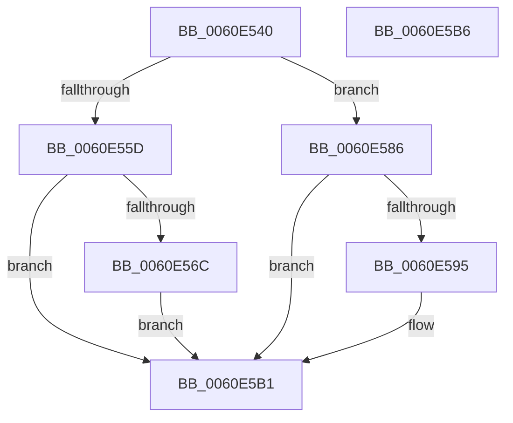

# ST_STORE&lt;SM_TRAITS&gt;::StNpEnumBTreeNodes

- RVA: `0x0060E540`–`0x0060E5B7` (길이 `119` bytes)
- VA: `0x000000014060E540`
- 실행 섹션: `.text`
- PDB 이름 있음: `예`; PDB Function 태그: `아니요`
- unwind 정보 RVA: `0x00097934`
- 디코드: `33`개 명령, `119/119` bytes 표시
- 미해석 바이트: `0` (있으면 어셈블리에 `.byte`로 보존)

> 이 문서는 커널 이미지의 기계어와 PDB 기호를 분석해 생성했습니다. 4번과 5번은 함수 원형과 자료형을 바이너리 사용 방식에서 추정한 C 해석이며 원본 소스 복구 결과는 아닙니다.

## 1. Dependencies

- 직접 호출 지점: **2**; 고유 호출 대상: **1**
- 직접 호출자로 확인된 함수: **0**
- RIP 상대 이미지 참조: **0**

### Outgoing calls
- `0x0060E57F` → [B_TREE<_SM_PAGE_KEY,ST_STORE<SM_TRAITS>::_ST_PAGE_ENTRY,4096,NP_CONTEXT,B_TREE_KEY_COMPARATOR<_SM_PAGE_KEY> >::BTreeWalkPostOrderInternal](B_TREE__SM_PAGE_KEY_ST_STORE_SM_TRAITS__ST_PAGE_ENTRY_4096_NP_CONTEXT_B_TREE_KEY_COMPARATOR__SM_PAGE_function_0060BD34.md) (function, `0x0060BD34`)
- `0x0060E5AC` → [B_TREE<_SM_PAGE_KEY,ST_STORE<SM_TRAITS>::_ST_PAGE_ENTRY,4096,NP_CONTEXT,B_TREE_KEY_COMPARATOR<_SM_PAGE_KEY> >::BTreeWalkPostOrderInternal](B_TREE__SM_PAGE_KEY_ST_STORE_SM_TRAITS__ST_PAGE_ENTRY_4096_NP_CONTEXT_B_TREE_KEY_COMPARATOR__SM_PAGE_function_0060BD34.md) (function, `0x0060BD34`)

### Direct callers
- 이 함수 시작 RVA로 연결되는 직접 call은 확인되지 않았습니다. 간접 호출은 완전히 역산할 수 없습니다.

### Static image references
- 디코드된 RIP-relative 메모리 참조가 없습니다.

## 2. Other-region calls and transfers

- 다른 실행 섹션으로 향하는 call: **0**
- 별도 외부 분기/꼬리 이동을 확인하지 못했습니다.

## 3. Assembly (complete function range)

```asm
0060E540  4C 8B DC                        mov r11, rsp
0060E543  48 83 EC 38                     sub rsp, 0x38
0060E547  4C 8B 09                        mov r9, qword ptr [rcx]
0060E54A  33 C0                           xor eax, eax
0060E54C  4C 8B D2                        mov r10, rdx
0060E54F  49 89 43 08                     mov qword ptr [r11 + 8], rax
0060E553  49 89 43 20                     mov qword ptr [r11 + 0x20], rax
0060E557  41 39 41 60                     cmp dword ptr [r9 + 0x60], eax
0060E55B  75 29                           jne 0x14060e586
0060E55D  49 8D 89 28 F9 FF FF            lea rcx, [r9 - 0x6d8]
0060E564  48 8B 11                        mov rdx, qword ptr [rcx]
0060E567  48 85 D2                        test rdx, rdx
0060E56A  74 45                           je 0x14060e5b1
0060E56C  49 8D 43 20                     lea rax, [r11 + 0x20]
0060E570  4D 8B CA                        mov r9, r10
0060E573  49 89 43 F0                     mov qword ptr [r11 - 0x10], rax
0060E577  4D 89 43 E8                     mov qword ptr [r11 - 0x18], r8
0060E57B  4D 8D 43 08                     lea r8, [r11 + 8]
0060E57F  E8 B0 D7 FF FF                  call 0x14060bd34
0060E584  EB 2B                           jmp 0x14060e5b1
0060E586  49 8D 89 E0 F8 FF FF            lea rcx, [r9 - 0x720]
0060E58D  48 8B 11                        mov rdx, qword ptr [rcx]
0060E590  48 85 D2                        test rdx, rdx
0060E593  74 1C                           je 0x14060e5b1
0060E595  48 8D 44 24 58                  lea rax, [rsp + 0x58]
0060E59A  4D 8B CA                        mov r9, r10
0060E59D  48 89 44 24 28                  mov qword ptr [rsp + 0x28], rax
0060E5A2  4C 89 44 24 20                  mov qword ptr [rsp + 0x20], r8
0060E5A7  4C 8D 44 24 40                  lea r8, [rsp + 0x40]
0060E5AC  E8 83 D7 FF FF                  call 0x14060bd34
0060E5B1  48 83 C4 38                     add rsp, 0x38
0060E5B5  C3                              ret
0060E5B6  CC                              int3
```

## 4. C-style interpretation (structured pseudocode)

```c
__int64 __fastcall ST_STORE_SM_TRAITS___StNpEnumBTreeNodes(__int64 a1, __int64 a2, __int64 a3)
{
    __int64 result;
    __int64 v_rsp;
    unsigned __int64 v_stack_m10;
    unsigned __int64 v_stack_m18;
    unsigned __int64 v_stack_p20;
    unsigned __int64 v_stack_p8;

    v_rsp = (v_rsp) - (56);
    result = 0;
    *(unsigned __int64 *)(v_rsp + 8) = 0;
    *(unsigned __int64 *)(v_rsp + 32) = 0;
    if ((*(unsigned int *)(*(unsigned __int64 *)(a1) + 96)) != 0) goto loc_0060E586;
    if (*(unsigned __int64 *)(*(unsigned __int64 *)(a1) - 1752) == 0) goto loc_0060E5B1;
    *(unsigned __int64 *)(v_rsp - 16) = v_rsp + 32;
    *(unsigned __int64 *)(v_rsp - 24) = a3;
    result = B_TREE__SM_PAGE_KEY_ST_STORE_SM_TRAITS____ST_PAGE_ENTRY_4096_NP_CONTEXT_B_TREE_KEY_COMPARATOR__SM_PA(*(unsigned __int64 *)(a1) - 1752, *(unsigned __int64 *)(*(unsigned __int64 *)(a1) - 1752), v_rsp + 8, a2);
    goto loc_0060E5B1;
loc_0060E586:
    if (*(unsigned __int64 *)(a2 - 1824) != 0) {
        result = v_stack_p20;
        a4 = a2;
        v_stack_m10 = result;
        v_stack_m18 = v_rsp + 8;
        a3 = v_stack_p8;
        result = B_TREE__SM_PAGE_KEY_ST_STORE_SM_TRAITS____ST_PAGE_ENTRY_4096_NP_CONTEXT_B_TREE_KEY_COMPARATOR__SM_PA(a2 - 1824, *(unsigned __int64 *)(a2 - 1824), a3, a4);
    }
    v_rsp = (v_rsp) + (56);
    return result;
}
```

## 5. (Beta) C Style

```c
int64_t ST_STORE_SM_TRAITS___StNpEnumBTreeNodes(void *Arg1, int64_t Arg2, int64_t Arg3)
{
    uint8_t *arg1 = (uint8_t *)Arg1;

    int64_t result;
    int64_t local_rsp;
    uint64_t v_stack_m10;
    uint64_t v_stack_m18;
    uint64_t v_stack_p20;
    uint64_t v_stack_p8;

    local_rsp = (local_rsp) - (56);
    result = 0;
    *(uint64_t *)(local_rsp + 0x8) = 0;
    *(uint64_t *)(local_rsp + 0x20) = 0;
    if ((*(uint32_t *)(*(uint64_t *)(arg1) + 0x60)) != 0) goto loc_0060E586;
    if (*(uint64_t *)(*(uint64_t *)(arg1) - 0x6D8) == 0) goto loc_0060E5B1;
    *(uint64_t *)(local_rsp - 0x10) = local_rsp + 32;
    *(uint64_t *)(local_rsp - 0x18) = Arg3;
    result = B_TREE__SM_PAGE_KEY_ST_STORE_SM_TRAITS____ST_PAGE_ENTRY_4096_NP_CONTEXT_B_TREE_KEY_COMPARATOR__SM_PA(*(uint64_t *)(arg1) - 1752, *(uint64_t *)(*(uint64_t *)(arg1) - 0x6D8), local_rsp + 8, Arg2);
    goto loc_0060E5B1;
loc_0060E586:
    if (*(uint64_t *)(Arg2 - 0x720) != 0) {
        result = v_stack_p20;
        a4 = Arg2;
        v_stack_m10 = result;
        v_stack_m18 = local_rsp + 8;
        Arg3 = v_stack_p8;
        result = B_TREE__SM_PAGE_KEY_ST_STORE_SM_TRAITS____ST_PAGE_ENTRY_4096_NP_CONTEXT_B_TREE_KEY_COMPARATOR__SM_PA(Arg2 - 1824, *(uint64_t *)(Arg2 - 0x720), Arg3, a4);
    }
    local_rsp = (local_rsp) + (56);
    return result;
}
```

### 관측된 메모리 오프셋

구조체 형식이 확인되지 않은 접근은 인자 기준의 오프셋으로만 기록했습니다.

| 기준 인자 | 오프셋 표현 | 폭 (bit) | 접근 |
|---|---:|---:|---|
| `Arg1` | `+ 0x0` | `64` | `R` |

## 6. Execution-region graph

[열기: 2D/3D 그래프와 함수 탐색 컨트롤 패널](../../../control-panel.html?section=text&rva=0x0060E540&view=graph)

- 2D 그래프는 위에서 아래로 흐르고, 3D 그래프는 빈 공간을 드래그해 회전합니다. Shift+드래그는 이동, 휠은 확대·축소, 함수 노드 선택은 대상 보고서 이동입니다.

### Static fallback


