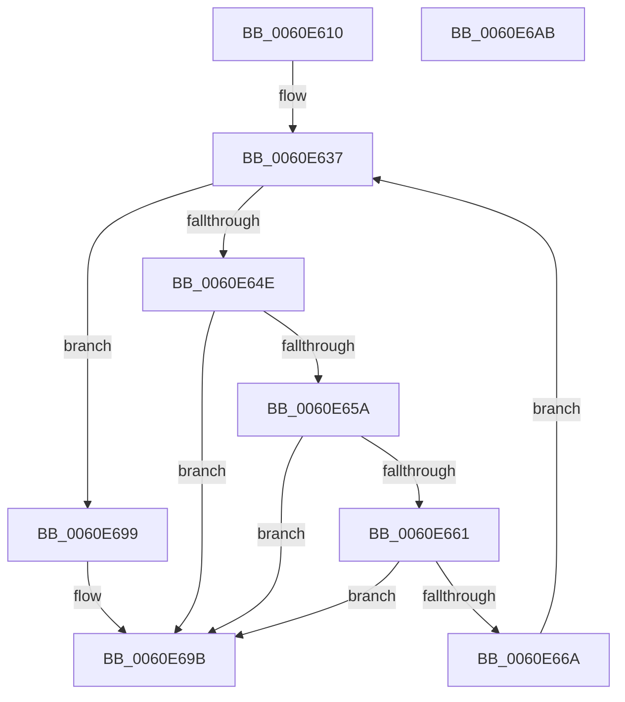

# ST_STORE&lt;SM_TRAITS&gt;::StNpLeafPageIn

- RVA: `0x0060E610`–`0x0060E6AC` (길이 `156` bytes)
- VA: `0x000000014060E610`
- 실행 섹션: `.text`
- PDB 이름 있음: `예`; PDB Function 태그: `아니요`
- unwind 정보 RVA: `0x000D1934`
- 디코드: `40`개 명령, `156/156` bytes 표시
- 미해석 바이트: `0` (있으면 어셈블리에 `.byte`로 보존)

> 이 문서는 커널 이미지의 기계어와 PDB 기호를 분석해 생성했습니다. 4번과 5번은 함수 원형과 자료형을 바이너리 사용 방식에서 추정한 C 해석이며 원본 소스 복구 결과는 아닙니다.

## 1. Dependencies

- 직접 호출 지점: **3**; 고유 호출 대상: **3**
- 직접 호출자로 확인된 함수: **0**
- RIP 상대 이미지 참조: **0**

### Outgoing calls
- `0x0060E645` → [ST_STORE<SM_TRAITS>::StDmSinglePageRetrieveSync](ST_STORE_SM_TRAITS_StDmSinglePageRetrieveSync_function_0060E414.md) (function, `0x0060E414`)
- `0x0060E67B` → [StEtaIoTimeout](StEtaIoTimeout_function_0060F038.md) (function, `0x0060F038`)
- `0x0060E692` → [KeDelayExecutionThread](../20/KeDelayExecutionThread_function_00209550.md) (function, `0x00209550`)

### Direct callers
- 이 함수 시작 RVA로 연결되는 직접 call은 확인되지 않았습니다. 간접 호출은 완전히 역산할 수 없습니다.

### Static image references
- 디코드된 RIP-relative 메모리 참조가 없습니다.

## 2. Other-region calls and transfers

- 다른 실행 섹션으로 향하는 call: **0**
- 별도 외부 분기/꼬리 이동을 확인하지 못했습니다.

## 3. Assembly (complete function range)

```asm
0060E610  48 89 5C 24 18                  mov qword ptr [rsp + 0x18], rbx
0060E615  48 89 74 24 20                  mov qword ptr [rsp + 0x20], rsi
0060E61A  57                              push rdi
0060E61B  48 83 EC 20                     sub rsp, 0x20
0060E61F  48 8B 01                        mov rax, qword ptr [rcx]
0060E622  41 83 E0 FC                     and r8d, 0xfffffffc
0060E626  48 8B F2                        mov rsi, rdx
0060E629  33 DB                           xor ebx, ebx
0060E62B  48 8B B8 80 00 00 00            mov rdi, qword ptr [rax + 0x80]
0060E632  44 89 44 24 30                  mov dword ptr [rsp + 0x30], r8d
0060E637  45 33 C9                        xor r9d, r9d
0060E63A  48 8D 54 24 30                  lea rdx, [rsp + 0x30]
0060E63F  4C 8B C6                        mov r8, rsi
0060E642  48 8B CF                        mov rcx, rdi
0060E645  E8 CA FD FF FF                  call 0x14060e414
0060E64A  85 C0                           test eax, eax
0060E64C  79 4B                           jns 0x14060e699
0060E64E  F7 87 08 03 00 00 00 20 00 00   test dword ptr [rdi + 0x308], 0x2000
0060E658  74 41                           je 0x14060e69b
0060E65A  3D 16 00 00 80                  cmp eax, 0x80000016
0060E65F  75 3A                           jne 0x14060e69b
0060E661  48 81 FB 80 C3 C9 01            cmp rbx, 0x1c9c380
0060E668  73 31                           jae 0x14060e69b
0060E66A  48 8B 8F 58 05 00 00            mov rcx, qword ptr [rdi + 0x558]
0060E671  48 81 C3 20 A1 07 00            add rbx, 0x7a120
0060E678  4C 8B CB                        mov r9, rbx
0060E67B  E8 B8 09 00 00                  call 0x14060f038
0060E680  4C 8D 44 24 38                  lea r8, [rsp + 0x38]
0060E685  48 C7 44 24 38 20 A1 07 00      mov qword ptr [rsp + 0x38], 0x7a120
0060E68E  33 D2                           xor edx, edx
0060E690  33 C9                           xor ecx, ecx
0060E692  E8 B9 AE BF FF                  call 0x140209550
0060E697  EB 9E                           jmp 0x14060e637
0060E699  33 C0                           xor eax, eax
0060E69B  48 8B 5C 24 40                  mov rbx, qword ptr [rsp + 0x40]
0060E6A0  48 8B 74 24 48                  mov rsi, qword ptr [rsp + 0x48]
0060E6A5  48 83 C4 20                     add rsp, 0x20
0060E6A9  5F                              pop rdi
0060E6AA  C3                              ret
0060E6AB  CC                              int3
```

## 4. C-style interpretation (structured pseudocode)

```c
__int64 __fastcall ST_STORE_SM_TRAITS___StNpLeafPageIn(__int64 a1, __int64 a2, int a3, int a4)
{
    __int64 result;
    __int64 v_rbx;
    __int64 v_rsp;
    unsigned __int64 v_stack_p10;
    unsigned __int64 v_stack_p18;
    unsigned __int64 v_stack_p20;
    unsigned int v_stack_p8;

    v_stack_p18 = v_rbx;
    v_stack_p20 = v_rsi;
    v_rsp = (v_rsp) - (32);
    a3 = (unsigned int)((a3) & (0xFFFFFFFCULL));
    v_rbx = 0;
    v_stack_p8 = a3;
loc_0060E637:
    a4 = 0;
    result = ST_STORE_SM_TRAITS___StDmSinglePageRetrieveSync(*(unsigned __int64 *)(*(unsigned __int64 *)(a1) + 128), v_stack_p8, a2, a4);
    if (!sign_flag) goto loc_0060E699;
    if (((*(unsigned int *)(*(unsigned __int64 *)(*(unsigned __int64 *)(a1) + 128) + 776)) & (0x2000ULL)) == 0) goto loc_0060E69B;
    if (((unsigned int)(result)) != 0x80000016ULL) goto loc_0060E69B;
    if (0 >= 0x1C9C380ULL) goto loc_0060E69B;
    v_rbx = (v_rbx) + (0x7A120ULL);
    result = StEtaIoTimeout(*(unsigned __int64 *)(*(unsigned __int64 *)(*(unsigned __int64 *)(a1) + 128) + 1368), v_stack_p8, a2, v_rbx);
    v_stack_p10 = 0x7A120ULL;
    a2 = 0;
    a1 = 0;
    result = KeDelayExecutionThread(a1, a2, v_stack_p10, v_rbx);
    goto loc_0060E637;
loc_0060E699:
    result = 0;
loc_0060E69B:
    v_rsp = (v_rsp) + (32);
    return result;
}
```

## 5. (Beta) C Style

```c
int64_t ST_STORE_SM_TRAITS___StNpLeafPageIn(void *Arg1, int64_t Arg2, int32_t Arg3, int32_t Arg4)
{
    uint8_t *arg1 = (uint8_t *)Arg1;

    int64_t result;
    int64_t local_rbx;
    int64_t local_rsp;
    uint64_t v_stack_p10;
    uint64_t v_stack_p18;
    uint64_t v_stack_p20;
    uint32_t v_stack_p8;

    v_stack_p18 = local_rbx;
    v_stack_p20 = local_rsi;
    local_rsp = (local_rsp) - (32);
    Arg3 = (uint32_t)((Arg3) & (0xFFFFFFFCULL));
    local_rbx = 0;
    v_stack_p8 = Arg3;
loc_0060E637:
    Arg4 = 0;
    result = ST_STORE_SM_TRAITS___StDmSinglePageRetrieveSync(*(uint64_t *)(*(uint64_t *)(arg1) + 0x80), v_stack_p8, Arg2, Arg4);
    if (!sign_flag) goto loc_0060E699;
    if (((*(uint32_t *)(*(uint64_t *)(*(uint64_t *)(arg1) + 0x80) + 0x308)) & (0x2000ULL)) == 0) goto loc_0060E69B;
    if (((uint32_t)(result)) != 0x80000016ULL) goto loc_0060E69B;
    if (0 >= 0x1C9C380ULL) goto loc_0060E69B;
    local_rbx = (local_rbx) + (0x7A120ULL);
    result = StEtaIoTimeout(*(uint64_t *)(*(uint64_t *)(*(uint64_t *)(arg1) + 0x80) + 0x558), v_stack_p8, Arg2, local_rbx);
    v_stack_p10 = 0x7A120ULL;
    Arg2 = 0;
    Arg1 = 0;
    result = KeDelayExecutionThread(Arg1, Arg2, v_stack_p10, local_rbx);
    goto loc_0060E637;
loc_0060E699:
    result = 0;
loc_0060E69B:
    local_rsp = (local_rsp) + (32);
    return result;
}
```

### 관측된 메모리 오프셋

구조체 형식이 확인되지 않은 접근은 인자 기준의 오프셋으로만 기록했습니다.

| 기준 인자 | 오프셋 표현 | 폭 (bit) | 접근 |
|---|---:|---:|---|
| `Arg1` | `+ 0x0` | `64` | `R` |

## 6. Execution-region graph

[열기: 2D/3D 그래프와 함수 탐색 컨트롤 패널](../../../control-panel.html?section=text&rva=0x0060E610&view=graph)

- 2D 그래프는 위에서 아래로 흐르고, 3D 그래프는 빈 공간을 드래그해 회전합니다. Shift+드래그는 이동, 휠은 확대·축소, 함수 노드 선택은 대상 보고서 이동입니다.

### Static fallback


