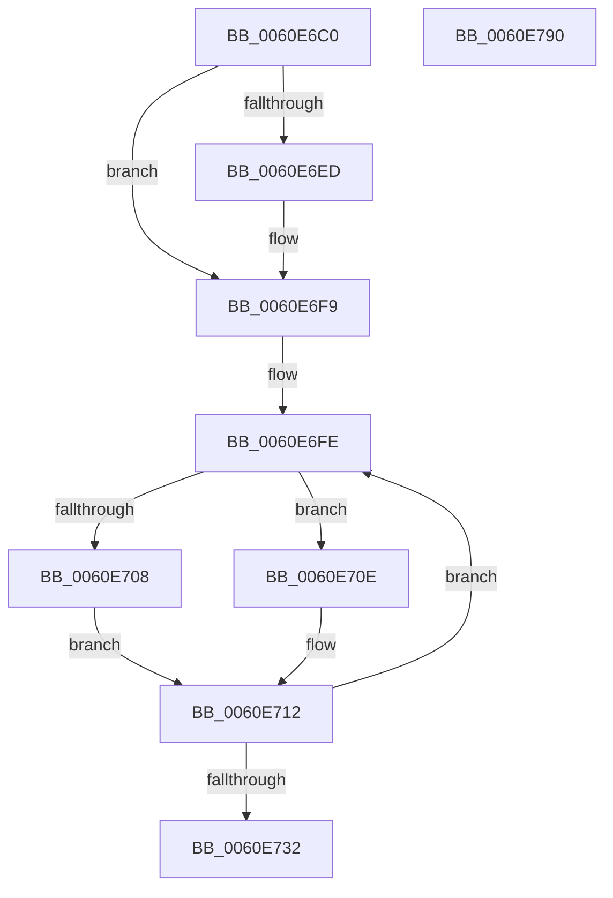

# ST_STORE&lt;SM_TRAITS&gt;::StNpLeafPageOut

- RVA: `0x0060E6C0`–`0x0060E791` (길이 `209` bytes)
- VA: `0x000000014060E6C0`
- 실행 섹션: `.text`
- PDB 이름 있음: `예`; PDB Function 태그: `아니요`
- unwind 정보 RVA: `0x000BDE04`
- 디코드: `56`개 명령, `209/209` bytes 표시
- 미해석 바이트: `0` (있으면 어셈블리에 `.byte`로 보존)

> 이 문서는 커널 이미지의 기계어와 PDB 기호를 분석해 생성했습니다. 4번과 5번은 함수 원형과 자료형을 바이너리 사용 방식에서 추정한 C 해석이며 원본 소스 복구 결과는 아닙니다.

## 1. Dependencies

- 직접 호출 지점: **3**; 고유 호출 대상: **3**
- 직접 호출자로 확인된 함수: **0**
- RIP 상대 이미지 참조: **0**

### Outgoing calls
- `0x0060E6F4` → [B_TREE<_SM_PAGE_KEY,ST_STORE<SM_TRAITS>::_ST_PAGE_ENTRY,4096,NP_CONTEXT,B_TREE_KEY_COMPARATOR<_SM_PAGE_KEY> >::BTreeSearchResultDeref](../3A/B_TREE__SM_PAGE_KEY_ST_STORE_SM_TRAITS__ST_PAGE_ENTRY_4096_NP_CONTEXT_B_TREE_KEY_COMPARATOR__SM_PAGE_function_003AC5D0.md) (function, `0x003AC5D0`)
- `0x0060E726` → [B_TREE<_SM_PAGE_KEY,ST_STORE<SM_TRAITS>::_ST_PAGE_ENTRY,4096,NP_CONTEXT,B_TREE_KEY_COMPARATOR<_SM_PAGE_KEY> >::BTreeSearchKey](../3A/B_TREE__SM_PAGE_KEY_ST_STORE_SM_TRAITS__ST_PAGE_ENTRY_4096_NP_CONTEXT_B_TREE_KEY_COMPARATOR__SM_PAGE_function_003AC3C0.md) (function, `0x003AC3C0`)
- `0x0060E761` → [ST_STORE<SM_TRAITS>::StDmpSinglePageAdd](../20/ST_STORE_SM_TRAITS_StDmpSinglePageAdd_function_0020502C.md) (function, `0x0020502C`)

### Direct callers
- 이 함수 시작 RVA로 연결되는 직접 call은 확인되지 않았습니다. 간접 호출은 완전히 역산할 수 없습니다.

### Static image references
- 디코드된 RIP-relative 메모리 참조가 없습니다.

## 2. Other-region calls and transfers

- 다른 실행 섹션으로 향하는 call: **0**
- 별도 외부 분기/꼬리 이동을 확인하지 못했습니다.

## 3. Assembly (complete function range)

```asm
0060E6C0  48 89 5C 24 10                  mov qword ptr [rsp + 0x10], rbx
0060E6C5  48 89 6C 24 18                  mov qword ptr [rsp + 0x18], rbp
0060E6CA  48 89 74 24 20                  mov qword ptr [rsp + 0x20], rsi
0060E6CF  57                              push rdi
0060E6D0  41 56                           push r14
0060E6D2  41 57                           push r15
0060E6D4  48 83 EC 40                     sub rsp, 0x40
0060E6D8  48 8B 31                        mov rsi, qword ptr [rcx]
0060E6DB  4C 8B FA                        mov r15, rdx
0060E6DE  4C 8B B6 80 00 00 00            mov r14, qword ptr [rsi + 0x80]
0060E6E5  41 8B 46 38                     mov eax, dword ptr [r14 + 0x38]
0060E6E9  A8 01                           test al, 1
0060E6EB  75 0C                           jne 0x14060e6f9
0060E6ED  49 8D 56 18                     lea rdx, [r14 + 0x18]
0060E6F1  49 8B CE                        mov rcx, r14
0060E6F4  E8 D7 DE D9 FF                  call 0x1403ac5d0
0060E6F9  41 83 4E 38 01                  or dword ptr [r14 + 0x38], 1
0060E6FE  48 8B 6E 68                     mov rbp, qword ptr [rsi + 0x68]
0060E702  48 3B 6E 78                     cmp rbp, qword ptr [rsi + 0x78]
0060E706  75 06                           jne 0x14060e70e
0060E708  48 8B 46 70                     mov rax, qword ptr [rsi + 0x70]
0060E70C  EB 04                           jmp 0x14060e712
0060E70E  48 8D 45 01                     lea rax, [rbp + 1]
0060E712  8D 1C AD 00 00 00 00            lea ebx, [rbp*4]
0060E719  48 89 46 68                     mov qword ptr [rsi + 0x68], rax
0060E71D  8B D3                           mov edx, ebx
0060E71F  4D 8D 46 18                     lea r8, [r14 + 0x18]
0060E723  49 8B CE                        mov rcx, r14
0060E726  E8 95 DC D9 FF                  call 0x1403ac3c0
0060E72B  3D 25 02 00 C0                  cmp eax, 0xc0000225
0060E730  75 CC                           jne 0x14060e6fe
0060E732  41 8B 96 34 03 00 00            mov edx, dword ptr [r14 + 0x334]
0060E739  33 FF                           xor edi, edi
0060E73B  48 89 7C 24 20                  mov qword ptr [rsp + 0x20], rdi
0060E740  89 7C 24 34                     mov dword ptr [rsp + 0x34], edi
0060E744  4C 89 7C 24 28                  mov qword ptr [rsp + 0x28], r15
0060E749  89 5C 24 30                     mov dword ptr [rsp + 0x30], ebx
0060E74D  89 54 24 60                     mov dword ptr [rsp + 0x60], edx
0060E751  4C 8D 4C 24 60                  lea r9, [rsp + 0x60]
0060E756  45 33 C0                        xor r8d, r8d
0060E759  48 8D 54 24 20                  lea rdx, [rsp + 0x20]
0060E75E  49 8B CE                        mov rcx, r14
0060E761  E8 C6 68 BF FF                  call 0x14020502c
0060E766  48 8B 5C 24 68                  mov rbx, qword ptr [rsp + 0x68]
0060E76B  48 8D 0C AD 00 00 00 00         lea rcx, [rbp*4]
0060E773  48 8B 6C 24 70                  mov rbp, qword ptr [rsp + 0x70]
0060E778  85 C0                           test eax, eax
0060E77A  48 8B 74 24 78                  mov rsi, qword ptr [rsp + 0x78]
0060E77F  48 0F 49 F9                     cmovns rdi, rcx
0060E783  48 8B C7                        mov rax, rdi
0060E786  48 83 C4 40                     add rsp, 0x40
0060E78A  41 5F                           pop r15
0060E78C  41 5E                           pop r14
0060E78E  5F                              pop rdi
0060E78F  C3                              ret
0060E790  CC                              int3
```

## 4. C-style interpretation (structured pseudocode)

```c
__int64 __fastcall ST_STORE_SM_TRAITS___StNpLeafPageOut(__int64 a1, __int64 a2)
{
    __int64 result;
    __int64 v_rdi;
    __int64 v_rsp;
    unsigned int v_stack_m24;
    unsigned int v_stack_m28;
    unsigned __int64 v_stack_m30;
    unsigned __int64 v_stack_m38;
    unsigned __int64 v_stack_p10;
    unsigned __int64 v_stack_p18;
    unsigned __int64 v_stack_p20;
    unsigned int v_stack_p8;

    v_stack_p10 = v_rbx;
    v_stack_p18 = v_rbp;
    v_stack_p20 = v_rsi;
    v_rsp = (v_rsp) - (64);
    result = (unsigned int)(*(unsigned int *)(*(unsigned __int64 *)(*(unsigned __int64 *)(a1) + 128) + 56));
    if ((((unsigned __int8)((unsigned int)(*(unsigned int *)(*(unsigned __int64 *)(*(unsigned __int64 *)(a1) + 128) + 56)))) & (1)) == 0) {
        a2 = *(unsigned __int64 *)(*(unsigned __int64 *)(a1) + 128) + 24;
        a1 = *(unsigned __int64 *)(*(unsigned __int64 *)(a1) + 128);
        result = B_TREE__SM_PAGE_KEY_ST_STORE_SM_TRAITS____ST_PAGE_ENTRY_4096_NP_CONTEXT_B_TREE_KEY_COMPARATOR__SM_PA(a1, a2, a3, a4);
    }
loc_0060E6FE:
    if ((*(unsigned __int64 *)(*(unsigned __int64 *)(a1) + 104)) != (*(unsigned __int64 *)(*(unsigned __int64 *)(a1) + 120))) goto loc_0060E70E;
    goto loc_0060E712;
loc_0060E70E:
loc_0060E712:
    *(unsigned __int64 *)(*(unsigned __int64 *)(a1) + 104) = *(unsigned __int64 *)(*(unsigned __int64 *)(a1) + 104) + 1;
    result = B_TREE__SM_PAGE_KEY_ST_STORE_SM_TRAITS____ST_PAGE_ENTRY_4096_NP_CONTEXT_B_TREE_KEY_COMPARATOR__SM_PA(*(unsigned __int64 *)(*(unsigned __int64 *)(a1) + 128), (unsigned int)((unsigned int)(*(unsigned __int64 *)(*(unsigned __int64 *)(a1) + 104) * 4)), *(unsigned __int64 *)(*(unsigned __int64 *)(a1) + 128) + 24, a4);
    if (((unsigned int)(result)) != 0xC0000225ULL) goto loc_0060E6FE;
    v_rdi = 0;
    v_stack_m38 = 0;
    v_stack_m24 = 0;
    v_stack_m30 = a2;
    v_stack_m28 = (unsigned int)(*(unsigned __int64 *)(*(unsigned __int64 *)(a1) + 104) * 4);
    v_stack_p8 = (unsigned int)((unsigned int)(*(unsigned int *)(*(unsigned __int64 *)(*(unsigned __int64 *)(a1) + 128) + 820)));
    a3 = 0;
    result = ST_STORE_SM_TRAITS___StDmpSinglePageAdd(*(unsigned __int64 *)(*(unsigned __int64 *)(a1) + 128), v_stack_m38, a3, v_stack_p8);
    if (!sign_flag) { v_rdi = *(unsigned __int64 *)(*(unsigned __int64 *)(a1) + 104) * 4; }
    v_rsp = (v_rsp) + (64);
    return v_rdi;
}
```

## 5. (Beta) C Style

```c
int64_t ST_STORE_SM_TRAITS___StNpLeafPageOut(void *Arg1, int64_t Arg2)
{
    uint8_t *arg1 = (uint8_t *)Arg1;

    int64_t result;
    int64_t local_rdi;
    int64_t local_rsp;
    uint32_t v_stack_m24;
    uint32_t v_stack_m28;
    uint64_t v_stack_m30;
    uint64_t v_stack_m38;
    uint64_t v_stack_p10;
    uint64_t v_stack_p18;
    uint64_t v_stack_p20;
    uint32_t v_stack_p8;

    v_stack_p10 = local_rbx;
    v_stack_p18 = local_rbp;
    v_stack_p20 = local_rsi;
    local_rsp = (local_rsp) - (64);
    result = (uint32_t)(*(uint32_t *)(*(uint64_t *)(*(uint64_t *)(arg1) + 0x80) + 0x38));
    if ((((uint8_t)((uint32_t)(*(uint32_t *)(*(uint64_t *)(*(uint64_t *)(arg1) + 0x80) + 0x38)))) & (1)) == 0) {
        Arg2 = *(uint64_t *)(*(uint64_t *)(arg1) + 0x80) + 24;
        Arg1 = *(uint64_t *)(*(uint64_t *)(arg1) + 0x80);
        result = B_TREE__SM_PAGE_KEY_ST_STORE_SM_TRAITS____ST_PAGE_ENTRY_4096_NP_CONTEXT_B_TREE_KEY_COMPARATOR__SM_PA(Arg1, Arg2, a3, a4);
    }
loc_0060E6FE:
    if ((*(uint64_t *)(*(uint64_t *)(arg1) + 0x68)) != (*(uint64_t *)(*(uint64_t *)(arg1) + 0x78))) goto loc_0060E70E;
    goto loc_0060E712;
loc_0060E70E:
loc_0060E712:
    *(uint64_t *)(*(uint64_t *)(arg1) + 0x68) = *(uint64_t *)(*(uint64_t *)(arg1) + 0x68) + 1;
    result = B_TREE__SM_PAGE_KEY_ST_STORE_SM_TRAITS____ST_PAGE_ENTRY_4096_NP_CONTEXT_B_TREE_KEY_COMPARATOR__SM_PA(*(uint64_t *)(*(uint64_t *)(arg1) + 0x80), (uint32_t)((uint32_t)(*(uint64_t *)(*(uint64_t *)(arg1) + 0x68) * 4)), *(uint64_t *)(*(uint64_t *)(arg1) + 0x80) + 24, a4);
    if (((uint32_t)(result)) != 0xC0000225ULL) goto loc_0060E6FE;
    local_rdi = 0;
    v_stack_m38 = 0;
    v_stack_m24 = 0;
    v_stack_m30 = Arg2;
    v_stack_m28 = (uint32_t)(*(uint64_t *)(*(uint64_t *)(arg1) + 0x68) * 4);
    v_stack_p8 = (uint32_t)((uint32_t)(*(uint32_t *)(*(uint64_t *)(*(uint64_t *)(arg1) + 0x80) + 0x334)));
    a3 = 0;
    result = ST_STORE_SM_TRAITS___StDmpSinglePageAdd(*(uint64_t *)(*(uint64_t *)(arg1) + 0x80), v_stack_m38, a3, v_stack_p8);
    if (!sign_flag) { local_rdi = *(uint64_t *)(*(uint64_t *)(arg1) + 0x68) * 4; }
    local_rsp = (local_rsp) + (64);
    return local_rdi;
}
```

### 관측된 메모리 오프셋

구조체 형식이 확인되지 않은 접근은 인자 기준의 오프셋으로만 기록했습니다.

| 기준 인자 | 오프셋 표현 | 폭 (bit) | 접근 |
|---|---:|---:|---|
| `Arg1` | `+ 0x0` | `64` | `R` |

## 6. Execution-region graph

[열기: 2D/3D 그래프와 함수 탐색 컨트롤 패널](../../../control-panel.html?section=text&rva=0x0060E6C0&view=graph)

- 2D 그래프는 위에서 아래로 흐르고, 3D 그래프는 빈 공간을 드래그해 회전합니다. Shift+드래그는 이동, 휠은 확대·축소, 함수 노드 선택은 대상 보고서 이동입니다.

### Static fallback


