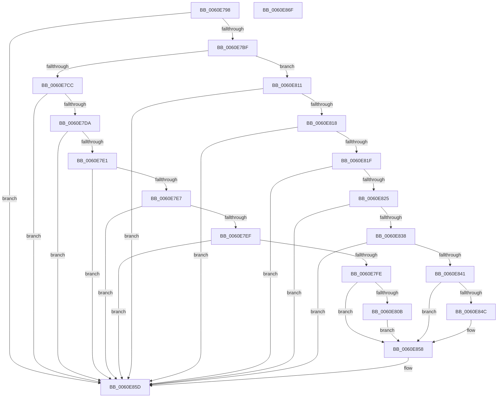

# ST_STORE&lt;SM_TRAITS&gt;::StRegionAccessExceptionFilter

- RVA: `0x0060E798`–`0x0060E870` (길이 `216` bytes)
- VA: `0x000000014060E798`
- 실행 섹션: `.text`
- PDB 이름 있음: `예`; PDB Function 태그: `아니요`
- unwind 정보 RVA: `0x00060BC4`
- 디코드: `61`개 명령, `216/216` bytes 표시
- 미해석 바이트: `0` (있으면 어셈블리에 `.byte`로 보존)

> 이 문서는 커널 이미지의 기계어와 PDB 기호를 분석해 생성했습니다. 4번과 5번은 함수 원형과 자료형을 바이너리 사용 방식에서 추정한 C 해석이며 원본 소스 복구 결과는 아닙니다.

## 1. Dependencies

- 직접 호출 지점: **2**; 고유 호출 대상: **2**
- 직접 호출자로 확인된 함수: **3**
- RIP 상대 이미지 참조: **0**

### Outgoing calls
- `0x0060E801` → [MmStoreLogRegionInPageError](../69/MmStoreLogRegionInPageError_function_00693450.md) (function, `0x00693450`)
- `0x0060E838` → [MmStoreIsVirtualAddressPoisoned](../69/MmStoreIsVirtualAddressPoisoned_function_00693120.md) (function, `0x00693120`)

### Direct callers
- [`ST_STORE&lt;SM_TRAITS&gt;::StDmSinglePageCopy&#x27;::`1&#x27;::filt$0](../6D/_ST_STORE_SM_TRAITS_StDmSinglePageCopy_1_filt_0_function_006D204D.md) at `0x006D2068`
- [`SMKM_STORE&lt;SM_TRAITS&gt;::SmStCompareRegionDataCallback&#x27;::`1&#x27;::filt$0](../6D/_SMKM_STORE_SM_TRAITS_SmStCompareRegionDataCallback_1_filt_0_function_006D21AB.md) at `0x006D21CD`
- [`ST_STORE&lt;SM_TRAITS&gt;::StDmHandleDecompressionFailure&#x27;::`1&#x27;::filt$0](../6D/_ST_STORE_SM_TRAITS_StDmHandleDecompressionFailure_1_filt_0_function_006D5C11.md) at `0x006D5C33`

### Static image references
- 디코드된 RIP-relative 메모리 참조가 없습니다.

## 2. Other-region calls and transfers

- 다른 실행 섹션으로 향하는 call: **0**
- 별도 외부 분기/꼬리 이동을 확인하지 못했습니다.

## 3. Assembly (complete function range)

```asm
0060E798  48 89 5C 24 08                  mov qword ptr [rsp + 8], rbx
0060E79D  48 89 74 24 10                  mov qword ptr [rsp + 0x10], rsi
0060E7A2  57                              push rdi
0060E7A3  48 83 EC 20                     sub rsp, 0x20
0060E7A7  33 DB                           xor ebx, ebx
0060E7A9  49 8B F1                        mov rsi, r9
0060E7AC  F7 82 08 03 00 00 00 00 02 00   test dword ptr [rdx + 0x308], 0x20000
0060E7B6  49 8B F8                        mov rdi, r8
0060E7B9  0F 84 9E 00 00 00               je 0x14060e85d
0060E7BF  4C 8B 01                        mov r8, qword ptr [rcx]
0060E7C2  41 8B 00                        mov eax, dword ptr [r8]
0060E7C5  3D 06 00 00 C0                  cmp eax, 0xc0000006
0060E7CA  75 45                           jne 0x14060e811
0060E7CC  8B 82 40 03 00 00               mov eax, dword ptr [rdx + 0x340]
0060E7D2  A8 60                           test al, 0x60
0060E7D4  0F 85 83 00 00 00               jne 0x14060e85d
0060E7DA  41 83 78 18 03                  cmp dword ptr [r8 + 0x18], 3
0060E7DF  72 7C                           jb 0x14060e85d
0060E7E1  49 39 58 20                     cmp qword ptr [r8 + 0x20], rbx
0060E7E5  75 76                           jne 0x14060e85d
0060E7E7  41 8B 40 30                     mov eax, dword ptr [r8 + 0x30]
0060E7EB  85 C0                           test eax, eax
0060E7ED  79 6E                           jns 0x14060e85d
0060E7EF  41 89 01                        mov dword ptr [r9], eax
0060E7F2  05 20 FB FF 3F                  add eax, 0x3ffffb20
0060E7F7  A9 FD FF FF FF                  test eax, 0xfffffffd
0060E7FC  74 5F                           je 0x14060e85d
0060E7FE  48 8B 09                        mov rcx, qword ptr [rcx]
0060E801  E8 4A 4C 08 00                  call 0x140693450
0060E806  48 85 FF                        test rdi, rdi
0060E809  74 4D                           je 0x14060e858
0060E80B  83 4F 14 0C                     or dword ptr [rdi + 0x14], 0xc
0060E80F  EB 47                           jmp 0x14060e858
0060E811  3D 05 00 00 C0                  cmp eax, 0xc0000005
0060E816  75 45                           jne 0x14060e85d
0060E818  41 83 78 18 02                  cmp dword ptr [r8 + 0x18], 2
0060E81D  72 3E                           jb 0x14060e85d
0060E81F  49 39 58 20                     cmp qword ptr [r8 + 0x20], rbx
0060E823  75 38                           jne 0x14060e85d
0060E825  49 8B 48 28                     mov rcx, qword ptr [r8 + 0x28]
0060E829  48 B8 FF FF FE FF FF 7F 00 00   movabs rax, 0x7ffffffeffff
0060E833  48 3B C8                        cmp rcx, rax
0060E836  77 25                           ja 0x14060e85d
0060E838  E8 E3 48 08 00                  call 0x140693120
0060E83D  85 C0                           test eax, eax
0060E83F  74 1C                           je 0x14060e85d
0060E841  C7 06 E2 04 00 C0               mov dword ptr [rsi], 0xc00004e2
0060E847  48 85 FF                        test rdi, rdi
0060E84A  74 0C                           je 0x14060e858
0060E84C  8B 47 14                        mov eax, dword ptr [rdi + 0x14]
0060E84F  83 E0 FB                        and eax, 0xfffffffb
0060E852  83 C8 08                        or eax, 8
0060E855  89 47 14                        mov dword ptr [rdi + 0x14], eax
0060E858  BB 01 00 00 00                  mov ebx, 1
0060E85D  48 8B 74 24 38                  mov rsi, qword ptr [rsp + 0x38]
0060E862  8B C3                           mov eax, ebx
0060E864  48 8B 5C 24 30                  mov rbx, qword ptr [rsp + 0x30]
0060E869  48 83 C4 20                     add rsp, 0x20
0060E86D  5F                              pop rdi
0060E86E  C3                              ret
0060E86F  CC                              int3
```

## 4. C-style interpretation (structured pseudocode)

```c
__int64 __fastcall ST_STORE_SM_TRAITS___StRegionAccessExceptionFilter(__int64 a1, __int64 a2, __int64 a3, __int64 a4)
{
    __int64 result;
    __int64 v_rbx;
    __int64 v_rsp;
    unsigned __int64 v_stack_p10;
    unsigned __int64 v_stack_p8;

    v_stack_p8 = v_rbx;
    v_stack_p10 = v_rsi;
    v_rsp = (v_rsp) - (32);
    v_rbx = 0;
    if (((*(unsigned int *)(a2 + 776)) & (0x20000ULL)) == 0) goto loc_0060E85D;
    if (((unsigned int)((unsigned int)(*(unsigned int *)(*(unsigned __int64 *)(a1))))) != 0xC0000006ULL) goto loc_0060E811;
    if ((((unsigned __int8)((unsigned int)(*(unsigned int *)(a2 + 832)))) & (96)) != 0) goto loc_0060E85D;
    if ((*(unsigned int *)(*(unsigned __int64 *)(a1) + 24)) < 3) goto loc_0060E85D;
    if ((*(unsigned __int64 *)(*(unsigned __int64 *)(a1) + 32)) != 0) goto loc_0060E85D;
    if (!sign_flag) goto loc_0060E85D;
    *(unsigned int *)(a4) = (unsigned int)((unsigned int)(*(unsigned int *)(*(unsigned __int64 *)(a1) + 48)));
    result = (unsigned int)(((unsigned int)(*(unsigned int *)(*(unsigned __int64 *)(a1) + 48))) + (0x3FFFFB20ULL));
    if ((((unsigned int)(result)) & (0xFFFFFFFDULL)) == 0) goto loc_0060E85D;
    result = MmStoreLogRegionInPageError(*(unsigned __int64 *)(a1), a2, *(unsigned __int64 *)(a1), a4);
    if (a3 == 0) goto loc_0060E858;
    goto loc_0060E858;
loc_0060E811:
    if (((unsigned int)(result)) != 0xC0000005ULL) goto loc_0060E85D;
    if ((*(unsigned int *)(*(unsigned __int64 *)(a1) + 24)) < 2) goto loc_0060E85D;
    if ((*(unsigned __int64 *)(*(unsigned __int64 *)(a1) + 32)) != 0) goto loc_0060E85D;
    if ((*(unsigned __int64 *)(*(unsigned __int64 *)(a1) + 40)) > result) goto loc_0060E85D;
    result = MmStoreIsVirtualAddressPoisoned(*(unsigned __int64 *)(*(unsigned __int64 *)(a1) + 40), a2, *(unsigned __int64 *)(a1), a4);
    if ((unsigned int)(result) == 0) goto loc_0060E85D;
    *(unsigned int *)(a4) = 0xC00004E2ULL;
    if (a3 != 0) {
        result = *(unsigned int *)(a3 + 20);
        result = (unsigned int)((result) & (0xFFFFFFFBULL));
        result = (unsigned int)((result) | (8));
        *(unsigned int *)(a3 + 20) = (unsigned int)(result);
    }
loc_0060E85D:
    v_rsp = (v_rsp) + (32);
    return 1;
}
```

## 5. (Beta) C Style

```c
int64_t ST_STORE_SM_TRAITS___StRegionAccessExceptionFilter(void *Arg1, void *Arg2, int64_t Arg3, void *Arg4)
{
    uint8_t *arg1 = (uint8_t *)Arg1;
    uint8_t *arg2 = (uint8_t *)Arg2;
    uint8_t *arg4 = (uint8_t *)Arg4;

    int64_t result;
    int64_t local_rbx;
    int64_t local_rsp;
    uint64_t v_stack_p10;
    uint64_t v_stack_p8;

    v_stack_p8 = local_rbx;
    v_stack_p10 = local_rsi;
    local_rsp = (local_rsp) - (32);
    local_rbx = 0;
    if (((*(uint32_t *)(arg2 + 0x308)) & (0x20000ULL)) == 0) goto loc_0060E85D;
    if (((uint32_t)((uint32_t)(*(uint32_t *)(*(uint64_t *)(arg1))))) != 0xC0000006ULL) goto loc_0060E811;
    if ((((uint8_t)((uint32_t)(*(uint32_t *)(arg2 + 0x340)))) & (96)) != 0) goto loc_0060E85D;
    if ((*(uint32_t *)(*(uint64_t *)(arg1) + 0x18)) < 3) goto loc_0060E85D;
    if ((*(uint64_t *)(*(uint64_t *)(arg1) + 0x20)) != 0) goto loc_0060E85D;
    if (!sign_flag) goto loc_0060E85D;
    *(uint32_t *)(arg4) = (uint32_t)((uint32_t)(*(uint32_t *)(*(uint64_t *)(arg1) + 0x30)));
    result = (uint32_t)(((uint32_t)(*(uint32_t *)(*(uint64_t *)(arg1) + 0x30))) + (0x3FFFFB20ULL));
    if ((((uint32_t)(result)) & (0xFFFFFFFDULL)) == 0) goto loc_0060E85D;
    result = MmStoreLogRegionInPageError(*(uint64_t *)(arg1), Arg2, *(uint64_t *)(arg1), Arg4);
    if (Arg3 == 0) goto loc_0060E858;
    goto loc_0060E858;
loc_0060E811:
    if (((uint32_t)(result)) != 0xC0000005ULL) goto loc_0060E85D;
    if ((*(uint32_t *)(*(uint64_t *)(arg1) + 0x18)) < 2) goto loc_0060E85D;
    if ((*(uint64_t *)(*(uint64_t *)(arg1) + 0x20)) != 0) goto loc_0060E85D;
    if ((*(uint64_t *)(*(uint64_t *)(arg1) + 0x28)) > result) goto loc_0060E85D;
    result = MmStoreIsVirtualAddressPoisoned(*(uint64_t *)(*(uint64_t *)(arg1) + 0x28), Arg2, *(uint64_t *)(arg1), Arg4);
    if ((uint32_t)(result) == 0) goto loc_0060E85D;
    *(uint32_t *)(arg4) = 0xC00004E2ULL;
    if (Arg3 != 0) {
        result = *(uint32_t *)(Arg3 + 0x14);
        result = (uint32_t)((result) & (0xFFFFFFFBULL));
        result = (uint32_t)((result) | (8));
        *(uint32_t *)(Arg3 + 0x14) = (uint32_t)(result);
    }
loc_0060E85D:
    local_rsp = (local_rsp) + (32);
    return 1;
}
```

### 관측된 메모리 오프셋

구조체 형식이 확인되지 않은 접근은 인자 기준의 오프셋으로만 기록했습니다.

| 기준 인자 | 오프셋 표현 | 폭 (bit) | 접근 |
|---|---:|---:|---|
| `Arg1` | `+ 0x0` | `64` | `R` |
| `Arg2` | `+ 0x308` | `32` | `R` |
| `Arg2` | `+ 0x340` | `32` | `R` |
| `Arg4` | `+ 0x0` | `32` | `W` |

## 6. Execution-region graph

[열기: 2D/3D 그래프와 함수 탐색 컨트롤 패널](../../../control-panel.html?section=text&rva=0x0060E798&view=graph)

- 2D 그래프는 위에서 아래로 흐르고, 3D 그래프는 빈 공간을 드래그해 회전합니다. Shift+드래그는 이동, 휠은 확대·축소, 함수 노드 선택은 대상 보고서 이동입니다.

### Static fallback


