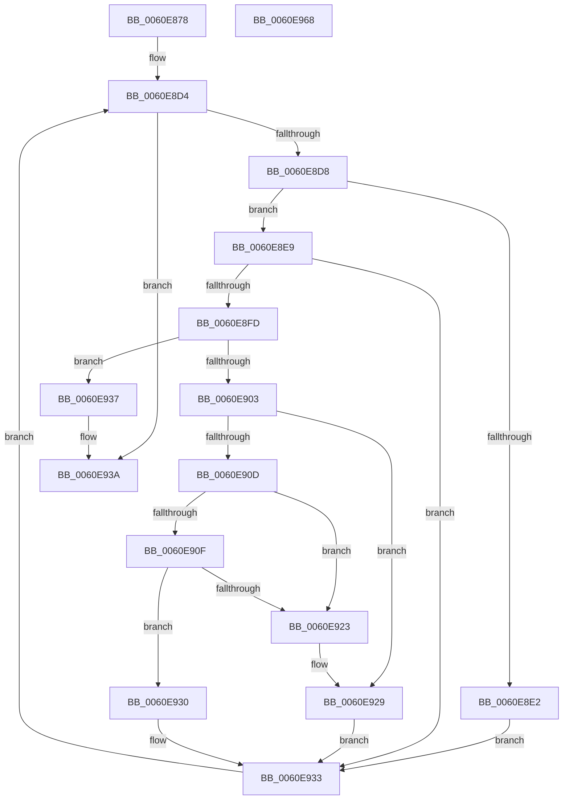

# ST_STORE&lt;SM_TRAITS&gt;::StRegionFindRepurpose

- RVA: `0x0060E878`–`0x0060E969` (길이 `241` bytes)
- VA: `0x000000014060E878`
- 실행 섹션: `.text`
- PDB 이름 있음: `예`; PDB Function 태그: `아니요`
- unwind 정보 RVA: `0x000D1878`
- 디코드: `70`개 명령, `241/241` bytes 표시
- 미해석 바이트: `0` (있으면 어셈블리에 `.byte`로 보존)

> 이 문서는 커널 이미지의 기계어와 PDB 기호를 분석해 생성했습니다. 4번과 5번은 함수 원형과 자료형을 바이너리 사용 방식에서 추정한 C 해석이며 원본 소스 복구 결과는 아닙니다.

## 1. Dependencies

- 직접 호출 지점: **0**; 고유 호출 대상: **0**
- 직접 호출자로 확인된 함수: **1**
- RIP 상대 이미지 참조: **0**

### Outgoing calls
- 직접 디코드된 call 명령이 없습니다.

### Direct callers
- [ST_STORE&lt;SM_TRAITS&gt;::StDmRegionRemove](ST_STORE_SM_TRAITS_StDmRegionRemove_function_0060E314.md) at `0x0060E331`

### Static image references
- 디코드된 RIP-relative 메모리 참조가 없습니다.

## 2. Other-region calls and transfers

- 다른 실행 섹션으로 향하는 call: **0**
- 별도 외부 분기/꼬리 이동을 확인하지 못했습니다.

## 3. Assembly (complete function range)

```asm
0060E878  48 8B C4                        mov rax, rsp
0060E87B  48 89 58 08                     mov qword ptr [rax + 8], rbx
0060E87F  48 89 68 10                     mov qword ptr [rax + 0x10], rbp
0060E883  48 89 70 18                     mov qword ptr [rax + 0x18], rsi
0060E887  48 89 78 20                     mov qword ptr [rax + 0x20], rdi
0060E88B  41 55                           push r13
0060E88D  41 56                           push r14
0060E88F  41 57                           push r15
0060E891  48 83 EC 10                     sub rsp, 0x10
0060E895  8B A9 58 03 00 00               mov ebp, dword ptr [rcx + 0x358]
0060E89B  4C 8D 40 DC                     lea r8, [rax - 0x24]
0060E89F  0F B7 81 30 03 00 00            movzx eax, word ptr [rcx + 0x330]
0060E8A6  48 8D 34 24                     lea rsi, [rsp]
0060E8AA  4C 8B B1 78 05 00 00            mov r14, qword ptr [rcx + 0x578]
0060E8B1  BB FF 1F 00 00                  mov ebx, 0x1fff
0060E8B6  4C 8B B9 88 05 00 00            mov r15, qword ptr [rcx + 0x588]
0060E8BD  66 23 C3                        and ax, bx
0060E8C0  FF CA                           dec edx
0060E8C2  66 89 44 24 04                  mov word ptr [rsp + 4], ax
0060E8C7  45 33 ED                        xor r13d, r13d
0060E8CA  C6 04 24 FF                     mov byte ptr [rsp], 0xff
0060E8CE  48 8B F9                        mov rdi, rcx
0060E8D1  41 8B CD                        mov ecx, r13d
0060E8D4  3B CD                           cmp ecx, ebp
0060E8D6  73 62                           jae 0x14060e93a
0060E8D8  FF C2                           inc edx
0060E8DA  3B 97 14 03 00 00               cmp edx, dword ptr [rdi + 0x314]
0060E8E0  75 07                           jne 0x14060e8e9
0060E8E2  83 CA FF                        or edx, 0xffffffff
0060E8E5  FF C9                           dec ecx
0060E8E7  EB 4A                           jmp 0x14060e933
0060E8E9  4D 8D 0C 56                     lea r9, [r14 + rdx*2]
0060E8ED  41 BB 00 40 00 00               mov r11d, 0x4000
0060E8F3  45 0F B7 11                     movzx r10d, word ptr [r9]
0060E8F7  66 45 3B D3                     cmp r10w, r11w
0060E8FB  73 36                           jae 0x14060e933
0060E8FD  66 44 23 D3                     and r10w, bx
0060E901  74 34                           je 0x14060e937
0060E903  4A 8D 1C 3A                     lea rbx, [rdx + r15]
0060E907  8A 03                           mov al, byte ptr [rbx]
0060E909  3A 06                           cmp al, byte ptr [rsi]
0060E90B  77 1C                           ja 0x14060e929
0060E90D  72 14                           jb 0x14060e923
0060E90F  41 0F B7 00                     movzx eax, word ptr [r8]
0060E913  41 BB FF 1F 00 00               mov r11d, 0x1fff
0060E919  66 41 23 C3                     and ax, r11w
0060E91D  66 44 3B D0                     cmp r10w, ax
0060E921  77 0D                           ja 0x14060e930
0060E923  48 8B F3                        mov rsi, rbx
0060E926  4D 8B C1                        mov r8, r9
0060E929  BB FF 1F 00 00                  mov ebx, 0x1fff
0060E92E  EB 03                           jmp 0x14060e933
0060E930  41 8B DB                        mov ebx, r11d
0060E933  FF C1                           inc ecx
0060E935  EB 9D                           jmp 0x14060e8d4
0060E937  4D 8B C1                        mov r8, r9
0060E93A  48 8B 5C 24 30                  mov rbx, qword ptr [rsp + 0x30]
0060E93F  48 8D 44 24 04                  lea rax, [rsp + 4]
0060E944  48 8B 6C 24 38                  mov rbp, qword ptr [rsp + 0x38]
0060E949  4C 3B C0                        cmp r8, rax
0060E94C  48 8B 74 24 40                  mov rsi, qword ptr [rsp + 0x40]
0060E951  48 8B 7C 24 48                  mov rdi, qword ptr [rsp + 0x48]
0060E956  4D 0F 44 C5                     cmove r8, r13
0060E95A  49 8B C0                        mov rax, r8
0060E95D  48 83 C4 10                     add rsp, 0x10
0060E961  41 5F                           pop r15
0060E963  41 5E                           pop r14
0060E965  41 5D                           pop r13
0060E967  C3                              ret
0060E968  CC                              int3
```

## 4. C-style interpretation (structured pseudocode)

```c
__int64 __fastcall ST_STORE_SM_TRAITS___StRegionFindRepurpose(__int64 a1, int a2)
{
    __int64 result;
    __int64 v_r10;
    __int64 v_r13;
    __int64 v_rsp;
    unsigned __int16 v_stack_m24;
    unsigned __int64 v_stack_m28;
    unsigned __int64 v_stack_p10;
    unsigned __int64 v_stack_p18;
    unsigned __int64 v_stack_p20;
    unsigned __int64 v_stack_p8;

    *(unsigned __int64 *)(v_rsp + 8) = v_rbx;
    *(unsigned __int64 *)(v_rsp + 16) = v_rbp;
    *(unsigned __int64 *)(v_rsp + 24) = v_rsi;
    *(unsigned __int64 *)(v_rsp + 32) = v_rdi;
    v_rsp = (v_rsp) - (16);
    result = (unsigned __int16)((*(unsigned __int16 *)(a1 + 816)) & ((unsigned __int16)((unsigned int)(0x1FFFULL))));
    a2 = (unsigned int)((a2) - 1);
    v_stack_m24 = (unsigned __int16)(result);
    v_r13 = 0;
    v_stack_m28 = 255;
loc_0060E8D4:
    if (0 >= ((unsigned int)((unsigned int)(*(unsigned int *)(a1 + 856))))) goto loc_0060E93A;
    a2 = (unsigned int)((a2) + 1);
    if (a2 != (*(unsigned int *)(a1 + 788))) goto loc_0060E8E9;
    a2 = (unsigned int)((a2) | (0xFFFFFFFFULL));
    a1 = (unsigned int)((0) - 1);
    goto loc_0060E933;
loc_0060E8E9:
    if (((unsigned __int16)(*(unsigned __int16 *)(*(unsigned __int64 *)(a1 + 1400) + a2 * 2))) >= ((unsigned __int16)((unsigned int)(0x4000ULL)))) goto loc_0060E933;
    v_r10 = (unsigned __int16)((*(unsigned __int16 *)(*(unsigned __int64 *)(a1 + 1400) + a2 * 2)) & ((unsigned __int16)((unsigned int)(0x1FFFULL))));
    if (condition_is_equal) goto loc_0060E937;
    if (((unsigned __int8)(*(unsigned __int8 *)(a2 + *(unsigned __int64 *)(a1 + 1416) * 1))) > (*(unsigned __int8 *)(v_stack_m28))) goto loc_0060E929;
    if (((unsigned __int8)(*(unsigned __int8 *)(a2 + *(unsigned __int64 *)(a1 + 1416) * 1))) < (*(unsigned __int8 *)(v_stack_m28))) goto loc_0060E923;
    result = (unsigned __int16)((*(unsigned __int16 *)(v_rsp - 36)) & ((unsigned __int16)((unsigned int)(0x1FFFULL))));
    if (((unsigned __int16)(v_r10)) > ((unsigned __int16)(result))) goto loc_0060E930;
loc_0060E923:
loc_0060E929:
    goto loc_0060E933;
loc_0060E930:
loc_0060E933:
    a1 = (unsigned int)((a1) + 1);
    goto loc_0060E8D4;
loc_0060E937:
loc_0060E93A:
    a3 = *(unsigned __int64 *)(a1 + 1400) + a2 * 2;
    if ((*(unsigned __int64 *)(a1 + 1400) + a2 * 2) == v_stack_m24) { a3 = 0; }
    v_rsp = (v_rsp) + (16);
    return a3;
}
```

## 5. (Beta) C Style

```c
int64_t ST_STORE_SM_TRAITS___StRegionFindRepurpose(void *Arg1, int32_t Arg2)
{
    uint8_t *arg1 = (uint8_t *)Arg1;

    int64_t result;
    int64_t local_r10;
    int64_t local_r13;
    int64_t local_rsp;
    uint16_t v_stack_m24;
    uint64_t v_stack_m28;
    uint64_t v_stack_p10;
    uint64_t v_stack_p18;
    uint64_t v_stack_p20;
    uint64_t v_stack_p8;

    *(uint64_t *)(local_rsp + 0x8) = local_rbx;
    *(uint64_t *)(local_rsp + 0x10) = local_rbp;
    *(uint64_t *)(local_rsp + 0x18) = local_rsi;
    *(uint64_t *)(local_rsp + 0x20) = local_rdi;
    local_rsp = (local_rsp) - (16);
    result = (uint16_t)((*(uint16_t *)(arg1 + 0x330)) & ((uint16_t)((uint32_t)(0x1FFFULL))));
    Arg2 = (uint32_t)((Arg2) - 1);
    v_stack_m24 = (uint16_t)(result);
    local_r13 = 0;
    v_stack_m28 = 255;
loc_0060E8D4:
    if (0 >= ((uint32_t)((uint32_t)(*(uint32_t *)(arg1 + 0x358))))) goto loc_0060E93A;
    Arg2 = (uint32_t)((Arg2) + 1);
    if (Arg2 != (*(uint32_t *)(arg1 + 0x314))) goto loc_0060E8E9;
    Arg2 = (uint32_t)((Arg2) | (0xFFFFFFFFULL));
    Arg1 = (uint32_t)((0) - 1);
    goto loc_0060E933;
loc_0060E8E9:
    if (((uint16_t)(*(uint16_t *)(*(uint64_t *)(arg1 + 0x578) + Arg2 * 2))) >= ((uint16_t)((uint32_t)(0x4000ULL)))) goto loc_0060E933;
    local_r10 = (uint16_t)((*(uint16_t *)(*(uint64_t *)(arg1 + 0x578) + Arg2 * 2)) & ((uint16_t)((uint32_t)(0x1FFFULL))));
    if (condition_is_equal) goto loc_0060E937;
    if (((uint8_t)(*(uint8_t *)(Arg2 + *(uint64_t *)(arg1 + 0x588) * 1))) > (*(uint8_t *)(v_stack_m28))) goto loc_0060E929;
    if (((uint8_t)(*(uint8_t *)(Arg2 + *(uint64_t *)(arg1 + 0x588) * 1))) < (*(uint8_t *)(v_stack_m28))) goto loc_0060E923;
    result = (uint16_t)((*(uint16_t *)(local_rsp - 0x24)) & ((uint16_t)((uint32_t)(0x1FFFULL))));
    if (((uint16_t)(local_r10)) > ((uint16_t)(result))) goto loc_0060E930;
loc_0060E923:
loc_0060E929:
    goto loc_0060E933;
loc_0060E930:
loc_0060E933:
    Arg1 = (uint32_t)((Arg1) + 1);
    goto loc_0060E8D4;
loc_0060E937:
loc_0060E93A:
    a3 = *(uint64_t *)(arg1 + 0x578) + Arg2 * 2;
    if ((*(uint64_t *)(arg1 + 0x578) + Arg2 * 2) == v_stack_m24) { a3 = 0; }
    local_rsp = (local_rsp) + (16);
    return a3;
}
```

### 관측된 메모리 오프셋

구조체 형식이 확인되지 않은 접근은 인자 기준의 오프셋으로만 기록했습니다.

| 기준 인자 | 오프셋 표현 | 폭 (bit) | 접근 |
|---|---:|---:|---|
| `Arg1` | `+ 0x314` | `32` | `R` |
| `Arg1` | `+ 0x330` | `16` | `R` |
| `Arg1` | `+ 0x358` | `32` | `R` |
| `Arg1` | `+ 0x578` | `64` | `R` |
| `Arg1` | `+ 0x588` | `64` | `R` |

## 6. Execution-region graph

[열기: 2D/3D 그래프와 함수 탐색 컨트롤 패널](../../../control-panel.html?section=text&rva=0x0060E878&view=graph)

- 2D 그래프는 위에서 아래로 흐르고, 3D 그래프는 빈 공간을 드래그해 회전합니다. Shift+드래그는 이동, 휠은 확대·축소, 함수 노드 선택은 대상 보고서 이동입니다.

### Static fallback


