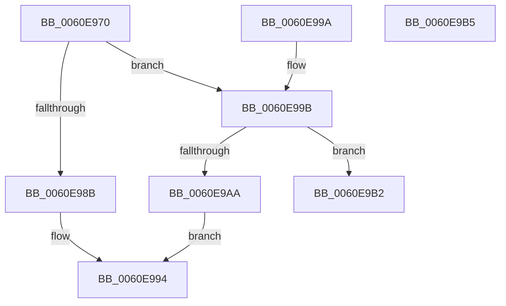

# ST_STORE&lt;SM_TRAITS&gt;::StRegionReadReference

- RVA: `0x0060E970`–`0x0060E9B6` (길이 `70` bytes)
- VA: `0x000000014060E970`
- 실행 섹션: `.text`
- PDB 이름 있음: `예`; PDB Function 태그: `아니요`
- unwind 정보 RVA: `0x000DB714`
- 디코드: `21`개 명령, `70/70` bytes 표시
- 미해석 바이트: `0` (있으면 어셈블리에 `.byte`로 보존)

> 이 문서는 커널 이미지의 기계어와 PDB 기호를 분석해 생성했습니다. 4번과 5번은 함수 원형과 자료형을 바이너리 사용 방식에서 추정한 C 해석이며 원본 소스 복구 결과는 아닙니다.

## 1. Dependencies

- 직접 호출 지점: **0**; 고유 호출 대상: **0**
- 직접 호출자로 확인된 함수: **1**
- RIP 상대 이미지 참조: **0**

### Outgoing calls
- 직접 디코드된 call 명령이 없습니다.

### Direct callers
- [ST_STORE&lt;SM_TRAITS&gt;::StDeviceIoBuild](ST_STORE_SM_TRAITS_StDeviceIoBuild_function_0060CDEC.md) at `0x0060CE66`

### Static image references
- 디코드된 RIP-relative 메모리 참조가 없습니다.

## 2. Other-region calls and transfers

- 다른 실행 섹션으로 향하는 call: **0**
- 별도 외부 분기/꼬리 이동을 확인하지 못했습니다.

## 3. Assembly (complete function range)

```asm
0060E970  44 8B C2                        mov r8d, edx
0060E973  41 B9 00 40 00 00               mov r9d, 0x4000
0060E979  48 8B 91 78 05 00 00            mov rdx, qword ptr [rcx + 0x578]
0060E980  42 0F B7 04 42                  movzx eax, word ptr [rdx + r8*2]
0060E985  66 41 85 C1                     test r9w, ax
0060E989  75 10                           jne 0x14060e99b
0060E98B  66 41 0B C1                     or ax, r9w
0060E98F  66 42 89 04 42                  mov word ptr [rdx + r8*2], ax
0060E994  B8 01 00 00 00                  mov eax, 1
0060E999  C3                              ret
0060E99A  CC                              int3
0060E99B  48 8B 89 80 05 00 00            mov rcx, qword ptr [rcx + 0x580]
0060E9A2  41 8A 04 08                     mov al, byte ptr [r8 + rcx]
0060E9A6  3C FF                           cmp al, 0xff
0060E9A8  73 08                           jae 0x14060e9b2
0060E9AA  FE C0                           inc al
0060E9AC  41 88 04 08                     mov byte ptr [r8 + rcx], al
0060E9B0  EB E2                           jmp 0x14060e994
0060E9B2  33 C0                           xor eax, eax
0060E9B4  C3                              ret
0060E9B5  CC                              int3
```

## 4. C-style interpretation (structured pseudocode)

```c
__int64 __fastcall ST_STORE_SM_TRAITS___StRegionReadReference(__int64 a1, int a2)
{
    __int64 result;

    if ((((unsigned __int16)((unsigned int)(0x4000ULL))) & ((unsigned __int16)(*(unsigned __int16 *)(*(unsigned __int64 *)(a1 + 1400) + (unsigned int)(a2) * 2)))) != 0) goto loc_0060E99B;
    result = (unsigned __int16)((*(unsigned __int16 *)(*(unsigned __int64 *)(a1 + 1400) + (unsigned int)(a2) * 2)) | ((unsigned __int16)((unsigned int)(0x4000ULL))));
    *(unsigned __int16 *)(*(unsigned __int64 *)(a1 + 1400) + (unsigned int)(a2) * 2) = (unsigned __int16)(result);
loc_0060E994:
    return 1;
loc_0060E99B:
    if (((unsigned __int8)(*(unsigned __int8 *)((unsigned int)(a2) + *(unsigned __int64 *)(a1 + 1408) * 1))) >= 255) goto loc_0060E9B2;
    result = (unsigned __int8)((*(unsigned __int8 *)((unsigned int)(a2) + *(unsigned __int64 *)(a1 + 1408) * 1)) + 1);
    *(unsigned __int8 *)((unsigned int)(a2) + *(unsigned __int64 *)(a1 + 1408) * 1) = (unsigned __int8)(result);
    goto loc_0060E994;
loc_0060E9B2:
    result = 0;
    return result;
}
```

## 5. (Beta) C Style

```c
int64_t ST_STORE_SM_TRAITS___StRegionReadReference(void *Arg1, void *Arg2)
{
    uint8_t *arg1 = (uint8_t *)Arg1;
    uint8_t *arg2 = (uint8_t *)Arg2;

    int64_t result;

    if ((((uint16_t)((uint32_t)(0x4000ULL))) & ((uint16_t)(*(uint16_t *)(*(uint64_t *)(arg1 + 0x578) + (uint32_t)(arg2) * 2)))) != 0) goto loc_0060E99B;
    result = (uint16_t)((*(uint16_t *)(*(uint64_t *)(arg1 + 0x578) + (uint32_t)(arg2) * 2)) | ((uint16_t)((uint32_t)(0x4000ULL))));
    *(uint16_t *)(*(uint64_t *)(arg1 + 0x578) + (uint32_t)(arg2) * 2) = (uint16_t)(result);
loc_0060E994:
    return 1;
loc_0060E99B:
    if (((uint8_t)(*(uint8_t *)((uint32_t)(arg2) + *(uint64_t *)(arg1 + 0x580) * 1))) >= 255) goto loc_0060E9B2;
    result = (uint8_t)((*(uint8_t *)((uint32_t)(arg2) + *(uint64_t *)(arg1 + 0x580) * 1)) + 1);
    *(uint8_t *)((uint32_t)(arg2) + *(uint64_t *)(arg1 + 0x580) * 1) = (uint8_t)(result);
    goto loc_0060E994;
loc_0060E9B2:
    result = 0;
    return result;
}
```

### 관측된 메모리 오프셋

구조체 형식이 확인되지 않은 접근은 인자 기준의 오프셋으로만 기록했습니다.

| 기준 인자 | 오프셋 표현 | 폭 (bit) | 접근 |
|---|---:|---:|---|
| `Arg1` | `+ 0x578` | `64` | `R` |
| `Arg1` | `+ 0x580` | `64` | `R` |
| `Arg2` | `+ 0x0 + rcx*1` | `8` | `R` |
| `Arg2` | `+ 0x0 + rcx*1` | `8` | `W` |

## 6. Execution-region graph

[열기: 2D/3D 그래프와 함수 탐색 컨트롤 패널](../../../control-panel.html?section=text&rva=0x0060E970&view=graph)

- 2D 그래프는 위에서 아래로 흐르고, 3D 그래프는 빈 공간을 드래그해 회전합니다. Shift+드래그는 이동, 휠은 확대·축소, 함수 노드 선택은 대상 보고서 이동입니다.

### Static fallback


