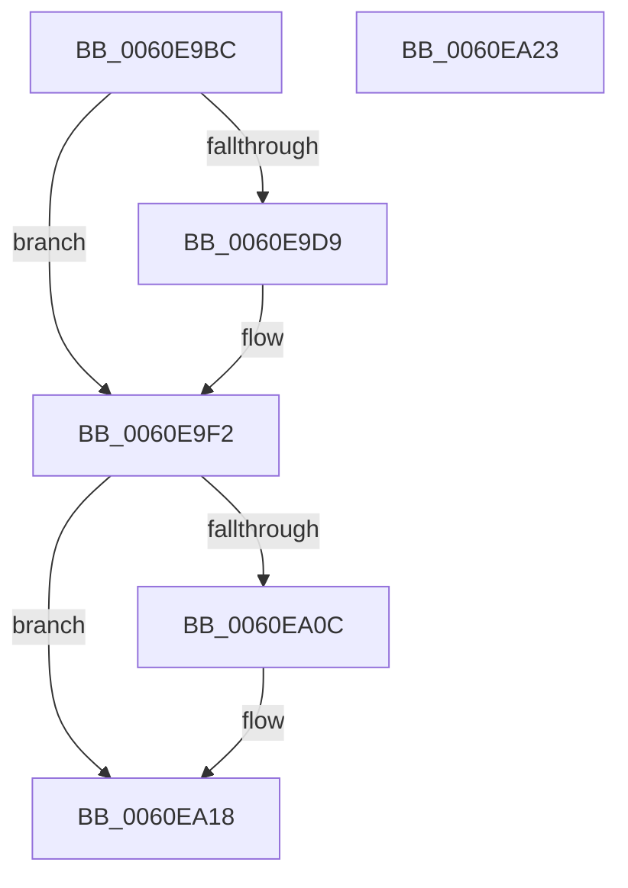

# ST_STORE&lt;SM_TRAITS&gt;::StSetDataMovementInProgress

- RVA: `0x0060E9BC`–`0x0060EA24` (길이 `104` bytes)
- VA: `0x000000014060E9BC`
- 실행 섹션: `.text`
- PDB 이름 있음: `예`; PDB Function 태그: `아니요`
- unwind 정보 RVA: `0x0005CAAC`
- 디코드: `22`개 명령, `104/104` bytes 표시
- 미해석 바이트: `0` (있으면 어셈블리에 `.byte`로 보존)

> 이 문서는 커널 이미지의 기계어와 PDB 기호를 분석해 생성했습니다. 4번과 5번은 함수 원형과 자료형을 바이너리 사용 방식에서 추정한 C 해석이며 원본 소스 복구 결과는 아닙니다.

## 1. Dependencies

- 직접 호출 지점: **2**; 고유 호출 대상: **2**
- 직접 호출자로 확인된 함수: **4**
- RIP 상대 이미지 참조: **0**

### Outgoing calls
- `0x0060E9E0` → [StLockAcquireExclusive](../26/StLockAcquireExclusive_function_00266FF0.md) (function, `0x00266FF0`)
- `0x0060EA13` → [StLockReleaseExclusive](../26/StLockReleaseExclusive_function_00267050.md) (function, `0x00267050`)

### Direct callers
- [ST_STORE&lt;SM_TRAITS&gt;::StDmReuseCurrentRegion](../3B/ST_STORE_SM_TRAITS_StDmReuseCurrentRegion_function_003B107C.md) at `0x003B10A6`
- [ST_STORE&lt;SM_TRAITS&gt;::StDmCurrentRegionSet](../3B/ST_STORE_SM_TRAITS_StDmCurrentRegionSet_function_003B1130.md) at `0x003B117D`
- [ST_STORE&lt;SM_TRAITS&gt;::StCompactionPerformInMem](../41/ST_STORE_SM_TRAITS_StCompactionPerformInMem_function_004111D8.md) at `0x0041128B`
- [ST_STORE&lt;SM_TRAITS&gt;::StCompactionPerformEmergency](../4E/ST_STORE_SM_TRAITS_StCompactionPerformEmergency_function_004EB170.md) at `0x004EB193`

### Static image references
- 디코드된 RIP-relative 메모리 참조가 없습니다.

## 2. Other-region calls and transfers

- 다른 실행 섹션으로 향하는 call: **0**
- 별도 외부 분기/꼬리 이동을 확인하지 못했습니다.

## 3. Assembly (complete function range)

```asm
0060E9BC  48 89 5C 24 08                  mov qword ptr [rsp + 8], rbx
0060E9C1  57                              push rdi
0060E9C2  48 83 EC 20                     sub rsp, 0x20
0060E9C6  48 8B 99 20 03 00 00            mov rbx, qword ptr [rcx + 0x320]
0060E9CD  48 8B F9                        mov rdi, rcx
0060E9D0  F6 83 95 1A 00 00 04            test byte ptr [rbx + 0x1a95], 4
0060E9D7  74 19                           je 0x14060e9f2
0060E9D9  48 8D 8B B0 1A 00 00            lea rcx, [rbx + 0x1ab0]
0060E9E0  E8 0B 86 C5 FF                  call 0x140266ff0
0060E9E5  48 FF 83 C0 1A 00 00            inc qword ptr [rbx + 0x1ac0]
0060E9EC  89 83 B8 1A 00 00               mov dword ptr [rbx + 0x1ab8], eax
0060E9F2  C7 87 C0 05 00 00 01 00 00 00   mov dword ptr [rdi + 0x5c0], 1
0060E9FC  48 8B 8F 20 03 00 00            mov rcx, qword ptr [rdi + 0x320]
0060EA03  F6 81 95 1A 00 00 04            test byte ptr [rcx + 0x1a95], 4
0060EA0A  74 0C                           je 0x14060ea18
0060EA0C  48 81 C1 B0 1A 00 00            add rcx, 0x1ab0
0060EA13  E8 38 86 C5 FF                  call 0x140267050
0060EA18  48 8B 5C 24 30                  mov rbx, qword ptr [rsp + 0x30]
0060EA1D  48 83 C4 20                     add rsp, 0x20
0060EA21  5F                              pop rdi
0060EA22  C3                              ret
0060EA23  CC                              int3
```

## 4. C-style interpretation (structured pseudocode)

```c
__int64 __fastcall ST_STORE_SM_TRAITS___StSetDataMovementInProgress(__int64 a1)
{
    __int64 result;
    __int64 v_rsp;
    unsigned __int64 v_stack_p8;

    v_stack_p8 = v_rbx;
    v_rsp = (v_rsp) - (32);
    if (((*(unsigned __int8 *)(*(unsigned __int64 *)(a1 + 800) + 6805)) & (4)) != 0) {
        a1 = *(unsigned __int64 *)(a1 + 800) + 6832;
        result = StLockAcquireExclusive(a1, a2, a3, a4);
        *(unsigned int *)(*(unsigned __int64 *)(a1 + 800) + 6840) = (unsigned int)(result);
    }
    *(unsigned int *)(a1 + 1472) = 1;
    if (((*(unsigned __int8 *)(*(unsigned __int64 *)(a1 + 800) + 6805)) & (4)) != 0) {
        a1 = (*(unsigned __int64 *)(a1 + 800)) + (0x1AB0ULL);
        result = StLockReleaseExclusive(a1, a2, a3, a4);
    }
    v_rsp = (v_rsp) + (32);
    return result;
}
```

## 5. (Beta) C Style

```c
int64_t ST_STORE_SM_TRAITS___StSetDataMovementInProgress(void *Arg1)
{
    uint8_t *arg1 = (uint8_t *)Arg1;

    int64_t result;
    int64_t local_rsp;
    uint64_t v_stack_p8;

    v_stack_p8 = local_rbx;
    local_rsp = (local_rsp) - (32);
    if (((*(uint8_t *)(*(uint64_t *)(arg1 + 0x320) + 0x1A95)) & (4)) != 0) {
        Arg1 = *(uint64_t *)(arg1 + 0x320) + 6832;
        result = StLockAcquireExclusive(Arg1, a2, a3, a4);
        *(uint32_t *)(*(uint64_t *)(arg1 + 0x320) + 0x1AB8) = (uint32_t)(result);
    }
    *(uint32_t *)(arg1 + 0x5C0) = 1;
    if (((*(uint8_t *)(*(uint64_t *)(arg1 + 0x320) + 0x1A95)) & (4)) != 0) {
        Arg1 = (*(uint64_t *)(arg1 + 0x320)) + (0x1AB0ULL);
        result = StLockReleaseExclusive(Arg1, a2, a3, a4);
    }
    local_rsp = (local_rsp) + (32);
    return result;
}
```

### 관측된 메모리 오프셋

구조체 형식이 확인되지 않은 접근은 인자 기준의 오프셋으로만 기록했습니다.

| 기준 인자 | 오프셋 표현 | 폭 (bit) | 접근 |
|---|---:|---:|---|
| `Arg1` | `+ 0x320` | `64` | `R` |
| `Arg1` | `+ 0x5C0` | `32` | `W` |

## 6. Execution-region graph

[열기: 2D/3D 그래프와 함수 탐색 컨트롤 패널](../../../control-panel.html?section=text&rva=0x0060E9BC&view=graph)

- 2D 그래프는 위에서 아래로 흐르고, 3D 그래프는 빈 공간을 드래그해 회전합니다. Shift+드래그는 이동, 휠은 확대·축소, 함수 노드 선택은 대상 보고서 이동입니다.

### Static fallback


