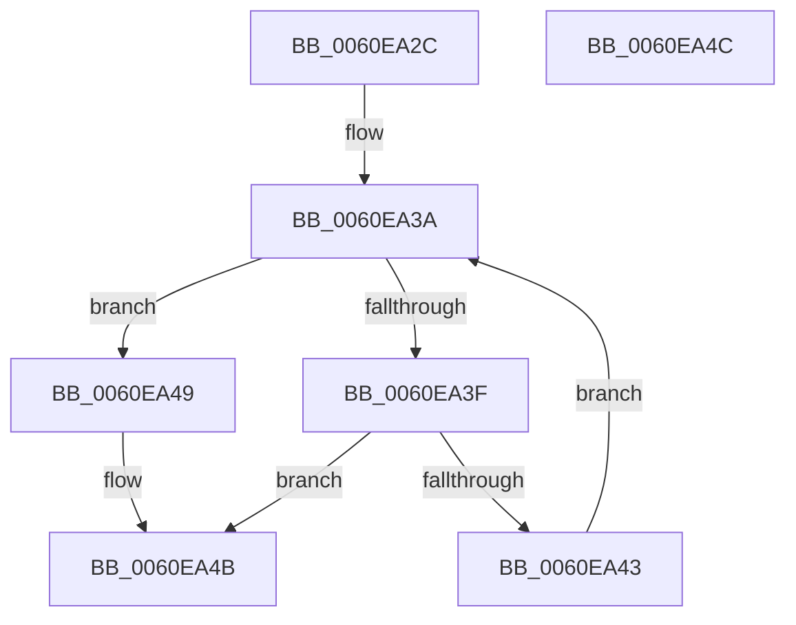

# ST_STORE&lt;SM_TRAITS&gt;::StStagingRegionFind

- RVA: `0x0060EA2C`–`0x0060EA4D` (길이 `33` bytes)
- VA: `0x000000014060EA2C`
- 실행 섹션: `.text`
- PDB 이름 있음: `예`; PDB Function 태그: `아니요`
- unwind 정보 RVA: `0x000DB714`
- 디코드: `11`개 명령, `33/33` bytes 표시
- 미해석 바이트: `0` (있으면 어셈블리에 `.byte`로 보존)

> 이 문서는 커널 이미지의 기계어와 PDB 기호를 분석해 생성했습니다. 4번과 5번은 함수 원형과 자료형을 바이너리 사용 방식에서 추정한 C 해석이며 원본 소스 복구 결과는 아닙니다.

## 1. Dependencies

- 직접 호출 지점: **0**; 고유 호출 대상: **0**
- 직접 호출자로 확인된 함수: **2**
- RIP 상대 이미지 참조: **0**

### Outgoing calls
- 직접 디코드된 call 명령이 없습니다.

### Direct callers
- [ST_STORE&lt;SM_TRAITS&gt;::StDmPickRandomRegion](ST_STORE_SM_TRAITS_StDmPickRandomRegion_function_0060DF34.md) at `0x0060DF69`
- [ST_STORE&lt;SM_TRAITS&gt;::StDmRegionRemove](ST_STORE_SM_TRAITS_StDmRegionRemove_function_0060E314.md) at `0x0060E3AA`

### Static image references
- 디코드된 RIP-relative 메모리 참조가 없습니다.

## 2. Other-region calls and transfers

- 다른 실행 섹션으로 향하는 call: **0**
- 별도 외부 분기/꼬리 이동을 확인하지 못했습니다.

## 3. Assembly (complete function range)

```asm
0060EA2C  48 8D 81 C8 05 00 00            lea rax, [rcx + 0x5c8]
0060EA33  48 8D 88 90 00 00 00            lea rcx, [rax + 0x90]
0060EA3A  48 3B C1                        cmp rax, rcx
0060EA3D  73 0A                           jae 0x14060ea49
0060EA3F  39 10                           cmp dword ptr [rax], edx
0060EA41  74 08                           je 0x14060ea4b
0060EA43  48 83 C0 18                     add rax, 0x18
0060EA47  EB F1                           jmp 0x14060ea3a
0060EA49  33 C0                           xor eax, eax
0060EA4B  C3                              ret
0060EA4C  CC                              int3
```

## 4. C-style interpretation (structured pseudocode)

```c
__int64 __fastcall ST_STORE_SM_TRAITS___StStagingRegionFind(__int64 a1, int a2)
{
    __int64 result;

loc_0060EA3A:
    if ((a1 + 1480) >= (a1 + 1480 + 144)) goto loc_0060EA49;
    if ((*(unsigned int *)(a1 + 1480)) == a2) goto loc_0060EA4B;
    result = (a1 + 1480) + (24);
    goto loc_0060EA3A;
loc_0060EA49:
    result = 0;
loc_0060EA4B:
    return result;
}
```

## 5. (Beta) C Style

```c
int64_t ST_STORE_SM_TRAITS___StStagingRegionFind(void *Arg1, int32_t Arg2)
{
    uint8_t *arg1 = (uint8_t *)Arg1;

    int64_t result;

loc_0060EA3A:
    if ((Arg1 + 1480) >= (Arg1 + 1480 + 144)) goto loc_0060EA49;
    if ((*(uint32_t *)(arg1 + 0x5C8)) == Arg2) goto loc_0060EA4B;
    result = (Arg1 + 1480) + (24);
    goto loc_0060EA3A;
loc_0060EA49:
    result = 0;
loc_0060EA4B:
    return result;
}
```

### 관측된 메모리 오프셋

구조체 형식이 확인되지 않은 접근은 인자 기준의 오프셋으로만 기록했습니다.

| 기준 인자 | 오프셋 표현 | 폭 (bit) | 접근 |
|---|---:|---:|---|
| `Arg1` | `+ 0x90` | `64` | `R` |
| `Arg1` | `+ 0x5C8` | `64` | `R` |

## 6. Execution-region graph

[열기: 2D/3D 그래프와 함수 탐색 컨트롤 패널](../../../control-panel.html?section=text&rva=0x0060EA2C&view=graph)

- 2D 그래프는 위에서 아래로 흐르고, 3D 그래프는 빈 공간을 드래그해 회전합니다. Shift+드래그는 이동, 휠은 확대·축소, 함수 노드 선택은 대상 보고서 이동입니다.

### Static fallback


