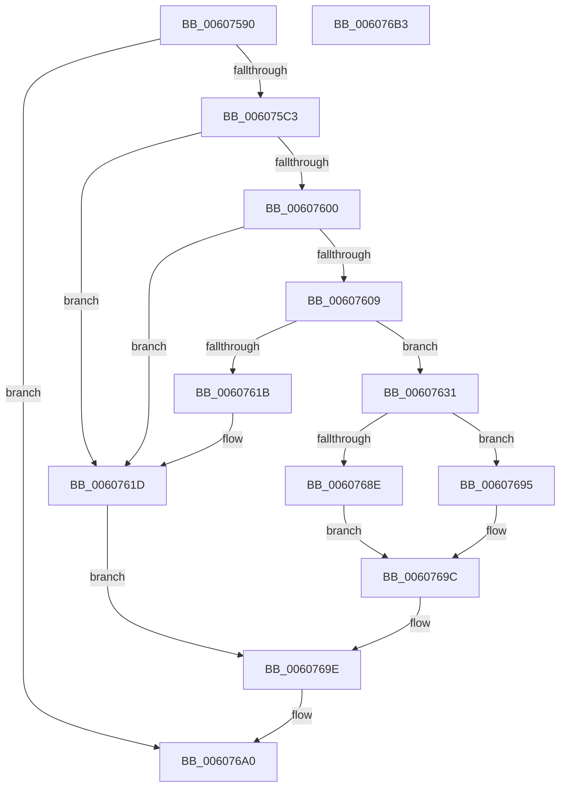

# SeAdjustAntiTamperCreatorAccess

- RVA: `0x00607590`–`0x006076B4` (길이 `292` bytes)
- VA: `0x0000000140607590`
- 실행 섹션: `.text`
- PDB 이름 있음: `예`; PDB Function 태그: `아니요`
- unwind 정보 RVA: `0x000D0FEC`
- 디코드: `85`개 명령, `292/292` bytes 표시
- 미해석 바이트: `0` (있으면 어셈블리에 `.byte`로 보존)

> 이 문서는 커널 이미지의 기계어와 PDB 기호를 분석해 생성했습니다. 4번과 5번은 함수 원형과 자료형을 바이너리 사용 방식에서 추정한 C 해석이며 원본 소스 복구 결과는 아닙니다.

## 1. Dependencies

- 직접 호출 지점: **11**; 고유 호출 대상: **9**
- 직접 호출자로 확인된 함수: **1**
- RIP 상대 이미지 참조: **0**

### Outgoing calls
- `0x006075E1` → [SeCaptureSubjectContext](../../page/86/SeCaptureSubjectContext_function_0086B820.md) (function, `0x0086B820`)
- `0x006075F5` → [SepGetMandatoryAccessControlList](../../page/79/SepGetMandatoryAccessControlList_function_0079D5EC.md) (function, `0x0079D5EC`)
- `0x00607612` → [RtlCreateSecurityDescriptor](../../page/9F/RtlCreateSecurityDescriptor_function_009F1DF0.md) (function, `0x009F1DF0`)
- `0x00607621` → [SepReleaseMandatoryAccessControlList](../../page/79/SepReleaseMandatoryAccessControlList_function_0079D974.md) (function, `0x0079D974`)
- `0x0060762A` → [SeReleaseSubjectContext](../../page/86/SeReleaseSubjectContext_function_0086B710.md) (function, `0x0086B710`)
- `0x0060763D` → [RtlSetSaclSecurityDescriptor](../../page/A1/RtlSetSaclSecurityDescriptor_function_00A18B80.md) (function, `0x00A18B80`)
- `0x00607646` → [SeLockSubjectContext](../../page/8C/SeLockSubjectContext_function_008C64C0.md) (function, `0x008C64C0`)
- `0x00607666` → [SepMandatoryAccessCheck](SepMandatoryAccessCheck_function_00608480.md) (function, `0x00608480`)
- `0x00607671` → [SepReleaseMandatoryAccessControlList](../../page/79/SepReleaseMandatoryAccessControlList_function_0079D974.md) (function, `0x0079D974`)
- `0x0060767A` → [SeUnlockSubjectContext](../../page/8C/SeUnlockSubjectContext_function_008C6520.md) (function, `0x008C6520`)
- `0x00607683` → [SeReleaseSubjectContext](../../page/86/SeReleaseSubjectContext_function_0086B710.md) (function, `0x0086B710`)

### Direct callers
- [NtCreateUserProcess](../../page/AE/NtCreateUserProcess_function_00AEA680.md) at `0x00AEB563`
- [NtCreateUserProcess](../../page/AE/NtCreateUserProcess_function_00AEA680.md) at `0x00AEB59A`

### Static image references
- 디코드된 RIP-relative 메모리 참조가 없습니다.

## 2. Other-region calls and transfers

- 다른 실행 섹션으로 향하는 call: **10**
  - `0x006075E1` → [SeCaptureSubjectContext](../../page/86/SeCaptureSubjectContext_function_0086B820.md) (`.text` → `PAGE`)
  - `0x006075F5` → [SepGetMandatoryAccessControlList](../../page/79/SepGetMandatoryAccessControlList_function_0079D5EC.md) (`.text` → `PAGE`)
  - `0x00607612` → [RtlCreateSecurityDescriptor](../../page/9F/RtlCreateSecurityDescriptor_function_009F1DF0.md) (`.text` → `PAGE`)
  - `0x00607621` → [SepReleaseMandatoryAccessControlList](../../page/79/SepReleaseMandatoryAccessControlList_function_0079D974.md) (`.text` → `PAGE`)
  - `0x0060762A` → [SeReleaseSubjectContext](../../page/86/SeReleaseSubjectContext_function_0086B710.md) (`.text` → `PAGE`)
  - `0x0060763D` → [RtlSetSaclSecurityDescriptor](../../page/A1/RtlSetSaclSecurityDescriptor_function_00A18B80.md) (`.text` → `PAGE`)
  - `0x00607646` → [SeLockSubjectContext](../../page/8C/SeLockSubjectContext_function_008C64C0.md) (`.text` → `PAGE`)
  - `0x00607671` → [SepReleaseMandatoryAccessControlList](../../page/79/SepReleaseMandatoryAccessControlList_function_0079D974.md) (`.text` → `PAGE`)
  - `0x0060767A` → [SeUnlockSubjectContext](../../page/8C/SeUnlockSubjectContext_function_008C6520.md) (`.text` → `PAGE`)
  - `0x00607683` → [SeReleaseSubjectContext](../../page/86/SeReleaseSubjectContext_function_0086B710.md) (`.text` → `PAGE`)
- 별도 외부 분기/꼬리 이동을 확인하지 못했습니다.

## 3. Assembly (complete function range)

```asm
00607590  48 89 5C 24 08                  mov qword ptr [rsp + 8], rbx
00607595  55                              push rbp
00607596  56                              push rsi
00607597  57                              push rdi
00607598  48 8D 6C 24 B9                  lea rbp, [rsp - 0x47]
0060759D  48 81 EC 90 00 00 00            sub rsp, 0x90
006075A4  33 C0                           xor eax, eax
006075A6  0F 57 C0                        xorps xmm0, xmm0
006075A9  48 89 45 37                     mov qword ptr [rbp + 0x37], rax
006075AD  49 8B F0                        mov rsi, r8
006075B0  48 8B F9                        mov rdi, rcx
006075B3  0F 11 45 17                     movups xmmword ptr [rbp + 0x17], xmm0
006075B7  0F 11 45 27                     movups xmmword ptr [rbp + 0x27], xmm0
006075BB  84 D2                           test dl, dl
006075BD  0F 84 DD 00 00 00               je 0x1406076a0
006075C3  41 8B 18                        mov ebx, dword ptr [r8]
006075C6  48 8D 4D F7                     lea rcx, [rbp - 9]
006075CA  21 45 6F                        and dword ptr [rbp + 0x6f], eax
006075CD  0F 57 C9                        xorps xmm1, xmm1
006075D0  48 21 45 7F                     and qword ptr [rbp + 0x7f], rax
006075D4  0F 11 4D F7                     movups xmmword ptr [rbp - 9], xmm1
006075D8  0F 11 4D 07                     movups xmmword ptr [rbp + 7], xmm1
006075DC  F3 0F 7F 45 E7                  movdqu xmmword ptr [rbp - 0x19], xmm0
006075E1  E8 3A 42 26 00                  call 0x14086b820
006075E6  4C 8D 4D E7                     lea r9, [rbp - 0x19]
006075EA  48 8B D7                        mov rdx, rdi
006075ED  4C 8D 45 7F                     lea r8, [rbp + 0x7f]
006075F1  48 8D 4D F7                     lea rcx, [rbp - 9]
006075F5  E8 F2 5F 19 00                  call 0x14079d5ec
006075FA  8B F8                           mov edi, eax
006075FC  85 C0                           test eax, eax
006075FE  78 1D                           js 0x14060761d
00607600  48 8B 7D 7F                     mov rdi, qword ptr [rbp + 0x7f]
00607604  48 85 FF                        test rdi, rdi
00607607  74 14                           je 0x14060761d
00607609  BA 01 00 00 00                  mov edx, 1
0060760E  48 8D 4D 17                     lea rcx, [rbp + 0x17]
00607612  E8 D9 A7 3E 00                  call 0x1409f1df0
00607617  85 C0                           test eax, eax
00607619  79 16                           jns 0x140607631
0060761B  8B F8                           mov edi, eax
0060761D  48 8D 4D E7                     lea rcx, [rbp - 0x19]
00607621  E8 4E 63 19 00                  call 0x14079d974
00607626  48 8D 4D F7                     lea rcx, [rbp - 9]
0060762A  E8 E1 40 26 00                  call 0x14086b710
0060762F  EB 6D                           jmp 0x14060769e
00607631  45 33 C9                        xor r9d, r9d
00607634  48 8D 4D 17                     lea rcx, [rbp + 0x17]
00607638  4C 8B C7                        mov r8, rdi
0060763B  B2 01                           mov dl, 1
0060763D  E8 3E 15 41 00                  call 0x140a18b80
00607642  48 8D 4D F7                     lea rcx, [rbp - 9]
00607646  E8 75 EE 2B 00                  call 0x1408c64c0
0060764B  48 8D 45 6F                     lea rax, [rbp + 0x6f]
0060764F  45 33 C9                        xor r9d, r9d
00607652  48 89 44 24 28                  mov qword ptr [rsp + 0x28], rax
00607657  48 8D 55 F7                     lea rdx, [rbp - 9]
0060765B  45 33 C0                        xor r8d, r8d
0060765E  89 5C 24 20                     mov dword ptr [rsp + 0x20], ebx
00607662  48 8D 4D 17                     lea rcx, [rbp + 0x17]
00607666  E8 15 0E 00 00                  call 0x140608480
0060766B  48 8D 4D E7                     lea rcx, [rbp - 0x19]
0060766F  8B F8                           mov edi, eax
00607671  E8 FE 62 19 00                  call 0x14079d974
00607676  48 8D 4D F7                     lea rcx, [rbp - 9]
0060767A  E8 A1 EE 2B 00                  call 0x1408c6520
0060767F  48 8D 4D F7                     lea rcx, [rbp - 9]
00607683  E8 88 40 26 00                  call 0x14086b710
00607688  0F BA E3 19                     bt ebx, 0x19
0060768C  73 07                           jae 0x140607695
0060768E  8B 5D 6F                        mov ebx, dword ptr [rbp + 0x6f]
00607691  F7 D3                           not ebx
00607693  EB 07                           jmp 0x14060769c
00607695  8B 45 6F                        mov eax, dword ptr [rbp + 0x6f]
00607698  F7 D0                           not eax
0060769A  23 D8                           and ebx, eax
0060769C  89 1E                           mov dword ptr [rsi], ebx
0060769E  8B C7                           mov eax, edi
006076A0  48 8B 9C 24 B0 00 00 00         mov rbx, qword ptr [rsp + 0xb0]
006076A8  48 81 C4 90 00 00 00            add rsp, 0x90
006076AF  5F                              pop rdi
006076B0  5E                              pop rsi
006076B1  5D                              pop rbp
006076B2  C3                              ret
006076B3  CC                              int3
```

## 4. C-style interpretation (structured pseudocode)

```c
__int64 __fastcall SeAdjustAntiTamperCreatorAccess(__int64 a1, unsigned __int8 a2, __int64 a3)
{
    __int64 result;
    __int64 v_rbx;
    __int64 v_rsp;
    unsigned __int64 v_stack_m28;
    unsigned __int64 v_stack_m38;
    unsigned __int64 v_stack_m48;
    unsigned __int64 v_stack_m58;
    unsigned __int64 v_stack_m5F;
    unsigned __int64 v_stack_m68;
    unsigned __int64 v_stack_m78;
    unsigned __int64 v_stack_m80;
    unsigned int v_stack_m88;
    unsigned int v_stack_p10;
    unsigned __int64 v_stack_p20;
    unsigned __int64 v_stack_p8;

    v_stack_p8 = v_rbx;
    v_rsp = (v_rsp) - (144);
    result = 0;
    v_stack_m28 = 0;
    v_stack_m48 = v_xmm0;
    v_stack_m38 = v_xmm0;
    if (a2 == 0) goto loc_006076A0;
    v_stack_m68 = v_xmm1;
    v_stack_m58 = v_xmm1;
    v_stack_m78 = v_xmm0;
    result = SeCaptureSubjectContext(v_stack_m68, a2, a3, a4);
    result = SepGetMandatoryAccessControlList(v_stack_m68, a1, v_stack_p20, v_stack_m78);
    if (sign_flag) goto loc_0060761D;
    if (v_stack_p20 == 0) goto loc_0060761D;
    result = RtlCreateSecurityDescriptor(v_stack_m48, 1, v_stack_p20, v_stack_m78);
    if (!sign_flag) goto loc_00607631;
loc_0060761D:
    result = SepReleaseMandatoryAccessControlList(v_stack_m78, 1, v_stack_p20, v_stack_m78);
    result = SeReleaseSubjectContext(v_stack_m68, 1, v_stack_p20, v_stack_m78);
    goto loc_0060769E;
loc_00607631:
    a4 = 0;
    result = RtlSetSaclSecurityDescriptor(v_stack_m48, 1, (unsigned int)((unsigned int)(result)), a4);
    result = SeLockSubjectContext(v_stack_m68, 1, (unsigned int)((unsigned int)(result)), a4);
    a4 = 0;
    v_stack_m80 = v_stack_p10;
    a3 = 0;
    v_stack_m88 = (unsigned int)((unsigned int)(*(unsigned int *)(a3)));
    result = SepMandatoryAccessCheck(v_stack_m48, v_stack_m68, a3, a4);
    result = SepReleaseMandatoryAccessControlList(v_stack_m78, v_stack_m68, a3, a4);
    result = SeUnlockSubjectContext(v_stack_m68, v_stack_m68, a3, a4);
    result = SeReleaseSubjectContext(v_stack_m68, v_stack_m68, a3, a4);
    if (condition_is_above_or_equal) goto loc_00607695;
    v_rbx = (unsigned int)(~((unsigned int)(v_stack_p10)));
    goto loc_0060769C;
loc_00607695:
    result = (unsigned int)(~((unsigned int)(v_stack_p10)));
    v_rbx = (unsigned int)((v_rbx) & ((unsigned int)(result)));
loc_0060769C:
    *(unsigned int *)(a3) = (unsigned int)(v_rbx);
loc_0060769E:
loc_006076A0:
    v_rsp = (v_rsp) + (144);
    return (unsigned int)((unsigned int)((unsigned int)((unsigned int)(result))));
}
```

## 5. (Beta) C Style

```c
int64_t SeAdjustAntiTamperCreatorAccess(int64_t Arg1, uint8_t Arg2, void *Arg3)
{
    uint8_t *arg3 = (uint8_t *)Arg3;

    int64_t result;
    int64_t local_rbx;
    int64_t local_rsp;
    uint64_t v_stack_m28;
    uint64_t v_stack_m38;
    uint64_t v_stack_m48;
    uint64_t v_stack_m58;
    uint64_t v_stack_m5F;
    uint64_t v_stack_m68;
    uint64_t v_stack_m78;
    uint64_t v_stack_m80;
    uint32_t v_stack_m88;
    uint32_t v_stack_p10;
    uint64_t v_stack_p20;
    uint64_t v_stack_p8;

    v_stack_p8 = local_rbx;
    local_rsp = (local_rsp) - (144);
    result = 0;
    v_stack_m28 = 0;
    v_stack_m48 = v_xmm0;
    v_stack_m38 = v_xmm0;
    if (Arg2 == 0) goto loc_006076A0;
    v_stack_m68 = v_xmm1;
    v_stack_m58 = v_xmm1;
    v_stack_m78 = v_xmm0;
    result = SeCaptureSubjectContext(v_stack_m68, Arg2, Arg3, a4);
    result = SepGetMandatoryAccessControlList(v_stack_m68, Arg1, v_stack_p20, v_stack_m78);
    if (sign_flag) goto loc_0060761D;
    if (v_stack_p20 == 0) goto loc_0060761D;
    result = RtlCreateSecurityDescriptor(v_stack_m48, 1, v_stack_p20, v_stack_m78);
    if (!sign_flag) goto loc_00607631;
loc_0060761D:
    result = SepReleaseMandatoryAccessControlList(v_stack_m78, 1, v_stack_p20, v_stack_m78);
    result = SeReleaseSubjectContext(v_stack_m68, 1, v_stack_p20, v_stack_m78);
    goto loc_0060769E;
loc_00607631:
    a4 = 0;
    result = RtlSetSaclSecurityDescriptor(v_stack_m48, 1, (uint32_t)((uint32_t)(result)), a4);
    result = SeLockSubjectContext(v_stack_m68, 1, (uint32_t)((uint32_t)(result)), a4);
    a4 = 0;
    v_stack_m80 = v_stack_p10;
    Arg3 = 0;
    v_stack_m88 = (uint32_t)((uint32_t)(*(uint32_t *)(arg3)));
    result = SepMandatoryAccessCheck(v_stack_m48, v_stack_m68, Arg3, a4);
    result = SepReleaseMandatoryAccessControlList(v_stack_m78, v_stack_m68, Arg3, a4);
    result = SeUnlockSubjectContext(v_stack_m68, v_stack_m68, Arg3, a4);
    result = SeReleaseSubjectContext(v_stack_m68, v_stack_m68, Arg3, a4);
    if (condition_is_above_or_equal) goto loc_00607695;
    local_rbx = (uint32_t)(~((uint32_t)(v_stack_p10)));
    goto loc_0060769C;
loc_00607695:
    result = (uint32_t)(~((uint32_t)(v_stack_p10)));
    local_rbx = (uint32_t)((local_rbx) & ((uint32_t)(result)));
loc_0060769C:
    *(uint32_t *)(arg3) = (uint32_t)(local_rbx);
loc_0060769E:
loc_006076A0:
    local_rsp = (local_rsp) + (144);
    return (uint32_t)((uint32_t)((uint32_t)((uint32_t)(result))));
}
```

### 관측된 메모리 오프셋

구조체 형식이 확인되지 않은 접근은 인자 기준의 오프셋으로만 기록했습니다.

| 기준 인자 | 오프셋 표현 | 폭 (bit) | 접근 |
|---|---:|---:|---|
| `Arg3` | `+ 0x0` | `32` | `R` |
| `Arg3` | `+ 0x0` | `32` | `W` |

## 6. Execution-region graph

[열기: 2D/3D 그래프와 함수 탐색 컨트롤 패널](../../../control-panel.html?section=text&rva=0x00607590&view=graph)

- 2D 그래프는 위에서 아래로 흐르고, 3D 그래프는 빈 공간을 드래그해 회전합니다. Shift+드래그는 이동, 휠은 확대·축소, 함수 노드 선택은 대상 보고서 이동입니다.

### Static fallback


