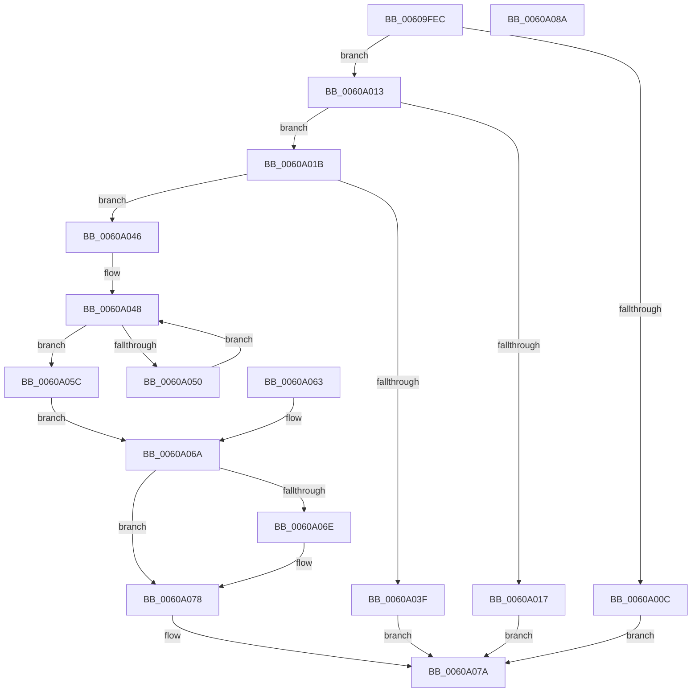

# SeCaptureHandles

- RVA: `0x00609FEC`–`0x0060A08B` (길이 `159` bytes)
- VA: `0x0000000140609FEC`
- 실행 섹션: `.text`
- PDB 이름 있음: `예`; PDB Function 태그: `아니요`
- unwind 정보 RVA: `0x000D16A8`
- 디코드: `52`개 명령, `159/159` bytes 표시
- 미해석 바이트: `0` (있으면 어셈블리에 `.byte`로 보존)

> 이 문서는 커널 이미지의 기계어와 PDB 기호를 분석해 생성했습니다. 4번과 5번은 함수 원형과 자료형을 바이너리 사용 방식에서 추정한 C 해석이며 원본 소스 복구 결과는 아닙니다.

## 1. Dependencies

- 직접 호출 지점: **2**; 고유 호출 대상: **2**
- 직접 호출자로 확인된 함수: **2**
- RIP 상대 이미지 참조: **0**

### Outgoing calls
- `0x0060A02D` → [ExAllocatePool2](../../poolcode/B8/ExAllocatePool2_function_00B820F0.md) (function, `0x00B820F0`)
- `0x0060A073` → [ExFreePoolWithTag](../../poolcode/B8/ExFreePoolWithTag_function_00B82870.md) (function, `0x00B82870`)

### Direct callers
- [PspBuildCreateProcessContext](../../page/9E/PspBuildCreateProcessContext_function_009ED6E0.md) at `0x009EE819`
- [NtCreateLowBoxToken](../../page/AB/NtCreateLowBoxToken_function_00AB9880.md) at `0x00AB9A82`
- [NtCreateLowBoxToken](../../page/AB/NtCreateLowBoxToken_function_00AB9880.md) at `0x00AB9DCA`

### Static image references
- 디코드된 RIP-relative 메모리 참조가 없습니다.

## 2. Other-region calls and transfers

- 다른 실행 섹션으로 향하는 call: **2**
  - `0x0060A02D` → [ExAllocatePool2](../../poolcode/B8/ExAllocatePool2_function_00B820F0.md) (`.text` → `POOLCODE`)
  - `0x0060A073` → [ExFreePoolWithTag](../../poolcode/B8/ExFreePoolWithTag_function_00B82870.md) (`.text` → `POOLCODE`)
- 별도 외부 분기/꼬리 이동을 확인하지 못했습니다.

## 3. Assembly (complete function range)

```asm
00609FEC  48 89 5C 24 08                  mov qword ptr [rsp + 8], rbx
00609FF1  48 89 74 24 10                  mov qword ptr [rsp + 0x10], rsi
00609FF6  57                              push rdi
00609FF7  48 83 EC 30                     sub rsp, 0x30
00609FFB  49 8B F8                        mov rdi, r8
00609FFE  48 8B F2                        mov rsi, rdx
0060A001  8B D9                           mov ebx, ecx
0060A003  49 83 20 00                     and qword ptr [r8], 0
0060A007  83 F9 0A                        cmp ecx, 0xa
0060A00A  76 07                           jbe 0x14060a013
0060A00C  B8 EF 00 00 C0                  mov eax, 0xc00000ef
0060A011  EB 67                           jmp 0x14060a07a
0060A013  85 C9                           test ecx, ecx
0060A015  75 04                           jne 0x14060a01b
0060A017  33 C0                           xor eax, eax
0060A019  EB 5F                           jmp 0x14060a07a
0060A01B  48 8B D3                        mov rdx, rbx
0060A01E  48 C1 E2 03                     shl rdx, 3
0060A022  B9 00 01 00 00                  mov ecx, 0x100
0060A027  41 B8 53 65 48 63               mov r8d, 0x63486553
0060A02D  E8 BE 80 57 00                  call 0x140b820f0
0060A032  4C 8B C0                        mov r8, rax
0060A035  48 89 44 24 50                  mov qword ptr [rsp + 0x50], rax
0060A03A  48 85 C0                        test rax, rax
0060A03D  75 07                           jne 0x14060a046
0060A03F  B8 9A 00 00 C0                  mov eax, 0xc000009a
0060A044  EB 34                           jmp 0x14060a07a
0060A046  33 D2                           xor edx, edx
0060A048  89 54 24 20                     mov dword ptr [rsp + 0x20], edx
0060A04C  3B D3                           cmp edx, ebx
0060A04E  73 0C                           jae 0x14060a05c
0060A050  48 8B 04 D6                     mov rax, qword ptr [rsi + rdx*8]
0060A054  49 89 04 D0                     mov qword ptr [r8 + rdx*8], rax
0060A058  FF C2                           inc edx
0060A05A  EB EC                           jmp 0x14060a048
0060A05C  4C 89 07                        mov qword ptr [rdi], r8
0060A05F  33 DB                           xor ebx, ebx
0060A061  EB 07                           jmp 0x14060a06a
0060A063  8B D8                           mov ebx, eax
0060A065  4C 8B 44 24 50                  mov r8, qword ptr [rsp + 0x50]
0060A06A  85 DB                           test ebx, ebx
0060A06C  79 0A                           jns 0x14060a078
0060A06E  33 D2                           xor edx, edx
0060A070  49 8B C8                        mov rcx, r8
0060A073  E8 F8 87 57 00                  call 0x140b82870
0060A078  8B C3                           mov eax, ebx
0060A07A  48 8B 5C 24 40                  mov rbx, qword ptr [rsp + 0x40]
0060A07F  48 8B 74 24 48                  mov rsi, qword ptr [rsp + 0x48]
0060A084  48 83 C4 30                     add rsp, 0x30
0060A088  5F                              pop rdi
0060A089  C3                              ret
0060A08A  CC                              int3
```

## 4. C-style interpretation (structured pseudocode)

```c
__int64 __fastcall SeCaptureHandles(int a1, __int64 a2, __int64 a3)
{
    __int64 result;
    __int64 v_rbx;
    __int64 v_rsp;
    unsigned int v_stack_m18;
    unsigned __int64 v_stack_p10;
    unsigned __int64 v_stack_p18;
    unsigned __int64 v_stack_p8;

    v_stack_p8 = v_rbx;
    v_stack_p10 = v_rsi;
    v_rsp = (v_rsp) - (48);
    if (a1 <= 10) goto loc_0060A013;
    goto loc_0060A07A;
loc_0060A013:
    if (a1 != 0) goto loc_0060A01B;
    result = 0;
    goto loc_0060A07A;
loc_0060A01B:
    a2 = ((unsigned int)(a1)) << (3);
    result = ExAllocatePool2(256, a2, (unsigned int)(0x63486553ULL), a4);
    v_stack_p18 = result;
    if (result != 0) goto loc_0060A046;
    goto loc_0060A07A;
loc_0060A046:
    a2 = 0;
loc_0060A048:
    v_stack_m18 = 0;
    if (0 >= ((unsigned int)((unsigned int)(a1)))) goto loc_0060A05C;
    *(unsigned __int64 *)(result + a2 * 8) = *(unsigned __int64 *)(a2 + a2 * 8);
    a2 = (unsigned int)((a2) + 1);
    goto loc_0060A048;
loc_0060A05C:
    *(unsigned __int64 *)(a3) = result;
    v_rbx = 0;
    goto loc_0060A06A;
loc_0060A06A:
    result = *(unsigned __int64 *)(a2 + a2 * 8);
    if (sign_flag) {
        a2 = 0;
        a1 = result;
        result = ExFreePoolWithTag(a1, a2, result, a4);
    }
loc_0060A07A:
    v_rsp = (v_rsp) + (48);
    return 0;
}
```

## 5. (Beta) C Style

```c
int64_t SeCaptureHandles(int32_t Arg1, void *Arg2, void *Arg3)
{
    uint8_t *arg2 = (uint8_t *)Arg2;
    uint8_t *arg3 = (uint8_t *)Arg3;

    int64_t result;
    int64_t local_rbx;
    int64_t local_rsp;
    uint32_t v_stack_m18;
    uint64_t v_stack_p10;
    uint64_t v_stack_p18;
    uint64_t v_stack_p8;

    v_stack_p8 = local_rbx;
    v_stack_p10 = local_rsi;
    local_rsp = (local_rsp) - (48);
    if (Arg1 <= 10) goto loc_0060A013;
    goto loc_0060A07A;
loc_0060A013:
    if (Arg1 != 0) goto loc_0060A01B;
    result = 0;
    goto loc_0060A07A;
loc_0060A01B:
    Arg2 = ((uint32_t)(Arg1)) << (3);
    result = ExAllocatePool2(256, Arg2, (uint32_t)(0x63486553ULL), a4);
    v_stack_p18 = result;
    if (result != 0) goto loc_0060A046;
    goto loc_0060A07A;
loc_0060A046:
    Arg2 = 0;
loc_0060A048:
    v_stack_m18 = 0;
    if (0 >= ((uint32_t)((uint32_t)(Arg1)))) goto loc_0060A05C;
    *(uint64_t *)(result + arg2 * 8) = *(uint64_t *)(arg2 + arg2 * 8);
    Arg2 = (uint32_t)((Arg2) + 1);
    goto loc_0060A048;
loc_0060A05C:
    *(uint64_t *)(arg3) = result;
    local_rbx = 0;
    goto loc_0060A06A;
loc_0060A06A:
    result = *(uint64_t *)(arg2 + arg2 * 8);
    if (sign_flag) {
        Arg2 = 0;
        Arg1 = result;
        result = ExFreePoolWithTag(Arg1, Arg2, result, a4);
    }
loc_0060A07A:
    local_rsp = (local_rsp) + (48);
    return 0;
}
```

### 관측된 메모리 오프셋

구조체 형식이 확인되지 않은 접근은 인자 기준의 오프셋으로만 기록했습니다.

| 기준 인자 | 오프셋 표현 | 폭 (bit) | 접근 |
|---|---:|---:|---|
| `Arg2` | `+ 0x0 + rdx*8` | `64` | `R` |
| `Arg3` | `+ 0x0` | `64` | `R/W` |
| `Arg3` | `+ 0x0` | `64` | `W` |

## 6. Execution-region graph

[열기: 2D/3D 그래프와 함수 탐색 컨트롤 패널](../../../control-panel.html?section=text&rva=0x00609FEC&view=graph)

- 2D 그래프는 위에서 아래로 흐르고, 3D 그래프는 빈 공간을 드래그해 회전합니다. Shift+드래그는 이동, 휠은 확대·축소, 함수 노드 선택은 대상 보고서 이동입니다.

### Static fallback


