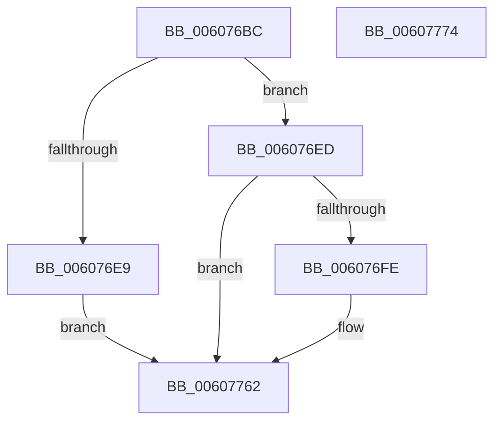

# SeComputeMandatoryDeniedAccess

- RVA: `0x006076BC`–`0x00607775` (길이 `185` bytes)
- VA: `0x00000001406076BC`
- 실행 섹션: `.text`
- PDB 이름 있음: `예`; PDB Function 태그: `아니요`
- unwind 정보 RVA: `0x000C572C`
- 디코드: `52`개 명령, `185/185` bytes 표시
- 미해석 바이트: `0` (있으면 어셈블리에 `.byte`로 보존)

> 이 문서는 커널 이미지의 기계어와 PDB 기호를 분석해 생성했습니다. 4번과 5번은 함수 원형과 자료형을 바이너리 사용 방식에서 추정한 C 해석이며 원본 소스 복구 결과는 아닙니다.

## 1. Dependencies

- 직접 호출 지점: **5**; 고유 호출 대상: **5**
- 직접 호출자로 확인된 함수: **1**
- RIP 상대 이미지 참조: **0**

### Outgoing calls
- `0x006076F5` → [ObGetObjectSecurity](../../page/9D/ObGetObjectSecurity_function_009D45F0.md) (function, `0x009D45F0`)
- `0x0060771F` → [SeCaptureSubjectContextEx](../../page/8C/SeCaptureSubjectContextEx_function_008C4C90.md) (function, `0x008C4C90`)
- `0x0060773F` → [SepMandatoryAccessCheck](SepMandatoryAccessCheck_function_00608480.md) (function, `0x00608480`)
- `0x0060774A` → [SeReleaseSubjectContext](../../page/86/SeReleaseSubjectContext_function_0086B710.md) (function, `0x0086B710`)
- `0x00607756` → [ObReleaseObjectSecurity](../../page/9D/ObReleaseObjectSecurity_function_009D77F0.md) (function, `0x009D77F0`)

### Direct callers
- [PspProcessOpen](../../page/AE/PspProcessOpen_function_00AE3620.md) at `0x00AE36A9`

### Static image references
- 디코드된 RIP-relative 메모리 참조가 없습니다.

## 2. Other-region calls and transfers

- 다른 실행 섹션으로 향하는 call: **4**
  - `0x006076F5` → [ObGetObjectSecurity](../../page/9D/ObGetObjectSecurity_function_009D45F0.md) (`.text` → `PAGE`)
  - `0x0060771F` → [SeCaptureSubjectContextEx](../../page/8C/SeCaptureSubjectContextEx_function_008C4C90.md) (`.text` → `PAGE`)
  - `0x0060774A` → [SeReleaseSubjectContext](../../page/86/SeReleaseSubjectContext_function_0086B710.md) (`.text` → `PAGE`)
  - `0x00607756` → [ObReleaseObjectSecurity](../../page/9D/ObReleaseObjectSecurity_function_009D77F0.md) (`.text` → `PAGE`)
- 별도 외부 분기/꼬리 이동을 확인하지 못했습니다.

## 3. Assembly (complete function range)

```asm
006076BC  48 89 5C 24 08                  mov qword ptr [rsp + 8], rbx
006076C1  48 89 7C 24 18                  mov qword ptr [rsp + 0x18], rdi
006076C6  55                              push rbp
006076C7  48 8B EC                        mov rbp, rsp
006076CA  48 83 EC 60                     sub rsp, 0x60
006076CE  48 83 65 D0 00                  and qword ptr [rbp - 0x30], 0
006076D3  49 8B F9                        mov rdi, r9
006076D6  83 65 28 00                     and dword ptr [rbp + 0x28], 0
006076DA  41 8B D8                        mov ebx, r8d
006076DD  41 83 21 00                     and dword ptr [r9], 0
006076E1  C6 45 18 00                     mov byte ptr [rbp + 0x18], 0
006076E5  84 D2                           test dl, dl
006076E7  75 04                           jne 0x1406076ed
006076E9  33 C0                           xor eax, eax
006076EB  EB 75                           jmp 0x140607762
006076ED  4C 8D 45 18                     lea r8, [rbp + 0x18]
006076F1  48 8D 55 D0                     lea rdx, [rbp - 0x30]
006076F5  E8 F6 CE 3C 00                  call 0x1409d45f0
006076FA  85 C0                           test eax, eax
006076FC  78 64                           js 0x140607762
006076FE  65 48 8B 14 25 88 01 00 00      mov rdx, qword ptr gs:[0x188]
00607707  4C 8D 45 D8                     lea r8, [rbp - 0x28]
0060770B  0F 57 C0                        xorps xmm0, xmm0
0060770E  33 C9                           xor ecx, ecx
00607710  0F 11 45 D8                     movups xmmword ptr [rbp - 0x28], xmm0
00607714  48 8B 92 B8 00 00 00            mov rdx, qword ptr [rdx + 0xb8]
0060771B  0F 11 45 E8                     movups xmmword ptr [rbp - 0x18], xmm0
0060771F  E8 6C D5 2B 00                  call 0x1408c4c90
00607724  48 8B 4D D0                     mov rcx, qword ptr [rbp - 0x30]
00607728  48 8D 45 28                     lea rax, [rbp + 0x28]
0060772C  48 89 44 24 28                  mov qword ptr [rsp + 0x28], rax
00607731  48 8D 55 D8                     lea rdx, [rbp - 0x28]
00607735  41 B1 01                        mov r9b, 1
00607738  89 5C 24 20                     mov dword ptr [rsp + 0x20], ebx
0060773C  45 33 C0                        xor r8d, r8d
0060773F  E8 3C 0D 00 00                  call 0x140608480
00607744  48 8D 4D D8                     lea rcx, [rbp - 0x28]
00607748  8B D8                           mov ebx, eax
0060774A  E8 C1 3F 26 00                  call 0x14086b710
0060774F  8A 55 18                        mov dl, byte ptr [rbp + 0x18]
00607752  48 8B 4D D0                     mov rcx, qword ptr [rbp - 0x30]
00607756  E8 95 00 3D 00                  call 0x1409d77f0
0060775B  8B 4D 28                        mov ecx, dword ptr [rbp + 0x28]
0060775E  8B C3                           mov eax, ebx
00607760  89 0F                           mov dword ptr [rdi], ecx
00607762  4C 8D 5C 24 60                  lea r11, [rsp + 0x60]
00607767  49 8B 5B 10                     mov rbx, qword ptr [r11 + 0x10]
0060776B  49 8B 7B 20                     mov rdi, qword ptr [r11 + 0x20]
0060776F  49 8B E3                        mov rsp, r11
00607772  5D                              pop rbp
00607773  C3                              ret
00607774  CC                              int3
```

## 4. C-style interpretation (structured pseudocode)

```c
__int64 __fastcall SeComputeMandatoryDeniedAccess(int a1, unsigned __int8 a2, int a3, __int64 a4)
{
    __int64 result;
    __int64 v_rbx;
    __int64 v_rsp;
    unsigned __int64 v_stack_m20;
    unsigned __int64 v_stack_m30;
    unsigned __int64 v_stack_m38;
    unsigned __int64 v_stack_m40;
    unsigned int v_stack_m48;
    unsigned __int64 v_stack_m8;
    unsigned __int8 v_stack_p10;
    unsigned __int64 v_stack_p18;
    unsigned int v_stack_p20;
    unsigned __int64 v_stack_p8;

    v_stack_p8 = v_rbx;
    v_stack_p18 = v_rdi;
    v_rsp = (v_rsp) - (96);
    v_stack_p10 = 0;
    if (a2 != 0) goto loc_006076ED;
    result = 0;
    goto loc_00607762;
loc_006076ED:
    result = ObGetObjectSecurity(a1, v_stack_m38, v_stack_p10, a4);
    v_rbx = (unsigned int)(a3);
    if (!(sign_flag)) {
        a2 = *(unsigned __int64 *)(gs_base + (0 + 392));
        a3 = v_stack_m30;
        a1 = 0;
        v_stack_m30 = v_xmm0;
        a2 = *(unsigned __int64 *)(a2 + 184);
        v_stack_m20 = v_xmm0;
        result = SeCaptureSubjectContextEx(a1, a2, a3, a4);
        a1 = v_stack_m38;
        result = v_stack_p20;
        v_stack_m40 = result;
        a2 = v_stack_m30;
        a4 = 1;
        v_stack_m48 = (unsigned int)((unsigned int)(a3));
        a3 = 0;
        result = SepMandatoryAccessCheck(a1, a2, a3, a4);
        a1 = v_stack_m30;
        v_rbx = (unsigned int)(result);
        result = SeReleaseSubjectContext(a1, a2, a3, a4);
        a2 = v_stack_p10;
        a1 = v_stack_m38;
        result = ObReleaseObjectSecurity(a1, a2, a3, a4);
        a1 = v_stack_p20;
        result = (unsigned int)(v_rbx);
        *(unsigned int *)(a4) = a1;
    }
    return result;
}
```

## 5. (Beta) C Style

```c
int64_t SeComputeMandatoryDeniedAccess(int32_t Arg1, uint8_t Arg2, int32_t Arg3, void *Arg4)
{
    uint8_t *arg4 = (uint8_t *)Arg4;

    int64_t result;
    int64_t local_rbx;
    int64_t local_rsp;
    uint64_t v_stack_m20;
    uint64_t v_stack_m30;
    uint64_t v_stack_m38;
    uint64_t v_stack_m40;
    uint32_t v_stack_m48;
    uint64_t v_stack_m8;
    uint8_t v_stack_p10;
    uint64_t v_stack_p18;
    uint32_t v_stack_p20;
    uint64_t v_stack_p8;

    v_stack_p8 = local_rbx;
    v_stack_p18 = local_rdi;
    local_rsp = (local_rsp) - (96);
    v_stack_p10 = 0;
    if (Arg2 != 0) goto loc_006076ED;
    result = 0;
    goto loc_00607762;
loc_006076ED:
    result = ObGetObjectSecurity(Arg1, v_stack_m38, v_stack_p10, Arg4);
    local_rbx = (uint32_t)(Arg3);
    if (!(sign_flag)) {
        Arg2 = *(uint64_t *)(gs_base + (0 + 0x188));
        Arg3 = v_stack_m30;
        Arg1 = 0;
        v_stack_m30 = v_xmm0;
        Arg2 = *(uint64_t *)(Arg2 + 0xB8);
        v_stack_m20 = v_xmm0;
        result = SeCaptureSubjectContextEx(Arg1, Arg2, Arg3, Arg4);
        Arg1 = v_stack_m38;
        result = v_stack_p20;
        v_stack_m40 = result;
        Arg2 = v_stack_m30;
        Arg4 = 1;
        v_stack_m48 = (uint32_t)((uint32_t)(Arg3));
        Arg3 = 0;
        result = SepMandatoryAccessCheck(Arg1, Arg2, Arg3, Arg4);
        Arg1 = v_stack_m30;
        local_rbx = (uint32_t)(result);
        result = SeReleaseSubjectContext(Arg1, Arg2, Arg3, Arg4);
        Arg2 = v_stack_p10;
        Arg1 = v_stack_m38;
        result = ObReleaseObjectSecurity(Arg1, Arg2, Arg3, Arg4);
        Arg1 = v_stack_p20;
        result = (uint32_t)(local_rbx);
        *(uint32_t *)(arg4) = Arg1;
    }
    return result;
}
```

### 관측된 메모리 오프셋

구조체 형식이 확인되지 않은 접근은 인자 기준의 오프셋으로만 기록했습니다.

| 기준 인자 | 오프셋 표현 | 폭 (bit) | 접근 |
|---|---:|---:|---|
| `Arg4` | `+ 0x0` | `32` | `R/W` |
| `Arg4` | `+ 0x0` | `32` | `W` |

## 6. Execution-region graph

[열기: 2D/3D 그래프와 함수 탐색 컨트롤 패널](../../../control-panel.html?section=text&rva=0x006076BC&view=graph)

- 2D 그래프는 위에서 아래로 흐르고, 3D 그래프는 빈 공간을 드래그해 회전합니다. Shift+드래그는 이동, 휠은 확대·축소, 함수 노드 선택은 대상 보고서 이동입니다.

### Static fallback


