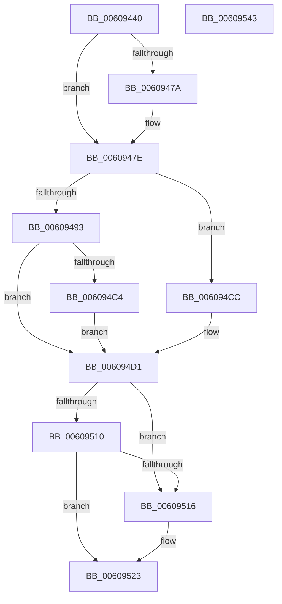

# SeCreateClientSecurityFromSubjectContextEx

- RVA: `0x00609440`–`0x00609544` (길이 `260` bytes)
- VA: `0x0000000140609440`
- 실행 섹션: `.text`
- PDB 이름 있음: `예`; PDB Function 태그: `아니요`
- unwind 정보 RVA: `0x000C39C4`
- 디코드: `75`개 명령, `260/260` bytes 표시
- 미해석 바이트: `0` (있으면 어셈블리에 `.byte`로 보존)

> 이 문서는 커널 이미지의 기계어와 PDB 기호를 분석해 생성했습니다. 4번과 5번은 함수 원형과 자료형을 바이너리 사용 방식에서 추정한 C 해석이며 원본 소스 복구 결과는 아닙니다.

## 1. Dependencies

- 직접 호출 지점: **4**; 고유 호출 대상: **4**
- 직접 호출자로 확인된 함수: **0**
- RIP 상대 이미지 참조: **0**

### Outgoing calls
- `0x00609486` → [ObfReferenceObjectWithTag](../21/ObfReferenceObjectWithTag_function_00210710.md) (function, `0x00210710`)
- `0x006094B5` → [RtlSidDominatesForTrust](../3E/RtlSidDominatesForTrust_function_003EDFE0.md) (function, `0x003EDFE0`)
- `0x00609505` → [SepCreateClientSecurityEx](../../page/89/SepCreateClientSecurityEx_function_00891C90.md) (function, `0x00891C90`)
- `0x0060951E` → [ObfDereferenceObjectWithTag](../2F/ObfDereferenceObjectWithTag_function_002F78E0.md) (function, `0x002F78E0`)

### Direct callers
- 이 함수 시작 RVA로 연결되는 직접 call은 확인되지 않았습니다. 간접 호출은 완전히 역산할 수 없습니다.

### Static image references
- 디코드된 RIP-relative 메모리 참조가 없습니다.

## 2. Other-region calls and transfers

- 다른 실행 섹션으로 향하는 call: **1**
  - `0x00609505` → [SepCreateClientSecurityEx](../../page/89/SepCreateClientSecurityEx_function_00891C90.md) (`.text` → `PAGE`)
- 별도 외부 분기/꼬리 이동을 확인하지 못했습니다.

## 3. Assembly (complete function range)

```asm
00609440  48 8B C4                        mov rax, rsp
00609443  48 89 58 10                     mov qword ptr [rax + 0x10], rbx
00609447  48 89 68 18                     mov qword ptr [rax + 0x18], rbp
0060944B  48 89 70 20                     mov qword ptr [rax + 0x20], rsi
0060944F  57                              push rdi
00609450  41 54                           push r12
00609452  41 55                           push r13
00609454  41 56                           push r14
00609456  41 57                           push r15
00609458  48 83 EC 60                     sub rsp, 0x60
0060945C  48 8B 19                        mov rbx, qword ptr [rcx]
0060945F  45 33 F6                        xor r14d, r14d
00609462  45 32 FF                        xor r15b, r15b
00609465  44 88 70 08                     mov byte ptr [rax + 8], r14b
00609469  49 8B F1                        mov rsi, r9
0060946C  45 8A E0                        mov r12b, r8b
0060946F  4C 8B EA                        mov r13, rdx
00609472  48 8B F9                        mov rdi, rcx
00609475  48 85 DB                        test rbx, rbx
00609478  75 04                           jne 0x14060947e
0060947A  48 8B 59 10                     mov rbx, qword ptr [rcx + 0x10]
0060947E  BA 53 65 43 63                  mov edx, 0x63436553
00609483  48 8B CB                        mov rcx, rbx
00609486  E8 85 72 C0 FF                  call 0x140210710
0060948B  48 8B 17                        mov rdx, qword ptr [rdi]
0060948E  48 85 D2                        test rdx, rdx
00609491  74 39                           je 0x1406094cc
00609493  48 8B 47 10                     mov rax, qword ptr [rdi + 0x10]
00609497  4C 8D 84 24 90 00 00 00         lea r8, [rsp + 0x90]
0060949F  48 8B 92 50 04 00 00            mov rdx, qword ptr [rdx + 0x450]
006094A6  BD 02 00 00 00                  mov ebp, 2
006094AB  4C 8B 98 50 04 00 00            mov r11, qword ptr [rax + 0x450]
006094B2  49 8B CB                        mov rcx, r11
006094B5  E8 26 4B DE FF                  call 0x1403edfe0
006094BA  44 38 B4 24 90 00 00 00         cmp byte ptr [rsp + 0x90], r14b
006094C2  75 0D                           jne 0x1406094d1
006094C4  41 B7 01                        mov r15b, 1
006094C7  4D 8B F3                        mov r14, r11
006094CA  EB 05                           jmp 0x1406094d1
006094CC  BD 01 00 00 00                  mov ebp, 1
006094D1  8B 47 08                        mov eax, dword ptr [rdi + 8]
006094D4  44 8B CD                        mov r9d, ebp
006094D7  48 89 74 24 50                  mov qword ptr [rsp + 0x50], rsi
006094DC  45 8A C4                        mov r8b, r12b
006094DF  4C 89 74 24 48                  mov qword ptr [rsp + 0x48], r14
006094E4  49 8B D5                        mov rdx, r13
006094E7  44 88 7C 24 40                  mov byte ptr [rsp + 0x40], r15b
006094EC  45 33 F6                        xor r14d, r14d
006094EF  4C 89 74 24 38                  mov qword ptr [rsp + 0x38], r14
006094F4  48 8B CB                        mov rcx, rbx
006094F7  C6 44 24 30 01                  mov byte ptr [rsp + 0x30], 1
006094FC  89 44 24 28                     mov dword ptr [rsp + 0x28], eax
00609500  44 88 74 24 20                  mov byte ptr [rsp + 0x20], r14b
00609505  E8 86 87 28 00                  call 0x140891c90
0060950A  8B F8                           mov edi, eax
0060950C  85 C0                           test eax, eax
0060950E  78 06                           js 0x140609516
00609510  44 38 76 08                     cmp byte ptr [rsi + 8], r14b
00609514  75 0D                           jne 0x140609523
00609516  BA 53 65 43 63                  mov edx, 0x63436553
0060951B  48 8B CB                        mov rcx, rbx
0060951E  E8 BD E3 CE FF                  call 0x1402f78e0
00609523  4C 8D 5C 24 60                  lea r11, [rsp + 0x60]
00609528  8B C7                           mov eax, edi
0060952A  49 8B 5B 38                     mov rbx, qword ptr [r11 + 0x38]
0060952E  49 8B 6B 40                     mov rbp, qword ptr [r11 + 0x40]
00609532  49 8B 73 48                     mov rsi, qword ptr [r11 + 0x48]
00609536  49 8B E3                        mov rsp, r11
00609539  41 5F                           pop r15
0060953B  41 5E                           pop r14
0060953D  41 5D                           pop r13
0060953F  41 5C                           pop r12
00609541  5F                              pop rdi
00609542  C3                              ret
00609543  CC                              int3
```

## 4. C-style interpretation (structured pseudocode)

```c
__int64 __fastcall SeCreateClientSecurityFromSubjectContextEx(__int64 a1, __int64 a2, unsigned __int8 a3, __int64 a4)
{
    __int64 result;
    __int64 v_r14;
    __int64 v_r15;
    __int64 v_rbx;
    __int64 v_rsp;
    unsigned __int64 v_stack_m28;
    unsigned __int64 v_stack_m38;
    unsigned __int64 v_stack_m40;
    unsigned __int8 v_stack_m48;
    unsigned __int64 v_stack_m50;
    unsigned __int8 v_stack_m58;
    unsigned int v_stack_m60;
    unsigned __int8 v_stack_m68;
    unsigned __int64 v_stack_p8;

    *(unsigned __int64 *)(v_rsp + 16) = v_rbx;
    *(unsigned __int64 *)(v_rsp + 24) = v_rbp;
    *(unsigned __int64 *)(v_rsp + 32) = v_rsi;
    v_rsp = (v_rsp) - (96);
    v_r14 = 0;
    v_r15 = 0;
    *(unsigned __int8 *)(v_rsp + 8) = 0;
    v_rbx = *(unsigned __int64 *)(a1);
    if (*(unsigned __int64 *)(a1) == 0) {
        v_rbx = *(unsigned __int64 *)(a1 + 16);
    }
    result = ObfReferenceObjectWithTag(v_rbx, (unsigned int)(0x63436553ULL), a3, a4);
    if (*(unsigned __int64 *)(a1) == 0) goto loc_006094CC;
    result = RtlSidDominatesForTrust(*(unsigned __int64 *)(*(unsigned __int64 *)(a1 + 16) + 1104), *(unsigned __int64 *)(*(unsigned __int64 *)(a1) + 1104), v_stack_p8, a4);
    if (v_stack_p8 != 0) goto loc_006094D1;
    goto loc_006094D1;
loc_006094CC:
loc_006094D1:
    v_stack_m38 = a4;
    v_stack_m40 = *(unsigned __int64 *)(*(unsigned __int64 *)(a1 + 16) + 1104);
    v_stack_m48 = 1;
    v_r14 = 0;
    v_stack_m50 = 0;
    v_stack_m58 = 1;
    v_stack_m60 = (unsigned int)((unsigned int)(*(unsigned int *)(a1 + 8)));
    v_stack_m68 = 0;
    result = SepCreateClientSecurityEx(v_rbx, a2, a3, 1);
    if (sign_flag) goto loc_00609516;
    if ((*(unsigned __int8 *)(a4 + 8)) == 0) {
        a2 = 0x63436553ULL;
        a1 = v_rbx;
        result = ObfDereferenceObjectWithTag(a1, a2, a3, 1);
    }
    return (unsigned int)((unsigned int)((unsigned int)((unsigned int)(result))));
}
```

## 5. (Beta) C Style

```c
int64_t SeCreateClientSecurityFromSubjectContextEx(void *Arg1, int64_t Arg2, uint8_t Arg3, void *Arg4)
{
    uint8_t *arg1 = (uint8_t *)Arg1;
    uint8_t *arg4 = (uint8_t *)Arg4;

    int64_t result;
    int64_t local_r14;
    int64_t local_r15;
    int64_t local_rbx;
    int64_t local_rsp;
    uint64_t v_stack_m28;
    uint64_t v_stack_m38;
    uint64_t v_stack_m40;
    uint8_t v_stack_m48;
    uint64_t v_stack_m50;
    uint8_t v_stack_m58;
    uint32_t v_stack_m60;
    uint8_t v_stack_m68;
    uint64_t v_stack_p8;

    *(uint64_t *)(local_rsp + 0x10) = local_rbx;
    *(uint64_t *)(local_rsp + 0x18) = local_rbp;
    *(uint64_t *)(local_rsp + 0x20) = local_rsi;
    local_rsp = (local_rsp) - (96);
    local_r14 = 0;
    local_r15 = 0;
    *(uint8_t *)(local_rsp + 0x8) = 0;
    local_rbx = *(uint64_t *)(arg1);
    if (*(uint64_t *)(arg1) == 0) {
        local_rbx = *(uint64_t *)(arg1 + 0x10);
    }
    result = ObfReferenceObjectWithTag(local_rbx, (uint32_t)(0x63436553ULL), Arg3, Arg4);
    if (*(uint64_t *)(arg1) == 0) goto loc_006094CC;
    result = RtlSidDominatesForTrust(*(uint64_t *)(*(uint64_t *)(arg1 + 0x10) + 0x450), *(uint64_t *)(*(uint64_t *)(arg1) + 0x450), v_stack_p8, Arg4);
    if (v_stack_p8 != 0) goto loc_006094D1;
    goto loc_006094D1;
loc_006094CC:
loc_006094D1:
    v_stack_m38 = Arg4;
    v_stack_m40 = *(uint64_t *)(*(uint64_t *)(arg1 + 0x10) + 0x450);
    v_stack_m48 = 1;
    local_r14 = 0;
    v_stack_m50 = 0;
    v_stack_m58 = 1;
    v_stack_m60 = (uint32_t)((uint32_t)(*(uint32_t *)(arg1 + 0x8)));
    v_stack_m68 = 0;
    result = SepCreateClientSecurityEx(local_rbx, Arg2, Arg3, 1);
    if (sign_flag) goto loc_00609516;
    if ((*(uint8_t *)(arg4 + 0x8)) == 0) {
        Arg2 = 0x63436553ULL;
        Arg1 = local_rbx;
        result = ObfDereferenceObjectWithTag(Arg1, Arg2, Arg3, 1);
    }
    return (uint32_t)((uint32_t)((uint32_t)((uint32_t)(result))));
}
```

### 관측된 메모리 오프셋

구조체 형식이 확인되지 않은 접근은 인자 기준의 오프셋으로만 기록했습니다.

| 기준 인자 | 오프셋 표현 | 폭 (bit) | 접근 |
|---|---:|---:|---|
| `Arg1` | `+ 0x0` | `64` | `R` |
| `Arg1` | `+ 0x8` | `32` | `R` |
| `Arg1` | `+ 0x10` | `64` | `R` |
| `Arg4` | `+ 0x8` | `8` | `R` |

## 6. Execution-region graph

[열기: 2D/3D 그래프와 함수 탐색 컨트롤 패널](../../../control-panel.html?section=text&rva=0x00609440&view=graph)

- 2D 그래프는 위에서 아래로 흐르고, 3D 그래프는 빈 공간을 드래그해 회전합니다. Shift+드래그는 이동, 휠은 확대·축소, 함수 노드 선택은 대상 보고서 이동입니다.

### Static fallback


