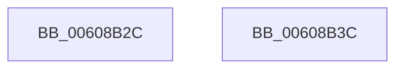

# SeEtwEnableCallback

- RVA: `0x00608B2C`–`0x00608B3D` (길이 `17` bytes)
- VA: `0x0000000140608B2C`
- 실행 섹션: `.text`
- PDB 이름 있음: `예`; PDB Function 태그: `아니요`
- unwind 정보 RVA: `0x000DB714`
- 디코드: `5`개 명령, `17/17` bytes 표시
- 미해석 바이트: `0` (있으면 어셈블리에 `.byte`로 보존)

> 이 문서는 커널 이미지의 기계어와 PDB 기호를 분석해 생성했습니다. 4번과 5번은 함수 원형과 자료형을 바이너리 사용 방식에서 추정한 C 해석이며 원본 소스 복구 결과는 아닙니다.

## 1. Dependencies

- 직접 호출 지점: **0**; 고유 호출 대상: **0**
- 직접 호출자로 확인된 함수: **1**
- RIP 상대 이미지 참조: **1**

### Outgoing calls
- 직접 디코드된 call 명령이 없습니다.

### Direct callers
- [EtwpKernelProvEnableCallback](../../page/7B/EtwpKernelProvEnableCallback_function_007B6D30.md) at `0x007B6D34`

### Static image references
- `0x00608B34` → RVA `0x00E67D01` (`.data`; write)

## 2. Other-region calls and transfers

- 다른 실행 섹션으로 향하는 call: **0**
- 별도 외부 분기/꼬리 이동을 확인하지 못했습니다.

## 3. Assembly (complete function range)

```asm
00608B2C  41 C0 E9 06                     shr r9b, 6
00608B30  41 80 E1 01                     and r9b, 1
00608B34  44 88 0D C6 F1 85 00            mov byte ptr [rip + 0x85f1c6], r9b
00608B3B  C3                              ret
00608B3C  CC                              int3
```

## 4. C-style interpretation (structured pseudocode)

```c
void __fastcall SeEtwEnableCallback(__int64 a1, __int64 a2, __int64 a3, unsigned __int8 a4)
{
    a4 = (unsigned __int8)((a4) >> (6));
    a4 = (unsigned __int8)((a4) & (1));
    *(unsigned __int8 *)(v_rip + 8778182) = a4;
    return;
}
```

## 5. (Beta) C Style

```c
void SeEtwEnableCallback(int64_t Arg1, int64_t Arg2, int64_t Arg3, uint8_t Arg4)
{
    Arg4 = (uint8_t)((Arg4) >> (6));
    Arg4 = (uint8_t)((Arg4) & (1));
    *(uint8_t *)(v_rip + 0x85F1C6) = Arg4;
    return;
}
```

## 6. Execution-region graph

[열기: 2D/3D 그래프와 함수 탐색 컨트롤 패널](../../../control-panel.html?section=text&rva=0x00608B2C&view=graph)

- 2D 그래프는 위에서 아래로 흐르고, 3D 그래프는 빈 공간을 드래그해 회전합니다. Shift+드래그는 이동, 휠은 확대·축소, 함수 노드 선택은 대상 보고서 이동입니다.

### Static fallback


