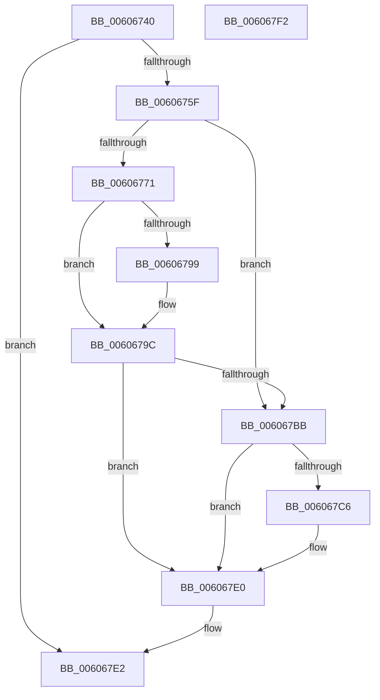

# SeGetProcessAntiTamperIdentity

- RVA: `0x00606740`–`0x006067F3` (길이 `179` bytes)
- VA: `0x0000000140606740`
- 실행 섹션: `.text`
- PDB 이름 있음: `예`; PDB Function 태그: `아니요`
- unwind 정보 RVA: `0x00060BC4`
- 디코드: `52`개 명령, `179/179` bytes 표시
- 미해석 바이트: `0` (있으면 어셈블리에 `.byte`로 보존)

> 이 문서는 커널 이미지의 기계어와 PDB 기호를 분석해 생성했습니다. 4번과 5번은 함수 원형과 자료형을 바이너리 사용 방식에서 추정한 C 해석이며 원본 소스 복구 결과는 아닙니다.

## 1. Dependencies

- 직접 호출 지점: **6**; 고유 호출 대상: **6**
- 직접 호출자로 확인된 함수: **0**
- RIP 상대 이미지 참조: **0**

### Outgoing calls
- `0x00606752` → [Feature_OutsideInProtection__private_IsEnabledDeviceUsageNoInline](../5C/Feature_OutsideInProtection__private_IsEnabledDeviceUsageNoInline_function_005CD968.md) (function, `0x005CD968`)
- `0x00606764` → [PsReferencePrimaryToken](../../page/9A/PsReferencePrimaryToken_function_009A2CB0.md) (function, `0x009A2CB0`)
- `0x00606788` → [ExAcquireResourceSharedLite](../21/ExAcquireResourceSharedLite_function_00211BC0.md) (function, `0x00211BC0`)
- `0x006067A0` → [ExReleaseResourceLite](../25/ExReleaseResourceLite_function_0025FA10.md) (function, `0x0025FA10`)
- `0x006067A5` → [KeLeaveCriticalRegion](../25/KeLeaveCriticalRegion_function_0025D8B0.md) (function, `0x0025D8B0`)
- `0x006067B2` → [ObfDereferenceObjectWithTag](../2F/ObfDereferenceObjectWithTag_function_002F78E0.md) (function, `0x002F78E0`)

### Direct callers
- 이 함수 시작 RVA로 연결되는 직접 call은 확인되지 않았습니다. 간접 호출은 완전히 역산할 수 없습니다.

### Static image references
- 디코드된 RIP-relative 메모리 참조가 없습니다.

## 2. Other-region calls and transfers

- 다른 실행 섹션으로 향하는 call: **1**
  - `0x00606764` → [PsReferencePrimaryToken](../../page/9A/PsReferencePrimaryToken_function_009A2CB0.md) (`.text` → `PAGE`)
- 별도 외부 분기/꼬리 이동을 확인하지 못했습니다.

## 3. Assembly (complete function range)

```asm
00606740  48 89 5C 24 08                  mov qword ptr [rsp + 8], rbx
00606745  48 89 74 24 10                  mov qword ptr [rsp + 0x10], rsi
0060674A  57                              push rdi
0060674B  48 83 EC 20                     sub rsp, 0x20
0060674F  48 8B F1                        mov rsi, rcx
00606752  E8 11 72 FC FF                  call 0x1405cd968
00606757  85 C0                           test eax, eax
00606759  0F 84 83 00 00 00               je 0x1406067e2
0060675F  48 8B CE                        mov rcx, rsi
00606762  33 DB                           xor ebx, ebx
00606764  E8 47 C5 39 00                  call 0x1409a2cb0
00606769  48 8B F8                        mov rdi, rax
0060676C  48 85 C0                        test rax, rax
0060676F  74 4A                           je 0x1406067bb
00606771  65 48 8B 0C 25 88 01 00 00      mov rcx, qword ptr gs:[0x188]
0060677A  B2 01                           mov dl, 1
0060677C  66 FF 89 E4 01 00 00            dec word ptr [rcx + 0x1e4]
00606783  90                              nop
00606784  48 8B 48 30                     mov rcx, qword ptr [rax + 0x30]
00606788  E8 33 B4 C0 FF                  call 0x140211bc0
0060678D  48 8B 87 B8 05 00 00            mov rax, qword ptr [rdi + 0x5b8]
00606794  48 85 C0                        test rax, rax
00606797  74 03                           je 0x14060679c
00606799  8B 58 28                        mov ebx, dword ptr [rax + 0x28]
0060679C  48 8B 4F 30                     mov rcx, qword ptr [rdi + 0x30]
006067A0  E8 6B 92 C5 FF                  call 0x14025fa10
006067A5  E8 06 71 C5 FF                  call 0x14025d8b0
006067AA  BA 44 66 6C 74                  mov edx, 0x746c6644
006067AF  48 8B CF                        mov rcx, rdi
006067B2  E8 29 11 CF FF                  call 0x1402f78e0
006067B7  85 DB                           test ebx, ebx
006067B9  75 25                           jne 0x1406067e0
006067BB  0F B6 86 FA 05 00 00            movzx eax, byte ptr [rsi + 0x5fa]
006067C2  A8 07                           test al, 7
006067C4  76 1A                           jbe 0x1406067e0
006067C6  8B D8                           mov ebx, eax
006067C8  8B C8                           mov ecx, eax
006067CA  83 E3 07                        and ebx, 7
006067CD  83 E1 08                        and ecx, 8
006067D0  C1 E3 14                        shl ebx, 0x14
006067D3  0B D8                           or ebx, eax
006067D5  C1 E1 09                        shl ecx, 9
006067D8  83 E3 F0                        and ebx, 0xfffffff0
006067DB  0B D9                           or ebx, ecx
006067DD  C1 E3 04                        shl ebx, 4
006067E0  8B C3                           mov eax, ebx
006067E2  48 8B 5C 24 30                  mov rbx, qword ptr [rsp + 0x30]
006067E7  48 8B 74 24 38                  mov rsi, qword ptr [rsp + 0x38]
006067EC  48 83 C4 20                     add rsp, 0x20
006067F0  5F                              pop rdi
006067F1  C3                              ret
006067F2  CC                              int3
```

## 4. C-style interpretation (structured pseudocode)

```c
__int64 __fastcall SeGetProcessAntiTamperIdentity(__int64 a1)
{
    __int64 result;
    __int64 v_rbx;
    __int64 v_rsp;
    unsigned __int64 v_stack_p10;
    unsigned __int64 v_stack_p8;

    v_stack_p8 = v_rbx;
    v_stack_p10 = v_rsi;
    v_rsp = (v_rsp) - (32);
    result = Feature_OutsideInProtection__private_IsEnabledDeviceUsageNoInline(a1, a2, a3, a4);
    if ((unsigned int)(result) == 0) goto loc_006067E2;
    v_rbx = 0;
    result = PsReferencePrimaryToken(a1, a2, a3, a4);
    if (result == 0) goto loc_006067BB;
    result = ExAcquireResourceSharedLite(*(unsigned __int64 *)(result + 48), 1, a3, a4);
    if (*(unsigned __int64 *)(result + 1464) != 0) {
        v_rbx = *(unsigned int *)(*(unsigned __int64 *)(result + 1464) + 40);
    }
    result = ExReleaseResourceLite(*(unsigned __int64 *)(result + 48), 1, a3, a4);
    result = KeLeaveCriticalRegion(*(unsigned __int64 *)(result + 48), 1, a3, a4);
    result = ObfDereferenceObjectWithTag(result, (unsigned int)(0x746C6644ULL), a3, a4);
    if ((unsigned int)(v_rbx) != 0) goto loc_006067E0;
loc_006067BB:
    if (!(condition_is_below_or_equal)) {
        v_rbx = (unsigned int)(*(unsigned __int8 *)(a1 + 1530));
        a1 = (unsigned int)(*(unsigned __int8 *)(a1 + 1530));
        v_rbx = (unsigned int)((v_rbx) & (7));
        a1 = (unsigned int)((a1) & (8));
        v_rbx = (unsigned int)((v_rbx) << (20));
        v_rbx = (unsigned int)((v_rbx) | ((unsigned int)(*(unsigned __int8 *)(a1 + 1530))));
        a1 = (unsigned int)((a1) << (9));
        v_rbx = (unsigned int)((v_rbx) & (0xFFFFFFF0ULL));
        v_rbx = (unsigned int)((v_rbx) | ((unsigned int)(a1)));
        v_rbx = (unsigned int)((v_rbx) << (4));
    }
loc_006067E2:
    v_rsp = (v_rsp) + (32);
    return (unsigned int)((unsigned int)(v_rbx));
}
```

## 5. (Beta) C Style

```c
int64_t SeGetProcessAntiTamperIdentity(void *Arg1)
{
    uint8_t *arg1 = (uint8_t *)Arg1;

    int64_t result;
    int64_t local_rbx;
    int64_t local_rsp;
    uint64_t v_stack_p10;
    uint64_t v_stack_p8;

    v_stack_p8 = local_rbx;
    v_stack_p10 = local_rsi;
    local_rsp = (local_rsp) - (32);
    result = Feature_OutsideInProtection__private_IsEnabledDeviceUsageNoInline(Arg1, a2, a3, a4);
    if ((uint32_t)(result) == 0) goto loc_006067E2;
    local_rbx = 0;
    result = PsReferencePrimaryToken(Arg1, a2, a3, a4);
    if (result == 0) goto loc_006067BB;
    result = ExAcquireResourceSharedLite(*(uint64_t *)(result + 0x30), 1, a3, a4);
    if (*(uint64_t *)(result + 0x5B8) != 0) {
        local_rbx = *(uint32_t *)(*(uint64_t *)(result + 0x5B8) + 0x28);
    }
    result = ExReleaseResourceLite(*(uint64_t *)(result + 0x30), 1, a3, a4);
    result = KeLeaveCriticalRegion(*(uint64_t *)(result + 0x30), 1, a3, a4);
    result = ObfDereferenceObjectWithTag(result, (uint32_t)(0x746C6644ULL), a3, a4);
    if ((uint32_t)(local_rbx) != 0) goto loc_006067E0;
loc_006067BB:
    if (!(condition_is_below_or_equal)) {
        local_rbx = (uint32_t)(*(uint8_t *)(arg1 + 0x5FA));
        Arg1 = (uint32_t)(*(uint8_t *)(arg1 + 0x5FA));
        local_rbx = (uint32_t)((local_rbx) & (7));
        Arg1 = (uint32_t)((Arg1) & (8));
        local_rbx = (uint32_t)((local_rbx) << (20));
        local_rbx = (uint32_t)((local_rbx) | ((uint32_t)(*(uint8_t *)(arg1 + 0x5FA))));
        Arg1 = (uint32_t)((Arg1) << (9));
        local_rbx = (uint32_t)((local_rbx) & (0xFFFFFFF0ULL));
        local_rbx = (uint32_t)((local_rbx) | ((uint32_t)(Arg1)));
        local_rbx = (uint32_t)((local_rbx) << (4));
    }
loc_006067E2:
    local_rsp = (local_rsp) + (32);
    return (uint32_t)((uint32_t)(local_rbx));
}
```

### 관측된 메모리 오프셋

구조체 형식이 확인되지 않은 접근은 인자 기준의 오프셋으로만 기록했습니다.

| 기준 인자 | 오프셋 표현 | 폭 (bit) | 접근 |
|---|---:|---:|---|
| `Arg1` | `+ 0x5FA` | `8` | `R` |

## 6. Execution-region graph

[열기: 2D/3D 그래프와 함수 탐색 컨트롤 패널](../../../control-panel.html?section=text&rva=0x00606740&view=graph)

- 2D 그래프는 위에서 아래로 흐르고, 3D 그래프는 빈 공간을 드래그해 회전합니다. Shift+드래그는 이동, 휠은 확대·축소, 함수 노드 선택은 대상 보고서 이동입니다.

### Static fallback


