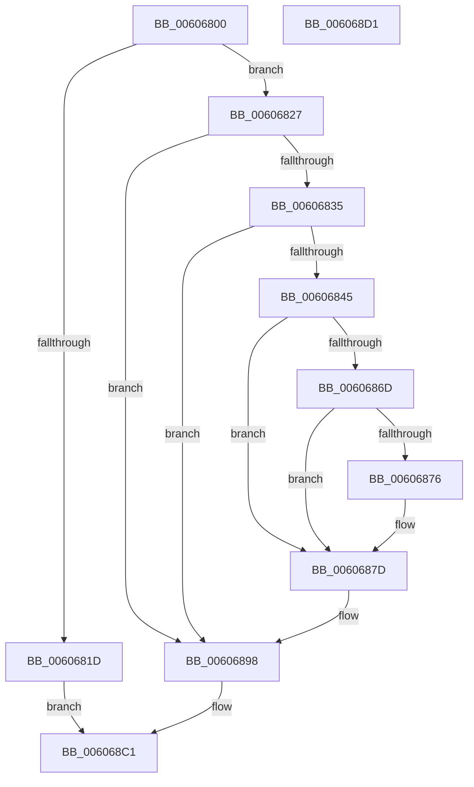

# SeGetProcessAntiTamperUIPolicy

- RVA: `0x00606800`–`0x006068D2` (길이 `210` bytes)
- VA: `0x0000000140606800`
- 실행 섹션: `.text`
- PDB 이름 있음: `예`; PDB Function 태그: `아니요`
- unwind 정보 RVA: `0x00060BC4`
- 디코드: `58`개 명령, `210/210` bytes 표시
- 미해석 바이트: `0` (있으면 어셈블리에 `.byte`로 보존)

> 이 문서는 커널 이미지의 기계어와 PDB 기호를 분석해 생성했습니다. 4번과 5번은 함수 원형과 자료형을 바이너리 사용 방식에서 추정한 C 해석이며 원본 소스 복구 결과는 아닙니다.

## 1. Dependencies

- 직접 호출 지점: **8**; 고유 호출 대상: **8**
- 직접 호출자로 확인된 함수: **0**
- RIP 상대 이미지 참조: **0**

### Outgoing calls
- `0x0060682C` → [Feature_OutsideInProtection__private_IsEnabledDeviceUsageNoInline](../5C/Feature_OutsideInProtection__private_IsEnabledDeviceUsageNoInline_function_005CD968.md) (function, `0x005CD968`)
- `0x00606838` → [PsReferencePrimaryToken](../../page/9A/PsReferencePrimaryToken_function_009A2CB0.md) (function, `0x009A2CB0`)
- `0x0060685C` → [ExAcquireResourceSharedLite](../21/ExAcquireResourceSharedLite_function_00211BC0.md) (function, `0x00211BC0`)
- `0x00606881` → [ExReleaseResourceLite](../25/ExReleaseResourceLite_function_0025FA10.md) (function, `0x0025FA10`)
- `0x00606886` → [KeLeaveCriticalRegion](../25/KeLeaveCriticalRegion_function_0025D8B0.md) (function, `0x0025D8B0`)
- `0x00606893` → [ObfDereferenceObjectWithTag](../2F/ObfDereferenceObjectWithTag_function_002F78E0.md) (function, `0x002F78E0`)
- `0x006068A0` → [memset](../6C/memset_function_006C6C40.md) (function, `0x006C6C40`)
- `0x006068BA` → [memcpy](../6C/memcpy_function_006C6840.md) (function, `0x006C6840`)

### Direct callers
- 이 함수 시작 RVA로 연결되는 직접 call은 확인되지 않았습니다. 간접 호출은 완전히 역산할 수 없습니다.

### Static image references
- 디코드된 RIP-relative 메모리 참조가 없습니다.

## 2. Other-region calls and transfers

- 다른 실행 섹션으로 향하는 call: **1**
  - `0x00606838` → [PsReferencePrimaryToken](../../page/9A/PsReferencePrimaryToken_function_009A2CB0.md) (`.text` → `PAGE`)
- 별도 외부 분기/꼬리 이동을 확인하지 못했습니다.

## 3. Assembly (complete function range)

```asm
00606800  48 89 5C 24 08                  mov qword ptr [rsp + 8], rbx
00606805  48 89 74 24 10                  mov qword ptr [rsp + 0x10], rsi
0060680A  57                              push rdi
0060680B  48 83 EC 20                     sub rsp, 0x20
0060680F  41 8B F8                        mov edi, r8d
00606812  48 8B F2                        mov rsi, rdx
00606815  48 8B D9                        mov rbx, rcx
00606818  45 85 C0                        test r8d, r8d
0060681B  75 0A                           jne 0x140606827
0060681D  B8 23 00 00 C0                  mov eax, 0xc0000023
00606822  E9 9A 00 00 00                  jmp 0x1406068c1
00606827  83 64 24 40 00                  and dword ptr [rsp + 0x40], 0
0060682C  E8 37 71 FC FF                  call 0x1405cd968
00606831  85 C0                           test eax, eax
00606833  74 63                           je 0x140606898
00606835  48 8B CB                        mov rcx, rbx
00606838  E8 73 C4 39 00                  call 0x1409a2cb0
0060683D  48 8B D8                        mov rbx, rax
00606840  48 85 C0                        test rax, rax
00606843  74 53                           je 0x140606898
00606845  65 48 8B 0C 25 88 01 00 00      mov rcx, qword ptr gs:[0x188]
0060684E  B2 01                           mov dl, 1
00606850  66 FF 89 E4 01 00 00            dec word ptr [rcx + 0x1e4]
00606857  90                              nop
00606858  48 8B 48 30                     mov rcx, qword ptr [rax + 0x30]
0060685C  E8 5F B3 C0 FF                  call 0x140211bc0
00606861  48 8B 83 B8 05 00 00            mov rax, qword ptr [rbx + 0x5b8]
00606868  48 85 C0                        test rax, rax
0060686B  74 10                           je 0x14060687d
0060686D  48 8B 40 30                     mov rax, qword ptr [rax + 0x30]
00606871  48 85 C0                        test rax, rax
00606874  74 07                           je 0x14060687d
00606876  8B 40 20                        mov eax, dword ptr [rax + 0x20]
00606879  89 44 24 40                     mov dword ptr [rsp + 0x40], eax
0060687D  48 8B 4B 30                     mov rcx, qword ptr [rbx + 0x30]
00606881  E8 8A 91 C5 FF                  call 0x14025fa10
00606886  E8 25 70 C5 FF                  call 0x14025d8b0
0060688B  BA 44 66 6C 74                  mov edx, 0x746c6644
00606890  48 8B CB                        mov rcx, rbx
00606893  E8 48 10 CF FF                  call 0x1402f78e0
00606898  4C 8B C7                        mov r8, rdi
0060689B  33 D2                           xor edx, edx
0060689D  48 8B CE                        mov rcx, rsi
006068A0  E8 9B 03 0C 00                  call 0x1406c6c40
006068A5  B8 04 00 00 00                  mov eax, 4
006068AA  48 8D 54 24 40                  lea rdx, [rsp + 0x40]
006068AF  3B F8                           cmp edi, eax
006068B1  48 8B CE                        mov rcx, rsi
006068B4  0F 43 F8                        cmovae edi, eax
006068B7  44 8B C7                        mov r8d, edi
006068BA  E8 81 FF 0B 00                  call 0x1406c6840
006068BF  33 C0                           xor eax, eax
006068C1  48 8B 5C 24 30                  mov rbx, qword ptr [rsp + 0x30]
006068C6  48 8B 74 24 38                  mov rsi, qword ptr [rsp + 0x38]
006068CB  48 83 C4 20                     add rsp, 0x20
006068CF  5F                              pop rdi
006068D0  C3                              ret
006068D1  CC                              int3
```

## 4. C-style interpretation (structured pseudocode)

```c
__int64 __fastcall SeGetProcessAntiTamperUIPolicy(__int64 a1, __int64 a2, int a3)
{
    __int64 result;
    __int64 v_rdi;
    __int64 v_rsp;
    unsigned __int64 v_stack_p10;
    unsigned int v_stack_p18;
    unsigned __int64 v_stack_p8;

    v_stack_p8 = v_rbx;
    v_stack_p10 = v_rsi;
    v_rsp = (v_rsp) - (32);
    if (a3 != 0) goto loc_00606827;
    goto loc_006068C1;
loc_00606827:
    result = Feature_OutsideInProtection__private_IsEnabledDeviceUsageNoInline(a1, a2, a3, a4);
    if ((unsigned int)(result) == 0) goto loc_00606898;
    result = PsReferencePrimaryToken(a1, a2, a3, a4);
    if (result == 0) goto loc_00606898;
    result = ExAcquireResourceSharedLite(*(unsigned __int64 *)(result + 48), 1, a3, a4);
    if (*(unsigned __int64 *)(result + 1464) == 0) goto loc_0060687D;
    result = *(unsigned __int64 *)(*(unsigned __int64 *)(result + 1464) + 48);
    if (*(unsigned __int64 *)(*(unsigned __int64 *)(result + 1464) + 48) != 0) {
        result = *(unsigned int *)(*(unsigned __int64 *)(*(unsigned __int64 *)(result + 1464) + 48) + 32);
        v_stack_p18 = (unsigned int)(result);
    }
    result = ExReleaseResourceLite(*(unsigned __int64 *)(result + 48), 1, a3, a4);
    result = KeLeaveCriticalRegion(*(unsigned __int64 *)(result + 48), 1, a3, a4);
    result = ObfDereferenceObjectWithTag(result, (unsigned int)(0x746C6644ULL), a3, a4);
loc_00606898:
    a2 = 0;
    result = memset(0, a2, (unsigned int)(a3), a4);
    v_rdi = (unsigned int)(a3);
    if (((unsigned int)((unsigned int)(a3))) >= 4) { v_rdi = 4; }
    result = memcpy(0, v_stack_p18, (unsigned int)((unsigned int)(v_rdi)), a4);
    result = 0;
loc_006068C1:
    v_rsp = (v_rsp) + (32);
    return result;
}
```

## 5. (Beta) C Style

```c
int64_t SeGetProcessAntiTamperUIPolicy(int64_t Arg1, int64_t Arg2, int32_t Arg3)
{
    int64_t result;
    int64_t local_rdi;
    int64_t local_rsp;
    uint64_t v_stack_p10;
    uint32_t v_stack_p18;
    uint64_t v_stack_p8;

    v_stack_p8 = local_rbx;
    v_stack_p10 = local_rsi;
    local_rsp = (local_rsp) - (32);
    if (Arg3 != 0) goto loc_00606827;
    goto loc_006068C1;
loc_00606827:
    result = Feature_OutsideInProtection__private_IsEnabledDeviceUsageNoInline(Arg1, Arg2, Arg3, a4);
    if ((uint32_t)(result) == 0) goto loc_00606898;
    result = PsReferencePrimaryToken(Arg1, Arg2, Arg3, a4);
    if (result == 0) goto loc_00606898;
    result = ExAcquireResourceSharedLite(*(uint64_t *)(result + 0x30), 1, Arg3, a4);
    if (*(uint64_t *)(result + 0x5B8) == 0) goto loc_0060687D;
    result = *(uint64_t *)(*(uint64_t *)(result + 0x5B8) + 0x30);
    if (*(uint64_t *)(*(uint64_t *)(result + 0x5B8) + 0x30) != 0) {
        result = *(uint32_t *)(*(uint64_t *)(*(uint64_t *)(result + 0x5B8) + 0x30) + 0x20);
        v_stack_p18 = (uint32_t)(result);
    }
    result = ExReleaseResourceLite(*(uint64_t *)(result + 0x30), 1, Arg3, a4);
    result = KeLeaveCriticalRegion(*(uint64_t *)(result + 0x30), 1, Arg3, a4);
    result = ObfDereferenceObjectWithTag(result, (uint32_t)(0x746C6644ULL), Arg3, a4);
loc_00606898:
    Arg2 = 0;
    result = memset(0, Arg2, (uint32_t)(Arg3), a4);
    local_rdi = (uint32_t)(Arg3);
    if (((uint32_t)((uint32_t)(Arg3))) >= 4) { local_rdi = 4; }
    result = memcpy(0, v_stack_p18, (uint32_t)((uint32_t)(local_rdi)), a4);
    result = 0;
loc_006068C1:
    local_rsp = (local_rsp) + (32);
    return result;
}
```

## 6. Execution-region graph

[열기: 2D/3D 그래프와 함수 탐색 컨트롤 패널](../../../control-panel.html?section=text&rva=0x00606800&view=graph)

- 2D 그래프는 위에서 아래로 흐르고, 3D 그래프는 빈 공간을 드래그해 회전합니다. Shift+드래그는 이동, 휠은 확대·축소, 함수 노드 선택은 대상 보고서 이동입니다.

### Static fallback


