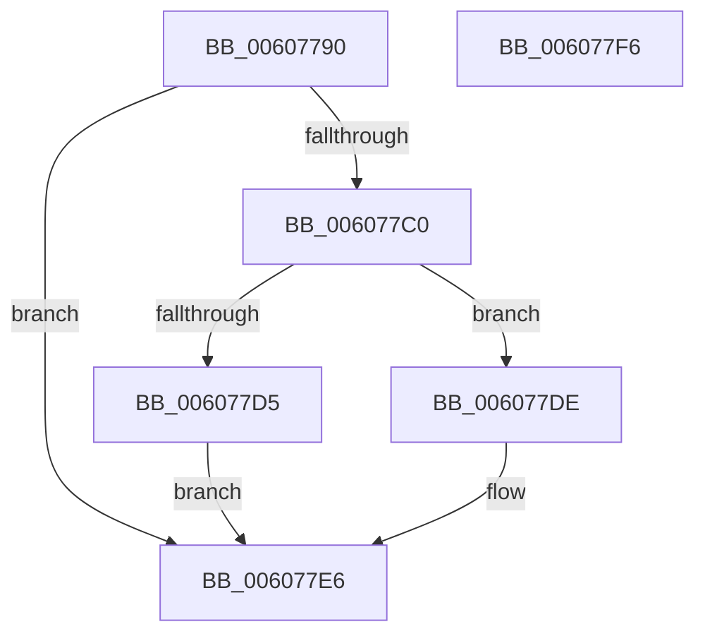

# SeInitializeObjectTypeEnumPolicyEntry

- RVA: `0x00607790`–`0x006077F7` (길이 `103` bytes)
- VA: `0x0000000140607790`
- 실행 섹션: `.text`
- PDB 이름 있음: `예`; PDB Function 태그: `아니요`
- unwind 정보 RVA: `0x000BC3A0`
- 디코드: `33`개 명령, `103/103` bytes 표시
- 미해석 바이트: `0` (있으면 어셈블리에 `.byte`로 보존)

> 이 문서는 커널 이미지의 기계어와 PDB 기호를 분석해 생성했습니다. 4번과 5번은 함수 원형과 자료형을 바이너리 사용 방식에서 추정한 C 해석이며 원본 소스 복구 결과는 아닙니다.

## 1. Dependencies

- 직접 호출 지점: **3**; 고유 호출 대상: **3**
- 직접 호출자로 확인된 함수: **2**
- RIP 상대 이미지 참조: **0**

### Outgoing calls
- `0x006077B7` → [SepAllocateObjectAntiTamperEntry](SepAllocateObjectAntiTamperEntry_function_00607994.md) (function, `0x00607994`)
- `0x006077CA` → [SepSetObjectAntiTamperEntryEnumSid](SepSetObjectAntiTamperEntryEnumSid_function_00608834.md) (function, `0x00608834`)
- `0x006077D5` → [ExFreePoolWithTag](../../poolcode/B8/ExFreePoolWithTag_function_00B82870.md) (function, `0x00B82870`)

### Direct callers
- [PspSetProcessObjectTypePolicy](../../init/C4/PspSetProcessObjectTypePolicy_function_00C45EE4.md) at `0x00C45FAD`
- [PspSetThreadObjectTypePolicy](../../init/C4/PspSetThreadObjectTypePolicy_function_00C4604C.md) at `0x00C46112`

### Static image references
- 디코드된 RIP-relative 메모리 참조가 없습니다.

## 2. Other-region calls and transfers

- 다른 실행 섹션으로 향하는 call: **1**
  - `0x006077D5` → [ExFreePoolWithTag](../../poolcode/B8/ExFreePoolWithTag_function_00B82870.md) (`.text` → `POOLCODE`)
- 별도 외부 분기/꼬리 이동을 확인하지 못했습니다.

## 3. Assembly (complete function range)

```asm
00607790  48 8B C4                        mov rax, rsp
00607793  48 89 58 08                     mov qword ptr [rax + 8], rbx
00607797  48 89 70 10                     mov qword ptr [rax + 0x10], rsi
0060779B  57                              push rdi
0060779C  48 83 EC 20                     sub rsp, 0x20
006077A0  48 83 60 18 00                  and qword ptr [rax + 0x18], 0
006077A5  8B F2                           mov esi, edx
006077A7  49 83 20 00                     and qword ptr [r8], 0
006077AB  48 8D 50 18                     lea rdx, [rax + 0x18]
006077AF  B9 01 00 00 00                  mov ecx, 1
006077B4  49 8B F8                        mov rdi, r8
006077B7  E8 D8 01 00 00                  call 0x140607994
006077BC  85 C0                           test eax, eax
006077BE  78 26                           js 0x1406077e6
006077C0  48 8B 4C 24 40                  mov rcx, qword ptr [rsp + 0x40]
006077C5  45 33 C0                        xor r8d, r8d
006077C8  33 D2                           xor edx, edx
006077CA  E8 65 10 00 00                  call 0x140608834
006077CF  8B D8                           mov ebx, eax
006077D1  85 C0                           test eax, eax
006077D3  79 09                           jns 0x1406077de
006077D5  E8 96 B0 57 00                  call 0x140b82870
006077DA  8B C3                           mov eax, ebx
006077DC  EB 08                           jmp 0x1406077e6
006077DE  89 71 04                        mov dword ptr [rcx + 4], esi
006077E1  33 C0                           xor eax, eax
006077E3  48 89 0F                        mov qword ptr [rdi], rcx
006077E6  48 8B 5C 24 30                  mov rbx, qword ptr [rsp + 0x30]
006077EB  48 8B 74 24 38                  mov rsi, qword ptr [rsp + 0x38]
006077F0  48 83 C4 20                     add rsp, 0x20
006077F4  5F                              pop rdi
006077F5  C3                              ret
006077F6  CC                              int3
```

## 4. C-style interpretation (structured pseudocode)

```c
__int64 __fastcall SeInitializeObjectTypeEnumPolicyEntry(__int64 a1, int a2, __int64 a3)
{
    __int64 result;
    __int64 v_rsp;
    unsigned __int64 v_stack_p10;
    unsigned __int64 v_stack_p18;
    unsigned __int64 v_stack_p8;

    *(unsigned __int64 *)(v_rsp + 8) = v_rbx;
    *(unsigned __int64 *)(v_rsp + 16) = v_rsi;
    v_rsp = (v_rsp) - (32);
    result = SepAllocateObjectAntiTamperEntry(1, v_rsp + 24, a3, a4);
    if (sign_flag) goto loc_006077E6;
    a3 = 0;
    a2 = 0;
    result = SepSetObjectAntiTamperEntryEnumSid(v_stack_p18, a2, a3, a4);
    if (!sign_flag) goto loc_006077DE;
    result = ExFreePoolWithTag(v_stack_p18, a2, a3, a4);
    goto loc_006077E6;
loc_006077DE:
    *(unsigned int *)(v_stack_p18 + 4) = (unsigned int)((unsigned int)(a2));
    result = 0;
    *(unsigned __int64 *)(a3) = v_stack_p18;
loc_006077E6:
    v_rsp = (v_rsp) + (32);
    return result;
}
```

## 5. (Beta) C Style

```c
int64_t SeInitializeObjectTypeEnumPolicyEntry(int64_t Arg1, int32_t Arg2, void *Arg3)
{
    uint8_t *arg3 = (uint8_t *)Arg3;

    int64_t result;
    int64_t local_rsp;
    uint64_t v_stack_p10;
    uint64_t v_stack_p18;
    uint64_t v_stack_p8;

    *(uint64_t *)(local_rsp + 0x8) = local_rbx;
    *(uint64_t *)(local_rsp + 0x10) = local_rsi;
    local_rsp = (local_rsp) - (32);
    result = SepAllocateObjectAntiTamperEntry(1, local_rsp + 24, Arg3, a4);
    if (sign_flag) goto loc_006077E6;
    Arg3 = 0;
    Arg2 = 0;
    result = SepSetObjectAntiTamperEntryEnumSid(v_stack_p18, Arg2, Arg3, a4);
    if (!sign_flag) goto loc_006077DE;
    result = ExFreePoolWithTag(v_stack_p18, Arg2, Arg3, a4);
    goto loc_006077E6;
loc_006077DE:
    *(uint32_t *)(v_stack_p18 + 0x4) = (uint32_t)((uint32_t)(Arg2));
    result = 0;
    *(uint64_t *)(arg3) = v_stack_p18;
loc_006077E6:
    local_rsp = (local_rsp) + (32);
    return result;
}
```

### 관측된 메모리 오프셋

구조체 형식이 확인되지 않은 접근은 인자 기준의 오프셋으로만 기록했습니다.

| 기준 인자 | 오프셋 표현 | 폭 (bit) | 접근 |
|---|---:|---:|---|
| `Arg3` | `+ 0x0` | `64` | `R/W` |
| `Arg3` | `+ 0x0` | `64` | `W` |

## 6. Execution-region graph

[열기: 2D/3D 그래프와 함수 탐색 컨트롤 패널](../../../control-panel.html?section=text&rva=0x00607790&view=graph)

- 2D 그래프는 위에서 아래로 흐르고, 3D 그래프는 빈 공간을 드래그해 회전합니다. Shift+드래그는 이동, 휠은 확대·축소, 함수 노드 선택은 대상 보고서 이동입니다.

### Static fallback


