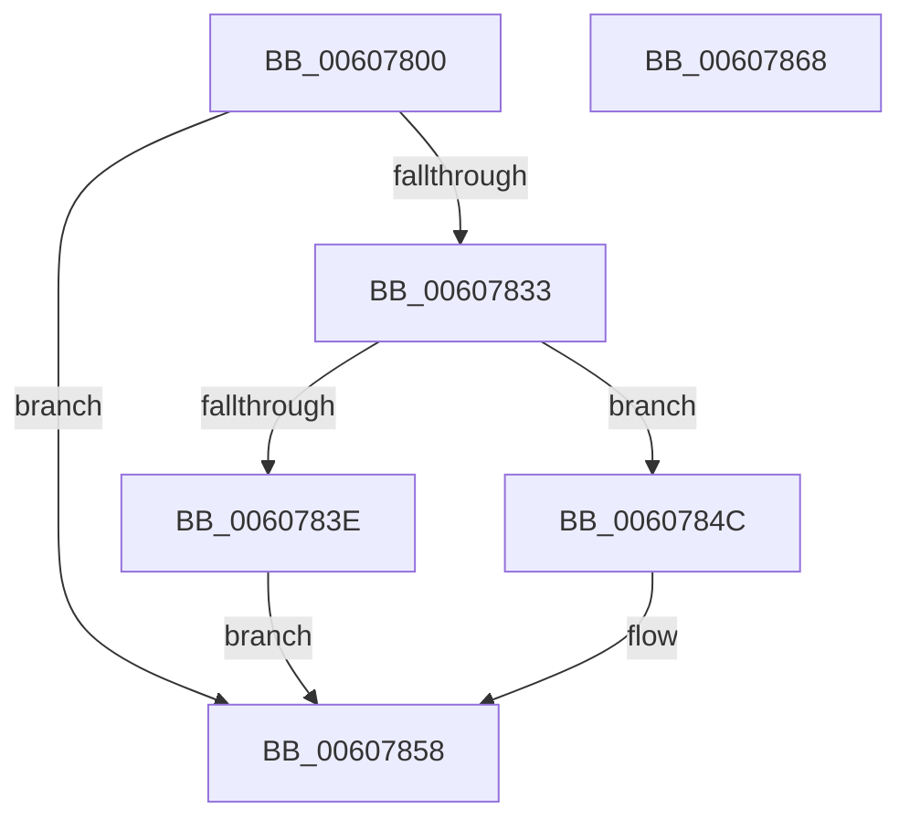

# SeInitializeObjectTypePolicyEntry

- RVA: `0x00607800`–`0x00607869` (길이 `105` bytes)
- VA: `0x0000000140607800`
- 실행 섹션: `.text`
- PDB 이름 있음: `예`; PDB Function 태그: `아니요`
- unwind 정보 RVA: `0x000BC3A0`
- 디코드: `32`개 명령, `105/105` bytes 표시
- 미해석 바이트: `0` (있으면 어셈블리에 `.byte`로 보존)

> 이 문서는 커널 이미지의 기계어와 PDB 기호를 분석해 생성했습니다. 4번과 5번은 함수 원형과 자료형을 바이너리 사용 방식에서 추정한 C 해석이며 원본 소스 복구 결과는 아닙니다.

## 1. Dependencies

- 직접 호출 지점: **2**; 고유 호출 대상: **2**
- 직접 호출자로 확인된 함수: **2**
- RIP 상대 이미지 참조: **0**

### Outgoing calls
- `0x0060782A` → [SepAllocateObjectAntiTamperEntry](SepAllocateObjectAntiTamperEntry_function_00607994.md) (function, `0x00607994`)
- `0x0060784E` → [ExFreePoolWithTag](../../poolcode/B8/ExFreePoolWithTag_function_00B82870.md) (function, `0x00B82870`)

### Direct callers
- [PspSetProcessObjectTypePolicy](../../init/C4/PspSetProcessObjectTypePolicy_function_00C45EE4.md) at `0x00C45F41`
- [PspSetProcessObjectTypePolicy](../../init/C4/PspSetProcessObjectTypePolicy_function_00C45EE4.md) at `0x00C45F60`
- [PspSetProcessObjectTypePolicy](../../init/C4/PspSetProcessObjectTypePolicy_function_00C45EE4.md) at `0x00C45F81`
- [PspSetProcessObjectTypePolicy](../../init/C4/PspSetProcessObjectTypePolicy_function_00C45EE4.md) at `0x00C45F9C`
- [PspSetProcessObjectTypePolicy](../../init/C4/PspSetProcessObjectTypePolicy_function_00C45EE4.md) at `0x00C45FC8`
- [PspSetThreadObjectTypePolicy](../../init/C4/PspSetThreadObjectTypePolicy_function_00C4604C.md) at `0x00C460A9`
- [PspSetThreadObjectTypePolicy](../../init/C4/PspSetThreadObjectTypePolicy_function_00C4604C.md) at `0x00C460C8`
- [PspSetThreadObjectTypePolicy](../../init/C4/PspSetThreadObjectTypePolicy_function_00C4604C.md) at `0x00C460E9`
- [PspSetThreadObjectTypePolicy](../../init/C4/PspSetThreadObjectTypePolicy_function_00C4604C.md) at `0x00C46101`
- [PspSetThreadObjectTypePolicy](../../init/C4/PspSetThreadObjectTypePolicy_function_00C4604C.md) at `0x00C4612B`

### Static image references
- 디코드된 RIP-relative 메모리 참조가 없습니다.

## 2. Other-region calls and transfers

- 다른 실행 섹션으로 향하는 call: **1**
  - `0x0060784E` → [ExFreePoolWithTag](../../poolcode/B8/ExFreePoolWithTag_function_00B82870.md) (`.text` → `POOLCODE`)
- 별도 외부 분기/꼬리 이동을 확인하지 못했습니다.

## 3. Assembly (complete function range)

```asm
00607800  48 8B C4                        mov rax, rsp
00607803  48 89 58 08                     mov qword ptr [rax + 8], rbx
00607807  48 89 70 10                     mov qword ptr [rax + 0x10], rsi
0060780B  57                              push rdi
0060780C  48 83 EC 20                     sub rsp, 0x20
00607810  48 83 60 18 00                  and qword ptr [rax + 0x18], 0
00607815  8B FA                           mov edi, edx
00607817  49 83 20 00                     and qword ptr [r8], 0
0060781B  48 8D 50 18                     lea rdx, [rax + 0x18]
0060781F  48 8B F1                        mov rsi, rcx
00607822  49 8B D8                        mov rbx, r8
00607825  B9 01 00 00 00                  mov ecx, 1
0060782A  E8 65 01 00 00                  call 0x140607994
0060782F  85 C0                           test eax, eax
00607831  78 25                           js 0x140607858
00607833  48 8B 4C 24 40                  mov rcx, qword ptr [rsp + 0x40]
00607838  83 79 08 00                     cmp dword ptr [rcx + 8], 0
0060783C  76 0E                           jbe 0x14060784c
0060783E  48 89 71 18                     mov qword ptr [rcx + 0x18], rsi
00607842  33 C0                           xor eax, eax
00607844  89 79 04                        mov dword ptr [rcx + 4], edi
00607847  48 89 0B                        mov qword ptr [rbx], rcx
0060784A  EB 0C                           jmp 0x140607858
0060784C  33 D2                           xor edx, edx
0060784E  E8 1D B0 57 00                  call 0x140b82870
00607853  B8 D1 04 00 C0                  mov eax, 0xc00004d1
00607858  48 8B 5C 24 30                  mov rbx, qword ptr [rsp + 0x30]
0060785D  48 8B 74 24 38                  mov rsi, qword ptr [rsp + 0x38]
00607862  48 83 C4 20                     add rsp, 0x20
00607866  5F                              pop rdi
00607867  C3                              ret
00607868  CC                              int3
```

## 4. C-style interpretation (structured pseudocode)

```c
__int64 __fastcall SeInitializeObjectTypePolicyEntry(__int64 a1, int a2, __int64 a3)
{
    __int64 result;
    __int64 v_rsp;
    unsigned __int64 v_stack_p10;
    unsigned __int64 v_stack_p18;
    unsigned __int64 v_stack_p8;

    *(unsigned __int64 *)(v_rsp + 8) = v_rbx;
    *(unsigned __int64 *)(v_rsp + 16) = v_rsi;
    v_rsp = (v_rsp) - (32);
    result = SepAllocateObjectAntiTamperEntry(1, v_rsp + 24, a3, a4);
    if (sign_flag) goto loc_00607858;
    if ((*(unsigned int *)(v_stack_p18 + 8)) <= 0) goto loc_0060784C;
    *(unsigned __int64 *)(v_stack_p18 + 24) = a1;
    result = 0;
    *(unsigned int *)(v_stack_p18 + 4) = (unsigned int)((unsigned int)(a2));
    *(unsigned __int64 *)(a3) = v_stack_p18;
    goto loc_00607858;
loc_0060784C:
    a2 = 0;
    result = ExFreePoolWithTag(v_stack_p18, a2, a3, a4);
loc_00607858:
    v_rsp = (v_rsp) + (32);
    return (unsigned int)(0xC00004D1ULL);
}
```

## 5. (Beta) C Style

```c
int64_t SeInitializeObjectTypePolicyEntry(int64_t Arg1, int32_t Arg2, void *Arg3)
{
    uint8_t *arg3 = (uint8_t *)Arg3;

    int64_t result;
    int64_t local_rsp;
    uint64_t v_stack_p10;
    uint64_t v_stack_p18;
    uint64_t v_stack_p8;

    *(uint64_t *)(local_rsp + 0x8) = local_rbx;
    *(uint64_t *)(local_rsp + 0x10) = local_rsi;
    local_rsp = (local_rsp) - (32);
    result = SepAllocateObjectAntiTamperEntry(1, local_rsp + 24, Arg3, a4);
    if (sign_flag) goto loc_00607858;
    if ((*(uint32_t *)(v_stack_p18 + 0x8)) <= 0) goto loc_0060784C;
    *(uint64_t *)(v_stack_p18 + 0x18) = Arg1;
    result = 0;
    *(uint32_t *)(v_stack_p18 + 0x4) = (uint32_t)((uint32_t)(Arg2));
    *(uint64_t *)(arg3) = v_stack_p18;
    goto loc_00607858;
loc_0060784C:
    Arg2 = 0;
    result = ExFreePoolWithTag(v_stack_p18, Arg2, Arg3, a4);
loc_00607858:
    local_rsp = (local_rsp) + (32);
    return (uint32_t)(0xC00004D1ULL);
}
```

### 관측된 메모리 오프셋

구조체 형식이 확인되지 않은 접근은 인자 기준의 오프셋으로만 기록했습니다.

| 기준 인자 | 오프셋 표현 | 폭 (bit) | 접근 |
|---|---:|---:|---|
| `Arg3` | `+ 0x0` | `64` | `R/W` |
| `Arg3` | `+ 0x0` | `64` | `W` |

## 6. Execution-region graph

[열기: 2D/3D 그래프와 함수 탐색 컨트롤 패널](../../../control-panel.html?section=text&rva=0x00607800&view=graph)

- 2D 그래프는 위에서 아래로 흐르고, 3D 그래프는 빈 공간을 드래그해 회전합니다. Shift+드래그는 이동, 휠은 확대·축소, 함수 노드 선택은 대상 보고서 이동입니다.

### Static fallback


