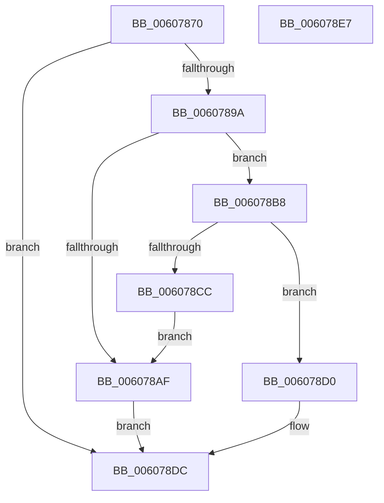

# SeInitializeObjectTypeUserAppInstancePolicyEntry

- RVA: `0x00607870`–`0x006078E8` (길이 `120` bytes)
- VA: `0x0000000140607870`
- 실행 섹션: `.text`
- PDB 이름 있음: `예`; PDB Function 태그: `아니요`
- unwind 정보 RVA: `0x0005CAAC`
- 디코드: `37`개 명령, `120/120` bytes 표시
- 미해석 바이트: `0` (있으면 어셈블리에 `.byte`로 보존)

> 이 문서는 커널 이미지의 기계어와 PDB 기호를 분석해 생성했습니다. 4번과 5번은 함수 원형과 자료형을 바이너리 사용 방식에서 추정한 C 해석이며 원본 소스 복구 결과는 아닙니다.

## 1. Dependencies

- 직접 호출 지점: **4**; 고유 호출 대상: **3**
- 직접 호출자로 확인된 함수: **2**
- RIP 상대 이미지 참조: **0**

### Outgoing calls
- `0x00607891` → [SepAllocateObjectAntiTamperEntry](SepAllocateObjectAntiTamperEntry_function_00607994.md) (function, `0x00607994`)
- `0x006078A4` → [SepSetObjectAntiTamperEntryEnumSid](SepSetObjectAntiTamperEntryEnumSid_function_00608834.md) (function, `0x00608834`)
- `0x006078AF` → [ExFreePoolWithTag](../../poolcode/B8/ExFreePoolWithTag_function_00B82870.md) (function, `0x00B82870`)
- `0x006078C1` → [SepSetObjectAntiTamperEntryEnumSid](SepSetObjectAntiTamperEntryEnumSid_function_00608834.md) (function, `0x00608834`)

### Direct callers
- [PspSetProcessObjectTypePolicy](../../init/C4/PspSetProcessObjectTypePolicy_function_00C45EE4.md) at `0x00C45F22`
- [PspSetThreadObjectTypePolicy](../../init/C4/PspSetThreadObjectTypePolicy_function_00C4604C.md) at `0x00C4608A`

### Static image references
- 디코드된 RIP-relative 메모리 참조가 없습니다.

## 2. Other-region calls and transfers

- 다른 실행 섹션으로 향하는 call: **1**
  - `0x006078AF` → [ExFreePoolWithTag](../../poolcode/B8/ExFreePoolWithTag_function_00B82870.md) (`.text` → `POOLCODE`)
- 별도 외부 분기/꼬리 이동을 확인하지 못했습니다.

## 3. Assembly (complete function range)

```asm
00607870  48 89 5C 24 08                  mov qword ptr [rsp + 8], rbx
00607875  57                              push rdi
00607876  48 83 EC 20                     sub rsp, 0x20
0060787A  48 83 22 00                     and qword ptr [rdx], 0
0060787E  48 8B FA                        mov rdi, rdx
00607881  48 83 64 24 38 00               and qword ptr [rsp + 0x38], 0
00607887  48 8D 54 24 38                  lea rdx, [rsp + 0x38]
0060788C  B9 02 00 00 00                  mov ecx, 2
00607891  E8 FE 00 00 00                  call 0x140607994
00607896  85 C0                           test eax, eax
00607898  78 42                           js 0x1406078dc
0060789A  48 8B 4C 24 38                  mov rcx, qword ptr [rsp + 0x38]
0060789F  45 33 C0                        xor r8d, r8d
006078A2  33 D2                           xor edx, edx
006078A4  E8 8B 0F 00 00                  call 0x140608834
006078A9  8B D8                           mov ebx, eax
006078AB  85 C0                           test eax, eax
006078AD  79 09                           jns 0x1406078b8
006078AF  E8 BC AF 57 00                  call 0x140b82870
006078B4  8B C3                           mov eax, ebx
006078B6  EB 24                           jmp 0x1406078dc
006078B8  BA 01 00 00 00                  mov edx, 1
006078BD  44 8D 42 01                     lea r8d, [rdx + 1]
006078C1  E8 6E 0F 00 00                  call 0x140608834
006078C6  8B D8                           mov ebx, eax
006078C8  85 C0                           test eax, eax
006078CA  79 04                           jns 0x1406078d0
006078CC  33 D2                           xor edx, edx
006078CE  EB DF                           jmp 0x1406078af
006078D0  C7 41 04 FF FF 1F 00            mov dword ptr [rcx + 4], 0x1fffff
006078D7  33 C0                           xor eax, eax
006078D9  48 89 0F                        mov qword ptr [rdi], rcx
006078DC  48 8B 5C 24 30                  mov rbx, qword ptr [rsp + 0x30]
006078E1  48 83 C4 20                     add rsp, 0x20
006078E5  5F                              pop rdi
006078E6  C3                              ret
006078E7  CC                              int3
```

## 4. C-style interpretation (structured pseudocode)

```c
__int64 __fastcall SeInitializeObjectTypeUserAppInstancePolicyEntry(__int64 a1, __int64 a2, int a3)
{
    __int64 result;
    __int64 v_rsp;
    unsigned __int64 v_stack_p10;
    unsigned __int64 v_stack_p8;

    v_stack_p8 = v_rbx;
    v_rsp = (v_rsp) - (32);
    result = SepAllocateObjectAntiTamperEntry(2, v_stack_p10, a3, a4);
    if (sign_flag) goto loc_006078DC;
    a3 = 0;
    a2 = 0;
    result = SepSetObjectAntiTamperEntryEnumSid(v_stack_p10, a2, a3, a4);
    if (!sign_flag) goto loc_006078B8;
loc_006078AF:
    result = ExFreePoolWithTag(v_stack_p10, a2, a3, a4);
    goto loc_006078DC;
loc_006078B8:
    result = SepSetObjectAntiTamperEntryEnumSid(v_stack_p10, 1, 1 + 1, a4);
    if (!sign_flag) goto loc_006078D0;
    a2 = 0;
    goto loc_006078AF;
loc_006078D0:
    *(unsigned int *)(v_stack_p10 + 4) = 0x1FFFFFULL;
    result = 0;
    *(unsigned __int64 *)(a2) = v_stack_p10;
loc_006078DC:
    v_rsp = (v_rsp) + (32);
    return result;
}
```

## 5. (Beta) C Style

```c
int64_t SeInitializeObjectTypeUserAppInstancePolicyEntry(int64_t Arg1, void *Arg2, int32_t Arg3)
{
    uint8_t *arg2 = (uint8_t *)Arg2;

    int64_t result;
    int64_t local_rsp;
    uint64_t v_stack_p10;
    uint64_t v_stack_p8;

    v_stack_p8 = local_rbx;
    local_rsp = (local_rsp) - (32);
    result = SepAllocateObjectAntiTamperEntry(2, v_stack_p10, Arg3, a4);
    if (sign_flag) goto loc_006078DC;
    Arg3 = 0;
    Arg2 = 0;
    result = SepSetObjectAntiTamperEntryEnumSid(v_stack_p10, Arg2, Arg3, a4);
    if (!sign_flag) goto loc_006078B8;
loc_006078AF:
    result = ExFreePoolWithTag(v_stack_p10, Arg2, Arg3, a4);
    goto loc_006078DC;
loc_006078B8:
    result = SepSetObjectAntiTamperEntryEnumSid(v_stack_p10, 1, 1 + 1, a4);
    if (!sign_flag) goto loc_006078D0;
    Arg2 = 0;
    goto loc_006078AF;
loc_006078D0:
    *(uint32_t *)(v_stack_p10 + 0x4) = 0x1FFFFFULL;
    result = 0;
    *(uint64_t *)(arg2) = v_stack_p10;
loc_006078DC:
    local_rsp = (local_rsp) + (32);
    return result;
}
```

### 관측된 메모리 오프셋

구조체 형식이 확인되지 않은 접근은 인자 기준의 오프셋으로만 기록했습니다.

| 기준 인자 | 오프셋 표현 | 폭 (bit) | 접근 |
|---|---:|---:|---|
| `Arg2` | `+ 0x0` | `64` | `R/W` |
| `Arg2` | `+ 0x0` | `64` | `W` |

## 6. Execution-region graph

[열기: 2D/3D 그래프와 함수 탐색 컨트롤 패널](../../../control-panel.html?section=text&rva=0x00607870&view=graph)

- 2D 그래프는 위에서 아래로 흐르고, 3D 그래프는 빈 공간을 드래그해 회전합니다. Shift+드래그는 이동, 휠은 확대·축소, 함수 노드 선택은 대상 보고서 이동입니다.

### Static fallback


