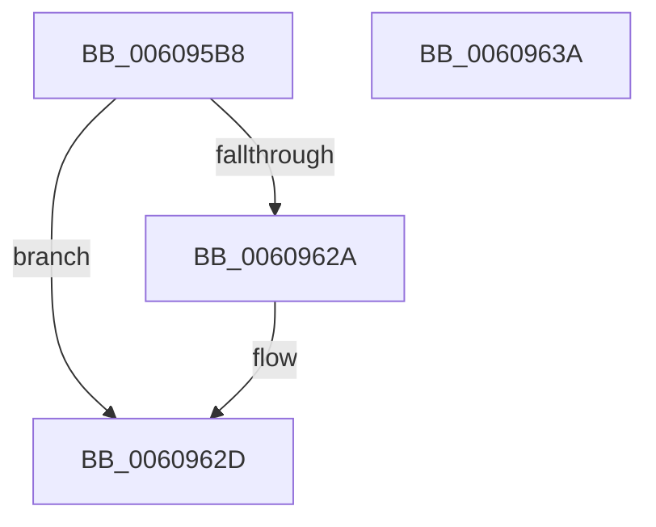

# SeIsSystemContext

- RVA: `0x006095B8`–`0x0060963B` (길이 `131` bytes)
- VA: `0x00000001406095B8`
- 실행 섹션: `.text`
- PDB 이름 있음: `예`; PDB Function 태그: `아니요`
- unwind 정보 RVA: `0x000B5DC4`
- 디코드: `33`개 명령, `131/131` bytes 표시
- 미해석 바이트: `0` (있으면 어셈블리에 `.byte`로 보존)

> 이 문서는 커널 이미지의 기계어와 PDB 기호를 분석해 생성했습니다. 4번과 5번은 함수 원형과 자료형을 바이너리 사용 방식에서 추정한 C 해석이며 원본 소스 복구 결과는 아닙니다.

## 1. Dependencies

- 직접 호출 지점: **1**; 고유 호출 대상: **1**
- 직접 호출자로 확인된 함수: **1**
- RIP 상대 이미지 참조: **2**

### Outgoing calls
- `0x00609621` → [SeAccessCheck](../3A/SeAccessCheck_function_003A6BC0.md) (function, `0x003A6BC0`)

### Direct callers
- [SepFilterToken](../../page/9C/SepFilterToken_function_009C6B80.md) at `0x009C722A`

### Static image references
- `0x006095F5` → RVA `0x00019EC0` (`.rdata`; read)
- `0x0060961A` → RVA `0x00B50898` (`SepSystemContextSecurityDescriptor`; read)

## 2. Other-region calls and transfers

- 다른 실행 섹션으로 향하는 call: **0**
- 별도 외부 분기/꼬리 이동을 확인하지 못했습니다.

## 3. Assembly (complete function range)

```asm
006095B8  4C 8B DC                        mov r11, rsp
006095BB  53                              push rbx
006095BC  48 83 EC 70                     sub rsp, 0x70
006095C0  41 83 63 10 00                  and dword ptr [r11 + 0x10], 0
006095C5  49 8D 43 08                     lea rax, [r11 + 8]
006095C9  41 83 63 08 00                  and dword ptr [r11 + 8], 0
006095CE  48 8B DA                        mov rbx, rdx
006095D1  49 83 63 D8 00                  and qword ptr [r11 - 0x28], 0
006095D6  41 B9 01 00 00 00               mov r9d, 1
006095DC  49 83 63 E0 00                  and qword ptr [r11 - 0x20], 0
006095E1  45 33 C0                        xor r8d, r8d
006095E4  49 83 63 F0 00                  and qword ptr [r11 - 0x10], 0
006095E9  49 89 43 D0                     mov qword ptr [r11 - 0x30], rax
006095ED  49 8D 43 10                     lea rax, [r11 + 0x10]
006095F1  49 89 43 C8                     mov qword ptr [r11 - 0x38], rax
006095F5  48 8D 05 C4 08 A1 FF            lea rax, [rip - 0x5ef73c]
006095FC  C6 44 24 38 01                  mov byte ptr [rsp + 0x38], 1
00609601  49 89 43 B8                     mov qword ptr [r11 - 0x48], rax
00609605  49 83 63 B0 00                  and qword ptr [r11 - 0x50], 0
0060960A  83 64 24 20 00                  and dword ptr [rsp + 0x20], 0
0060960F  C6 02 00                        mov byte ptr [rdx], 0
00609612  49 8D 53 D8                     lea rdx, [r11 - 0x28]
00609616  49 89 4B E8                     mov qword ptr [r11 - 0x18], rcx
0060961A  48 8D 0D 77 72 54 00            lea rcx, [rip + 0x547277]
00609621  E8 9A D5 D9 FF                  call 0x1403a6bc0
00609626  84 C0                           test al, al
00609628  74 03                           je 0x14060962d
0060962A  C6 03 01                        mov byte ptr [rbx], 1
0060962D  8B 84 24 80 00 00 00            mov eax, dword ptr [rsp + 0x80]
00609634  48 83 C4 70                     add rsp, 0x70
00609638  5B                              pop rbx
00609639  C3                              ret
0060963A  CC                              int3
```

## 4. C-style interpretation (structured pseudocode)

```c
__int64 __fastcall SeIsSystemContext(__int64 a1, __int64 a2, int a3)
{
    __int64 result;
    __int64 v_rsp;
    unsigned __int8 v_stack_m40;
    unsigned int v_stack_m58;
    unsigned int v_stack_p8;

    v_rsp = (v_rsp) - (112);
    a3 = 0;
    *(unsigned __int64 *)(v_rsp - 48) = v_rsp + 8;
    *(unsigned __int64 *)(v_rsp - 56) = v_rsp + 16;
    v_stack_m40 = 1;
    *(unsigned __int64 *)(v_rsp - 72) = v_rip - 6223676;
    *(unsigned __int8 *)(a2) = 0;
    *(unsigned __int64 *)(v_rsp - 24) = a1;
    result = SeAccessCheck(v_rip + 5534327, v_rsp - 40, a3, 1);
    if ((unsigned __int8)(result) != 0) {
        *(unsigned __int8 *)(a2) = 1;
    }
    v_rsp = (v_rsp) + (112);
    return (unsigned int)(v_stack_p8);
}
```

## 5. (Beta) C Style

```c
int64_t SeIsSystemContext(int64_t Arg1, void *Arg2, int32_t Arg3)
{
    uint8_t *arg2 = (uint8_t *)Arg2;

    int64_t result;
    int64_t local_rsp;
    uint8_t v_stack_m40;
    uint32_t v_stack_m58;
    uint32_t v_stack_p8;

    local_rsp = (local_rsp) - (112);
    Arg3 = 0;
    *(uint64_t *)(local_rsp - 0x30) = local_rsp + 8;
    *(uint64_t *)(local_rsp - 0x38) = local_rsp + 16;
    v_stack_m40 = 1;
    *(uint64_t *)(local_rsp - 0x48) = v_rip - 6223676;
    *(uint8_t *)(arg2) = 0;
    *(uint64_t *)(local_rsp - 0x18) = Arg1;
    result = SeAccessCheck(v_rip + 5534327, local_rsp - 40, Arg3, 1);
    if ((uint8_t)(result) != 0) {
        *(uint8_t *)(arg2) = 1;
    }
    local_rsp = (local_rsp) + (112);
    return (uint32_t)(v_stack_p8);
}
```

### 관측된 메모리 오프셋

구조체 형식이 확인되지 않은 접근은 인자 기준의 오프셋으로만 기록했습니다.

| 기준 인자 | 오프셋 표현 | 폭 (bit) | 접근 |
|---|---:|---:|---|
| `Arg2` | `+ 0x0` | `8` | `W` |

## 6. Execution-region graph

[열기: 2D/3D 그래프와 함수 탐색 컨트롤 패널](../../../control-panel.html?section=text&rva=0x006095B8&view=graph)

- 2D 그래프는 위에서 아래로 흐르고, 3D 그래프는 빈 공간을 드래그해 회전합니다. Shift+드래그는 이동, 휠은 확대·축소, 함수 노드 선택은 대상 보고서 이동입니다.

### Static fallback


