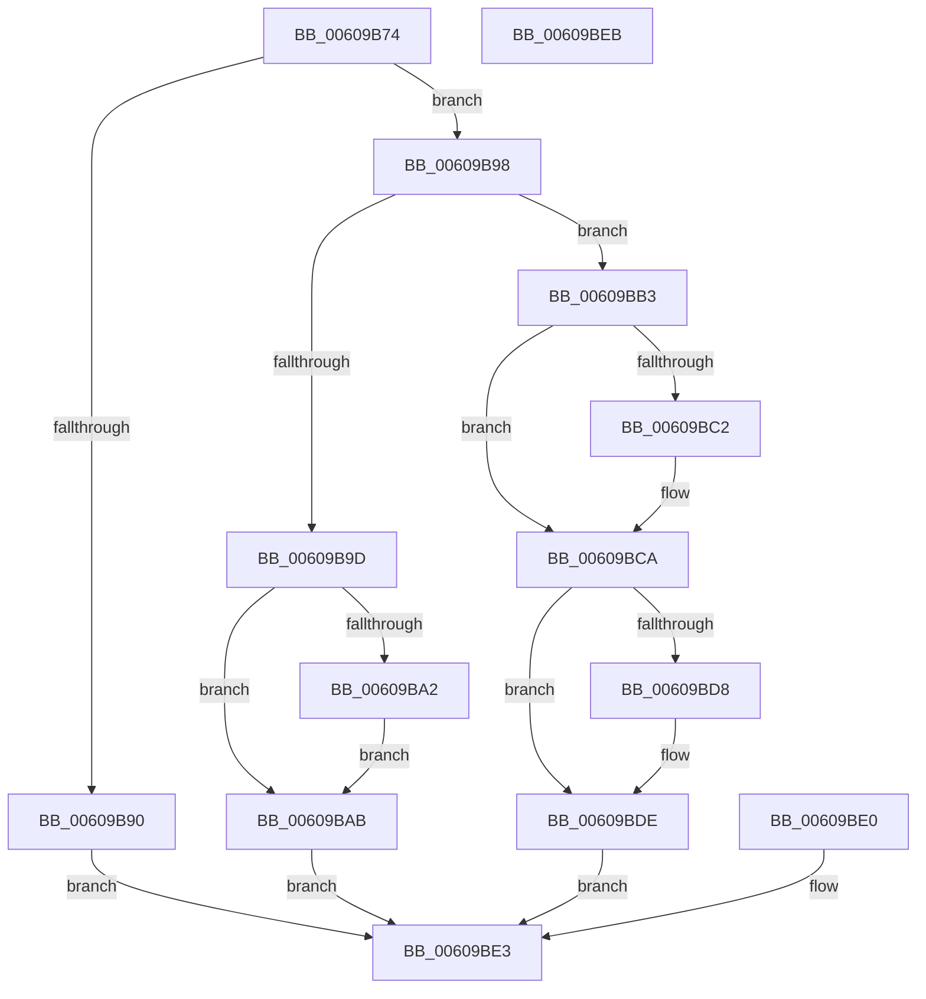

# SeQueryTrustedPlatformModuleInformation

- RVA: `0x00609B74`–`0x00609BEC` (길이 `120` bytes)
- VA: `0x0000000140609B74`
- 실행 섹션: `.text`
- PDB 이름 있음: `예`; PDB Function 태그: `아니요`
- unwind 정보 RVA: `0x000D1528`
- 디코드: `34`개 명령, `120/120` bytes 표시
- 미해석 바이트: `0` (있으면 어셈블리에 `.byte`로 보존)

> 이 문서는 커널 이미지의 기계어와 PDB 기호를 분석해 생성했습니다. 4번과 5번은 함수 원형과 자료형을 바이너리 사용 방식에서 추정한 C 해석이며 원본 소스 복구 결과는 아닙니다.

## 1. Dependencies

- 직접 호출 지점: **0**; 고유 호출 대상: **0**
- 직접 호출자로 확인된 함수: **1**
- RIP 상대 이미지 참조: **2**

### Outgoing calls
- 직접 디코드된 call 명령이 없습니다.

### Direct callers
- [ExpQuerySystemInformation](../../page/A5/ExpQuerySystemInformation_function_00A57858.md) at `0x00A5A53C`

### Static image references
- `0x00609BB9` → RVA `0x00E67D00` (`.data`; read)
- `0x00609BCA` → RVA `0x00F8CFB0` (`.data`; read)

## 2. Other-region calls and transfers

- 다른 실행 섹션으로 향하는 call: **0**
- 별도 외부 분기/꼬리 이동을 확인하지 못했습니다.

## 3. Assembly (complete function range)

```asm
00609B74  48 83 EC 38                     sub rsp, 0x38
00609B78  4C 8B D9                        mov r11, rcx
00609B7B  45 33 D2                        xor r10d, r10d
00609B7E  65 48 8B 04 25 88 01 00 00      mov rax, qword ptr gs:[0x188]
00609B87  44 38 90 32 02 00 00            cmp byte ptr [rax + 0x232], r10b
00609B8E  74 08                           je 0x140609b98
00609B90  41 BA 22 00 00 C0               mov r10d, 0xc0000022
00609B96  EB 4B                           jmp 0x140609be3
00609B98  83 FA 04                        cmp edx, 4
00609B9B  73 16                           jae 0x140609bb3
00609B9D  4D 85 C0                        test r8, r8
00609BA0  74 09                           je 0x140609bab
00609BA2  41 C7 00 04 00 00 00            mov dword ptr [r8], 4
00609BA9  EB 00                           jmp 0x140609bab
00609BAB  41 BA 04 00 00 C0               mov r10d, 0xc0000004
00609BB1  EB 30                           jmp 0x140609be3
00609BB3  44 89 11                        mov dword ptr [rcx], r10d
00609BB6  41 8B CA                        mov ecx, r10d
00609BB9  44 38 15 40 E1 85 00            cmp byte ptr [rip + 0x85e140], r10b
00609BC0  74 08                           je 0x140609bca
00609BC2  B9 01 00 00 00                  mov ecx, 1
00609BC7  41 89 0B                        mov dword ptr [r11], ecx
00609BCA  83 3D DF 33 98 00 02            cmp dword ptr [rip + 0x9833df], 2
00609BD1  0F 9F C0                        setg al
00609BD4  84 C0                           test al, al
00609BD6  74 06                           je 0x140609bde
00609BD8  83 C9 02                        or ecx, 2
00609BDB  41 89 0B                        mov dword ptr [r11], ecx
00609BDE  EB 03                           jmp 0x140609be3
00609BE0  44 8B D0                        mov r10d, eax
00609BE3  41 8B C2                        mov eax, r10d
00609BE6  48 83 C4 38                     add rsp, 0x38
00609BEA  C3                              ret
00609BEB  CC                              int3
```

## 4. C-style interpretation (structured pseudocode)

```c
__int64 __fastcall SeQueryTrustedPlatformModuleInformation(__int64 a1, int a2, __int64 a3)
{
    __int64 result;
    __int64 v_r10;
    __int64 v_rsp;

    v_rsp = (v_rsp) - (56);
    v_r10 = 0;
    if ((*(unsigned __int8 *)(*(unsigned __int64 *)(gs_base + (0 + 392)) + 562)) == 0) goto loc_00609B98;
    goto loc_00609BE3;
loc_00609B98:
    if (a2 >= 4) goto loc_00609BB3;
    if (a3 == 0) goto loc_00609BAB;
    *(unsigned int *)(a3) = 4;
    goto loc_00609BAB;
loc_00609BAB:
    goto loc_00609BE3;
loc_00609BB3:
    *(unsigned int *)(a1) = (unsigned int)((unsigned int)(0xC0000004ULL));
    if ((*(unsigned __int8 *)(v_rip + 8773952)) != ((unsigned __int8)((unsigned int)(0xC0000004ULL)))) {
        a1 = 1;
        *(unsigned int *)(a1) = (unsigned int)(a1);
    }
    result = ((*(unsigned int *)(v_rip + 9974751)) > 2) ? 1 : 0;
    if ((unsigned __int8)(result) != 0) {
        a1 = (unsigned int)((a1) | (2));
        *(unsigned int *)(a1) = (unsigned int)(a1);
    }
    goto loc_00609BE3;
loc_00609BE3:
    v_rsp = (v_rsp) + (56);
    return (unsigned int)((unsigned int)((unsigned int)(0xC0000004ULL)));
}
```

## 5. (Beta) C Style

```c
int64_t SeQueryTrustedPlatformModuleInformation(void *Arg1, int32_t Arg2, int64_t Arg3)
{
    uint8_t *arg1 = (uint8_t *)Arg1;

    int64_t result;
    int64_t local_r10;
    int64_t local_rsp;

    local_rsp = (local_rsp) - (56);
    local_r10 = 0;
    if ((*(uint8_t *)(*(uint64_t *)(gs_base + (0 + 0x188)) + 0x232)) == 0) goto loc_00609B98;
    goto loc_00609BE3;
loc_00609B98:
    if (Arg2 >= 4) goto loc_00609BB3;
    if (Arg3 == 0) goto loc_00609BAB;
    *(uint32_t *)(Arg3) = 4;
    goto loc_00609BAB;
loc_00609BAB:
    goto loc_00609BE3;
loc_00609BB3:
    *(uint32_t *)(arg1) = (uint32_t)((uint32_t)(0xC0000004ULL));
    if ((*(uint8_t *)(v_rip + 0x85E140)) != ((uint8_t)((uint32_t)(0xC0000004ULL)))) {
        Arg1 = 1;
        *(uint32_t *)(arg1) = (uint32_t)(Arg1);
    }
    result = ((*(uint32_t *)(v_rip + 0x9833DF)) > 2) ? 1 : 0;
    if ((uint8_t)(result) != 0) {
        Arg1 = (uint32_t)((Arg1) | (2));
        *(uint32_t *)(arg1) = (uint32_t)(Arg1);
    }
    goto loc_00609BE3;
loc_00609BE3:
    local_rsp = (local_rsp) + (56);
    return (uint32_t)((uint32_t)((uint32_t)(0xC0000004ULL)));
}
```

### 관측된 메모리 오프셋

구조체 형식이 확인되지 않은 접근은 인자 기준의 오프셋으로만 기록했습니다.

| 기준 인자 | 오프셋 표현 | 폭 (bit) | 접근 |
|---|---:|---:|---|
| `Arg1` | `+ 0x0` | `32` | `W` |

## 6. Execution-region graph

[열기: 2D/3D 그래프와 함수 탐색 컨트롤 패널](../../../control-panel.html?section=text&rva=0x00609B74&view=graph)

- 2D 그래프는 위에서 아래로 흐르고, 3D 그래프는 빈 공간을 드래그해 회전합니다. Shift+드래그는 이동, 휠은 확대·축소, 함수 노드 선택은 대상 보고서 이동입니다.

### Static fallback


