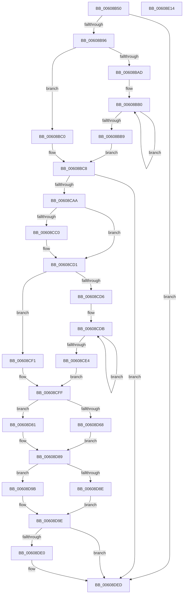

# SeReportLearningModeViolation

- RVA: `0x00608B50`–`0x00608E15` (길이 `709` bytes)
- VA: `0x0000000140608B50`
- 실행 섹션: `.text`
- PDB 이름 있음: `예`; PDB Function 태그: `아니요`
- unwind 정보 RVA: `0x000D10AC`
- 디코드: `168`개 명령, `709/709` bytes 표시
- 미해석 바이트: `0` (있으면 어셈블리에 `.byte`로 보존)

> 이 문서는 커널 이미지의 기계어와 PDB 기호를 분석해 생성했습니다. 4번과 5번은 함수 원형과 자료형을 바이너리 사용 방식에서 추정한 C 해석이며 원본 소스 복구 결과는 아닙니다.

## 1. Dependencies

- 직접 호출 지점: **7**; 고유 호출 대상: **5**
- 직접 호출자로 확인된 함수: **1**
- RIP 상대 이미지 참조: **6**

### Outgoing calls
- `0x00608C40` → [Feature_LearningModeViolationLogWithSids__private_IsEnabledDeviceUsageNoInline](Feature_LearningModeViolationLogWithSids__private_IsEnabledDeviceUsageNoInline_function_00608ABC.md) (function, `0x00608ABC`)
- `0x00608C98` → [EtwWriteEx](../25/EtwWriteEx_function_0025F0D0.md) (function, `0x0025F0D0`)
- `0x00608C9D` → [Feature_LearningModeViolationLogWithSids__private_IsEnabledDeviceUsageNoInline](Feature_LearningModeViolationLogWithSids__private_IsEnabledDeviceUsageNoInline_function_00608ABC.md) (function, `0x00608ABC`)
- `0x00608CB3` → [PsReferencePrimaryToken](../../page/9A/PsReferencePrimaryToken_function_009A2CB0.md) (function, `0x009A2CB0`)
- `0x00608DD6` → [EtwWriteEx](../25/EtwWriteEx_function_0025F0D0.md) (function, `0x0025F0D0`)
- `0x00608DE8` → [ObfDereferenceObjectWithTag](../2F/ObfDereferenceObjectWithTag_function_002F78E0.md) (function, `0x002F78E0`)
- `0x00608DF4` → [_security_check_cookie](../6A/_security_check_cookie_function_006AC640.md) (function, `0x006AC640`)

### Direct callers
- [PsConvertToGuiThread](../../page/A2/PsConvertToGuiThread_function_00A2F8B0.md) at `0x00A2F9CB`

### Static image references
- `0x00608B75` → RVA `0x00E0A740` (`.data`; read)
- `0x00608B89` → RVA `0x00EFFA28` (`.data`; read)
- `0x00608BA1` → RVA `0x006C7800` (` ?? ::FNODOBFM::`string'`; read)
- `0x00608C5F` → RVA `0x00021E10` (`.rdata`; read)
- `0x00608D44` → RVA `0x006C8EC0` (` ?? ::FNODOBFM::`string'`; read)
- `0x00608DAD` → RVA `0x00022328` (`.rdata`; read)

## 2. Other-region calls and transfers

- 다른 실행 섹션으로 향하는 call: **1**
  - `0x00608CB3` → [PsReferencePrimaryToken](../../page/9A/PsReferencePrimaryToken_function_009A2CB0.md) (`.text` → `PAGE`)
- 별도 외부 분기/꼬리 이동을 확인하지 못했습니다.

## 3. Assembly (complete function range)

```asm
00608B50  48 89 5C 24 20                  mov qword ptr [rsp + 0x20], rbx
00608B55  44 89 44 24 18                  mov dword ptr [rsp + 0x18], r8d
00608B5A  89 54 24 10                     mov dword ptr [rsp + 0x10], edx
00608B5E  55                              push rbp
00608B5F  56                              push rsi
00608B60  57                              push rdi
00608B61  41 54                           push r12
00608B63  41 55                           push r13
00608B65  41 56                           push r14
00608B67  41 57                           push r15
00608B69  48 8D 6C 24 B0                  lea rbp, [rsp - 0x50]
00608B6E  48 81 EC 50 01 00 00            sub rsp, 0x150
00608B75  48 8B 05 C4 1B 80 00            mov rax, qword ptr [rip + 0x801bc4]
00608B7C  48 33 C4                        xor rax, rsp
00608B7F  48 89 45 40                     mov qword ptr [rbp + 0x40], rax
00608B83  45 33 E4                        xor r12d, r12d
00608B86  4C 8B F1                        mov r14, rcx
00608B89  4C 39 25 98 6E 8F 00            cmp qword ptr [rip + 0x8f6e98], r12
00608B90  0F 84 57 02 00 00               je 0x140608ded
00608B96  48 8D B9 38 03 00 00            lea rdi, [rcx + 0x338]
00608B9D  48 83 CB FF                     or rbx, 0xffffffffffffffff
00608BA1  4C 8D 2D 58 EC 0B 00            lea r13, [rip + 0xbec58]
00608BA8  48 85 FF                        test rdi, rdi
00608BAB  74 13                           je 0x140608bc0
00608BAD  48 8B C3                        mov rax, rbx
00608BB0  48 FF C0                        inc rax
00608BB3  44 38 24 07                     cmp byte ptr [rdi + rax], r12b
00608BB7  75 F7                           jne 0x140608bb0
00608BB9  FF C0                           inc eax
00608BBB  48 8B CF                        mov rcx, rdi
00608BBE  EB 08                           jmp 0x140608bc8
00608BC0  B8 01 00 00 00                  mov eax, 1
00608BC5  49 8B CD                        mov rcx, r13
00608BC8  89 45 E8                        mov dword ptr [rbp - 0x18], eax
00608BCB  49 8B 86 D0 01 00 00            mov rax, qword ptr [r14 + 0x1d0]
00608BD2  48 89 44 24 48                  mov qword ptr [rsp + 0x48], rax
00608BD7  48 8D 44 24 48                  lea rax, [rsp + 0x48]
00608BDC  48 89 45 F0                     mov qword ptr [rbp - 0x10], rax
00608BE0  49 8B 86 78 06 00 00            mov rax, qword ptr [r14 + 0x678]
00608BE7  48 89 44 24 50                  mov qword ptr [rsp + 0x50], rax
00608BEC  48 8D 44 24 50                  lea rax, [rsp + 0x50]
00608BF1  48 89 45 00                     mov qword ptr [rbp], rax
00608BF5  48 8D 85 98 00 00 00            lea rax, [rbp + 0x98]
00608BFC  48 89 45 10                     mov qword ptr [rbp + 0x10], rax
00608C00  48 8D 85 A0 00 00 00            lea rax, [rbp + 0xa0]
00608C07  48 89 45 20                     mov qword ptr [rbp + 0x20], rax
00608C0B  41 0F B6 C1                     movzx eax, r9b
00608C0F  89 44 24 44                     mov dword ptr [rsp + 0x44], eax
00608C13  48 89 4D E0                     mov qword ptr [rbp - 0x20], rcx
00608C17  44 89 65 EC                     mov dword ptr [rbp - 0x14], r12d
00608C1B  48 C7 45 F8 08 00 00 00         mov qword ptr [rbp - 8], 8
00608C23  48 C7 45 08 08 00 00 00         mov qword ptr [rbp + 8], 8
00608C2B  48 C7 45 18 04 00 00 00         mov qword ptr [rbp + 0x18], 4
00608C33  48 C7 45 28 04 00 00 00         mov qword ptr [rbp + 0x28], 4
00608C3B  44 88 4C 24 40                  mov byte ptr [rsp + 0x40], r9b
00608C40  E8 77 FE FF FF                  call 0x140608abc
00608C45  85 C0                           test eax, eax
00608C47  44 89 65 3C                     mov dword ptr [rbp + 0x3c], r12d
00608C4B  48 8D 54 24 44                  lea rdx, [rsp + 0x44]
00608C50  48 8D 4C 24 40                  lea rcx, [rsp + 0x40]
00608C55  48 0F 45 CA                     cmovne rcx, rdx
00608C59  F7 D8                           neg eax
00608C5B  48 89 4D 30                     mov qword ptr [rbp + 0x30], rcx
00608C5F  48 8D 15 AA 91 A1 FF            lea rdx, [rip - 0x5e6e56]
00608C66  48 8B 0D BB 6D 8F 00            mov rcx, qword ptr [rip + 0x8f6dbb]
00608C6D  1B C0                           sbb eax, eax
00608C6F  83 E0 03                        and eax, 3
00608C72  45 33 C9                        xor r9d, r9d
00608C75  FF C0                           inc eax
00608C77  45 33 C0                        xor r8d, r8d
00608C7A  89 45 38                        mov dword ptr [rbp + 0x38], eax
00608C7D  48 8D 45 E0                     lea rax, [rbp - 0x20]
00608C81  48 89 44 24 38                  mov qword ptr [rsp + 0x38], rax
00608C86  C7 44 24 30 06 00 00 00         mov dword ptr [rsp + 0x30], 6
00608C8E  4C 89 64 24 28                  mov qword ptr [rsp + 0x28], r12
00608C93  4C 89 64 24 20                  mov qword ptr [rsp + 0x20], r12
00608C98  E8 33 64 C5 FF                  call 0x14025f0d0
00608C9D  E8 1A FE FF FF                  call 0x140608abc
00608CA2  85 C0                           test eax, eax
00608CA4  0F 84 43 01 00 00               je 0x140608ded
00608CAA  49 8B CE                        mov rcx, r14
00608CAD  4D 8B FC                        mov r15, r12
00608CB0  49 8B F4                        mov rsi, r12
00608CB3  E8 F8 9F 39 00                  call 0x1409a2cb0
00608CB8  4C 8B F0                        mov r14, rax
00608CBB  48 85 C0                        test rax, rax
00608CBE  74 11                           je 0x140608cd1
00608CC0  48 8B 88 98 00 00 00            mov rcx, qword ptr [rax + 0x98]
00608CC7  48 8B B0 10 03 00 00            mov rsi, qword ptr [rax + 0x310]
00608CCE  4C 8B 39                        mov r15, qword ptr [rcx]
00608CD1  48 85 FF                        test rdi, rdi
00608CD4  74 1B                           je 0x140608cf1
00608CD6  48 89 7C 24 60                  mov qword ptr [rsp + 0x60], rdi
00608CDB  48 FF C3                        inc rbx
00608CDE  44 38 24 1F                     cmp byte ptr [rdi + rbx], r12b
00608CE2  75 F7                           jne 0x140608cdb
00608CE4  FF C3                           inc ebx
00608CE6  44 89 64 24 6C                  mov dword ptr [rsp + 0x6c], r12d
00608CEB  89 5C 24 68                     mov dword ptr [rsp + 0x68], ebx
00608CEF  EB 0E                           jmp 0x140608cff
00608CF1  4C 89 6C 24 60                  mov qword ptr [rsp + 0x60], r13
00608CF6  48 C7 44 24 68 01 00 00 00      mov qword ptr [rsp + 0x68], 1
00608CFF  48 C7 45 98 04 00 00 00         mov qword ptr [rbp - 0x68], 4
00608D07  41 B8 08 00 00 00               mov r8d, 8
00608D0D  4C 89 44 24 78                  mov qword ptr [rsp + 0x78], r8
00608D12  48 8D 44 24 48                  lea rax, [rsp + 0x48]
00608D17  48 89 44 24 70                  mov qword ptr [rsp + 0x70], rax
00608D1C  48 8D 44 24 50                  lea rax, [rsp + 0x50]
00608D21  48 89 45 80                     mov qword ptr [rbp - 0x80], rax
00608D25  48 8D 85 98 00 00 00            lea rax, [rbp + 0x98]
00608D2C  48 89 45 90                     mov qword ptr [rbp - 0x70], rax
00608D30  48 8D 85 A0 00 00 00            lea rax, [rbp + 0xa0]
00608D37  48 89 45 A0                     mov qword ptr [rbp - 0x60], rax
00608D3B  48 8D 44 24 44                  lea rax, [rsp + 0x44]
00608D40  48 89 45 B0                     mov qword ptr [rbp - 0x50], rax
00608D44  48 8D 15 75 01 0C 00            lea rdx, [rip + 0xc0175]
00608D4B  4C 89 45 88                     mov qword ptr [rbp - 0x78], r8
00608D4F  41 8D 48 FA                     lea ecx, [r8 - 6]
00608D53  48 C7 45 A8 04 00 00 00         mov qword ptr [rbp - 0x58], 4
00608D5B  48 C7 45 B8 04 00 00 00         mov qword ptr [rbp - 0x48], 4
00608D63  4D 85 FF                        test r15, r15
00608D66  74 19                           je 0x140608d81
00608D68  41 0F B6 47 01                  movzx eax, byte ptr [r15 + 1]
00608D6D  4C 89 7D C0                     mov qword ptr [rbp - 0x40], r15
00608D71  44 89 65 CC                     mov dword ptr [rbp - 0x34], r12d
00608D75  8D 04 85 08 00 00 00            lea eax, [rax*4 + 8]
00608D7C  89 45 C8                        mov dword ptr [rbp - 0x38], eax
00608D7F  EB 08                           jmp 0x140608d89
00608D81  48 89 55 C0                     mov qword ptr [rbp - 0x40], rdx
00608D85  48 89 4D C8                     mov qword ptr [rbp - 0x38], rcx
00608D89  48 85 F6                        test rsi, rsi
00608D8C  74 0D                           je 0x140608d9b
00608D8E  0F B6 46 01                     movzx eax, byte ptr [rsi + 1]
00608D92  8D 0C 85 08 00 00 00            lea ecx, [rax*4 + 8]
00608D99  EB 03                           jmp 0x140608d9e
00608D9B  48 8B F2                        mov rsi, rdx
00608D9E  48 8D 44 24 60                  lea rax, [rsp + 0x60]
00608DA3  89 4D D8                        mov dword ptr [rbp - 0x28], ecx
00608DA6  48 8B 0D 7B 6C 8F 00            mov rcx, qword ptr [rip + 0x8f6c7b]
00608DAD  48 8D 15 74 95 A1 FF            lea rdx, [rip - 0x5e6a8c]
00608DB4  48 89 44 24 38                  mov qword ptr [rsp + 0x38], rax
00608DB9  45 33 C9                        xor r9d, r9d
00608DBC  44 89 44 24 30                  mov dword ptr [rsp + 0x30], r8d
00608DC1  45 33 C0                        xor r8d, r8d
00608DC4  4C 89 64 24 28                  mov qword ptr [rsp + 0x28], r12
00608DC9  4C 89 64 24 20                  mov qword ptr [rsp + 0x20], r12
00608DCE  48 89 75 D0                     mov qword ptr [rbp - 0x30], rsi
00608DD2  44 89 65 DC                     mov dword ptr [rbp - 0x24], r12d
00608DD6  E8 F5 62 C5 FF                  call 0x14025f0d0
00608DDB  4D 85 F6                        test r14, r14
00608DDE  74 0D                           je 0x140608ded
00608DE0  BA 44 66 6C 74                  mov edx, 0x746c6644
00608DE5  49 8B CE                        mov rcx, r14
00608DE8  E8 F3 EA CE FF                  call 0x1402f78e0
00608DED  48 8B 4D 40                     mov rcx, qword ptr [rbp + 0x40]
00608DF1  48 33 CC                        xor rcx, rsp
00608DF4  E8 47 38 0A 00                  call 0x1406ac640
00608DF9  48 8B 9C 24 A8 01 00 00         mov rbx, qword ptr [rsp + 0x1a8]
00608E01  48 81 C4 50 01 00 00            add rsp, 0x150
00608E08  41 5F                           pop r15
00608E0A  41 5E                           pop r14
00608E0C  41 5D                           pop r13
00608E0E  41 5C                           pop r12
00608E10  5F                              pop rdi
00608E11  5E                              pop rsi
00608E12  5D                              pop rbp
00608E13  C3                              ret
00608E14  CC                              int3
```

## 4. C-style interpretation (structured pseudocode)

```c
__int64 __fastcall SeReportLearningModeViolation(__int64 a1, int a2, int a3, int a4)
{
    __int64 result;
    __int64 v_r12;
    __int64 v_r15;
    __int64 v_rbx;
    __int64 v_rsi;
    __int64 v_rsp;
    unsigned __int64 v_stack_m100;
    unsigned __int64 v_stack_m108;
    unsigned __int64 v_stack_m110;
    unsigned __int64 v_stack_m118;
    unsigned int v_stack_m11C;
    unsigned int v_stack_m120;
    unsigned __int64 v_stack_m128;
    unsigned __int64 v_stack_m138;
    unsigned __int64 v_stack_m140;
    unsigned int v_stack_m144;
    unsigned __int8 v_stack_m148;
    unsigned __int64 v_stack_m150;
    unsigned int v_stack_m158;
    unsigned __int64 v_stack_m160;
    unsigned __int64 v_stack_m168;
    unsigned __int64 v_stack_m48;
    unsigned int v_stack_m4C;
    unsigned int v_stack_m50;
    unsigned __int64 v_stack_m58;
    unsigned __int64 v_stack_m60;
    unsigned __int64 v_stack_m68;
    unsigned __int64 v_stack_m70;
    unsigned __int64 v_stack_m78;
    unsigned __int64 v_stack_m80;
    unsigned __int64 v_stack_m88;
    unsigned __int64 v_stack_m90;
    unsigned __int64 v_stack_m98;
    unsigned int v_stack_m9C;
    unsigned int v_stack_mA0;
    unsigned __int64 v_stack_mA8;
    unsigned int v_stack_mAC;
    unsigned int v_stack_mB0;
    unsigned __int64 v_stack_mB8;
    unsigned int v_stack_mBC;
    unsigned int v_stack_mC0;
    unsigned __int64 v_stack_mC8;
    unsigned __int64 v_stack_mD0;
    unsigned __int64 v_stack_mD8;
    unsigned __int64 v_stack_mE0;
    unsigned __int64 v_stack_mE8;
    unsigned __int64 v_stack_mF0;
    unsigned __int64 v_stack_mF8;
    unsigned int v_stack_p10;
    unsigned int v_stack_p18;
    unsigned __int64 v_stack_p20;

    v_stack_p20 = v_rbx;
    v_stack_p18 = a3;
    v_stack_p10 = a2;
    v_rsp = (v_rsp) - (336);
    result = (*(unsigned __int64 *)(v_rip + 8395716)) ^ (v_rsp);
    v_stack_m48 = result;
    v_r12 = 0;
    if ((*(unsigned __int64 *)(v_rip + 9399960)) == 0) goto loc_00608DED;
    v_rbx = (v_rbx) | (-1);
    if (a1 + 824 == 0) goto loc_00608BC0;
loc_00608BB0:
    result = (v_rbx) + 1;
    if ((*(unsigned __int8 *)(a1 + 824 + result * 1)) != 0) goto loc_00608BB0;
    result = (unsigned int)((result) + 1);
    goto loc_00608BC8;
loc_00608BC0:
loc_00608BC8:
    v_stack_mA0 = 1;
    v_stack_m140 = *(unsigned __int64 *)(a1 + 464);
    v_stack_m98 = v_stack_m140;
    v_stack_m138 = *(unsigned __int64 *)(a1 + 1656);
    v_stack_m88 = v_stack_m138;
    v_stack_m78 = v_stack_p10;
    v_stack_m68 = v_stack_p18;
    v_stack_m144 = (unsigned int)((unsigned __int8)(a4));
    v_stack_mA8 = v_rip + 781400;
    v_stack_m9C = 0;
    v_stack_m90 = 8;
    v_stack_m80 = 8;
    v_stack_m70 = 4;
    v_stack_m60 = 4;
    v_stack_m148 = (unsigned __int8)(a4);
    result = Feature_LearningModeViolationLogWithSids__private_IsEnabledDeviceUsageNoInline(v_rip + 781400, a2, a3, a4);
    v_stack_m4C = 0;
    a1 = v_stack_m148;
    if ((unsigned int)(result) != 0) { a1 = v_stack_m144; }
    result = (unsigned int)(-(result));
    v_stack_m58 = a1;
    result = (unsigned int)((result) & (3));
    a4 = 0;
    result = (unsigned int)((result) + 1);
    a3 = 0;
    v_stack_m50 = (unsigned int)(result);
    v_stack_m150 = v_stack_mA8;
    v_stack_m158 = 6;
    v_stack_m160 = 0;
    v_stack_m168 = 0;
    result = EtwWriteEx(*(unsigned __int64 *)(v_rip + 9399739), v_rip - 6188630, a3, a4);
    result = Feature_LearningModeViolationLogWithSids__private_IsEnabledDeviceUsageNoInline(*(unsigned __int64 *)(v_rip + 9399739), v_rip - 6188630, a3, a4);
    if ((unsigned int)(result) == 0) goto loc_00608DED;
    result = PsReferencePrimaryToken(a1, v_rip - 6188630, a3, a4);
    v_rsi = 0;
    v_r15 = 0;
    if (result != 0) {
        a1 = *(unsigned __int64 *)(result + 152);
        v_rsi = *(unsigned __int64 *)(result + 784);
        v_r15 = *(unsigned __int64 *)(a1);
    }
    if (a1 + 824 == 0) goto loc_00608CF1;
    v_stack_m128 = a1 + 824;
loc_00608CDB:
    v_rbx = (v_rbx) + 1;
    if ((*(unsigned __int8 *)(a1 + 824 + v_rbx * 1)) != 0) goto loc_00608CDB;
    v_rbx = (unsigned int)((v_rbx) + 1);
    v_stack_m11C = 0;
    v_stack_m120 = (unsigned int)(v_rbx);
    goto loc_00608CFF;
loc_00608CF1:
    v_stack_m128 = v_rip + 781400;
    v_stack_m120 = 1;
loc_00608CFF:
    v_stack_mF0 = 4;
    v_stack_m110 = 8;
    v_stack_m118 = v_stack_m140;
    v_stack_m108 = v_stack_m138;
    v_stack_mF8 = v_stack_p10;
    v_stack_mE8 = v_stack_p18;
    v_stack_mD8 = v_stack_m144;
    v_stack_m100 = 8;
    v_stack_mE0 = 4;
    v_stack_mD0 = 4;
    if (v_r15 == 0) goto loc_00608D81;
    v_stack_mC8 = v_r15;
    v_stack_mBC = 0;
    v_stack_mC0 = (unsigned int)(*(unsigned __int8 *)(v_r15 + 1) * 4 + 8);
    goto loc_00608D89;
loc_00608D81:
    v_stack_mC8 = v_rip + 786805;
    v_stack_mC0 = 8 - 6;
loc_00608D89:
    if (v_rsi == 0) goto loc_00608D9B;
    goto loc_00608D9E;
loc_00608D9B:
loc_00608D9E:
    v_stack_mB0 = (unsigned int)(*(unsigned __int8 *)(v_rsi + 1) * 4 + 8);
    v_stack_m150 = v_stack_m128;
    a4 = 0;
    v_stack_m158 = 8;
    a3 = 0;
    v_stack_m160 = 0;
    v_stack_m168 = 0;
    v_stack_mB8 = v_rip + 786805;
    v_stack_mAC = 0;
    result = EtwWriteEx(*(unsigned __int64 *)(v_rip + 9399419), v_rip - 6187660, a3, a4);
    if (result != 0) {
        a2 = 0x746C6644ULL;
        a1 = result;
        result = ObfDereferenceObjectWithTag(a1, a2, a3, a4);
    }
    a1 = (v_stack_m48) ^ (v_rsp);
    result = _security_check_cookie(a1, a2, a3, a4);
    v_rsp = (v_rsp) + (336);
    return result;
}
```

## 5. (Beta) C Style

```c
int64_t SeReportLearningModeViolation(void *Arg1, int32_t Arg2, int32_t Arg3, int32_t Arg4)
{
    uint8_t *arg1 = (uint8_t *)Arg1;

    int64_t result;
    int64_t local_r12;
    int64_t local_r15;
    int64_t local_rbx;
    int64_t local_rsi;
    int64_t local_rsp;
    uint64_t v_stack_m100;
    uint64_t v_stack_m108;
    uint64_t v_stack_m110;
    uint64_t v_stack_m118;
    uint32_t v_stack_m11C;
    uint32_t v_stack_m120;
    uint64_t v_stack_m128;
    uint64_t v_stack_m138;
    uint64_t v_stack_m140;
    uint32_t v_stack_m144;
    uint8_t v_stack_m148;
    uint64_t v_stack_m150;
    uint32_t v_stack_m158;
    uint64_t v_stack_m160;
    uint64_t v_stack_m168;
    uint64_t v_stack_m48;
    uint32_t v_stack_m4C;
    uint32_t v_stack_m50;
    uint64_t v_stack_m58;
    uint64_t v_stack_m60;
    uint64_t v_stack_m68;
    uint64_t v_stack_m70;
    uint64_t v_stack_m78;
    uint64_t v_stack_m80;
    uint64_t v_stack_m88;
    uint64_t v_stack_m90;
    uint64_t v_stack_m98;
    uint32_t v_stack_m9C;
    uint32_t v_stack_mA0;
    uint64_t v_stack_mA8;
    uint32_t v_stack_mAC;
    uint32_t v_stack_mB0;
    uint64_t v_stack_mB8;
    uint32_t v_stack_mBC;
    uint32_t v_stack_mC0;
    uint64_t v_stack_mC8;
    uint64_t v_stack_mD0;
    uint64_t v_stack_mD8;
    uint64_t v_stack_mE0;
    uint64_t v_stack_mE8;
    uint64_t v_stack_mF0;
    uint64_t v_stack_mF8;
    uint32_t v_stack_p10;
    uint32_t v_stack_p18;
    uint64_t v_stack_p20;

    v_stack_p20 = local_rbx;
    v_stack_p18 = Arg3;
    v_stack_p10 = Arg2;
    local_rsp = (local_rsp) - (336);
    result = (*(uint64_t *)(v_rip + 0x801BC4)) ^ (local_rsp);
    v_stack_m48 = result;
    local_r12 = 0;
    if ((*(uint64_t *)(v_rip + 0x8F6E98)) == 0) goto loc_00608DED;
    local_rbx = (local_rbx) | (-1);
    if (Arg1 + 824 == 0) goto loc_00608BC0;
loc_00608BB0:
    result = (local_rbx) + 1;
    if ((*(uint8_t *)(arg1 + 0x338 + result * 1)) != 0) goto loc_00608BB0;
    result = (uint32_t)((result) + 1);
    goto loc_00608BC8;
loc_00608BC0:
loc_00608BC8:
    v_stack_mA0 = 1;
    v_stack_m140 = *(uint64_t *)(arg1 + 0x1D0);
    v_stack_m98 = v_stack_m140;
    v_stack_m138 = *(uint64_t *)(arg1 + 0x678);
    v_stack_m88 = v_stack_m138;
    v_stack_m78 = v_stack_p10;
    v_stack_m68 = v_stack_p18;
    v_stack_m144 = (uint32_t)((uint8_t)(Arg4));
    v_stack_mA8 = v_rip + 781400;
    v_stack_m9C = 0;
    v_stack_m90 = 8;
    v_stack_m80 = 8;
    v_stack_m70 = 4;
    v_stack_m60 = 4;
    v_stack_m148 = (uint8_t)(Arg4);
    result = Feature_LearningModeViolationLogWithSids__private_IsEnabledDeviceUsageNoInline(v_rip + 781400, Arg2, Arg3, Arg4);
    v_stack_m4C = 0;
    Arg1 = v_stack_m148;
    if ((uint32_t)(result) != 0) { Arg1 = v_stack_m144; }
    result = (uint32_t)(-(result));
    v_stack_m58 = Arg1;
    result = (uint32_t)((result) & (3));
    Arg4 = 0;
    result = (uint32_t)((result) + 1);
    Arg3 = 0;
    v_stack_m50 = (uint32_t)(result);
    v_stack_m150 = v_stack_mA8;
    v_stack_m158 = 6;
    v_stack_m160 = 0;
    v_stack_m168 = 0;
    result = EtwWriteEx(*(uint64_t *)(v_rip + 0x8F6DBB), v_rip - 6188630, Arg3, Arg4);
    result = Feature_LearningModeViolationLogWithSids__private_IsEnabledDeviceUsageNoInline(*(uint64_t *)(v_rip + 0x8F6DBB), v_rip - 6188630, Arg3, Arg4);
    if ((uint32_t)(result) == 0) goto loc_00608DED;
    result = PsReferencePrimaryToken(Arg1, v_rip - 6188630, Arg3, Arg4);
    local_rsi = 0;
    local_r15 = 0;
    if (result != 0) {
        Arg1 = *(uint64_t *)(result + 0x98);
        local_rsi = *(uint64_t *)(result + 0x310);
        local_r15 = *(uint64_t *)(arg1);
    }
    if (Arg1 + 824 == 0) goto loc_00608CF1;
    v_stack_m128 = Arg1 + 824;
loc_00608CDB:
    local_rbx = (local_rbx) + 1;
    if ((*(uint8_t *)(arg1 + 0x338 + local_rbx * 1)) != 0) goto loc_00608CDB;
    local_rbx = (uint32_t)((local_rbx) + 1);
    v_stack_m11C = 0;
    v_stack_m120 = (uint32_t)(local_rbx);
    goto loc_00608CFF;
loc_00608CF1:
    v_stack_m128 = v_rip + 781400;
    v_stack_m120 = 1;
loc_00608CFF:
    v_stack_mF0 = 4;
    v_stack_m110 = 8;
    v_stack_m118 = v_stack_m140;
    v_stack_m108 = v_stack_m138;
    v_stack_mF8 = v_stack_p10;
    v_stack_mE8 = v_stack_p18;
    v_stack_mD8 = v_stack_m144;
    v_stack_m100 = 8;
    v_stack_mE0 = 4;
    v_stack_mD0 = 4;
    if (local_r15 == 0) goto loc_00608D81;
    v_stack_mC8 = local_r15;
    v_stack_mBC = 0;
    v_stack_mC0 = (uint32_t)(*(uint8_t *)(local_r15 + 0x1) * 4 + 8);
    goto loc_00608D89;
loc_00608D81:
    v_stack_mC8 = v_rip + 786805;
    v_stack_mC0 = 8 - 6;
loc_00608D89:
    if (local_rsi == 0) goto loc_00608D9B;
    goto loc_00608D9E;
loc_00608D9B:
loc_00608D9E:
    v_stack_mB0 = (uint32_t)(*(uint8_t *)(local_rsi + 0x1) * 4 + 8);
    v_stack_m150 = v_stack_m128;
    Arg4 = 0;
    v_stack_m158 = 8;
    Arg3 = 0;
    v_stack_m160 = 0;
    v_stack_m168 = 0;
    v_stack_mB8 = v_rip + 786805;
    v_stack_mAC = 0;
    result = EtwWriteEx(*(uint64_t *)(v_rip + 0x8F6C7B), v_rip - 6187660, Arg3, Arg4);
    if (result != 0) {
        Arg2 = 0x746C6644ULL;
        Arg1 = result;
        result = ObfDereferenceObjectWithTag(Arg1, Arg2, Arg3, Arg4);
    }
    Arg1 = (v_stack_m48) ^ (local_rsp);
    result = _security_check_cookie(Arg1, Arg2, Arg3, Arg4);
    local_rsp = (local_rsp) + (336);
    return result;
}
```

### 관측된 메모리 오프셋

구조체 형식이 확인되지 않은 접근은 인자 기준의 오프셋으로만 기록했습니다.

| 기준 인자 | 오프셋 표현 | 폭 (bit) | 접근 |
|---|---:|---:|---|
| `Arg1` | `+ 0x1D0` | `64` | `R` |
| `Arg1` | `+ 0x338` | `64` | `R` |
| `Arg1` | `+ 0x678` | `64` | `R` |

## 6. Execution-region graph

[열기: 2D/3D 그래프와 함수 탐색 컨트롤 패널](../../../control-panel.html?section=text&rva=0x00608B50&view=graph)

- 2D 그래프는 위에서 아래로 흐르고, 3D 그래프는 빈 공간을 드래그해 회전합니다. Shift+드래그는 이동, 휠은 확대·축소, 함수 노드 선택은 대상 보고서 이동입니다.

### Static fallback


