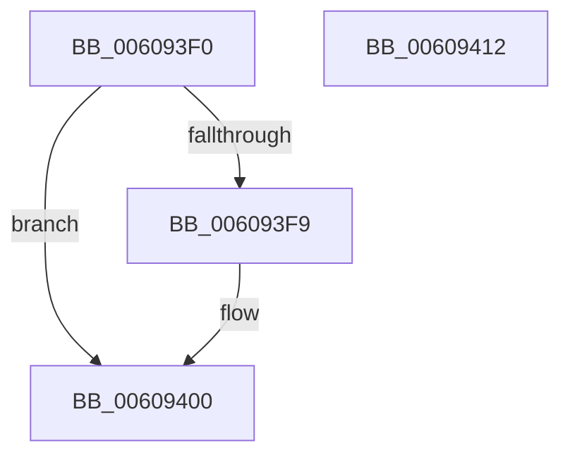

# SeReportSecurityEvent

- RVA: `0x006093F0`–`0x00609413` (길이 `35` bytes)
- VA: `0x00000001406093F0`
- 실행 섹션: `.text`
- PDB 이름 있음: `예`; PDB Function 태그: `아니요`
- unwind 정보 RVA: `0x0005D2F4`
- 디코드: `9`개 명령, `35/35` bytes 표시
- 미해석 바이트: `0` (있으면 어셈블리에 `.byte`로 보존)

> 이 문서는 커널 이미지의 기계어와 PDB 기호를 분석해 생성했습니다. 4번과 5번은 함수 원형과 자료형을 바이너리 사용 방식에서 추정한 C 해석이며 원본 소스 복구 결과는 아닙니다.

## 1. Dependencies

- 직접 호출 지점: **1**; 고유 호출 대상: **1**
- 직접 호출자로 확인된 함수: **0**
- RIP 상대 이미지 참조: **0**

### Outgoing calls
- `0x00609408` → [SeReportSecurityEventWithSubCategory](../22/SeReportSecurityEventWithSubCategory_function_002248B0.md) (function, `0x002248B0`)

### Direct callers
- 이 함수 시작 RVA로 연결되는 직접 call은 확인되지 않았습니다. 간접 호출은 완전히 역산할 수 없습니다.

### Static image references
- 디코드된 RIP-relative 메모리 참조가 없습니다.

## 2. Other-region calls and transfers

- 다른 실행 섹션으로 향하는 call: **0**
- 별도 외부 분기/꼬리 이동을 확인하지 못했습니다.

## 3. Assembly (complete function range)

```asm
006093F0  48 83 EC 38                     sub rsp, 0x38
006093F4  4D 85 C9                        test r9, r9
006093F7  74 07                           je 0x140609400
006093F9  41 C7 01 03 00 00 00            mov dword ptr [r9], 3
00609400  C7 44 24 20 7B 00 00 00         mov dword ptr [rsp + 0x20], 0x7b
00609408  E8 A3 B4 C1 FF                  call 0x1402248b0
0060940D  48 83 C4 38                     add rsp, 0x38
00609411  C3                              ret
00609412  CC                              int3
```

## 4. C-style interpretation (structured pseudocode)

```c
__int64 __fastcall SeReportSecurityEvent(__int64 a1, __int64 a2, __int64 a3, __int64 a4)
{
    __int64 result;
    __int64 v_rsp;
    unsigned int v_stack_m18;

    v_rsp = (v_rsp) - (56);
    if (a4 != 0) {
        *(unsigned int *)(a4) = 3;
    }
    v_stack_m18 = 123;
    result = SeReportSecurityEventWithSubCategory(a1, a2, a3, a4);
    v_rsp = (v_rsp) + (56);
    return result;
}
```

## 5. (Beta) C Style

```c
int64_t SeReportSecurityEvent(int64_t Arg1, int64_t Arg2, int64_t Arg3, int64_t Arg4)
{
    int64_t result;
    int64_t local_rsp;
    uint32_t v_stack_m18;

    local_rsp = (local_rsp) - (56);
    if (Arg4 != 0) {
        *(uint32_t *)(Arg4) = 3;
    }
    v_stack_m18 = 123;
    result = SeReportSecurityEventWithSubCategory(Arg1, Arg2, Arg3, Arg4);
    local_rsp = (local_rsp) + (56);
    return result;
}
```

## 6. Execution-region graph

[열기: 2D/3D 그래프와 함수 탐색 컨트롤 패널](../../../control-panel.html?section=text&rva=0x006093F0&view=graph)

- 2D 그래프는 위에서 아래로 흐르고, 3D 그래프는 빈 공간을 드래그해 회전합니다. Shift+드래그는 이동, 휠은 확대·축소, 함수 노드 선택은 대상 보고서 이동입니다.

### Static fallback


