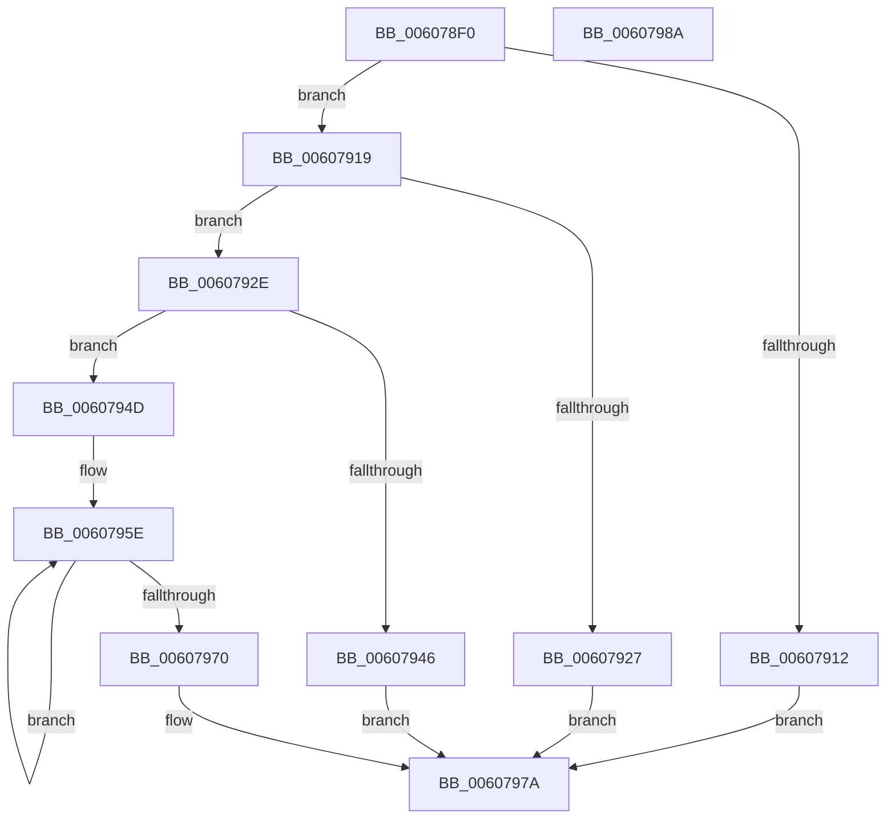

# SeSetObjectTypePolicy

- RVA: `0x006078F0`–`0x0060798B` (길이 `155` bytes)
- VA: `0x00000001406078F0`
- 실행 섹션: `.text`
- PDB 이름 있음: `예`; PDB Function 태그: `아니요`
- unwind 정보 RVA: `0x00060BC4`
- 디코드: `44`개 명령, `155/155` bytes 표시
- 미해석 바이트: `0` (있으면 어셈블리에 `.byte`로 보존)

> 이 문서는 커널 이미지의 기계어와 PDB 기호를 분석해 생성했습니다. 4번과 5번은 함수 원형과 자료형을 바이너리 사용 방식에서 추정한 C 해석이며 원본 소스 복구 결과는 아닙니다.

## 1. Dependencies

- 직접 호출 지점: **1**; 고유 호출 대상: **1**
- 직접 호출자로 확인된 함수: **2**
- RIP 상대 이미지 참조: **1**

### Outgoing calls
- `0x00607939` → [ExAllocatePool2](../../poolcode/B8/ExAllocatePool2_function_00B820F0.md) (function, `0x00B820F0`)

### Direct callers
- [PspSetProcessObjectTypePolicy](../../init/C4/PspSetProcessObjectTypePolicy_function_00C45EE4.md) at `0x00C45FDE`
- [PspSetThreadObjectTypePolicy](../../init/C4/PspSetThreadObjectTypePolicy_function_00C4604C.md) at `0x00C46141`

### Static image references
- `0x00607919` → RVA `0x00F04F60` (`.data`; read)

## 2. Other-region calls and transfers

- 다른 실행 섹션으로 향하는 call: **1**
  - `0x00607939` → [ExAllocatePool2](../../poolcode/B8/ExAllocatePool2_function_00B820F0.md) (`.text` → `POOLCODE`)
- 별도 외부 분기/꼬리 이동을 확인하지 못했습니다.

## 3. Assembly (complete function range)

```asm
006078F0  48 89 5C 24 08                  mov qword ptr [rsp + 8], rbx
006078F5  48 89 74 24 10                  mov qword ptr [rsp + 0x10], rsi
006078FA  57                              push rdi
006078FB  48 83 EC 20                     sub rsp, 0x20
006078FF  0F B6 41 28                     movzx eax, byte ptr [rcx + 0x28]
00607903  48 8B F9                        mov rdi, rcx
00607906  B9 00 01 00 00                  mov ecx, 0x100
0060790B  49 8B D9                        mov rbx, r9
0060790E  3B C1                           cmp eax, ecx
00607910  72 07                           jb 0x140607919
00607912  B8 D1 04 00 C0                  mov eax, 0xc00004d1
00607917  EB 61                           jmp 0x14060797a
00607919  48 8D 35 40 D6 8F 00            lea rsi, [rip + 0x8fd640]
00607920  48 83 3C C6 00                  cmp qword ptr [rsi + rax*8], 0
00607925  74 07                           je 0x14060792e
00607927  B8 10 05 00 C0                  mov eax, 0xc0000510
0060792C  EB 4C                           jmp 0x14060797a
0060792E  BA 40 00 00 00                  mov edx, 0x40
00607933  41 B8 53 65 4F 50               mov r8d, 0x504f6553
00607939  E8 B2 A7 57 00                  call 0x140b820f0
0060793E  48 8B C8                        mov rcx, rax
00607941  48 85 C0                        test rax, rax
00607944  75 07                           jne 0x14060794d
00607946  B8 17 00 00 C0                  mov eax, 0xc0000017
0060794B  EB 2D                           jmp 0x14060797a
0060794D  83 20 FE                        and dword ptr [rax], 0xfffffffe
00607950  BA 07 00 00 00                  mov edx, 7
00607955  4C 8B C1                        mov r8, rcx
00607958  89 50 04                        mov dword ptr [rax + 4], edx
0060795B  4C 2B C3                        sub r8, rbx
0060795E  48 8B 03                        mov rax, qword ptr [rbx]
00607961  49 89 44 18 08                  mov qword ptr [r8 + rbx + 8], rax
00607966  48 8D 5B 08                     lea rbx, [rbx + 8]
0060796A  48 83 EA 01                     sub rdx, 1
0060796E  75 EE                           jne 0x14060795e
00607970  0F B6 47 28                     movzx eax, byte ptr [rdi + 0x28]
00607974  48 89 0C C6                     mov qword ptr [rsi + rax*8], rcx
00607978  33 C0                           xor eax, eax
0060797A  48 8B 5C 24 30                  mov rbx, qword ptr [rsp + 0x30]
0060797F  48 8B 74 24 38                  mov rsi, qword ptr [rsp + 0x38]
00607984  48 83 C4 20                     add rsp, 0x20
00607988  5F                              pop rdi
00607989  C3                              ret
0060798A  CC                              int3
```

## 4. C-style interpretation (structured pseudocode)

```c
__int64 __fastcall SeSetObjectTypePolicy(__int64 a1, __int64 a2, __int64 a3, __int64 a4)
{
    __int64 result;
    __int64 v_rsp;
    unsigned __int64 v_stack_p10;
    unsigned __int64 v_stack_p8;

    v_stack_p8 = v_rbx;
    v_stack_p10 = v_rsi;
    v_rsp = (v_rsp) - (32);
    if (((unsigned int)(*(unsigned __int8 *)(a1 + 40))) < 256) goto loc_00607919;
    goto loc_0060797A;
loc_00607919:
    if ((*(unsigned __int64 *)(v_rip + 9426496 + (unsigned int)(0xC00004D1ULL) * 8)) == 0) goto loc_0060792E;
    goto loc_0060797A;
loc_0060792E:
    result = ExAllocatePool2(256, 64, (unsigned int)(0x504F6553ULL), a4);
    if (result != 0) goto loc_0060794D;
    goto loc_0060797A;
loc_0060794D:
    *(unsigned int *)((unsigned int)(0xC0000017ULL) + 4) = 7;
    a3 = (result) - (a4);
loc_0060795E:
    *(unsigned __int64 *)(a3 + a4 * 1 + 8) = *(unsigned __int64 *)(a4);
    a2 = (7) - (1);
    if (condition_is_not_equal) goto loc_0060795E;
    *(unsigned __int64 *)(v_rip + 9426496 + *(unsigned __int8 *)(a1 + 40) * 8) = result;
    result = 0;
loc_0060797A:
    v_rsp = (v_rsp) + (32);
    return result;
}
```

## 5. (Beta) C Style

```c
int64_t SeSetObjectTypePolicy(void *Arg1, int64_t Arg2, int64_t Arg3, void *Arg4)
{
    uint8_t *arg1 = (uint8_t *)Arg1;
    uint8_t *arg4 = (uint8_t *)Arg4;

    int64_t result;
    int64_t local_rsp;
    uint64_t v_stack_p10;
    uint64_t v_stack_p8;

    v_stack_p8 = local_rbx;
    v_stack_p10 = local_rsi;
    local_rsp = (local_rsp) - (32);
    if (((uint32_t)(*(uint8_t *)(arg1 + 0x28))) < 256) goto loc_00607919;
    goto loc_0060797A;
loc_00607919:
    if ((*(uint64_t *)(v_rip + 0x8FD640 + (uint32_t)(0xC00004D1ULL) * 8)) == 0) goto loc_0060792E;
    goto loc_0060797A;
loc_0060792E:
    result = ExAllocatePool2(256, 64, (uint32_t)(0x504F6553ULL), Arg4);
    if (result != 0) goto loc_0060794D;
    goto loc_0060797A;
loc_0060794D:
    *(uint32_t *)((uint32_t)(0xC0000017ULL) + 0x4) = 7;
    Arg3 = (result) - (Arg4);
loc_0060795E:
    *(uint64_t *)(Arg3 + arg4 * 1 + 0x8) = *(uint64_t *)(arg4);
    Arg2 = (7) - (1);
    if (condition_is_not_equal) goto loc_0060795E;
    *(uint64_t *)(v_rip + 0x8FD640 + *(uint8_t *)(arg1 + 0x28) * 8) = result;
    result = 0;
loc_0060797A:
    local_rsp = (local_rsp) + (32);
    return result;
}
```

### 관측된 메모리 오프셋

구조체 형식이 확인되지 않은 접근은 인자 기준의 오프셋으로만 기록했습니다.

| 기준 인자 | 오프셋 표현 | 폭 (bit) | 접근 |
|---|---:|---:|---|
| `Arg1` | `+ 0x28` | `8` | `R` |
| `Arg4` | `+ 0x0` | `64` | `R` |
| `Arg4` | `+ 0x8` | `64` | `R` |

## 6. Execution-region graph

[열기: 2D/3D 그래프와 함수 탐색 컨트롤 패널](../../../control-panel.html?section=text&rva=0x006078F0&view=graph)

- 2D 그래프는 위에서 아래로 흐르고, 3D 그래프는 빈 공간을 드래그해 회전합니다. Shift+드래그는 이동, 휠은 확대·축소, 함수 노드 선택은 대상 보고서 이동입니다.

### Static fallback


