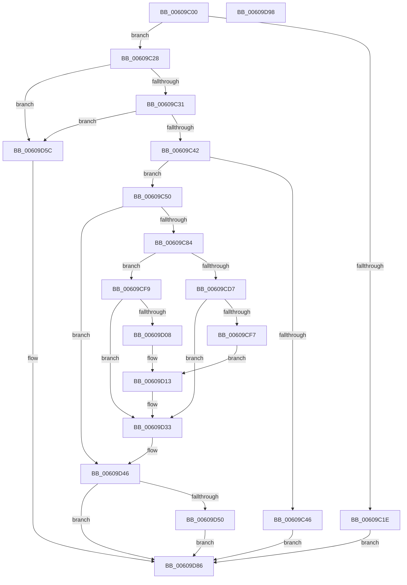

# SeSetSecurityAttributesTokenEx

- RVA: `0x00609C00`–`0x00609D99` (길이 `409` bytes)
- VA: `0x0000000140609C00`
- 실행 섹션: `.text`
- PDB 이름 있음: `예`; PDB Function 태그: `아니요`
- unwind 정보 RVA: `0x0007F83C`
- 디코드: `98`개 명령, `409/409` bytes 표시
- 미해석 바이트: `0` (있으면 어셈블리에 `.byte`로 보존)

> 이 문서는 커널 이미지의 기계어와 PDB 기호를 분석해 생성했습니다. 4번과 5번은 함수 원형과 자료형을 바이너리 사용 방식에서 추정한 C 해석이며 원본 소스 복구 결과는 아닙니다.

## 1. Dependencies

- 직접 호출 지점: **9**; 고유 호출 대상: **9**
- 직접 호출자로 확인된 함수: **0**
- RIP 상대 이미지 참조: **4**

### Outgoing calls
- `0x00609C75` → [ObReferenceObjectByHandle](../../page/86/ObReferenceObjectByHandle_function_00868DB0.md) (function, `0x00868DB0`)
- `0x00609CA0` → [ExAcquireResourceExclusiveLite](../21/ExAcquireResourceExclusiveLite_function_00214E20.md) (function, `0x00214E20`)
- `0x00609CBE` → [SepGetProcUniqueLuidAndIndexFromTokenEx](../30/SepGetProcUniqueLuidAndIndexFromTokenEx_function_00300B40.md) (function, `0x00300B40`)
- `0x00609CE9` → [AuthzBasepSetSecurityAttributesToken](../3A/AuthzBasepSetSecurityAttributesToken_function_003A8D1C.md) (function, `0x003A8D1C`)
- `0x00609CFD` → [SepSetSingletonEntry](SepSetSingletonEntry_function_00609DA0.md) (function, `0x00609DA0`)
- `0x00609D3C` → [ExReleaseResourceLite](../25/ExReleaseResourceLite_function_0025FA10.md) (function, `0x0025FA10`)
- `0x00609D41` → [KeLeaveCriticalRegion](../25/KeLeaveCriticalRegion_function_0025D8B0.md) (function, `0x0025D8B0`)
- `0x00609D55` → [ObfDereferenceObjectWithTag](../2F/ObfDereferenceObjectWithTag_function_002F78E0.md) (function, `0x002F78E0`)
- `0x00609D7F` → [SepInternalSetSecurityAttributesToken](../3A/SepInternalSetSecurityAttributesToken_function_003A9474.md) (function, `0x003A9474`)

### Direct callers
- 이 함수 시작 RVA로 연결되는 직접 call은 확인되지 않았습니다. 간접 호출은 완전히 역산할 수 없습니다.

### Static image references
- `0x00609C31` → RVA `0x00E67E20` (`.data`; read)
- `0x00609C50` → RVA `0x00FD8020` (`PAGEDATA`; read)
- `0x00609D13` → RVA `0x00012D08` (`.rdata`; read)
- `0x00609D1D` → RVA `0x00E0EBF0` (`.data`; read/write)

## 2. Other-region calls and transfers

- 다른 실행 섹션으로 향하는 call: **1**
  - `0x00609C75` → [ObReferenceObjectByHandle](../../page/86/ObReferenceObjectByHandle_function_00868DB0.md) (`.text` → `PAGE`)
- 별도 외부 분기/꼬리 이동을 확인하지 못했습니다.

## 3. Assembly (complete function range)

```asm
00609C00  48 8B C4                        mov rax, rsp
00609C03  48 89 58 08                     mov qword ptr [rax + 8], rbx
00609C07  48 89 70 10                     mov qword ptr [rax + 0x10], rsi
00609C0B  57                              push rdi
00609C0C  48 83 EC 50                     sub rsp, 0x50
00609C10  48 83 60 E8 00                  and qword ptr [rax - 0x18], 0
00609C15  83 60 D8 00                     and dword ptr [rax - 0x28], 0
00609C19  4D 85 C0                        test r8, r8
00609C1C  74 0A                           je 0x140609c28
00609C1E  BB 0D 00 00 C0                  mov ebx, 0xc000000d
00609C23  E9 5E 01 00 00                  jmp 0x140609d86
00609C28  45 84 C9                        test r9b, r9b
00609C2B  0F 84 2B 01 00 00               je 0x140609d5c
00609C31  8B 05 E9 E1 85 00               mov eax, dword ptr [rip + 0x85e1e9]
00609C37  83 E0 03                        and eax, 3
00609C3A  3C 03                           cmp al, 3
00609C3C  0F 85 1A 01 00 00               jne 0x140609d5c
00609C42  84 D2                           test dl, dl
00609C44  74 0A                           je 0x140609c50
00609C46  BB 22 00 00 C0                  mov ebx, 0xc0000022
00609C4B  E9 36 01 00 00                  jmp 0x140609d86
00609C50  4C 8B 05 C9 E3 9C 00            mov r8, qword ptr [rip + 0x9ce3c9]
00609C57  48 8D 44 24 38                  lea rax, [rsp + 0x38]
00609C5C  48 83 64 24 28 00               and qword ptr [rsp + 0x28], 0
00609C62  45 33 C9                        xor r9d, r9d
00609C65  48 83 64 24 38 00               and qword ptr [rsp + 0x38], 0
00609C6B  BA 80 00 00 00                  mov edx, 0x80
00609C70  48 89 44 24 20                  mov qword ptr [rsp + 0x20], rax
00609C75  E8 36 F1 25 00                  call 0x140868db0
00609C7A  8B D8                           mov ebx, eax
00609C7C  85 C0                           test eax, eax
00609C7E  0F 88 C2 00 00 00               js 0x140609d46
00609C84  65 48 8B 04 25 88 01 00 00      mov rax, qword ptr gs:[0x188]
00609C8D  B2 01                           mov dl, 1
00609C8F  48 8B 74 24 38                  mov rsi, qword ptr [rsp + 0x38]
00609C94  66 FF 88 E4 01 00 00            dec word ptr [rax + 0x1e4]
00609C9B  90                              nop
00609C9C  48 8B 4E 30                     mov rcx, qword ptr [rsi + 0x30]
00609CA0  E8 7B B1 C0 FF                  call 0x140214e20
00609CA5  F0 83 0C 24 00                  lock or dword ptr [rsp], 0
00609CAA  48 8B 7C 24 38                  mov rdi, qword ptr [rsp + 0x38]
00609CAF  4C 8D 4C 24 40                  lea r9, [rsp + 0x40]
00609CB4  48 8B D7                        mov rdx, rdi
00609CB7  4C 8D 44 24 30                  lea r8, [rsp + 0x30]
00609CBC  B1 01                           mov cl, 1
00609CBE  E8 7D 6E CF FF                  call 0x140300b40
00609CC3  4C 8B 84 24 88 00 00 00         mov r8, qword ptr [rsp + 0x88]
00609CCB  48 8B 94 24 80 00 00 00         mov rdx, qword ptr [rsp + 0x80]
00609CD3  85 C0                           test eax, eax
00609CD5  79 22                           jns 0x140609cf9
00609CD7  48 8B 84 24 90 00 00 00         mov rax, qword ptr [rsp + 0x90]
00609CDF  C6 00 00                        mov byte ptr [rax], 0
00609CE2  48 8B 8F 08 03 00 00            mov rcx, qword ptr [rdi + 0x308]
00609CE9  E8 2E F0 D9 FF                  call 0x1403a8d1c
00609CEE  8B D8                           mov ebx, eax
00609CF0  C1 E8 1F                        shr eax, 0x1f
00609CF3  34 01                           xor al, 1
00609CF5  74 3C                           je 0x140609d33
00609CF7  EB 1A                           jmp 0x140609d13
00609CF9  8B 4C 24 30                     mov ecx, dword ptr [rsp + 0x30]
00609CFD  E8 9E 00 00 00                  call 0x140609da0
00609D02  8B D8                           mov ebx, eax
00609D04  85 C0                           test eax, eax
00609D06  78 2B                           js 0x140609d33
00609D08  48 8B 8C 24 90 00 00 00         mov rcx, qword ptr [rsp + 0x90]
00609D10  C6 01 01                        mov byte ptr [rcx], 1
00609D13  48 8B 15 EE 8F A0 FF            mov rdx, qword ptr [rip - 0x5f7012]
00609D1A  48 8B CA                        mov rcx, rdx
00609D1D  F0 48 0F C1 0D CA 4E 80 00      lock xadd qword ptr [rip + 0x804eca], rcx
00609D26  48 03 CA                        add rcx, rdx
00609D29  89 4F 38                        mov dword ptr [rdi + 0x38], ecx
00609D2C  48 C1 E9 20                     shr rcx, 0x20
00609D30  89 4F 3C                        mov dword ptr [rdi + 0x3c], ecx
00609D33  F0 83 0C 24 00                  lock or dword ptr [rsp], 0
00609D38  48 8B 4E 30                     mov rcx, qword ptr [rsi + 0x30]
00609D3C  E8 CF 5C C5 FF                  call 0x14025fa10
00609D41  E8 6A 3B C5 FF                  call 0x14025d8b0
00609D46  48 8B 4C 24 38                  mov rcx, qword ptr [rsp + 0x38]
00609D4B  48 85 C9                        test rcx, rcx
00609D4E  74 36                           je 0x140609d86
00609D50  BA 44 66 6C 74                  mov edx, 0x746c6644
00609D55  E8 86 DB CE FF                  call 0x1402f78e0
00609D5A  EB 2A                           jmp 0x140609d86
00609D5C  48 8B 84 24 90 00 00 00         mov rax, qword ptr [rsp + 0x90]
00609D64  41 B0 01                        mov r8b, 1
00609D67  4C 8B 8C 24 80 00 00 00         mov r9, qword ptr [rsp + 0x80]
00609D6F  C6 00 00                        mov byte ptr [rax], 0
00609D72  48 8B 84 24 88 00 00 00         mov rax, qword ptr [rsp + 0x88]
00609D7A  48 89 44 24 20                  mov qword ptr [rsp + 0x20], rax
00609D7F  E8 F0 F6 D9 FF                  call 0x1403a9474
00609D84  8B D8                           mov ebx, eax
00609D86  48 8B 74 24 68                  mov rsi, qword ptr [rsp + 0x68]
00609D8B  8B C3                           mov eax, ebx
00609D8D  48 8B 5C 24 60                  mov rbx, qword ptr [rsp + 0x60]
00609D92  48 83 C4 50                     add rsp, 0x50
00609D96  5F                              pop rdi
00609D97  C3                              ret
00609D98  CC                              int3
```

## 4. C-style interpretation (structured pseudocode)

```c
__int64 __fastcall SeSetSecurityAttributesTokenEx(__int64 a1, unsigned __int8 a2, __int64 a3, int a4, __int64 a5, __int64 a6, __int64 a7)
{
    __int64 result;
    __int64 v_rsp;
    unsigned __int64 v_stack_m18;
    unsigned __int64 v_stack_m20;
    unsigned __int64 v_stack_m28;
    unsigned __int64 v_stack_m30;
    unsigned __int64 v_stack_m38;
    unsigned int v_stack_m58;
    unsigned __int64 v_stack_p10;
    unsigned __int64 v_stack_p8;

    *(unsigned __int64 *)(v_rsp + 8) = v_rbx;
    *(unsigned __int64 *)(v_rsp + 16) = v_rsi;
    v_rsp = (v_rsp) - (80);
    if (a3 == 0) goto loc_00609C28;
    goto loc_00609D86;
loc_00609C28:
    if ((unsigned __int8)(a4) == 0) goto loc_00609D5C;
    result = (unsigned int)(((unsigned int)(*(unsigned int *)(v_rip + 8774121))) & (3));
    if (((unsigned __int8)(result)) != 3) goto loc_00609D5C;
    if (a2 == 0) goto loc_00609C50;
    goto loc_00609D86;
loc_00609C50:
    a4 = 0;
    v_stack_m38 = v_stack_m20;
    result = ObReferenceObjectByHandle(a1, 128, *(unsigned __int64 *)(v_rip + 10281929), a4);
    if (sign_flag) goto loc_00609D46;
    result = ExAcquireResourceExclusiveLite(*(unsigned __int64 *)(v_stack_m20 + 48), 1, *(unsigned __int64 *)(v_rip + 10281929), a4);
    result = SepGetProcUniqueLuidAndIndexFromTokenEx(1, v_stack_m20, v_stack_m28, v_stack_m18);
    if (!sign_flag) goto loc_00609CF9;
    *(unsigned __int8 *)(a7) = 0;
    result = AuthzBasepSetSecurityAttributesToken(*(unsigned __int64 *)(v_stack_m20 + 776), a5, a6, v_stack_m18);
    result = (unsigned int)((result) >> (31));
    result = (unsigned __int8)((result) ^ (1));
    if (condition_is_equal) goto loc_00609D33;
    goto loc_00609D13;
loc_00609CF9:
    result = SepSetSingletonEntry((unsigned int)(v_stack_m28), a5, a6, v_stack_m18);
    if (sign_flag) goto loc_00609D33;
    *(unsigned __int8 *)(a7) = 1;
loc_00609D13:
    a1 = (*(unsigned __int64 *)(v_rip - 6254610)) + (*(unsigned __int64 *)(v_rip - 6254610));
    *(unsigned int *)(v_stack_m20 + 56) = (unsigned int)(a1);
    a1 = (a1) >> (32);
    *(unsigned int *)(v_stack_m20 + 60) = (unsigned int)(a1);
loc_00609D33:
    result = ExReleaseResourceLite(*(unsigned __int64 *)(v_stack_m20 + 48), *(unsigned __int64 *)(v_rip - 6254610), a6, v_stack_m18);
    result = KeLeaveCriticalRegion(*(unsigned __int64 *)(v_stack_m20 + 48), *(unsigned __int64 *)(v_rip - 6254610), a6, v_stack_m18);
loc_00609D46:
    if (v_stack_m20 == 0) goto loc_00609D86;
    result = ObfDereferenceObjectWithTag(v_stack_m20, (unsigned int)(0x746C6644ULL), a6, v_stack_m18);
    goto loc_00609D86;
loc_00609D5C:
    *(unsigned __int8 *)(a7) = 0;
    v_stack_m38 = a6;
    result = SepInternalSetSecurityAttributesToken(v_stack_m20, (unsigned int)(0x746C6644ULL), 1, a5);
loc_00609D86:
    v_rsp = (v_rsp) + (80);
    return (unsigned int)((unsigned int)((unsigned int)((unsigned int)(result))));
}
```

## 5. (Beta) C Style

```c
int64_t SeSetSecurityAttributesTokenEx(int64_t Arg1, uint8_t Arg2, int64_t Arg3, int32_t Arg4, int64_t Arg5, int64_t Arg6, void *Arg7)
{
    uint8_t *arg7 = (uint8_t *)Arg7;

    int64_t result;
    int64_t local_rsp;
    uint64_t v_stack_m18;
    uint64_t v_stack_m20;
    uint64_t v_stack_m28;
    uint64_t v_stack_m30;
    uint64_t v_stack_m38;
    uint32_t v_stack_m58;
    uint64_t v_stack_p10;
    uint64_t v_stack_p8;

    *(uint64_t *)(local_rsp + 0x8) = local_rbx;
    *(uint64_t *)(local_rsp + 0x10) = local_rsi;
    local_rsp = (local_rsp) - (80);
    if (Arg3 == 0) goto loc_00609C28;
    goto loc_00609D86;
loc_00609C28:
    if ((uint8_t)(Arg4) == 0) goto loc_00609D5C;
    result = (uint32_t)(((uint32_t)(*(uint32_t *)(v_rip + 0x85E1E9))) & (3));
    if (((uint8_t)(result)) != 3) goto loc_00609D5C;
    if (Arg2 == 0) goto loc_00609C50;
    goto loc_00609D86;
loc_00609C50:
    Arg4 = 0;
    v_stack_m38 = v_stack_m20;
    result = ObReferenceObjectByHandle(Arg1, 128, *(uint64_t *)(v_rip + 0x9CE3C9), Arg4);
    if (sign_flag) goto loc_00609D46;
    result = ExAcquireResourceExclusiveLite(*(uint64_t *)(v_stack_m20 + 0x30), 1, *(uint64_t *)(v_rip + 0x9CE3C9), Arg4);
    result = SepGetProcUniqueLuidAndIndexFromTokenEx(1, v_stack_m20, v_stack_m28, v_stack_m18);
    if (!sign_flag) goto loc_00609CF9;
    *(uint8_t *)(arg7) = 0;
    result = AuthzBasepSetSecurityAttributesToken(*(uint64_t *)(v_stack_m20 + 0x308), Arg5, Arg6, v_stack_m18);
    result = (uint32_t)((result) >> (31));
    result = (uint8_t)((result) ^ (1));
    if (condition_is_equal) goto loc_00609D33;
    goto loc_00609D13;
loc_00609CF9:
    result = SepSetSingletonEntry((uint32_t)(v_stack_m28), Arg5, Arg6, v_stack_m18);
    if (sign_flag) goto loc_00609D33;
    *(uint8_t *)(arg7) = 1;
loc_00609D13:
    Arg1 = (*(uint64_t *)(v_rip - 0x5F7012)) + (*(uint64_t *)(v_rip - 0x5F7012));
    *(uint32_t *)(v_stack_m20 + 0x38) = (uint32_t)(Arg1);
    Arg1 = (Arg1) >> (32);
    *(uint32_t *)(v_stack_m20 + 0x3C) = (uint32_t)(Arg1);
loc_00609D33:
    result = ExReleaseResourceLite(*(uint64_t *)(v_stack_m20 + 0x30), *(uint64_t *)(v_rip - 0x5F7012), Arg6, v_stack_m18);
    result = KeLeaveCriticalRegion(*(uint64_t *)(v_stack_m20 + 0x30), *(uint64_t *)(v_rip - 0x5F7012), Arg6, v_stack_m18);
loc_00609D46:
    if (v_stack_m20 == 0) goto loc_00609D86;
    result = ObfDereferenceObjectWithTag(v_stack_m20, (uint32_t)(0x746C6644ULL), Arg6, v_stack_m18);
    goto loc_00609D86;
loc_00609D5C:
    *(uint8_t *)(arg7) = 0;
    v_stack_m38 = Arg6;
    result = SepInternalSetSecurityAttributesToken(v_stack_m20, (uint32_t)(0x746C6644ULL), 1, Arg5);
loc_00609D86:
    local_rsp = (local_rsp) + (80);
    return (uint32_t)((uint32_t)((uint32_t)((uint32_t)(result))));
}
```

### 관측된 메모리 오프셋

구조체 형식이 확인되지 않은 접근은 인자 기준의 오프셋으로만 기록했습니다.

| 기준 인자 | 오프셋 표현 | 폭 (bit) | 접근 |
|---|---:|---:|---|
| `Arg7` | `+ 0x0` | `8` | `W` |

## 6. Execution-region graph

[열기: 2D/3D 그래프와 함수 탐색 컨트롤 패널](../../../control-panel.html?section=text&rva=0x00609C00&view=graph)

- 2D 그래프는 위에서 아래로 흐르고, 3D 그래프는 빈 공간을 드래그해 회전합니다. Shift+드래그는 이동, 휠은 확대·축소, 함수 노드 선택은 대상 보고서 이동입니다.

### Static fallback


