# SeSetTokenTamperProtection

- RVA: `0x00609644`–`0x00609A2F` (길이 `1,003` bytes)
- VA: `0x0000000140609644`
- 실행 섹션: `.text`
- PDB 이름 있음: `예`; PDB Function 태그: `아니요`
- unwind 정보 RVA: `0x000D14D8`
- 디코드: `272`개 명령, `1,003/1,003` bytes 표시
- 미해석 바이트: `0` (있으면 어셈블리에 `.byte`로 보존)

> 이 문서는 커널 이미지의 기계어와 PDB 기호를 분석해 생성했습니다. 4번과 5번은 함수 원형과 자료형을 바이너리 사용 방식에서 추정한 C 해석이며 원본 소스 복구 결과는 아닙니다.

## 1. Dependencies

- 직접 호출 지점: **28**; 고유 호출 대상: **18**
- 직접 호출자로 확인된 함수: **1**
- RIP 상대 이미지 참조: **2**

### Outgoing calls
- `0x006096AE` → [SepAppIdentityFromPackageInformation](SepAppIdentityFromPackageInformation_function_00607D7C.md) (function, `0x00607D7C`)
- `0x006096DC` → [SepAppIdentityFromImageHash](SepAppIdentityFromImageHash_function_00607AA4.md) (function, `0x00607AA4`)
- `0x00609705` → [PsReferencePrimaryToken](../../page/9A/PsReferencePrimaryToken_function_009A2CB0.md) (function, `0x009A2CB0`)
- `0x0060974A` → [RtlEqualSid](../40/RtlEqualSid_function_00400AD0.md) (function, `0x00400AD0`)
- `0x00609772` → [ExAllocatePool2](../../poolcode/B8/ExAllocatePool2_function_00B820F0.md) (function, `0x00B820F0`)
- `0x00609793` → [RtlCopySid](../../page/9A/RtlCopySid_function_009A9A50.md) (function, `0x009A9A50`)
- `0x006097A0` → [SepAllocateInstanceSid](SepAllocateInstanceSid_function_0060A788.md) (function, `0x0060A788`)
- `0x006097C4` → [ObFastDereferenceObject](../3E/ObFastDereferenceObject_function_003ED5F0.md) (function, `0x003ED5F0`)
- `0x006097E6` → [RtlValidSid](../../page/92/RtlValidSid_function_00929710.md) (function, `0x00929710`)
- `0x006097F6` → [RtlValidSid](../../page/92/RtlValidSid_function_00929710.md) (function, `0x00929710`)
- `0x00609806` → [RtlIsValidAntiTamperSid](../5E/RtlIsValidAntiTamperSid_function_005E720C.md) (function, `0x005E720C`)
- `0x00609816` → [RtlIsValidAntiTamperSid](../5E/RtlIsValidAntiTamperSid_function_005E720C.md) (function, `0x005E720C`)
- `0x0060982C` → [RtlValidSid](../../page/92/RtlValidSid_function_00929710.md) (function, `0x00929710`)
- `0x0060983D` → [RtlIsValidAntiTamperSid](../5E/RtlIsValidAntiTamperSid_function_005E720C.md) (function, `0x005E720C`)
- `0x00609866` → [ExAllocatePool2](../../poolcode/B8/ExAllocatePool2_function_00B820F0.md) (function, `0x00B820F0`)
- `0x006098AC` → [SepLengthSidAndAttributesArray](../../page/9C/SepLengthSidAndAttributesArray_function_009C9CB8.md) (function, `0x009C9CB8`)
- `0x006098C9` → [ExAllocatePool2](../../poolcode/B8/ExAllocatePool2_function_00B820F0.md) (function, `0x00B820F0`)
- `0x00609906` → [SeCaptureSidAndAttributesArray](../../page/9C/SeCaptureSidAndAttributesArray_function_009C9D70.md) (function, `0x009C9D70`)
- `0x0060992C` → [ExAcquireResourceExclusiveLite](../21/ExAcquireResourceExclusiveLite_function_00214E20.md) (function, `0x00214E20`)
- `0x00609957` → [RtlSidHashInitialize](../41/RtlSidHashInitialize_function_00416EA0.md) (function, `0x00416EA0`)
- `0x0060996B` → [SepSetTokenAntiTamperEntry](SepSetTokenAntiTamperEntry_function_0060B28C.md) (function, `0x0060B28C`)
- `0x006099A1` → [ExReleaseResourceLite](../25/ExReleaseResourceLite_function_0025FA10.md) (function, `0x0025FA10`)
- `0x006099A6` → [KeLeaveCriticalRegion](../25/KeLeaveCriticalRegion_function_0025D8B0.md) (function, `0x0025D8B0`)
- `0x006099BD` → [ExFreePoolWithTag](../../poolcode/B8/ExFreePoolWithTag_function_00B82870.md) (function, `0x00B82870`)
- `0x006099CC` → [ExFreePoolWithTag](../../poolcode/B8/ExFreePoolWithTag_function_00B82870.md) (function, `0x00B82870`)
- `0x006099DC` → [ExFreePoolWithTag](../../poolcode/B8/ExFreePoolWithTag_function_00B82870.md) (function, `0x00B82870`)
- `0x006099EB` → [ExFreePoolWithTag](../../poolcode/B8/ExFreePoolWithTag_function_00B82870.md) (function, `0x00B82870`)
- `0x006099FE` → [ExFreePoolWithTag](../../poolcode/B8/ExFreePoolWithTag_function_00B82870.md) (function, `0x00B82870`)

### Direct callers
- [PspAllocateProcess](../../page/A1/PspAllocateProcess_function_00A13B3C.md) at `0x00A161F3`

### Static image references
- `0x00609976` → RVA `0x00012D08` (`.rdata`; read)
- `0x00609980` → RVA `0x00E0EBF0` (`.data`; read/write)

## 2. Other-region calls and transfers

- 다른 실행 섹션으로 향하는 call: **15**
  - `0x00609705` → [PsReferencePrimaryToken](../../page/9A/PsReferencePrimaryToken_function_009A2CB0.md) (`.text` → `PAGE`)
  - `0x00609772` → [ExAllocatePool2](../../poolcode/B8/ExAllocatePool2_function_00B820F0.md) (`.text` → `POOLCODE`)
  - `0x00609793` → [RtlCopySid](../../page/9A/RtlCopySid_function_009A9A50.md) (`.text` → `PAGE`)
  - `0x006097E6` → [RtlValidSid](../../page/92/RtlValidSid_function_00929710.md) (`.text` → `PAGE`)
  - `0x006097F6` → [RtlValidSid](../../page/92/RtlValidSid_function_00929710.md) (`.text` → `PAGE`)
  - `0x0060982C` → [RtlValidSid](../../page/92/RtlValidSid_function_00929710.md) (`.text` → `PAGE`)
  - `0x00609866` → [ExAllocatePool2](../../poolcode/B8/ExAllocatePool2_function_00B820F0.md) (`.text` → `POOLCODE`)
  - `0x006098AC` → [SepLengthSidAndAttributesArray](../../page/9C/SepLengthSidAndAttributesArray_function_009C9CB8.md) (`.text` → `PAGE`)
  - `0x006098C9` → [ExAllocatePool2](../../poolcode/B8/ExAllocatePool2_function_00B820F0.md) (`.text` → `POOLCODE`)
  - `0x00609906` → [SeCaptureSidAndAttributesArray](../../page/9C/SeCaptureSidAndAttributesArray_function_009C9D70.md) (`.text` → `PAGE`)
  - `0x006099BD` → [ExFreePoolWithTag](../../poolcode/B8/ExFreePoolWithTag_function_00B82870.md) (`.text` → `POOLCODE`)
  - `0x006099CC` → [ExFreePoolWithTag](../../poolcode/B8/ExFreePoolWithTag_function_00B82870.md) (`.text` → `POOLCODE`)
  - `0x006099DC` → [ExFreePoolWithTag](../../poolcode/B8/ExFreePoolWithTag_function_00B82870.md) (`.text` → `POOLCODE`)
  - `0x006099EB` → [ExFreePoolWithTag](../../poolcode/B8/ExFreePoolWithTag_function_00B82870.md) (`.text` → `POOLCODE`)
  - `0x006099FE` → [ExFreePoolWithTag](../../poolcode/B8/ExFreePoolWithTag_function_00B82870.md) (`.text` → `POOLCODE`)
- 별도 외부 분기/꼬리 이동을 확인하지 못했습니다.

## 3. Assembly (complete function range)

```asm
00609644  48 8B C4                        mov rax, rsp
00609647  48 89 58 10                     mov qword ptr [rax + 0x10], rbx
0060964B  4C 89 40 18                     mov qword ptr [rax + 0x18], r8
0060964F  48 89 48 08                     mov qword ptr [rax + 8], rcx
00609653  55                              push rbp
00609654  56                              push rsi
00609655  57                              push rdi
00609656  41 54                           push r12
00609658  41 55                           push r13
0060965A  41 56                           push r14
0060965C  41 57                           push r15
0060965E  48 8D 68 A1                     lea rbp, [rax - 0x5f]
00609662  48 81 EC 90 00 00 00            sub rsp, 0x90
00609669  33 F6                           xor esi, esi
0060966B  4D 8B E9                        mov r13, r9
0060966E  4C 8B E2                        mov r12, rdx
00609671  89 75 7F                        mov dword ptr [rbp + 0x7f], esi
00609674  8B FE                           mov edi, esi
00609676  48 89 75 F7                     mov qword ptr [rbp - 9], rsi
0060967A  44 8B F6                        mov r14d, esi
0060967D  48 89 75 EF                     mov qword ptr [rbp - 0x11], rsi
00609681  44 8B FE                        mov r15d, esi
00609684  48 89 75 FF                     mov qword ptr [rbp - 1], rsi
00609688  48 89 75 0F                     mov qword ptr [rbp + 0xf], rsi
0060968C  48 89 75 07                     mov qword ptr [rbp + 7], rsi
00609690  49 39 B1 98 04 00 00            cmp qword ptr [r9 + 0x498], rsi
00609697  74 0A                           je 0x1406096a3
00609699  B8 10 05 00 C0                  mov eax, 0xc0000510
0060969E  E9 62 03 00 00                  jmp 0x140609a05
006096A3  4C 8D 45 FF                     lea r8, [rbp - 1]
006096A7  49 8B CD                        mov rcx, r13
006096AA  48 8D 55 F7                     lea rdx, [rbp - 9]
006096AE  E8 C9 E6 FF FF                  call 0x140607d7c
006096B3  8B D8                           mov ebx, eax
006096B5  85 C0                           test eax, eax
006096B7  0F 88 F2 02 00 00               js 0x1406099af
006096BD  48 8B 75 F7                     mov rsi, qword ptr [rbp - 9]
006096C1  48 85 F6                        test rsi, rsi
006096C4  75 29                           jne 0x1406096ef
006096C6  4D 85 E4                        test r12, r12
006096C9  75 0A                           jne 0x1406096d5
006096CB  BB 0D 00 00 C0                  mov ebx, 0xc000000d
006096D0  E9 FC 02 00 00                  jmp 0x1406099d1
006096D5  48 8D 55 F7                     lea rdx, [rbp - 9]
006096D9  49 8B CC                        mov rcx, r12
006096DC  E8 C3 E3 FF FF                  call 0x140607aa4
006096E1  8B D8                           mov ebx, eax
006096E3  85 C0                           test eax, eax
006096E5  0F 88 C4 02 00 00               js 0x1406099af
006096EB  48 8B 75 F7                     mov rsi, qword ptr [rbp - 9]
006096EF  48 8B 45 67                     mov rax, qword ptr [rbp + 0x67]
006096F3  41 BC 02 00 00 00               mov r12d, 2
006096F9  48 85 C0                        test rax, rax
006096FC  0F 84 9A 00 00 00               je 0x14060979c
00609702  48 8B C8                        mov rcx, rax
00609705  E8 A6 95 39 00                  call 0x1409a2cb0
0060970A  4C 8B F8                        mov r15, rax
0060970D  48 85 C0                        test rax, rax
00609710  0F 84 86 00 00 00               je 0x14060979c
00609716  48 8B 98 98 04 00 00            mov rbx, qword ptr [rax + 0x498]
0060971D  48 85 DB                        test rbx, rbx
00609720  74 7A                           je 0x14060979c
00609722  48 8B 80 B8 05 00 00            mov rax, qword ptr [rax + 0x5b8]
00609729  48 8B 48 30                     mov rcx, qword ptr [rax + 0x30]
0060972D  8B 41 24                        mov eax, dword ptr [rcx + 0x24]
00609730  A8 04                           test al, 4
00609732  74 68                           je 0x14060979c
00609734  48 8B 45 77                     mov rax, qword ptr [rbp + 0x77]
00609738  8B 40 24                        mov eax, dword ptr [rax + 0x24]
0060973B  A8 01                           test al, 1
0060973D  75 5D                           jne 0x14060979c
0060973F  41 84 C4                        test r12b, al
00609742  75 0F                           jne 0x140609753
00609744  48 8B 0B                        mov rcx, qword ptr [rbx]
00609747  48 8B D6                        mov rdx, rsi
0060974A  E8 81 73 DF FF                  call 0x140400ad0
0060974F  84 C0                           test al, al
00609751  74 49                           je 0x14060979c
00609753  48 8B 5B 10                     mov rbx, qword ptr [rbx + 0x10]
00609757  B9 00 01 00 00                  mov ecx, 0x100
0060975C  41 B8 53 65 53 69               mov r8d, 0x69536553
00609762  0F B6 43 01                     movzx eax, byte ptr [rbx + 1]
00609766  8D 04 85 08 00 00 00            lea eax, [rax*4 + 8]
0060976D  8B D0                           mov edx, eax
0060976F  89 45 E7                        mov dword ptr [rbp - 0x19], eax
00609772  E8 79 89 57 00                  call 0x140b820f0
00609777  48 89 45 EF                     mov qword ptr [rbp - 0x11], rax
0060977B  48 8B F8                        mov rdi, rax
0060977E  48 85 C0                        test rax, rax
00609781  75 07                           jne 0x14060978a
00609783  BB 17 00 00 C0                  mov ebx, 0xc0000017
00609788  EB 26                           jmp 0x1406097b0
0060978A  8B 4D E7                        mov ecx, dword ptr [rbp - 0x19]
0060978D  4C 8B C3                        mov r8, rbx
00609790  48 8B D0                        mov rdx, rax
00609793  E8 B8 02 3A 00                  call 0x1409a9a50
00609798  8B D8                           mov ebx, eax
0060979A  EB 14                           jmp 0x1406097b0
0060979C  48 8D 4D EF                     lea rcx, [rbp - 0x11]
006097A0  E8 E3 0F 00 00                  call 0x14060a788
006097A5  48 8B 7D EF                     mov rdi, qword ptr [rbp - 0x11]
006097A9  8B D8                           mov ebx, eax
006097AB  4D 85 FF                        test r15, r15
006097AE  74 19                           je 0x1406097c9
006097B0  48 8B 4D 67                     mov rcx, qword ptr [rbp + 0x67]
006097B4  41 B8 44 66 6C 74               mov r8d, 0x746c6644
006097BA  48 81 C1 48 02 00 00            add rcx, 0x248
006097C1  49 8B D7                        mov rdx, r15
006097C4  E8 27 3E DE FF                  call 0x1403ed5f0
006097C9  85 DB                           test ebx, ebx
006097CB  0F 88 E2 01 00 00               js 0x1406099b3
006097D1  48 85 F6                        test rsi, rsi
006097D4  0F 84 47 02 00 00               je 0x140609a21
006097DA  48 85 FF                        test rdi, rdi
006097DD  0F 84 3E 02 00 00               je 0x140609a21
006097E3  48 8B CE                        mov rcx, rsi
006097E6  E8 25 FF 31 00                  call 0x140929710
006097EB  84 C0                           test al, al
006097ED  0F 84 35 02 00 00               je 0x140609a28
006097F3  48 8B CF                        mov rcx, rdi
006097F6  E8 15 FF 31 00                  call 0x140929710
006097FB  84 C0                           test al, al
006097FD  0F 84 25 02 00 00               je 0x140609a28
00609803  48 8B CE                        mov rcx, rsi
00609806  E8 01 DA FD FF                  call 0x1405e720c
0060980B  84 C0                           test al, al
0060980D  0F 84 0E 02 00 00               je 0x140609a21
00609813  48 8B CF                        mov rcx, rdi
00609816  E8 F1 D9 FD FF                  call 0x1405e720c
0060981B  84 C0                           test al, al
0060981D  0F 84 FE 01 00 00               je 0x140609a21
00609823  48 8B 4D FF                     mov rcx, qword ptr [rbp - 1]
00609827  48 85 C9                        test rcx, rcx
0060982A  74 24                           je 0x140609850
0060982C  E8 DF FE 31 00                  call 0x140929710
00609831  84 C0                           test al, al
00609833  0F 84 EF 01 00 00               je 0x140609a28
00609839  48 8B 4D FF                     mov rcx, qword ptr [rbp - 1]
0060983D  E8 CA D9 FD FF                  call 0x1405e720c
00609842  84 C0                           test al, al
00609844  0F 84 D7 01 00 00               je 0x140609a21
0060984A  41 BC 03 00 00 00               mov r12d, 3
00609850  41 8B D4                        mov edx, r12d
00609853  41 BF 00 01 00 00               mov r15d, 0x100
00609859  48 C1 E2 04                     shl rdx, 4
0060985D  41 8B CF                        mov ecx, r15d
00609860  41 B8 53 65 53 61               mov r8d, 0x61536553
00609866  E8 85 88 57 00                  call 0x140b820f0
0060986B  4C 8B F0                        mov r14, rax
0060986E  48 85 C0                        test rax, rax
00609871  75 0A                           jne 0x14060987d
00609873  BB 17 00 00 C0                  mov ebx, 0xc0000017
00609878  E9 36 01 00 00                  jmp 0x1406099b3
0060987D  48 8B 4D FF                     mov rcx, qword ptr [rbp - 1]
00609881  48 89 30                        mov qword ptr [rax], rsi
00609884  B8 04 00 00 00                  mov eax, 4
00609889  41 89 46 08                     mov dword ptr [r14 + 8], eax
0060988D  41 89 46 18                     mov dword ptr [r14 + 0x18], eax
00609891  49 89 7E 10                     mov qword ptr [r14 + 0x10], rdi
00609895  48 85 C9                        test rcx, rcx
00609898  74 08                           je 0x1406098a2
0060989A  49 89 4E 20                     mov qword ptr [r14 + 0x20], rcx
0060989E  41 89 46 28                     mov dword ptr [r14 + 0x28], eax
006098A2  4C 8D 45 7F                     lea r8, [rbp + 0x7f]
006098A6  41 8B D4                        mov edx, r12d
006098A9  49 8B CE                        mov rcx, r14
006098AC  E8 07 04 3C 00                  call 0x1409c9cb8
006098B1  8B D8                           mov ebx, eax
006098B3  85 C0                           test eax, eax
006098B5  0F 88 F8 00 00 00               js 0x1406099b3
006098BB  8B 5D 7F                        mov ebx, dword ptr [rbp + 0x7f]
006098BE  41 B8 53 65 53 73               mov r8d, 0x73536553
006098C4  8B D3                           mov edx, ebx
006098C6  49 8B CF                        mov rcx, r15
006098C9  E8 22 88 57 00                  call 0x140b820f0
006098CE  48 89 45 07                     mov qword ptr [rbp + 7], rax
006098D2  4C 8B F8                        mov r15, rax
006098D5  48 85 C0                        test rax, rax
006098D8  75 0A                           jne 0x1406098e4
006098DA  BB 9A 00 00 C0                  mov ebx, 0xc000009a
006098DF  E9 CF 00 00 00                  jmp 0x1406099b3
006098E4  48 8D 45 E7                     lea rax, [rbp - 0x19]
006098E8  4D 8B CF                        mov r9, r15
006098EB  48 89 44 24 40                  mov qword ptr [rsp + 0x40], rax
006098F0  45 33 C0                        xor r8d, r8d
006098F3  48 8D 45 0F                     lea rax, [rbp + 0xf]
006098F7  41 8B D4                        mov edx, r12d
006098FA  48 89 44 24 38                  mov qword ptr [rsp + 0x38], rax
006098FF  49 8B CE                        mov rcx, r14
00609902  89 5C 24 20                     mov dword ptr [rsp + 0x20], ebx
00609906  E8 65 04 3C 00                  call 0x1409c9d70
0060990B  8B D8                           mov ebx, eax
0060990D  85 C0                           test eax, eax
0060990F  0F 88 9E 00 00 00               js 0x1406099b3
00609915  65 48 8B 04 25 88 01 00 00      mov rax, qword ptr gs:[0x188]
0060991E  B2 01                           mov dl, 1
00609920  66 FF 88 E4 01 00 00            dec word ptr [rax + 0x1e4]
00609927  90                              nop
00609928  49 8B 4D 30                     mov rcx, qword ptr [r13 + 0x30]
0060992C  E8 EF B4 C0 FF                  call 0x140214e20
00609931  F0 83 0C 24 00                  lock or dword ptr [rsp], 0
00609936  33 C0                           xor eax, eax
00609938  4D 89 BD 98 04 00 00            mov qword ptr [r13 + 0x498], r15
0060993F  4D 8D 85 A8 04 00 00            lea r8, [r13 + 0x4a8]
00609946  48 89 45 07                     mov qword ptr [rbp + 7], rax
0060994A  41 8B D4                        mov edx, r12d
0060994D  45 89 A5 A0 04 00 00            mov dword ptr [r13 + 0x4a0], r12d
00609954  49 8B CF                        mov rcx, r15
00609957  E8 44 D5 E0 FF                  call 0x140416ea0
0060995C  4C 8B 4D 77                     mov r9, qword ptr [rbp + 0x77]
00609960  49 8B CD                        mov rcx, r13
00609963  4C 8B 45 EF                     mov r8, qword ptr [rbp - 0x11]
00609967  41 8B 55 78                     mov edx, dword ptr [r13 + 0x78]
0060996B  E8 1C 19 00 00                  call 0x14060b28c
00609970  8B D8                           mov ebx, eax
00609972  85 C0                           test eax, eax
00609974  78 22                           js 0x140609998
00609976  48 8B 0D 8B 93 A0 FF            mov rcx, qword ptr [rip - 0x5f6c75]
0060997D  48 8B C1                        mov rax, rcx
00609980  F0 48 0F C1 05 67 52 80 00      lock xadd qword ptr [rip + 0x805267], rax
00609989  48 03 C1                        add rax, rcx
0060998C  41 89 45 38                     mov dword ptr [r13 + 0x38], eax
00609990  48 C1 E8 20                     shr rax, 0x20
00609994  41 89 45 3C                     mov dword ptr [r13 + 0x3c], eax
00609998  F0 83 0C 24 00                  lock or dword ptr [rsp], 0
0060999D  49 8B 4D 30                     mov rcx, qword ptr [r13 + 0x30]
006099A1  E8 6A 60 C5 FF                  call 0x14025fa10
006099A6  E8 05 3F C5 FF                  call 0x14025d8b0
006099AB  48 8B 7D EF                     mov rdi, qword ptr [rbp - 0x11]
006099AF  48 8B 75 F7                     mov rsi, qword ptr [rbp - 9]
006099B3  48 85 F6                        test rsi, rsi
006099B6  74 0A                           je 0x1406099c2
006099B8  33 D2                           xor edx, edx
006099BA  48 8B CE                        mov rcx, rsi
006099BD  E8 AE 8E 57 00                  call 0x140b82870
006099C2  48 85 FF                        test rdi, rdi
006099C5  74 0A                           je 0x1406099d1
006099C7  33 D2                           xor edx, edx
006099C9  48 8B CF                        mov rcx, rdi
006099CC  E8 9F 8E 57 00                  call 0x140b82870
006099D1  48 8B 4D FF                     mov rcx, qword ptr [rbp - 1]
006099D5  48 85 C9                        test rcx, rcx
006099D8  74 07                           je 0x1406099e1
006099DA  33 D2                           xor edx, edx
006099DC  E8 8F 8E 57 00                  call 0x140b82870
006099E1  4D 85 F6                        test r14, r14
006099E4  74 0A                           je 0x1406099f0
006099E6  33 D2                           xor edx, edx
006099E8  49 8B CE                        mov rcx, r14
006099EB  E8 80 8E 57 00                  call 0x140b82870
006099F0  48 8B 45 07                     mov rax, qword ptr [rbp + 7]
006099F4  48 85 C0                        test rax, rax
006099F7  74 0A                           je 0x140609a03
006099F9  33 D2                           xor edx, edx
006099FB  48 8B C8                        mov rcx, rax
006099FE  E8 6D 8E 57 00                  call 0x140b82870
00609A03  8B C3                           mov eax, ebx
00609A05  48 8B 9C 24 D8 00 00 00         mov rbx, qword ptr [rsp + 0xd8]
00609A0D  48 81 C4 90 00 00 00            add rsp, 0x90
00609A14  41 5F                           pop r15
00609A16  41 5E                           pop r14
00609A18  41 5D                           pop r13
00609A1A  41 5C                           pop r12
00609A1C  5F                              pop rdi
00609A1D  5E                              pop rsi
00609A1E  5D                              pop rbp
00609A1F  C3                              ret
00609A20  CC                              int3
00609A21  BB 0D 00 00 C0                  mov ebx, 0xc000000d
00609A26  EB 8B                           jmp 0x1406099b3
00609A28  BB 78 00 00 C0                  mov ebx, 0xc0000078
00609A2D  EB 84                           jmp 0x1406099b3
```

## 4. C-style interpretation (structured pseudocode)

```c
__int64 __fastcall SeSetTokenTamperProtection(__int64 a1, __int64 a2, __int64 a3, __int64 a4)
{
    __int64 result;
    __int64 v_rsi;
    __int64 v_rsp;
    unsigned __int64 v_stack_m88;
    unsigned __int64 v_stack_m90;
    unsigned int v_stack_mA8;
    unsigned int v_stack_mC8;
    unsigned __int64 v_stack_p10;

    *(unsigned __int64 *)(v_rsp + 16) = v_rbx;
    *(unsigned __int64 *)(v_rsp + 24) = a3;
    *(unsigned __int64 *)(v_rsp + 8) = a1;
    v_rsp = (v_rsp) - (144);
    v_rsi = 0;
    *(unsigned int *)(v_rsp - 95 + 127) = 0;
    *(unsigned __int64 *)(v_rsp - 95 - 9) = 0;
    *(unsigned __int64 *)(v_rsp - 95 - 17) = 0;
    *(unsigned __int64 *)(v_rsp - 95 - 1) = 0;
    *(unsigned __int64 *)(v_rsp - 95 + 15) = 0;
    *(unsigned __int64 *)(v_rsp - 95 + 7) = 0;
    if ((*(unsigned __int64 *)(a4 + 1176)) == 0) goto loc_006096A3;
    goto loc_00609A05;
loc_006096A3:
    result = SepAppIdentityFromPackageInformation(a4, v_rsp - 95 - 9, v_rsp - 95 - 1, a4);
    if (sign_flag) goto loc_006099AF;
    if (*(unsigned __int64 *)(v_rsp - 95 - 9) != 0) goto loc_006096EF;
    if (a2 != 0) goto loc_006096D5;
    goto loc_006099D1;
loc_006096D5:
    result = SepAppIdentityFromImageHash(a2, v_rsp - 95 - 9, v_rsp - 95 - 1, a4);
    if (sign_flag) goto loc_006099AF;
loc_006096EF:
    if (*(unsigned __int64 *)(v_rsp - 95 + 103) == 0) goto loc_0060979C;
    result = PsReferencePrimaryToken(*(unsigned __int64 *)(v_rsp - 95 + 103), v_rsp - 95 - 9, v_rsp - 95 - 1, a4);
    if (result == 0) goto loc_0060979C;
    if (*(unsigned __int64 *)(result + 1176) == 0) goto loc_0060979C;
    if ((((unsigned __int8)((unsigned int)(*(unsigned int *)(*(unsigned __int64 *)(*(unsigned __int64 *)(result + 1464) + 48) + 36)))) & (4)) == 0) goto loc_0060979C;
    if ((((unsigned __int8)((unsigned int)(*(unsigned int *)(*(unsigned __int64 *)(v_rsp - 95 + 119) + 36)))) & (1)) != 0) goto loc_0060979C;
    if (((2) & ((unsigned __int8)((unsigned int)(*(unsigned int *)(*(unsigned __int64 *)(v_rsp - 95 + 119) + 36))))) != 0) goto loc_00609753;
    result = RtlEqualSid(*(unsigned __int64 *)(*(unsigned __int64 *)(result + 1176)), *(unsigned __int64 *)(v_rsp - 95 - 9), v_rsp - 95 - 1, a4);
    if ((unsigned __int8)(result) == 0) goto loc_0060979C;
loc_00609753:
    *(unsigned int *)(v_rsp - 95 - 25) = (unsigned int)(*(unsigned __int8 *)(*(unsigned __int64 *)(*(unsigned __int64 *)(result + 1176) + 16) + 1) * 4 + 8);
    result = ExAllocatePool2(256, (unsigned int)((unsigned int)(*(unsigned __int8 *)(*(unsigned __int64 *)(*(unsigned __int64 *)(result + 1176) + 16) + 1) * 4 + 8)), (unsigned int)(0x69536553ULL), a4);
    *(unsigned __int64 *)(v_rsp - 95 - 17) = result;
    if (result != 0) goto loc_0060978A;
    goto loc_006097B0;
loc_0060978A:
    result = RtlCopySid((unsigned int)(*(unsigned int *)(v_rsp - 95 - 25)), result, (unsigned int)(0xC0000017ULL), a4);
    goto loc_006097B0;
loc_0060979C:
    result = SepAllocateInstanceSid(v_rsp - 95 - 17, result, (unsigned int)(0xC0000017ULL), a4);
    if (result != 0) {
        a1 = *(unsigned __int64 *)(v_rsp - 95 + 103);
        a3 = 0x746C6644ULL;
        a1 = (a1) + (584);
        a2 = result;
        result = ObFastDereferenceObject(a1, a2, a3, a4);
    }
    if (sign_flag) goto loc_006099B3;
    if (*(unsigned __int64 *)(v_rsp - 95 - 9) == 0) goto loc_00609A21;
    if (*(unsigned __int64 *)(v_rsp - 95 - 17) == 0) goto loc_00609A21;
    result = RtlValidSid(*(unsigned __int64 *)(v_rsp - 95 - 9), a2, a3, a4);
    if ((unsigned __int8)(result) == 0) goto loc_00609A28;
    result = RtlValidSid(*(unsigned __int64 *)(v_rsp - 95 - 17), a2, a3, a4);
    if ((unsigned __int8)(result) == 0) goto loc_00609A28;
    result = RtlIsValidAntiTamperSid(*(unsigned __int64 *)(v_rsp - 95 - 9), a2, a3, a4);
    if ((unsigned __int8)(result) == 0) goto loc_00609A21;
    result = RtlIsValidAntiTamperSid(*(unsigned __int64 *)(v_rsp - 95 - 17), a2, a3, a4);
    if ((unsigned __int8)(result) == 0) goto loc_00609A21;
    if (*(unsigned __int64 *)(v_rsp - 95 - 1) == 0) goto loc_00609850;
    result = RtlValidSid(*(unsigned __int64 *)(v_rsp - 95 - 1), a2, a3, a4);
    if ((unsigned __int8)(result) == 0) goto loc_00609A28;
    result = RtlIsValidAntiTamperSid(*(unsigned __int64 *)(v_rsp - 95 - 1), a2, a3, a4);
    if ((unsigned __int8)(result) == 0) goto loc_00609A21;
loc_00609850:
    a2 = (3) << (4);
    result = ExAllocatePool2(256, a2, (unsigned int)(0x61536553ULL), a4);
    if (result != 0) goto loc_0060987D;
    goto loc_006099B3;
loc_0060987D:
    *(unsigned __int64 *)(result) = *(unsigned __int64 *)(v_rsp - 95 - 9);
    *(unsigned int *)(result + 8) = 4;
    *(unsigned int *)(result + 24) = 4;
    *(unsigned __int64 *)(result + 16) = *(unsigned __int64 *)(v_rsp - 95 - 17);
    if (*(unsigned __int64 *)(v_rsp - 95 - 1) != 0) {
        *(unsigned __int64 *)(result + 32) = *(unsigned __int64 *)(v_rsp - 95 - 1);
        *(unsigned int *)(result + 40) = 4;
    }
    result = SepLengthSidAndAttributesArray(result, 3, v_rsp - 95 + 127, a4);
    if (sign_flag) goto loc_006099B3;
    result = ExAllocatePool2(256, (unsigned int)((unsigned int)((unsigned int)(*(unsigned int *)(v_rsp - 95 + 127)))), (unsigned int)(0x73536553ULL), a4);
    *(unsigned __int64 *)(v_rsp - 95 + 7) = result;
    if (result != 0) goto loc_006098E4;
    goto loc_006099B3;
loc_006098E4:
    v_stack_m88 = v_rsp - 95 - 25;
    a3 = 0;
    v_stack_m90 = v_rsp - 95 + 15;
    v_stack_mA8 = (unsigned int)((unsigned int)(0xC000009AULL));
    result = SeCaptureSidAndAttributesArray(result, 3, a3, result);
    if (sign_flag) goto loc_006099B3;
    result = ExAcquireResourceExclusiveLite(*(unsigned __int64 *)(a4 + 48), 1, a3, result);
    result = 0;
    *(unsigned __int64 *)(a4 + 1176) = 0;
    *(unsigned __int64 *)(v_rsp - 95 + 7) = 0;
    *(unsigned int *)(a4 + 1184) = 3;
    result = RtlSidHashInitialize(0, 3, a4 + 1192, result);
    result = SepSetTokenAntiTamperEntry(a4, (unsigned int)(*(unsigned int *)(a4 + 120)), *(unsigned __int64 *)(v_rsp - 95 - 17), *(unsigned __int64 *)(v_rsp - 95 + 119));
    if (!(sign_flag)) {
        a1 = *(unsigned __int64 *)(v_rip - 6253685);
        result = a1;
        result = (result) + (a1);
        *(unsigned int *)(a4 + 56) = (unsigned int)(result);
        result = (result) >> (32);
        *(unsigned int *)(a4 + 60) = (unsigned int)(result);
    }
    result = ExReleaseResourceLite(*(unsigned __int64 *)(a4 + 48), (unsigned int)(*(unsigned int *)(a4 + 120)), *(unsigned __int64 *)(v_rsp - 95 - 17), *(unsigned __int64 *)(v_rsp - 95 + 119));
    result = KeLeaveCriticalRegion(*(unsigned __int64 *)(a4 + 48), (unsigned int)(*(unsigned int *)(a4 + 120)), *(unsigned __int64 *)(v_rsp - 95 - 17), *(unsigned __int64 *)(v_rsp - 95 + 119));
loc_006099AF:
loc_006099B3:
    if (*(unsigned __int64 *)(v_rsp - 95 - 9) != 0) {
        a2 = 0;
        a1 = *(unsigned __int64 *)(v_rsp - 95 - 9);
        result = ExFreePoolWithTag(a1, a2, *(unsigned __int64 *)(v_rsp - 95 - 17), *(unsigned __int64 *)(v_rsp - 95 + 119));
    }
    if (*(unsigned __int64 *)(v_rsp - 95 - 17) != 0) {
        a2 = 0;
        a1 = *(unsigned __int64 *)(v_rsp - 95 - 17);
        result = ExFreePoolWithTag(a1, a2, *(unsigned __int64 *)(v_rsp - 95 - 17), *(unsigned __int64 *)(v_rsp - 95 + 119));
    }
    if (*(unsigned __int64 *)(v_rsp - 95 - 1) != 0) {
        a2 = 0;
        result = ExFreePoolWithTag(*(unsigned __int64 *)(v_rsp - 95 - 1), a2, *(unsigned __int64 *)(v_rsp - 95 - 17), *(unsigned __int64 *)(v_rsp - 95 + 119));
    }
    if (result != 0) {
        a2 = 0;
        a1 = result;
        result = ExFreePoolWithTag(a1, a2, *(unsigned __int64 *)(v_rsp - 95 - 17), *(unsigned __int64 *)(v_rsp - 95 + 119));
    }
    result = *(unsigned __int64 *)(v_rsp - 95 + 7);
    if (*(unsigned __int64 *)(v_rsp - 95 + 7) != 0) {
        a2 = 0;
        a1 = *(unsigned __int64 *)(v_rsp - 95 + 7);
        result = ExFreePoolWithTag(a1, a2, *(unsigned __int64 *)(v_rsp - 95 - 17), *(unsigned __int64 *)(v_rsp - 95 + 119));
    }
loc_00609A05:
    v_rsp = (v_rsp) + (144);
    return (unsigned int)((unsigned int)((unsigned int)((unsigned int)(result))));
loc_00609A21:
    goto loc_006099B3;
loc_00609A28:
    goto loc_006099B3;
}
```

## 5. (Beta) C Style

```c
int64_t SeSetTokenTamperProtection(int64_t Arg1, int64_t Arg2, int64_t Arg3, void *Arg4)
{
    uint8_t *arg4 = (uint8_t *)Arg4;

    int64_t result;
    int64_t local_rsi;
    int64_t local_rsp;
    uint64_t v_stack_m88;
    uint64_t v_stack_m90;
    uint32_t v_stack_mA8;
    uint32_t v_stack_mC8;
    uint64_t v_stack_p10;

    *(uint64_t *)(local_rsp + 0x10) = local_rbx;
    *(uint64_t *)(local_rsp + 0x18) = Arg3;
    *(uint64_t *)(local_rsp + 0x8) = Arg1;
    local_rsp = (local_rsp) - (144);
    local_rsi = 0;
    *(uint32_t *)(local_rsp - 0x5F + 0x7F) = 0;
    *(uint64_t *)(local_rsp - 0x5F - 0x9) = 0;
    *(uint64_t *)(local_rsp - 0x5F - 0x11) = 0;
    *(uint64_t *)(local_rsp - 0x5F - 0x1) = 0;
    *(uint64_t *)(local_rsp - 0x5F + 0xF) = 0;
    *(uint64_t *)(local_rsp - 0x5F + 0x7) = 0;
    if ((*(uint64_t *)(arg4 + 0x498)) == 0) goto loc_006096A3;
    goto loc_00609A05;
loc_006096A3:
    result = SepAppIdentityFromPackageInformation(Arg4, local_rsp - 95 - 9, local_rsp - 95 - 1, Arg4);
    if (sign_flag) goto loc_006099AF;
    if (*(uint64_t *)(local_rsp - 0x5F - 0x9) != 0) goto loc_006096EF;
    if (Arg2 != 0) goto loc_006096D5;
    goto loc_006099D1;
loc_006096D5:
    result = SepAppIdentityFromImageHash(Arg2, local_rsp - 95 - 9, local_rsp - 95 - 1, Arg4);
    if (sign_flag) goto loc_006099AF;
loc_006096EF:
    if (*(uint64_t *)(local_rsp - 0x5F + 0x67) == 0) goto loc_0060979C;
    result = PsReferencePrimaryToken(*(uint64_t *)(local_rsp - 0x5F + 0x67), local_rsp - 95 - 9, local_rsp - 95 - 1, Arg4);
    if (result == 0) goto loc_0060979C;
    if (*(uint64_t *)(result + 0x498) == 0) goto loc_0060979C;
    if ((((uint8_t)((uint32_t)(*(uint32_t *)(*(uint64_t *)(*(uint64_t *)(result + 0x5B8) + 0x30) + 0x24)))) & (4)) == 0) goto loc_0060979C;
    if ((((uint8_t)((uint32_t)(*(uint32_t *)(*(uint64_t *)(local_rsp - 0x5F + 0x77) + 0x24)))) & (1)) != 0) goto loc_0060979C;
    if (((2) & ((uint8_t)((uint32_t)(*(uint32_t *)(*(uint64_t *)(local_rsp - 0x5F + 0x77) + 0x24))))) != 0) goto loc_00609753;
    result = RtlEqualSid(*(uint64_t *)(*(uint64_t *)(result + 0x498)), *(uint64_t *)(local_rsp - 0x5F - 0x9), local_rsp - 95 - 1, Arg4);
    if ((uint8_t)(result) == 0) goto loc_0060979C;
loc_00609753:
    *(uint32_t *)(local_rsp - 0x5F - 0x19) = (uint32_t)(*(uint8_t *)(*(uint64_t *)(*(uint64_t *)(result + 0x498) + 0x10) + 0x1) * 4 + 8);
    result = ExAllocatePool2(256, (uint32_t)((uint32_t)(*(uint8_t *)(*(uint64_t *)(*(uint64_t *)(result + 0x498) + 0x10) + 0x1) * 4 + 8)), (uint32_t)(0x69536553ULL), Arg4);
    *(uint64_t *)(local_rsp - 0x5F - 0x11) = result;
    if (result != 0) goto loc_0060978A;
    goto loc_006097B0;
loc_0060978A:
    result = RtlCopySid((uint32_t)(*(uint32_t *)(local_rsp - 0x5F - 0x19)), result, (uint32_t)(0xC0000017ULL), Arg4);
    goto loc_006097B0;
loc_0060979C:
    result = SepAllocateInstanceSid(local_rsp - 95 - 17, result, (uint32_t)(0xC0000017ULL), Arg4);
    if (result != 0) {
        Arg1 = *(uint64_t *)(local_rsp - 0x5F + 0x67);
        Arg3 = 0x746C6644ULL;
        Arg1 = (Arg1) + (584);
        Arg2 = result;
        result = ObFastDereferenceObject(Arg1, Arg2, Arg3, Arg4);
    }
    if (sign_flag) goto loc_006099B3;
    if (*(uint64_t *)(local_rsp - 0x5F - 0x9) == 0) goto loc_00609A21;
    if (*(uint64_t *)(local_rsp - 0x5F - 0x11) == 0) goto loc_00609A21;
    result = RtlValidSid(*(uint64_t *)(local_rsp - 0x5F - 0x9), Arg2, Arg3, Arg4);
    if ((uint8_t)(result) == 0) goto loc_00609A28;
    result = RtlValidSid(*(uint64_t *)(local_rsp - 0x5F - 0x11), Arg2, Arg3, Arg4);
    if ((uint8_t)(result) == 0) goto loc_00609A28;
    result = RtlIsValidAntiTamperSid(*(uint64_t *)(local_rsp - 0x5F - 0x9), Arg2, Arg3, Arg4);
    if ((uint8_t)(result) == 0) goto loc_00609A21;
    result = RtlIsValidAntiTamperSid(*(uint64_t *)(local_rsp - 0x5F - 0x11), Arg2, Arg3, Arg4);
    if ((uint8_t)(result) == 0) goto loc_00609A21;
    if (*(uint64_t *)(local_rsp - 0x5F - 0x1) == 0) goto loc_00609850;
    result = RtlValidSid(*(uint64_t *)(local_rsp - 0x5F - 0x1), Arg2, Arg3, Arg4);
    if ((uint8_t)(result) == 0) goto loc_00609A28;
    result = RtlIsValidAntiTamperSid(*(uint64_t *)(local_rsp - 0x5F - 0x1), Arg2, Arg3, Arg4);
    if ((uint8_t)(result) == 0) goto loc_00609A21;
loc_00609850:
    Arg2 = (3) << (4);
    result = ExAllocatePool2(256, Arg2, (uint32_t)(0x61536553ULL), Arg4);
    if (result != 0) goto loc_0060987D;
    goto loc_006099B3;
loc_0060987D:
    *(uint64_t *)(result) = *(uint64_t *)(local_rsp - 0x5F - 0x9);
    *(uint32_t *)(result + 0x8) = 4;
    *(uint32_t *)(result + 0x18) = 4;
    *(uint64_t *)(result + 0x10) = *(uint64_t *)(local_rsp - 0x5F - 0x11);
    if (*(uint64_t *)(local_rsp - 0x5F - 0x1) != 0) {
        *(uint64_t *)(result + 0x20) = *(uint64_t *)(local_rsp - 0x5F - 0x1);
        *(uint32_t *)(result + 0x28) = 4;
    }
    result = SepLengthSidAndAttributesArray(result, 3, local_rsp - 95 + 127, Arg4);
    if (sign_flag) goto loc_006099B3;
    result = ExAllocatePool2(256, (uint32_t)((uint32_t)((uint32_t)(*(uint32_t *)(local_rsp - 0x5F + 0x7F)))), (uint32_t)(0x73536553ULL), Arg4);
    *(uint64_t *)(local_rsp - 0x5F + 0x7) = result;
    if (result != 0) goto loc_006098E4;
    goto loc_006099B3;
loc_006098E4:
    v_stack_m88 = local_rsp - 95 - 25;
    Arg3 = 0;
    v_stack_m90 = local_rsp - 95 + 15;
    v_stack_mA8 = (uint32_t)((uint32_t)(0xC000009AULL));
    result = SeCaptureSidAndAttributesArray(result, 3, Arg3, result);
    if (sign_flag) goto loc_006099B3;
    result = ExAcquireResourceExclusiveLite(*(uint64_t *)(arg4 + 0x30), 1, Arg3, result);
    result = 0;
    *(uint64_t *)(arg4 + 0x498) = 0;
    *(uint64_t *)(local_rsp - 0x5F + 0x7) = 0;
    *(uint32_t *)(arg4 + 0x4A0) = 3;
    result = RtlSidHashInitialize(0, 3, Arg4 + 1192, result);
    result = SepSetTokenAntiTamperEntry(Arg4, (uint32_t)(*(uint32_t *)(arg4 + 0x78)), *(uint64_t *)(local_rsp - 0x5F - 0x11), *(uint64_t *)(local_rsp - 0x5F + 0x77));
    if (!(sign_flag)) {
        Arg1 = *(uint64_t *)(v_rip - 0x5F6C75);
        result = Arg1;
        result = (result) + (Arg1);
        *(uint32_t *)(arg4 + 0x38) = (uint32_t)(result);
        result = (result) >> (32);
        *(uint32_t *)(arg4 + 0x3C) = (uint32_t)(result);
    }
    result = ExReleaseResourceLite(*(uint64_t *)(arg4 + 0x30), (uint32_t)(*(uint32_t *)(arg4 + 0x78)), *(uint64_t *)(local_rsp - 0x5F - 0x11), *(uint64_t *)(local_rsp - 0x5F + 0x77));
    result = KeLeaveCriticalRegion(*(uint64_t *)(arg4 + 0x30), (uint32_t)(*(uint32_t *)(arg4 + 0x78)), *(uint64_t *)(local_rsp - 0x5F - 0x11), *(uint64_t *)(local_rsp - 0x5F + 0x77));
loc_006099AF:
loc_006099B3:
    if (*(uint64_t *)(local_rsp - 0x5F - 0x9) != 0) {
        Arg2 = 0;
        Arg1 = *(uint64_t *)(local_rsp - 0x5F - 0x9);
        result = ExFreePoolWithTag(Arg1, Arg2, *(uint64_t *)(local_rsp - 0x5F - 0x11), *(uint64_t *)(local_rsp - 0x5F + 0x77));
    }
    if (*(uint64_t *)(local_rsp - 0x5F - 0x11) != 0) {
        Arg2 = 0;
        Arg1 = *(uint64_t *)(local_rsp - 0x5F - 0x11);
        result = ExFreePoolWithTag(Arg1, Arg2, *(uint64_t *)(local_rsp - 0x5F - 0x11), *(uint64_t *)(local_rsp - 0x5F + 0x77));
    }
    if (*(uint64_t *)(local_rsp - 0x5F - 0x1) != 0) {
        Arg2 = 0;
        result = ExFreePoolWithTag(*(uint64_t *)(local_rsp - 0x5F - 0x1), Arg2, *(uint64_t *)(local_rsp - 0x5F - 0x11), *(uint64_t *)(local_rsp - 0x5F + 0x77));
    }
    if (result != 0) {
        Arg2 = 0;
        Arg1 = result;
        result = ExFreePoolWithTag(Arg1, Arg2, *(uint64_t *)(local_rsp - 0x5F - 0x11), *(uint64_t *)(local_rsp - 0x5F + 0x77));
    }
    result = *(uint64_t *)(local_rsp - 0x5F + 0x7);
    if (*(uint64_t *)(local_rsp - 0x5F + 0x7) != 0) {
        Arg2 = 0;
        Arg1 = *(uint64_t *)(local_rsp - 0x5F + 0x7);
        result = ExFreePoolWithTag(Arg1, Arg2, *(uint64_t *)(local_rsp - 0x5F - 0x11), *(uint64_t *)(local_rsp - 0x5F + 0x77));
    }
loc_00609A05:
    local_rsp = (local_rsp) + (144);
    return (uint32_t)((uint32_t)((uint32_t)((uint32_t)(result))));
loc_00609A21:
    goto loc_006099B3;
loc_00609A28:
    goto loc_006099B3;
}
```

### 관측된 메모리 오프셋

구조체 형식이 확인되지 않은 접근은 인자 기준의 오프셋으로만 기록했습니다.

| 기준 인자 | 오프셋 표현 | 폭 (bit) | 접근 |
|---|---:|---:|---|
| `Arg4` | `+ 0x30` | `64` | `R` |
| `Arg4` | `+ 0x38` | `32` | `W` |
| `Arg4` | `+ 0x3C` | `32` | `W` |
| `Arg4` | `+ 0x78` | `32` | `R` |
| `Arg4` | `+ 0x498` | `64` | `R` |
| `Arg4` | `+ 0x498` | `64` | `W` |
| `Arg4` | `+ 0x4A0` | `32` | `W` |
| `Arg4` | `+ 0x4A8` | `64` | `R` |

## 6. Execution-region graph

[열기: 2D/3D 그래프와 함수 탐색 컨트롤 패널](../../../control-panel.html?section=text&rva=0x00609644&view=graph)

- 2D 그래프는 위에서 아래로 흐르고, 3D 그래프는 빈 공간을 드래그해 회전합니다. Shift+드래그는 이동, 휠은 확대·축소, 함수 노드 선택은 대상 보고서 이동입니다.

### Static fallback

```mermaid
flowchart TD
  bb_00609644[BB_00609644]
  bb_00609699[BB_00609699]
  bb_006096A3[BB_006096A3]
  bb_006096BD[BB_006096BD]
  bb_006096C6[BB_006096C6]
  bb_006096CB[BB_006096CB]
  bb_006096D5[BB_006096D5]
  bb_006096EB[BB_006096EB]
  bb_006096EF[BB_006096EF]
  bb_00609702[BB_00609702]
  bb_00609716[BB_00609716]
  bb_00609722[BB_00609722]
  bb_00609734[BB_00609734]
  bb_0060973F[BB_0060973F]
  bb_00609744[BB_00609744]
  bb_00609753[BB_00609753]
  bb_00609783[BB_00609783]
  bb_0060978A[BB_0060978A]
  bb_0060979C[BB_0060979C]
  bb_006097B0[BB_006097B0]
  bb_006097C9[BB_006097C9]
  bb_006097D1[BB_006097D1]
  bb_006097DA[BB_006097DA]
  bb_006097E3[BB_006097E3]
  bb_006097F3[BB_006097F3]
  bb_00609803[BB_00609803]
  bb_00609813[BB_00609813]
  bb_00609823[BB_00609823]
  bb_0060982C[BB_0060982C]
  bb_00609839[BB_00609839]
  bb_0060984A[BB_0060984A]
  bb_00609850[BB_00609850]
  bb_00609873[BB_00609873]
  bb_0060987D[BB_0060987D]
  bb_0060989A[BB_0060989A]
  bb_006098A2[BB_006098A2]
  bb_006098BB[BB_006098BB]
  bb_006098DA[BB_006098DA]
  bb_006098E4[BB_006098E4]
  bb_00609915[BB_00609915]
  bb_00609976[BB_00609976]
  bb_00609998[BB_00609998]
  bb_006099AF[BB_006099AF]
  bb_006099B3[BB_006099B3]
  bb_006099B8[BB_006099B8]
  bb_006099C2[BB_006099C2]
  bb_006099C7[BB_006099C7]
  bb_006099D1[BB_006099D1]
  bb_006099DA[BB_006099DA]
  bb_006099E1[BB_006099E1]
  bb_006099E6[BB_006099E6]
  bb_006099F0[BB_006099F0]
  bb_006099F9[BB_006099F9]
  bb_00609A03[BB_00609A03]
  bb_00609A05[BB_00609A05]
  bb_00609A20[BB_00609A20]
  bb_00609A21[BB_00609A21]
  bb_00609A28[BB_00609A28]
  bb_00609644 -->|branch| bb_006096A3
  bb_00609644 -->|fallthrough| bb_00609699
  bb_00609699 -->|branch| bb_00609A05
  bb_006096A3 -->|branch| bb_006099AF
  bb_006096A3 -->|fallthrough| bb_006096BD
  bb_006096BD -->|branch| bb_006096EF
  bb_006096BD -->|fallthrough| bb_006096C6
  bb_006096C6 -->|branch| bb_006096D5
  bb_006096C6 -->|fallthrough| bb_006096CB
  bb_006096CB -->|branch| bb_006099D1
  bb_006096D5 -->|branch| bb_006099AF
  bb_006096D5 -->|fallthrough| bb_006096EB
  bb_006096EB -->|flow| bb_006096EF
  bb_006096EF -->|branch| bb_0060979C
  bb_006096EF -->|fallthrough| bb_00609702
  bb_00609702 -->|branch| bb_0060979C
  bb_00609702 -->|fallthrough| bb_00609716
  bb_00609716 -->|branch| bb_0060979C
  bb_00609716 -->|fallthrough| bb_00609722
  bb_00609722 -->|branch| bb_0060979C
  bb_00609722 -->|fallthrough| bb_00609734
  bb_00609734 -->|branch| bb_0060979C
  bb_00609734 -->|fallthrough| bb_0060973F
  bb_0060973F -->|branch| bb_00609753
  bb_0060973F -->|fallthrough| bb_00609744
  bb_00609744 -->|branch| bb_0060979C
  bb_00609744 -->|fallthrough| bb_00609753
  bb_00609753 -->|branch| bb_0060978A
  bb_00609753 -->|fallthrough| bb_00609783
  bb_00609783 -->|branch| bb_006097B0
  bb_0060978A -->|branch| bb_006097B0
  bb_0060979C -->|branch| bb_006097C9
  bb_0060979C -->|fallthrough| bb_006097B0
  bb_006097B0 -->|flow| bb_006097C9
  bb_006097C9 -->|branch| bb_006099B3
  bb_006097C9 -->|fallthrough| bb_006097D1
  bb_006097D1 -->|branch| bb_00609A21
  bb_006097D1 -->|fallthrough| bb_006097DA
  bb_006097DA -->|branch| bb_00609A21
  bb_006097DA -->|fallthrough| bb_006097E3
  bb_006097E3 -->|branch| bb_00609A28
  bb_006097E3 -->|fallthrough| bb_006097F3
  bb_006097F3 -->|branch| bb_00609A28
  bb_006097F3 -->|fallthrough| bb_00609803
  bb_00609803 -->|branch| bb_00609A21
  bb_00609803 -->|fallthrough| bb_00609813
  bb_00609813 -->|branch| bb_00609A21
  bb_00609813 -->|fallthrough| bb_00609823
  bb_00609823 -->|branch| bb_00609850
  bb_00609823 -->|fallthrough| bb_0060982C
  bb_0060982C -->|branch| bb_00609A28
  bb_0060982C -->|fallthrough| bb_00609839
  bb_00609839 -->|branch| bb_00609A21
  bb_00609839 -->|fallthrough| bb_0060984A
  bb_0060984A -->|flow| bb_00609850
  bb_00609850 -->|branch| bb_0060987D
  bb_00609850 -->|fallthrough| bb_00609873
  bb_00609873 -->|branch| bb_006099B3
  bb_0060987D -->|branch| bb_006098A2
  bb_0060987D -->|fallthrough| bb_0060989A
  bb_0060989A -->|flow| bb_006098A2
  bb_006098A2 -->|branch| bb_006099B3
  bb_006098A2 -->|fallthrough| bb_006098BB
  bb_006098BB -->|branch| bb_006098E4
  bb_006098BB -->|fallthrough| bb_006098DA
  bb_006098DA -->|branch| bb_006099B3
  bb_006098E4 -->|branch| bb_006099B3
  bb_006098E4 -->|fallthrough| bb_00609915
  bb_00609915 -->|branch| bb_00609998
  bb_00609915 -->|fallthrough| bb_00609976
  bb_00609976 -->|flow| bb_00609998
  bb_00609998 -->|flow| bb_006099AF
  bb_006099AF -->|flow| bb_006099B3
  bb_006099B3 -->|branch| bb_006099C2
  bb_006099B3 -->|fallthrough| bb_006099B8
  bb_006099B8 -->|flow| bb_006099C2
  bb_006099C2 -->|branch| bb_006099D1
  bb_006099C2 -->|fallthrough| bb_006099C7
  bb_006099C7 -->|flow| bb_006099D1
  bb_006099D1 -->|branch| bb_006099E1
  bb_006099D1 -->|fallthrough| bb_006099DA
  bb_006099DA -->|flow| bb_006099E1
  bb_006099E1 -->|branch| bb_006099F0
  bb_006099E1 -->|fallthrough| bb_006099E6
  bb_006099E6 -->|flow| bb_006099F0
  bb_006099F0 -->|branch| bb_00609A03
  bb_006099F0 -->|fallthrough| bb_006099F9
  bb_006099F9 -->|flow| bb_00609A03
  bb_00609A03 -->|flow| bb_00609A05
  bb_00609A20 -->|flow| bb_00609A21
  bb_00609A21 -->|branch| bb_006099B3
  bb_00609A28 -->|branch| bb_006099B3
```


