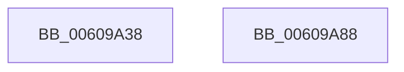

# SeTokenIsNoChildProcessRestrictionEnforced

- RVA: `0x00609A38`–`0x00609A89` (길이 `81` bytes)
- VA: `0x0000000140609A38`
- 실행 섹션: `.text`
- PDB 이름 있음: `예`; PDB Function 태그: `아니요`
- unwind 정보 RVA: `0x0005CAAC`
- 디코드: `22`개 명령, `81/81` bytes 표시
- 미해석 바이트: `0` (있으면 어셈블리에 `.byte`로 보존)

> 이 문서는 커널 이미지의 기계어와 PDB 기호를 분석해 생성했습니다. 4번과 5번은 함수 원형과 자료형을 바이너리 사용 방식에서 추정한 C 해석이며 원본 소스 복구 결과는 아닙니다.

## 1. Dependencies

- 직접 호출 지점: **3**; 고유 호출 대상: **3**
- 직접 호출자로 확인된 함수: **1**
- RIP 상대 이미지 참조: **0**

### Outgoing calls
- `0x00609A5C` → [ExAcquireResourceSharedLite](../21/ExAcquireResourceSharedLite_function_00211BC0.md) (function, `0x00211BC0`)
- `0x00609A6B` → [ExReleaseResourceLite](../25/ExReleaseResourceLite_function_0025FA10.md) (function, `0x0025FA10`)
- `0x00609A70` → [KeLeaveCriticalRegion](../25/KeLeaveCriticalRegion_function_0025D8B0.md) (function, `0x0025D8B0`)

### Direct callers
- [SeSubProcessToken](../../page/AA/SeSubProcessToken_function_00AAD570.md) at `0x00AAD6FB`

### Static image references
- 디코드된 RIP-relative 메모리 참조가 없습니다.

## 2. Other-region calls and transfers

- 다른 실행 섹션으로 향하는 call: **0**
- 별도 외부 분기/꼬리 이동을 확인하지 못했습니다.

## 3. Assembly (complete function range)

```asm
00609A38  48 89 5C 24 08                  mov qword ptr [rsp + 8], rbx
00609A3D  57                              push rdi
00609A3E  48 83 EC 20                     sub rsp, 0x20
00609A42  65 48 8B 04 25 88 01 00 00      mov rax, qword ptr gs:[0x188]
00609A4B  48 8B F9                        mov rdi, rcx
00609A4E  B2 01                           mov dl, 1
00609A50  66 FF 88 E4 01 00 00            dec word ptr [rax + 0x1e4]
00609A57  90                              nop
00609A58  48 8B 49 30                     mov rcx, qword ptr [rcx + 0x30]
00609A5C  E8 5F 81 C0 FF                  call 0x140211bc0
00609A61  48 8B 4F 30                     mov rcx, qword ptr [rdi + 0x30]
00609A65  8B 9F C8 00 00 00               mov ebx, dword ptr [rdi + 0xc8]
00609A6B  E8 A0 5F C5 FF                  call 0x14025fa10
00609A70  E8 3B 3E C5 FF                  call 0x14025d8b0
00609A75  C1 EB 13                        shr ebx, 0x13
00609A78  80 E3 01                        and bl, 1
00609A7B  8A C3                           mov al, bl
00609A7D  48 8B 5C 24 30                  mov rbx, qword ptr [rsp + 0x30]
00609A82  48 83 C4 20                     add rsp, 0x20
00609A86  5F                              pop rdi
00609A87  C3                              ret
00609A88  CC                              int3
```

## 4. C-style interpretation (structured pseudocode)

```c
__int64 __fastcall SeTokenIsNoChildProcessRestrictionEnforced(__int64 a1)
{
    __int64 result;
    __int64 v_rbx;
    __int64 v_rsp;
    unsigned __int64 v_stack_p8;

    v_stack_p8 = v_rbx;
    v_rsp = (v_rsp) - (32);
    result = ExAcquireResourceSharedLite(*(unsigned __int64 *)(a1 + 48), 1, a3, a4);
    result = ExReleaseResourceLite(*(unsigned __int64 *)(a1 + 48), 1, a3, a4);
    result = KeLeaveCriticalRegion(*(unsigned __int64 *)(a1 + 48), 1, a3, a4);
    v_rbx = (unsigned int)(((unsigned int)(*(unsigned int *)(a1 + 200))) >> (19));
    v_rbx = (unsigned __int8)((v_rbx) & (1));
    v_rsp = (v_rsp) + (32);
    return (unsigned __int8)(v_rbx);
}
```

## 5. (Beta) C Style

```c
int64_t SeTokenIsNoChildProcessRestrictionEnforced(void *Arg1)
{
    uint8_t *arg1 = (uint8_t *)Arg1;

    int64_t result;
    int64_t local_rbx;
    int64_t local_rsp;
    uint64_t v_stack_p8;

    v_stack_p8 = local_rbx;
    local_rsp = (local_rsp) - (32);
    result = ExAcquireResourceSharedLite(*(uint64_t *)(arg1 + 0x30), 1, a3, a4);
    result = ExReleaseResourceLite(*(uint64_t *)(arg1 + 0x30), 1, a3, a4);
    result = KeLeaveCriticalRegion(*(uint64_t *)(arg1 + 0x30), 1, a3, a4);
    local_rbx = (uint32_t)(((uint32_t)(*(uint32_t *)(arg1 + 0xC8))) >> (19));
    local_rbx = (uint8_t)((local_rbx) & (1));
    local_rsp = (local_rsp) + (32);
    return (uint8_t)(local_rbx);
}
```

### 관측된 메모리 오프셋

구조체 형식이 확인되지 않은 접근은 인자 기준의 오프셋으로만 기록했습니다.

| 기준 인자 | 오프셋 표현 | 폭 (bit) | 접근 |
|---|---:|---:|---|
| `Arg1` | `+ 0x30` | `64` | `R` |
| `Arg1` | `+ 0xC8` | `32` | `R` |

## 6. Execution-region graph

[열기: 2D/3D 그래프와 함수 탐색 컨트롤 패널](../../../control-panel.html?section=text&rva=0x00609A38&view=graph)

- 2D 그래프는 위에서 아래로 흐르고, 3D 그래프는 빈 공간을 드래그해 회전합니다. Shift+드래그는 이동, 휠은 확대·축소, 함수 노드 선택은 대상 보고서 이동입니다.

### Static fallback


