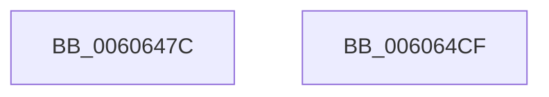

# SepAdtInitLsaDeadEventForNonPagedList

- RVA: `0x0060647C`–`0x006064D0` (길이 `84` bytes)
- VA: `0x000000014060647C`
- 실행 섹션: `.text`
- PDB 이름 있음: `예`; PDB Function 태그: `아니요`
- unwind 정보 RVA: `0x000697A4`
- 디코드: `21`개 명령, `84/84` bytes 표시
- 미해석 바이트: `0` (있으면 어셈블리에 `.byte`로 보존)

> 이 문서는 커널 이미지의 기계어와 PDB 기호를 분석해 생성했습니다. 4번과 5번은 함수 원형과 자료형을 바이너리 사용 방식에서 추정한 C 해석이며 원본 소스 복구 결과는 아닙니다.

## 1. Dependencies

- 직접 호출 지점: **2**; 고유 호출 대상: **2**
- 직접 호출자로 확인된 함수: **1**
- RIP 상대 이미지 참조: **3**

### Outgoing calls
- `0x006064A0` → [KeAcquireInStackQueuedSpinLock](../27/KeAcquireInStackQueuedSpinLock_function_002757A0.md) (function, `0x002757A0`)
- `0x006064C2` → [KeReleaseInStackQueuedSpinLock](../34/KeReleaseInStackQueuedSpinLock_function_00342CE0.md) (function, `0x00342CE0`)

### Direct callers
- [sub_00B3F12C](../../page/B3/Unknown_function_00B3F12C.md) at `0x00B3F1D6`

### Static image references
- `0x0060648D` → RVA `0x00E67EB8` (`.data`; read)
- `0x006064A5` → RVA `0x00E67E40` (`.data`; read)
- `0x006064AC` → RVA `0x00E67EF8` (`.data`; write)

## 2. Other-region calls and transfers

- 다른 실행 섹션으로 향하는 call: **0**
- 별도 외부 분기/꼬리 이동을 확인하지 못했습니다.

## 3. Assembly (complete function range)

```asm
0060647C  40 53                           push rbx
0060647E  48 83 EC 40                     sub rsp, 0x40
00606482  48 8B D9                        mov rbx, rcx
00606485  48 8D 54 24 20                  lea rdx, [rsp + 0x20]
0060648A  0F 57 C0                        xorps xmm0, xmm0
0060648D  48 8D 0D 24 1A 86 00            lea rcx, [rip + 0x861a24]
00606494  33 C0                           xor eax, eax
00606496  0F 11 44 24 20                  movups xmmword ptr [rsp + 0x20], xmm0
0060649B  48 89 44 24 30                  mov qword ptr [rsp + 0x30], rax
006064A0  E8 FB F2 C6 FF                  call 0x1402757a0
006064A5  48 8D 05 94 19 86 00            lea rax, [rip + 0x861994]
006064AC  48 89 1D 45 1A 86 00            mov qword ptr [rip + 0x861a45], rbx
006064B3  48 39 05 86 19 86 00            cmp qword ptr [rip + 0x861986], rax
006064BA  48 8D 4C 24 20                  lea rcx, [rsp + 0x20]
006064BF  0F 95 C3                        setne bl
006064C2  E8 19 C8 D3 FF                  call 0x140342ce0
006064C7  8A C3                           mov al, bl
006064C9  48 83 C4 40                     add rsp, 0x40
006064CD  5B                              pop rbx
006064CE  C3                              ret
006064CF  CC                              int3
```

## 4. C-style interpretation (structured pseudocode)

```c
__int64 __fastcall SepAdtInitLsaDeadEventForNonPagedList(__int64 a1)
{
    __int64 result;
    __int64 v_rbx;
    __int64 v_rsp;
    unsigned __int64 v_stack_m18;
    unsigned __int64 v_stack_m28;

    v_rsp = (v_rsp) - (64);
    result = 0;
    v_stack_m28 = v_xmm0;
    v_stack_m18 = 0;
    result = KeAcquireInStackQueuedSpinLock(v_rip + 8788516, v_stack_m28, a3, a4);
    *(unsigned __int64 *)(v_rip + 8788549) = a1;
    v_rbx = ((*(unsigned __int64 *)(v_rip + 8788358)) != (v_rip + 8788372)) ? 1 : 0;
    result = KeReleaseInStackQueuedSpinLock(v_stack_m28, v_stack_m28, a3, a4);
    v_rsp = (v_rsp) + (64);
    return (unsigned __int8)(v_rbx);
}
```

## 5. (Beta) C Style

```c
int64_t SepAdtInitLsaDeadEventForNonPagedList(int64_t Arg1)
{
    int64_t result;
    int64_t local_rbx;
    int64_t local_rsp;
    uint64_t v_stack_m18;
    uint64_t v_stack_m28;

    local_rsp = (local_rsp) - (64);
    result = 0;
    v_stack_m28 = v_xmm0;
    v_stack_m18 = 0;
    result = KeAcquireInStackQueuedSpinLock(v_rip + 8788516, v_stack_m28, a3, a4);
    *(uint64_t *)(v_rip + 0x861A45) = Arg1;
    local_rbx = ((*(uint64_t *)(v_rip + 0x861986)) != (v_rip + 8788372)) ? 1 : 0;
    result = KeReleaseInStackQueuedSpinLock(v_stack_m28, v_stack_m28, a3, a4);
    local_rsp = (local_rsp) + (64);
    return (uint8_t)(local_rbx);
}
```

## 6. Execution-region graph

[열기: 2D/3D 그래프와 함수 탐색 컨트롤 패널](../../../control-panel.html?section=text&rva=0x0060647C&view=graph)

- 2D 그래프는 위에서 아래로 흐르고, 3D 그래프는 빈 공간을 드래그해 회전합니다. Shift+드래그는 이동, 휠은 확대·축소, 함수 노드 선택은 대상 보고서 이동입니다.

### Static fallback


