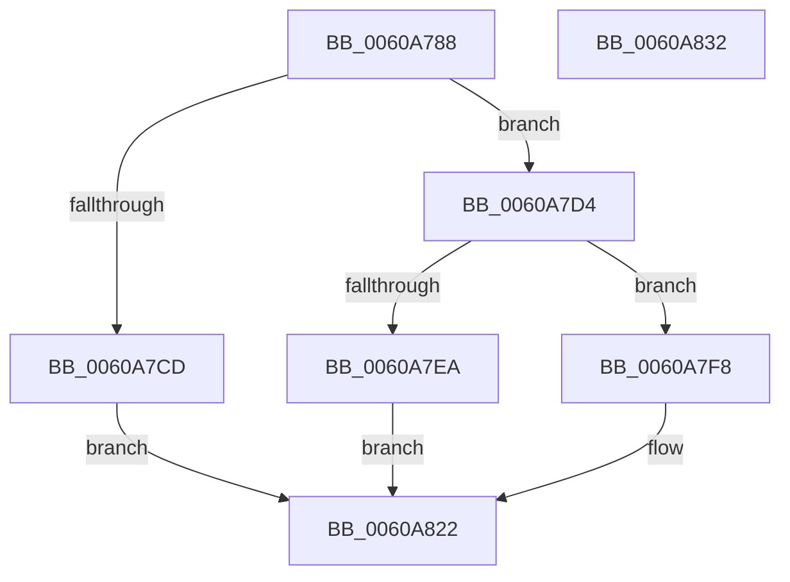

# SepAllocateInstanceSid

- RVA: `0x0060A788`–`0x0060A833` (길이 `171` bytes)
- VA: `0x000000014060A788`
- 실행 섹션: `.text`
- PDB 이름 있음: `예`; PDB Function 태그: `아니요`
- unwind 정보 RVA: `0x000A9ACC`
- 디코드: `48`개 명령, `171/171` bytes 표시
- 미해석 바이트: `0` (있으면 어셈블리에 `.byte`로 보존)

> 이 문서는 커널 이미지의 기계어와 PDB 기호를 분석해 생성했습니다. 4번과 5번은 함수 원형과 자료형을 바이너리 사용 방식에서 추정한 C 해석이며 원본 소스 복구 결과는 아닙니다.

## 1. Dependencies

- 직접 호출 지점: **4**; 고유 호출 대상: **4**
- 직접 호출자로 확인된 함수: **1**
- RIP 상대 이미지 참조: **1**

### Outgoing calls
- `0x0060A7AE` → [RtlLengthRequiredSid](../../page/9C/RtlLengthRequiredSid_function_009CA4D0.md) (function, `0x009CA4D0`)
- `0x0060A7C0` → [ExAllocatePool2](../../poolcode/B8/ExAllocatePool2_function_00B820F0.md) (function, `0x00B820F0`)
- `0x0060A7DF` → [RtlInitializeSid](../../page/9E/RtlInitializeSid_function_009EB720.md) (function, `0x009EB720`)
- `0x0060A7EF` → [ExFreePoolWithTag](../../poolcode/B8/ExFreePoolWithTag_function_00B82870.md) (function, `0x00B82870`)

### Direct callers
- [SeSetTokenTamperProtection](SeSetTokenTamperProtection_function_00609644.md) at `0x006097A0`

### Static image references
- `0x0060A7FD` → RVA `0x00E0CCA8` (`.data`; read/write)

## 2. Other-region calls and transfers

- 다른 실행 섹션으로 향하는 call: **4**
  - `0x0060A7AE` → [RtlLengthRequiredSid](../../page/9C/RtlLengthRequiredSid_function_009CA4D0.md) (`.text` → `PAGE`)
  - `0x0060A7C0` → [ExAllocatePool2](../../poolcode/B8/ExAllocatePool2_function_00B820F0.md) (`.text` → `POOLCODE`)
  - `0x0060A7DF` → [RtlInitializeSid](../../page/9E/RtlInitializeSid_function_009EB720.md) (`.text` → `PAGE`)
  - `0x0060A7EF` → [ExFreePoolWithTag](../../poolcode/B8/ExFreePoolWithTag_function_00B82870.md) (`.text` → `POOLCODE`)
- 별도 외부 분기/꼬리 이동을 확인하지 못했습니다.

## 3. Assembly (complete function range)

```asm
0060A788  48 8B C4                        mov rax, rsp
0060A78B  48 89 58 10                     mov qword ptr [rax + 0x10], rbx
0060A78F  48 89 70 18                     mov qword ptr [rax + 0x18], rsi
0060A793  57                              push rdi
0060A794  48 83 EC 20                     sub rsp, 0x20
0060A798  48 83 21 00                     and qword ptr [rcx], 0
0060A79C  48 8B F1                        mov rsi, rcx
0060A79F  83 60 08 00                     and dword ptr [rax + 8], 0
0060A7A3  B9 03 00 00 00                  mov ecx, 3
0060A7A8  66 C7 40 0C 00 14               mov word ptr [rax + 0xc], 0x1400
0060A7AE  E8 1D FD 3B 00                  call 0x1409ca4d0
0060A7B3  8B D0                           mov edx, eax
0060A7B5  B9 00 01 00 00                  mov ecx, 0x100
0060A7BA  41 B8 53 65 53 69               mov r8d, 0x69536553
0060A7C0  E8 2B 79 57 00                  call 0x140b820f0
0060A7C5  48 8B D8                        mov rbx, rax
0060A7C8  48 85 C0                        test rax, rax
0060A7CB  75 07                           jne 0x14060a7d4
0060A7CD  B8 17 00 00 C0                  mov eax, 0xc0000017
0060A7D2  EB 4E                           jmp 0x14060a822
0060A7D4  41 B0 03                        mov r8b, 3
0060A7D7  48 8D 54 24 30                  lea rdx, [rsp + 0x30]
0060A7DC  48 8B CB                        mov rcx, rbx
0060A7DF  E8 3C 0F 3E 00                  call 0x1409eb720
0060A7E4  8B F8                           mov edi, eax
0060A7E6  85 C0                           test eax, eax
0060A7E8  79 0E                           jns 0x14060a7f8
0060A7EA  33 D2                           xor edx, edx
0060A7EC  48 8B CB                        mov rcx, rbx
0060A7EF  E8 7C 80 57 00                  call 0x140b82870
0060A7F4  8B C7                           mov eax, edi
0060A7F6  EB 2A                           jmp 0x14060a822
0060A7F8  B8 01 00 00 00                  mov eax, 1
0060A7FD  F0 48 0F C1 05 A2 24 80 00      lock xadd qword ptr [rip + 0x8024a2], rax
0060A806  48 FF C0                        inc rax
0060A809  C7 43 08 03 00 00 00            mov dword ptr [rbx + 8], 3
0060A810  48 8B C8                        mov rcx, rax
0060A813  48 89 1E                        mov qword ptr [rsi], rbx
0060A816  48 C1 E9 20                     shr rcx, 0x20
0060A81A  89 4B 0C                        mov dword ptr [rbx + 0xc], ecx
0060A81D  89 43 10                        mov dword ptr [rbx + 0x10], eax
0060A820  33 C0                           xor eax, eax
0060A822  48 8B 5C 24 38                  mov rbx, qword ptr [rsp + 0x38]
0060A827  48 8B 74 24 40                  mov rsi, qword ptr [rsp + 0x40]
0060A82C  48 83 C4 20                     add rsp, 0x20
0060A830  5F                              pop rdi
0060A831  C3                              ret
0060A832  CC                              int3
```

## 4. C-style interpretation (structured pseudocode)

```c
__int64 __fastcall SepAllocateInstanceSid(__int64 a1)
{
    __int64 result;
    __int64 v_rsp;
    unsigned __int64 v_stack_p10;
    unsigned __int64 v_stack_p18;
    unsigned __int64 v_stack_p8;

    *(unsigned __int64 *)(v_rsp + 16) = v_rbx;
    *(unsigned __int64 *)(v_rsp + 24) = v_rsi;
    v_rsp = (v_rsp) - (32);
    *(unsigned __int16 *)(v_rsp + 12) = 0x1400ULL;
    result = RtlLengthRequiredSid(3, a2, a3, a4);
    result = ExAllocatePool2(256, (unsigned int)((unsigned int)(result)), (unsigned int)(0x69536553ULL), a4);
    if (result != 0) goto loc_0060A7D4;
    goto loc_0060A822;
loc_0060A7D4:
    result = RtlInitializeSid(result, v_stack_p8, 3, a4);
    if (!sign_flag) goto loc_0060A7F8;
    a2 = 0;
    result = ExFreePoolWithTag(result, a2, 3, a4);
    goto loc_0060A822;
loc_0060A7F8:
    result = (1) + 1;
    *(unsigned int *)(result + 8) = 3;
    *(unsigned __int64 *)(a1) = result;
    a1 = (result) >> (32);
    *(unsigned int *)(result + 12) = (unsigned int)(a1);
    *(unsigned int *)(result + 16) = (unsigned int)(result);
    result = 0;
loc_0060A822:
    v_rsp = (v_rsp) + (32);
    return result;
}
```

## 5. (Beta) C Style

```c
int64_t SepAllocateInstanceSid(void *Arg1)
{
    uint8_t *arg1 = (uint8_t *)Arg1;

    int64_t result;
    int64_t local_rsp;
    uint64_t v_stack_p10;
    uint64_t v_stack_p18;
    uint64_t v_stack_p8;

    *(uint64_t *)(local_rsp + 0x10) = local_rbx;
    *(uint64_t *)(local_rsp + 0x18) = local_rsi;
    local_rsp = (local_rsp) - (32);
    *(uint16_t *)(local_rsp + 0xC) = 0x1400ULL;
    result = RtlLengthRequiredSid(3, a2, a3, a4);
    result = ExAllocatePool2(256, (uint32_t)((uint32_t)(result)), (uint32_t)(0x69536553ULL), a4);
    if (result != 0) goto loc_0060A7D4;
    goto loc_0060A822;
loc_0060A7D4:
    result = RtlInitializeSid(result, v_stack_p8, 3, a4);
    if (!sign_flag) goto loc_0060A7F8;
    a2 = 0;
    result = ExFreePoolWithTag(result, a2, 3, a4);
    goto loc_0060A822;
loc_0060A7F8:
    result = (1) + 1;
    *(uint32_t *)(result + 0x8) = 3;
    *(uint64_t *)(arg1) = result;
    Arg1 = (result) >> (32);
    *(uint32_t *)(result + 0xC) = (uint32_t)(Arg1);
    *(uint32_t *)(result + 0x10) = (uint32_t)(result);
    result = 0;
loc_0060A822:
    local_rsp = (local_rsp) + (32);
    return result;
}
```

### 관측된 메모리 오프셋

구조체 형식이 확인되지 않은 접근은 인자 기준의 오프셋으로만 기록했습니다.

| 기준 인자 | 오프셋 표현 | 폭 (bit) | 접근 |
|---|---:|---:|---|
| `Arg1` | `+ 0x0` | `64` | `R/W` |
| `Arg1` | `+ 0x0` | `64` | `W` |

## 6. Execution-region graph

[열기: 2D/3D 그래프와 함수 탐색 컨트롤 패널](../../../control-panel.html?section=text&rva=0x0060A788&view=graph)

- 2D 그래프는 위에서 아래로 흐르고, 3D 그래프는 빈 공간을 드래그해 회전합니다. Shift+드래그는 이동, 휠은 확대·축소, 함수 노드 선택은 대상 보고서 이동입니다.

### Static fallback


