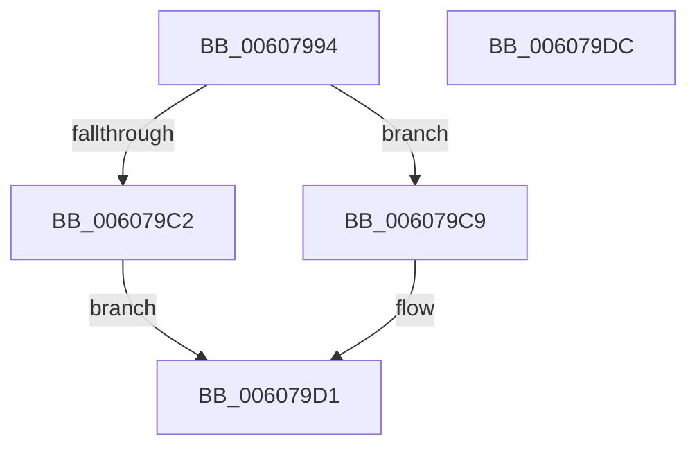

# SepAllocateObjectAntiTamperEntry

- RVA: `0x00607994`–`0x006079DD` (길이 `73` bytes)
- VA: `0x0000000140607994`
- 실행 섹션: `.text`
- PDB 이름 있음: `예`; PDB Function 태그: `아니요`
- unwind 정보 RVA: `0x0005CAAC`
- 디코드: `23`개 명령, `73/73` bytes 표시
- 미해석 바이트: `0` (있으면 어셈블리에 `.byte`로 보존)

> 이 문서는 커널 이미지의 기계어와 PDB 기호를 분석해 생성했습니다. 4번과 5번은 함수 원형과 자료형을 바이너리 사용 방식에서 추정한 C 해석이며 원본 소스 복구 결과는 아닙니다.

## 1. Dependencies

- 직접 호출 지점: **1**; 고유 호출 대상: **1**
- 직접 호출자로 확인된 함수: **3**
- RIP 상대 이미지 참조: **0**

### Outgoing calls
- `0x006079B8` → [ExAllocatePool2](../../poolcode/B8/ExAllocatePool2_function_00B820F0.md) (function, `0x00B820F0`)

### Direct callers
- [SeInitializeObjectTypeEnumPolicyEntry](SeInitializeObjectTypeEnumPolicyEntry_function_00607790.md) at `0x006077B7`
- [SeInitializeObjectTypePolicyEntry](SeInitializeObjectTypePolicyEntry_function_00607800.md) at `0x0060782A`
- [SeInitializeObjectTypeUserAppInstancePolicyEntry](SeInitializeObjectTypeUserAppInstancePolicyEntry_function_00607870.md) at `0x00607891`

### Static image references
- 디코드된 RIP-relative 메모리 참조가 없습니다.

## 2. Other-region calls and transfers

- 다른 실행 섹션으로 향하는 call: **1**
  - `0x006079B8` → [ExAllocatePool2](../../poolcode/B8/ExAllocatePool2_function_00B820F0.md) (`.text` → `POOLCODE`)
- 별도 외부 분기/꼬리 이동을 확인하지 못했습니다.

## 3. Assembly (complete function range)

```asm
00607994  48 89 5C 24 08                  mov qword ptr [rsp + 8], rbx
00607999  57                              push rdi
0060799A  48 83 EC 20                     sub rsp, 0x20
0060799E  48 83 22 00                     and qword ptr [rdx], 0
006079A2  48 8B DA                        mov rbx, rdx
006079A5  8D 51 01                        lea edx, [rcx + 1]
006079A8  8B F9                           mov edi, ecx
006079AA  C1 E2 04                        shl edx, 4
006079AD  B9 00 01 00 00                  mov ecx, 0x100
006079B2  41 B8 53 65 4F 45               mov r8d, 0x454f6553
006079B8  E8 33 A7 57 00                  call 0x140b820f0
006079BD  48 85 C0                        test rax, rax
006079C0  75 07                           jne 0x1406079c9
006079C2  B8 17 00 00 C0                  mov eax, 0xc0000017
006079C7  EB 08                           jmp 0x1406079d1
006079C9  89 78 08                        mov dword ptr [rax + 8], edi
006079CC  48 89 03                        mov qword ptr [rbx], rax
006079CF  33 C0                           xor eax, eax
006079D1  48 8B 5C 24 30                  mov rbx, qword ptr [rsp + 0x30]
006079D6  48 83 C4 20                     add rsp, 0x20
006079DA  5F                              pop rdi
006079DB  C3                              ret
006079DC  CC                              int3
```

## 4. C-style interpretation (structured pseudocode)

```c
__int64 __fastcall SepAllocateObjectAntiTamperEntry(__int64 a1, __int64 a2)
{
    __int64 result;
    __int64 v_rsp;
    unsigned __int64 v_stack_p8;

    v_stack_p8 = v_rbx;
    v_rsp = (v_rsp) - (32);
    a2 = (unsigned int)((a1 + 1) << (4));
    result = ExAllocatePool2(256, a2, (unsigned int)(0x454F6553ULL), a4);
    if (result != 0) goto loc_006079C9;
    goto loc_006079D1;
loc_006079C9:
    *(unsigned int *)((unsigned int)(0xC0000017ULL) + 8) = (unsigned int)((unsigned int)((unsigned int)(a1)));
    *(unsigned __int64 *)(a2) = (unsigned int)(0xC0000017ULL);
    result = 0;
loc_006079D1:
    v_rsp = (v_rsp) + (32);
    return result;
}
```

## 5. (Beta) C Style

```c
int64_t SepAllocateObjectAntiTamperEntry(void *Arg1, void *Arg2)
{
    uint8_t *arg1 = (uint8_t *)Arg1;
    uint8_t *arg2 = (uint8_t *)Arg2;

    int64_t result;
    int64_t local_rsp;
    uint64_t v_stack_p8;

    v_stack_p8 = local_rbx;
    local_rsp = (local_rsp) - (32);
    Arg2 = (uint32_t)((Arg1 + 1) << (4));
    result = ExAllocatePool2(256, Arg2, (uint32_t)(0x454F6553ULL), a4);
    if (result != 0) goto loc_006079C9;
    goto loc_006079D1;
loc_006079C9:
    *(uint32_t *)((uint32_t)(0xC0000017ULL) + 0x8) = (uint32_t)((uint32_t)((uint32_t)(Arg1)));
    *(uint64_t *)(arg2) = (uint32_t)(0xC0000017ULL);
    result = 0;
loc_006079D1:
    local_rsp = (local_rsp) + (32);
    return result;
}
```

### 관측된 메모리 오프셋

구조체 형식이 확인되지 않은 접근은 인자 기준의 오프셋으로만 기록했습니다.

| 기준 인자 | 오프셋 표현 | 폭 (bit) | 접근 |
|---|---:|---:|---|
| `Arg1` | `+ 0x1` | `32` | `R` |
| `Arg2` | `+ 0x0` | `64` | `R/W` |
| `Arg2` | `+ 0x0` | `64` | `W` |

## 6. Execution-region graph

[열기: 2D/3D 그래프와 함수 탐색 컨트롤 패널](../../../control-panel.html?section=text&rva=0x00607994&view=graph)

- 2D 그래프는 위에서 아래로 흐르고, 3D 그래프는 빈 공간을 드래그해 회전합니다. Shift+드래그는 이동, 휠은 확대·축소, 함수 노드 선택은 대상 보고서 이동입니다.

### Static fallback


