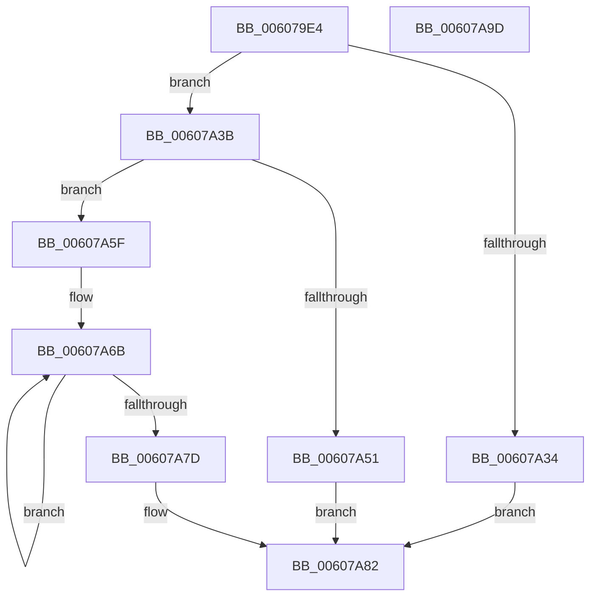

# SepAppIdentityFromHash

- RVA: `0x006079E4`–`0x00607A9E` (길이 `186` bytes)
- VA: `0x00000001406079E4`
- 실행 섹션: `.text`
- PDB 이름 있음: `예`; PDB Function 태그: `아니요`
- unwind 정보 RVA: `0x0005D7BC`
- 디코드: `54`개 명령, `186/186` bytes 표시
- 미해석 바이트: `0` (있으면 어셈블리에 `.byte`로 보존)

> 이 문서는 커널 이미지의 기계어와 PDB 기호를 분석해 생성했습니다. 4번과 5번은 함수 원형과 자료형을 바이너리 사용 방식에서 추정한 C 해석이며 원본 소스 복구 결과는 아닙니다.

## 1. Dependencies

- 직접 호출 지점: **4**; 고유 호출 대상: **4**
- 직접 호출자로 확인된 함수: **2**
- RIP 상대 이미지 참조: **0**

### Outgoing calls
- `0x00607A15` → [RtlLengthRequiredSid](../../page/9C/RtlLengthRequiredSid_function_009CA4D0.md) (function, `0x009CA4D0`)
- `0x00607A27` → [ExAllocatePool2](../../poolcode/B8/ExAllocatePool2_function_00B820F0.md) (function, `0x00B820F0`)
- `0x00607A46` → [RtlInitializeSid](../../page/9E/RtlInitializeSid_function_009EB720.md) (function, `0x009EB720`)
- `0x00607A56` → [ExFreePoolWithTag](../../poolcode/B8/ExFreePoolWithTag_function_00B82870.md) (function, `0x00B82870`)

### Direct callers
- [SepAppIdentityFromImageHash](SepAppIdentityFromImageHash_function_00607AA4.md) at `0x00607B6E`
- [SepAppIdentityFromImageHash](SepAppIdentityFromImageHash_function_00607AA4.md) at `0x00607D32`
- [SepAppIdentityFromPackageInformation](SepAppIdentityFromPackageInformation_function_00607D7C.md) at `0x00607EB0`

### Static image references
- 디코드된 RIP-relative 메모리 참조가 없습니다.

## 2. Other-region calls and transfers

- 다른 실행 섹션으로 향하는 call: **4**
  - `0x00607A15` → [RtlLengthRequiredSid](../../page/9C/RtlLengthRequiredSid_function_009CA4D0.md) (`.text` → `PAGE`)
  - `0x00607A27` → [ExAllocatePool2](../../poolcode/B8/ExAllocatePool2_function_00B820F0.md) (`.text` → `POOLCODE`)
  - `0x00607A46` → [RtlInitializeSid](../../page/9E/RtlInitializeSid_function_009EB720.md) (`.text` → `PAGE`)
  - `0x00607A56` → [ExFreePoolWithTag](../../poolcode/B8/ExFreePoolWithTag_function_00B82870.md) (`.text` → `POOLCODE`)
- 별도 외부 분기/꼬리 이동을 확인하지 못했습니다.

## 3. Assembly (complete function range)

```asm
006079E4  48 8B C4                        mov rax, rsp
006079E7  48 89 58 08                     mov qword ptr [rax + 8], rbx
006079EB  48 89 68 10                     mov qword ptr [rax + 0x10], rbp
006079EF  48 89 70 18                     mov qword ptr [rax + 0x18], rsi
006079F3  48 89 78 20                     mov qword ptr [rax + 0x20], rdi
006079F7  41 56                           push r14
006079F9  48 83 EC 30                     sub rsp, 0x30
006079FD  83 60 E8 00                     and dword ptr [rax - 0x18], 0
00607A01  48 8B F9                        mov rdi, rcx
00607A04  B9 08 00 00 00                  mov ecx, 8
00607A09  66 C7 40 EC 00 14               mov word ptr [rax - 0x14], 0x1400
00607A0F  4D 8B F1                        mov r14, r9
00607A12  41 8B E8                        mov ebp, r8d
00607A15  E8 B6 2A 3C 00                  call 0x1409ca4d0
00607A1A  8B D0                           mov edx, eax
00607A1C  B9 00 01 00 00                  mov ecx, 0x100
00607A21  41 B8 53 65 53 69               mov r8d, 0x69536553
00607A27  E8 C4 A6 57 00                  call 0x140b820f0
00607A2C  48 8B D8                        mov rbx, rax
00607A2F  48 85 C0                        test rax, rax
00607A32  75 07                           jne 0x140607a3b
00607A34  B8 17 00 00 C0                  mov eax, 0xc0000017
00607A39  EB 47                           jmp 0x140607a82
00607A3B  41 B0 08                        mov r8b, 8
00607A3E  48 8D 54 24 20                  lea rdx, [rsp + 0x20]
00607A43  48 8B CB                        mov rcx, rbx
00607A46  E8 D5 3C 3E 00                  call 0x1409eb720
00607A4B  8B F0                           mov esi, eax
00607A4D  85 C0                           test eax, eax
00607A4F  79 0E                           jns 0x140607a5f
00607A51  33 D2                           xor edx, edx
00607A53  48 8B CB                        mov rcx, rbx
00607A56  E8 15 AE 57 00                  call 0x140b82870
00607A5B  8B C6                           mov eax, esi
00607A5D  EB 23                           jmp 0x140607a82
00607A5F  89 6B 08                        mov dword ptr [rbx + 8], ebp
00607A62  48 8D 4B 0C                     lea rcx, [rbx + 0xc]
00607A66  BA 07 00 00 00                  mov edx, 7
00607A6B  8B 07                           mov eax, dword ptr [rdi]
00607A6D  48 8D 7F 04                     lea rdi, [rdi + 4]
00607A71  89 01                           mov dword ptr [rcx], eax
00607A73  48 8D 49 04                     lea rcx, [rcx + 4]
00607A77  48 83 EA 01                     sub rdx, 1
00607A7B  75 EE                           jne 0x140607a6b
00607A7D  49 89 1E                        mov qword ptr [r14], rbx
00607A80  33 C0                           xor eax, eax
00607A82  48 8B 5C 24 40                  mov rbx, qword ptr [rsp + 0x40]
00607A87  48 8B 6C 24 48                  mov rbp, qword ptr [rsp + 0x48]
00607A8C  48 8B 74 24 50                  mov rsi, qword ptr [rsp + 0x50]
00607A91  48 8B 7C 24 58                  mov rdi, qword ptr [rsp + 0x58]
00607A96  48 83 C4 30                     add rsp, 0x30
00607A9A  41 5E                           pop r14
00607A9C  C3                              ret
00607A9D  CC                              int3
```

## 4. C-style interpretation (structured pseudocode)

```c
__int64 __fastcall SepAppIdentityFromHash(__int64 a1, __int64 a2, int a3, __int64 a4)
{
    __int64 result;
    __int64 v_rsp;
    unsigned __int64 v_stack_m18;
    unsigned __int64 v_stack_p10;
    unsigned __int64 v_stack_p18;
    unsigned __int64 v_stack_p20;
    unsigned __int64 v_stack_p8;

    *(unsigned __int64 *)(v_rsp + 8) = v_rbx;
    *(unsigned __int64 *)(v_rsp + 16) = v_rbp;
    *(unsigned __int64 *)(v_rsp + 24) = v_rsi;
    *(unsigned __int64 *)(v_rsp + 32) = v_rdi;
    v_rsp = (v_rsp) - (48);
    *(unsigned __int16 *)(v_rsp - 20) = 0x1400ULL;
    result = RtlLengthRequiredSid(8, a2, a3, a4);
    result = ExAllocatePool2(256, (unsigned int)((unsigned int)(result)), (unsigned int)(0x69536553ULL), a4);
    if (result != 0) goto loc_00607A3B;
    goto loc_00607A82;
loc_00607A3B:
    result = RtlInitializeSid(result, v_stack_m18, 8, a4);
    if (!sign_flag) goto loc_00607A5F;
    a2 = 0;
    result = ExFreePoolWithTag(result, a2, 8, a4);
    goto loc_00607A82;
loc_00607A5F:
    *(unsigned int *)(result + 8) = (unsigned int)((unsigned int)(a3));
loc_00607A6B:
    *(unsigned int *)(result + 12) = (unsigned int)((unsigned int)(*(unsigned int *)(a1)));
    a2 = (7) - (1);
    if (condition_is_not_equal) goto loc_00607A6B;
    *(unsigned __int64 *)(a4) = result;
    result = 0;
loc_00607A82:
    v_rsp = (v_rsp) + (48);
    return result;
}
```

## 5. (Beta) C Style

```c
int64_t SepAppIdentityFromHash(void *Arg1, int64_t Arg2, int32_t Arg3, void *Arg4)
{
    uint8_t *arg1 = (uint8_t *)Arg1;
    uint8_t *arg4 = (uint8_t *)Arg4;

    int64_t result;
    int64_t local_rsp;
    uint64_t v_stack_m18;
    uint64_t v_stack_p10;
    uint64_t v_stack_p18;
    uint64_t v_stack_p20;
    uint64_t v_stack_p8;

    *(uint64_t *)(local_rsp + 0x8) = local_rbx;
    *(uint64_t *)(local_rsp + 0x10) = local_rbp;
    *(uint64_t *)(local_rsp + 0x18) = local_rsi;
    *(uint64_t *)(local_rsp + 0x20) = local_rdi;
    local_rsp = (local_rsp) - (48);
    *(uint16_t *)(local_rsp - 0x14) = 0x1400ULL;
    result = RtlLengthRequiredSid(8, Arg2, Arg3, Arg4);
    result = ExAllocatePool2(256, (uint32_t)((uint32_t)(result)), (uint32_t)(0x69536553ULL), Arg4);
    if (result != 0) goto loc_00607A3B;
    goto loc_00607A82;
loc_00607A3B:
    result = RtlInitializeSid(result, v_stack_m18, 8, Arg4);
    if (!sign_flag) goto loc_00607A5F;
    Arg2 = 0;
    result = ExFreePoolWithTag(result, Arg2, 8, Arg4);
    goto loc_00607A82;
loc_00607A5F:
    *(uint32_t *)(result + 0x8) = (uint32_t)((uint32_t)(Arg3));
loc_00607A6B:
    *(uint32_t *)(result + 0xC) = (uint32_t)((uint32_t)(*(uint32_t *)(arg1)));
    Arg2 = (7) - (1);
    if (condition_is_not_equal) goto loc_00607A6B;
    *(uint64_t *)(arg4) = result;
    result = 0;
loc_00607A82:
    local_rsp = (local_rsp) + (48);
    return result;
}
```

### 관측된 메모리 오프셋

구조체 형식이 확인되지 않은 접근은 인자 기준의 오프셋으로만 기록했습니다.

| 기준 인자 | 오프셋 표현 | 폭 (bit) | 접근 |
|---|---:|---:|---|
| `Arg1` | `+ 0x0` | `32` | `R` |
| `Arg1` | `+ 0x4` | `64` | `R` |
| `Arg4` | `+ 0x0` | `64` | `W` |

## 6. Execution-region graph

[열기: 2D/3D 그래프와 함수 탐색 컨트롤 패널](../../../control-panel.html?section=text&rva=0x006079E4&view=graph)

- 2D 그래프는 위에서 아래로 흐르고, 3D 그래프는 빈 공간을 드래그해 회전합니다. Shift+드래그는 이동, 휠은 확대·축소, 함수 노드 선택은 대상 보고서 이동입니다.

### Static fallback


