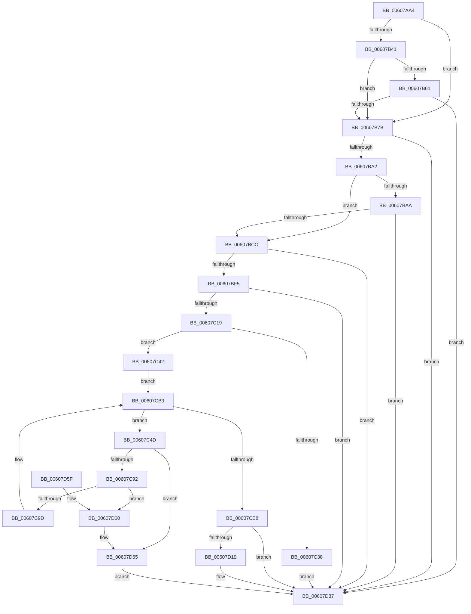

# SepAppIdentityFromImageHash

- RVA: `0x00607AA4`–`0x00607D73` (길이 `719` bytes)
- VA: `0x0000000140607AA4`
- 실행 섹션: `.text`
- PDB 이름 있음: `예`; PDB Function 태그: `아니요`
- unwind 정보 RVA: `0x000D0F68`
- 디코드: `180`개 명령, `719/719` bytes 표시
- 미해석 바이트: `0` (있으면 어셈블리에 `.byte`로 보존)

> 이 문서는 커널 이미지의 기계어와 PDB 기호를 분석해 생성했습니다. 4번과 5번은 함수 원형과 자료형을 바이너리 사용 방식에서 추정한 C 해석이며 원본 소스 복구 결과는 아닙니다.

## 1. Dependencies

- 직접 호출 지점: **22**; 고유 호출 대상: **14**
- 직접 호출자로 확인된 함수: **1**
- RIP 상대 이미지 참조: **1**

### Outgoing calls
- `0x00607B07` → [memset](../6C/memset_function_006C6C40.md) (function, `0x006C6C40`)
- `0x00607B38` → [SepGetImageEa](SepGetImageEa_function_006081FC.md) (function, `0x006081FC`)
- `0x00607B4A` → [SepImageHashFromEa](SepImageHashFromEa_function_00608310.md) (function, `0x00608310`)
- `0x00607B58` → [ExFreePoolWithTag](../../poolcode/B8/ExFreePoolWithTag_function_00B82870.md) (function, `0x00B82870`)
- `0x00607B6E` → [SepAppIdentityFromHash](SepAppIdentityFromHash_function_006079E4.md) (function, `0x006079E4`)
- `0x00607B95` → [ZwQueryInformationFile](../6A/ZwQueryInformationFile_function_006AD2F0.md) (function, `0x006AD2F0`)
- `0x00607BBF` → [ZwSetInformationFile](../6A/ZwSetInformationFile_function_006AD5B0.md) (function, `0x006AD5B0`)
- `0x00607BE8` → [ZwQueryInformationFile](../6A/ZwQueryInformationFile_function_006AD2F0.md) (function, `0x006AD2F0`)
- `0x00607C0C` → [ZwQueryInformationFile](../6A/ZwQueryInformationFile_function_006AD2F0.md) (function, `0x006AD2F0`)
- `0x00607C2B` → [ExAllocatePool2](../../poolcode/B8/ExAllocatePool2_function_00B820F0.md) (function, `0x00B820F0`)
- `0x00607C46` → [SymCryptSha256Init](../51/SymCryptSha256Init_function_0051E2C0.md) (function, `0x0051E2C0`)
- `0x00607C83` → [ZwReadFile](../6A/ZwReadFile_function_006AD190.md) (function, `0x006AD190`)
- `0x00607CAB` → [SymCryptSha256Append](../51/SymCryptSha256Append_function_0051CB20.md) (function, `0x0051CB20`)
- `0x00607CC6` → [SymCryptSha256Append](../51/SymCryptSha256Append_function_0051CB20.md) (function, `0x0051CB20`)
- `0x00607CD9` → [SymCryptSha256Append](../51/SymCryptSha256Append_function_0051CB20.md) (function, `0x0051CB20`)
- `0x00607CE6` → [SymCryptSha256Result](../51/SymCryptSha256Result_function_0051E2F0.md) (function, `0x0051E2F0`)
- `0x00607CF0` → [ExFreePoolWithTag](../../poolcode/B8/ExFreePoolWithTag_function_00B82870.md) (function, `0x00B82870`)
- `0x00607D10` → [ZwSetInformationFile](../6A/ZwSetInformationFile_function_006AD5B0.md) (function, `0x006AD5B0`)
- `0x00607D20` → [SepSetImageEa](SepSetImageEa_function_0060874C.md) (function, `0x0060874C`)
- `0x00607D32` → [SepAppIdentityFromHash](SepAppIdentityFromHash_function_006079E4.md) (function, `0x006079E4`)
- `0x00607D3E` → [_security_check_cookie](../6A/_security_check_cookie_function_006AC640.md) (function, `0x006AC640`)
- `0x00607D6A` → [ExFreePoolWithTag](../../poolcode/B8/ExFreePoolWithTag_function_00B82870.md) (function, `0x00B82870`)

### Direct callers
- [SeSetTokenTamperProtection](SeSetTokenTamperProtection_function_00609644.md) at `0x006096DC`

### Static image references
- `0x00607AC2` → RVA `0x00E0A740` (`.data`; read)

## 2. Other-region calls and transfers

- 다른 실행 섹션으로 향하는 call: **4**
  - `0x00607B58` → [ExFreePoolWithTag](../../poolcode/B8/ExFreePoolWithTag_function_00B82870.md) (`.text` → `POOLCODE`)
  - `0x00607C2B` → [ExAllocatePool2](../../poolcode/B8/ExAllocatePool2_function_00B820F0.md) (`.text` → `POOLCODE`)
  - `0x00607CF0` → [ExFreePoolWithTag](../../poolcode/B8/ExFreePoolWithTag_function_00B82870.md) (`.text` → `POOLCODE`)
  - `0x00607D6A` → [ExFreePoolWithTag](../../poolcode/B8/ExFreePoolWithTag_function_00B82870.md) (`.text` → `POOLCODE`)
- 별도 외부 분기/꼬리 이동을 확인하지 못했습니다.

## 3. Assembly (complete function range)

```asm
00607AA4  48 89 5C 24 18                  mov qword ptr [rsp + 0x18], rbx
00607AA9  48 89 74 24 20                  mov qword ptr [rsp + 0x20], rsi
00607AAE  55                              push rbp
00607AAF  57                              push rdi
00607AB0  41 54                           push r12
00607AB2  41 56                           push r14
00607AB4  41 57                           push r15
00607AB6  48 8D 6C 24 A0                  lea rbp, [rsp - 0x60]
00607ABB  48 81 EC 60 01 00 00            sub rsp, 0x160
00607AC2  48 8B 05 77 2C 80 00            mov rax, qword ptr [rip + 0x802c77]
00607AC9  48 33 C4                        xor rax, rsp
00607ACC  48 89 45 50                     mov qword ptr [rbp + 0x50], rax
00607AD0  48 83 64 24 70 00               and qword ptr [rsp + 0x70], 0
00607AD6  33 C0                           xor eax, eax
00607AD8  83 64 24 60 00                  and dword ptr [rsp + 0x60], 0
00607ADD  4C 8B E2                        mov r12, rdx
00607AE0  48 83 64 24 68 00               and qword ptr [rsp + 0x68], 0
00607AE6  48 8B F1                        mov rsi, rcx
00607AE9  0F 57 C0                        xorps xmm0, xmm0
00607AEC  48 89 45 90                     mov qword ptr [rbp - 0x70], rax
00607AF0  44 8D 40 7C                     lea r8d, [rax + 0x7c]
00607AF4  89 45 B4                        mov dword ptr [rbp - 0x4c], eax
00607AF7  33 D2                           xor edx, edx
00607AF9  48 8D 4D B0                     lea rcx, [rbp - 0x50]
00607AFD  41 BF 00 40 00 00               mov r15d, 0x4000
00607B03  0F 11 45 80                     movups xmmword ptr [rbp - 0x80], xmm0
00607B07  E8 34 F1 0B 00                  call 0x1406c6c40
00607B0C  48 83 64 24 78 00               and qword ptr [rsp + 0x78], 0
00607B12  4C 8D 44 24 68                  lea r8, [rsp + 0x68]
00607B17  33 C0                           xor eax, eax
00607B19  48 8D 54 24 60                  lea rdx, [rsp + 0x60]
00607B1E  49 21 04 24                     and qword ptr [r12], rax
00607B22  0F 57 C0                        xorps xmm0, xmm0
00607B25  0F 57 C9                        xorps xmm1, xmm1
00607B28  48 89 45 A8                     mov qword ptr [rbp - 0x58], rax
00607B2C  48 8B CE                        mov rcx, rsi
00607B2F  0F 11 44 24 50                  movups xmmword ptr [rsp + 0x50], xmm0
00607B34  0F 11 4D 98                     movups xmmword ptr [rbp - 0x68], xmm1
00607B38  E8 BF 06 00 00                  call 0x1406081fc
00607B3D  85 C0                           test eax, eax
00607B3F  78 3A                           js 0x140607b7b
00607B41  48 8B 4C 24 68                  mov rcx, qword ptr [rsp + 0x68]
00607B46  4C 8D 45 30                     lea r8, [rbp + 0x30]
00607B4A  E8 C1 07 00 00                  call 0x140608310
00607B4F  48 8B 4C 24 68                  mov rcx, qword ptr [rsp + 0x68]
00607B54  33 D2                           xor edx, edx
00607B56  8B D8                           mov ebx, eax
00607B58  E8 13 AD 57 00                  call 0x140b82870
00607B5D  85 DB                           test ebx, ebx
00607B5F  78 1A                           js 0x140607b7b
00607B61  4D 8B CC                        mov r9, r12
00607B64  48 8D 4D 30                     lea rcx, [rbp + 0x30]
00607B68  41 B8 02 00 00 00               mov r8d, 2
00607B6E  E8 71 FE FF FF                  call 0x1406079e4
00607B73  85 C0                           test eax, eax
00607B75  0F 89 BC 01 00 00               jns 0x140607d37
00607B7B  BB 0E 00 00 00                  mov ebx, 0xe
00607B80  4C 8D 44 24 70                  lea r8, [rsp + 0x70]
00607B85  48 8D 54 24 50                  lea rdx, [rsp + 0x50]
00607B8A  89 5C 24 20                     mov dword ptr [rsp + 0x20], ebx
00607B8E  48 8B CE                        mov rcx, rsi
00607B91  44 8D 4B FA                     lea r9d, [rbx - 6]
00607B95  E8 56 57 0A 00                  call 0x1406ad2f0
00607B9A  85 C0                           test eax, eax
00607B9C  0F 88 95 01 00 00               js 0x140607d37
00607BA2  48 83 7C 24 70 00               cmp qword ptr [rsp + 0x70], 0
00607BA8  74 22                           je 0x140607bcc
00607BAA  44 8D 4B FA                     lea r9d, [rbx - 6]
00607BAE  89 5C 24 20                     mov dword ptr [rsp + 0x20], ebx
00607BB2  4C 8D 44 24 78                  lea r8, [rsp + 0x78]
00607BB7  48 8B CE                        mov rcx, rsi
00607BBA  48 8D 54 24 50                  lea rdx, [rsp + 0x50]
00607BBF  E8 EC 59 0A 00                  call 0x1406ad5b0
00607BC4  85 C0                           test eax, eax
00607BC6  0F 88 6B 01 00 00               js 0x140607d37
00607BCC  BB 18 00 00 00                  mov ebx, 0x18
00607BD1  C7 44 24 20 05 00 00 00         mov dword ptr [rsp + 0x20], 5
00607BD9  44 8B CB                        mov r9d, ebx
00607BDC  4C 8D 45 98                     lea r8, [rbp - 0x68]
00607BE0  48 8D 54 24 50                  lea rdx, [rsp + 0x50]
00607BE5  48 8B CE                        mov rcx, rsi
00607BE8  E8 03 57 0A 00                  call 0x1406ad2f0
00607BED  85 C0                           test eax, eax
00607BEF  0F 88 42 01 00 00               js 0x140607d37
00607BF5  44 8B CB                        mov r9d, ebx
00607BF8  C7 44 24 20 3B 00 00 00         mov dword ptr [rsp + 0x20], 0x3b
00607C00  4C 8D 45 80                     lea r8, [rbp - 0x80]
00607C04  48 8B CE                        mov rcx, rsi
00607C07  48 8D 54 24 50                  lea rdx, [rsp + 0x50]
00607C0C  E8 DF 56 0A 00                  call 0x1406ad2f0
00607C11  85 C0                           test eax, eax
00607C13  0F 88 1E 01 00 00               js 0x140607d37
00607C19  48 8B 5D A0                     mov rbx, qword ptr [rbp - 0x60]
00607C1D  49 8B D7                        mov rdx, r15
00607C20  B9 00 01 00 00                  mov ecx, 0x100
00607C25  41 B8 53 65 49 6D               mov r8d, 0x6d496553
00607C2B  E8 C0 A4 57 00                  call 0x140b820f0
00607C30  4C 8B F0                        mov r14, rax
00607C33  48 85 C0                        test rax, rax
00607C36  75 0A                           jne 0x140607c42
00607C38  B8 17 00 00 C0                  mov eax, 0xc0000017
00607C3D  E9 F5 00 00 00                  jmp 0x140607d37
00607C42  48 8D 4D B0                     lea rcx, [rbp - 0x50]
00607C46  E8 75 66 F1 FF                  call 0x14051e2c0
00607C4B  EB 66                           jmp 0x140607cb3
00607C4D  48 8D 44 24 50                  lea rax, [rsp + 0x50]
00607C52  48 81 FB 00 40 00 00            cmp rbx, 0x4000
00607C59  48 8B CE                        mov rcx, rsi
00607C5C  44 0F 4C FB                     cmovl r15d, ebx
00607C60  48 83 64 24 40 00               and qword ptr [rsp + 0x40], 0
00607C66  48 83 64 24 38 00               and qword ptr [rsp + 0x38], 0
00607C6C  45 33 C9                        xor r9d, r9d
00607C6F  44 89 7C 24 30                  mov dword ptr [rsp + 0x30], r15d
00607C74  45 33 C0                        xor r8d, r8d
00607C77  4C 89 74 24 28                  mov qword ptr [rsp + 0x28], r14
00607C7C  33 D2                           xor edx, edx
00607C7E  48 89 44 24 20                  mov qword ptr [rsp + 0x20], rax
00607C83  E8 08 55 0A 00                  call 0x1406ad190
00607C88  8B F8                           mov edi, eax
00607C8A  85 C0                           test eax, eax
00607C8C  0F 88 D3 00 00 00               js 0x140607d65
00607C92  44 39 7C 24 58                  cmp dword ptr [rsp + 0x58], r15d
00607C97  0F 85 C3 00 00 00               jne 0x140607d60
00607C9D  8B 7C 24 58                     mov edi, dword ptr [rsp + 0x58]
00607CA1  48 8D 4D B0                     lea rcx, [rbp - 0x50]
00607CA5  44 8B C7                        mov r8d, edi
00607CA8  49 8B D6                        mov rdx, r14
00607CAB  E8 70 4E F1 FF                  call 0x14051cb20
00607CB0  48 2B DF                        sub rbx, rdi
00607CB3  48 85 DB                        test rbx, rbx
00607CB6  7F 95                           jg 0x140607c4d
00607CB8  41 B8 08 00 00 00               mov r8d, 8
00607CBE  48 8D 55 80                     lea rdx, [rbp - 0x80]
00607CC2  48 8D 4D B0                     lea rcx, [rbp - 0x50]
00607CC6  E8 55 4E F1 FF                  call 0x14051cb20
00607CCB  41 B8 10 00 00 00               mov r8d, 0x10
00607CD1  48 8D 55 88                     lea rdx, [rbp - 0x78]
00607CD5  48 8D 4D B0                     lea rcx, [rbp - 0x50]
00607CD9  E8 42 4E F1 FF                  call 0x14051cb20
00607CDE  48 8D 55 30                     lea rdx, [rbp + 0x30]
00607CE2  48 8D 4D B0                     lea rcx, [rbp - 0x50]
00607CE6  E8 05 66 F1 FF                  call 0x14051e2f0
00607CEB  33 D2                           xor edx, edx
00607CED  49 8B CE                        mov rcx, r14
00607CF0  E8 7B AB 57 00                  call 0x140b82870
00607CF5  41 B9 08 00 00 00               mov r9d, 8
00607CFB  C7 44 24 20 0E 00 00 00         mov dword ptr [rsp + 0x20], 0xe
00607D03  4C 8D 44 24 70                  lea r8, [rsp + 0x70]
00607D08  48 8B CE                        mov rcx, rsi
00607D0B  48 8D 54 24 50                  lea rdx, [rsp + 0x50]
00607D10  E8 9B 58 0A 00                  call 0x1406ad5b0
00607D15  85 C0                           test eax, eax
00607D17  78 1E                           js 0x140607d37
00607D19  48 8D 55 30                     lea rdx, [rbp + 0x30]
00607D1D  48 8B CE                        mov rcx, rsi
00607D20  E8 27 0A 00 00                  call 0x14060874c
00607D25  4D 8B CC                        mov r9, r12
00607D28  48 8D 4D 30                     lea rcx, [rbp + 0x30]
00607D2C  41 B8 02 00 00 00               mov r8d, 2
00607D32  E8 AD FC FF FF                  call 0x1406079e4
00607D37  48 8B 4D 50                     mov rcx, qword ptr [rbp + 0x50]
00607D3B  48 33 CC                        xor rcx, rsp
00607D3E  E8 FD 48 0A 00                  call 0x1406ac640
00607D43  4C 8D 9C 24 60 01 00 00         lea r11, [rsp + 0x160]
00607D4B  49 8B 5B 40                     mov rbx, qword ptr [r11 + 0x40]
00607D4F  49 8B 73 48                     mov rsi, qword ptr [r11 + 0x48]
00607D53  49 8B E3                        mov rsp, r11
00607D56  41 5F                           pop r15
00607D58  41 5E                           pop r14
00607D5A  41 5C                           pop r12
00607D5C  5F                              pop rdi
00607D5D  5D                              pop rbp
00607D5E  C3                              ret
00607D5F  CC                              int3
00607D60  BF E9 00 00 C0                  mov edi, 0xc00000e9
00607D65  33 D2                           xor edx, edx
00607D67  49 8B CE                        mov rcx, r14
00607D6A  E8 01 AB 57 00                  call 0x140b82870
00607D6F  8B C7                           mov eax, edi
00607D71  EB C4                           jmp 0x140607d37
```

## 4. C-style interpretation (structured pseudocode)

```c
__int64 __fastcall SepAppIdentityFromImageHash(__int64 a1, __int64 a2)
{
    __int64 result;
    __int64 v_r15;
    __int64 v_rbx;
    __int64 v_rsp;
    unsigned __int64 v_stack_m100;
    unsigned __int64 v_stack_m108;
    unsigned __int64 v_stack_m110;
    unsigned __int64 v_stack_m118;
    unsigned __int64 v_stack_m120;
    unsigned int v_stack_m128;
    unsigned int v_stack_m130;
    unsigned __int64 v_stack_m138;
    unsigned __int64 v_stack_m148;
    unsigned __int64 v_stack_m150;
    unsigned int v_stack_m158;
    unsigned __int64 v_stack_m160;
    unsigned int v_stack_m168;
    unsigned __int64 v_stack_m28;
    unsigned __int64 v_stack_m38;
    unsigned __int64 v_stack_m58;
    unsigned __int64 v_stack_m88;
    unsigned int v_stack_mD4;
    unsigned __int64 v_stack_mD8;
    unsigned __int64 v_stack_mE0;
    unsigned __int64 v_stack_mE8;
    unsigned __int64 v_stack_mF0;
    unsigned __int64 v_stack_mF8;
    unsigned __int64 v_stack_p18;
    unsigned __int64 v_stack_p20;

    v_stack_p18 = v_rbx;
    v_stack_p20 = v_rsi;
    v_rsp = (v_rsp) - (352);
    result = (*(unsigned __int64 *)(v_rip + 8399991)) ^ (v_rsp);
    v_stack_m38 = result;
    result = 0;
    v_stack_mF8 = 0;
    v_stack_mD4 = 0;
    a2 = 0;
    v_stack_m108 = v_xmm0;
    result = memset(v_stack_mD8, a2, result + 124, a4);
    result = 0;
    v_stack_mE0 = 0;
    v_stack_m138 = v_xmm0;
    v_stack_mF0 = v_xmm1;
    result = SepGetImageEa(a1, v_stack_m128, v_stack_m120, a4);
    if (sign_flag) goto loc_00607B7B;
    result = SepImageHashFromEa(v_stack_m120, v_stack_m128, v_stack_m58, a4);
    a2 = 0;
    result = ExFreePoolWithTag(v_stack_m120, a2, v_stack_m58, a4);
    if (sign_flag) goto loc_00607B7B;
    result = SepAppIdentityFromHash(v_stack_m58, a2, 2, 0);
    if (!sign_flag) goto loc_00607D37;
loc_00607B7B:
    v_stack_m168 = 14;
    result = ZwQueryInformationFile(a1, v_stack_m138, v_stack_m118, 14 - 6);
    if (sign_flag) goto loc_00607D37;
    if (v_stack_m118 == 0) goto loc_00607BCC;
    v_stack_m168 = 14;
    result = ZwSetInformationFile(a1, v_stack_m138, v_stack_m110, 14 - 6);
    if (sign_flag) goto loc_00607D37;
loc_00607BCC:
    v_stack_m168 = 5;
    result = ZwQueryInformationFile(a1, v_stack_m138, v_stack_mF0, 24);
    if (sign_flag) goto loc_00607D37;
    v_stack_m168 = 59;
    result = ZwQueryInformationFile(a1, v_stack_m138, v_stack_m108, 24);
    if (sign_flag) goto loc_00607D37;
    result = ExAllocatePool2(256, (unsigned int)(0x4000ULL), (unsigned int)(0x6D496553ULL), 24);
    if (result != 0) goto loc_00607C42;
    goto loc_00607D37;
loc_00607C42:
    result = SymCryptSha256Init(v_stack_mD8, (unsigned int)(0x4000ULL), (unsigned int)(0x6D496553ULL), 24);
    goto loc_00607CB3;
loc_00607C4D:
    v_r15 = (unsigned int)(0x4000ULL);
    if (v_stack_mE8 < 0x4000ULL) { v_r15 = (unsigned int)(v_stack_mE8); }
    a4 = 0;
    v_stack_m158 = (unsigned int)(v_r15);
    a3 = 0;
    v_stack_m160 = result;
    a2 = 0;
    v_stack_m168 = v_stack_m138;
    result = ZwReadFile(a1, a2, a3, a4);
    if (sign_flag) goto loc_00607D65;
    if (v_stack_m130 != ((unsigned int)(v_r15))) goto loc_00607D60;
    result = SymCryptSha256Append(v_stack_mD8, result, (unsigned int)((unsigned int)((unsigned int)(v_stack_m130))), a4);
    v_rbx = (v_stack_mE8) - ((unsigned int)(v_stack_m130));
loc_00607CB3:
    if (condition_is_greater) goto loc_00607C4D;
    result = SymCryptSha256Append(v_stack_mD8, v_stack_m108, 8, a4);
    result = SymCryptSha256Append(v_stack_mD8, v_stack_m100, 16, a4);
    result = SymCryptSha256Result(v_stack_mD8, v_stack_m58, 16, a4);
    a2 = 0;
    result = ExFreePoolWithTag(result, a2, 16, a4);
    v_stack_m168 = 14;
    result = ZwSetInformationFile(a1, v_stack_m138, v_stack_m118, 8);
    if (!(sign_flag)) {
        a2 = v_stack_m58;
        a1 = a1;
        result = SepSetImageEa(a1, a2, v_stack_m118, 8);
        a4 = a2;
        a1 = v_stack_m58;
        a3 = 2;
        result = SepAppIdentityFromHash(a1, a2, a3, a4);
    }
    a1 = (v_stack_m38) ^ (v_rsp);
    result = _security_check_cookie(a1, a2, a3, a4);
    return result;
loc_00607D60:
loc_00607D65:
    a2 = 0;
    result = ExFreePoolWithTag(result, a2, a3, a4);
    goto loc_00607D37;
}
```

## 5. (Beta) C Style

```c
int64_t SepAppIdentityFromImageHash(int64_t Arg1, void *Arg2)
{
    uint8_t *arg2 = (uint8_t *)Arg2;

    int64_t result;
    int64_t local_r15;
    int64_t local_rbx;
    int64_t local_rsp;
    uint64_t v_stack_m100;
    uint64_t v_stack_m108;
    uint64_t v_stack_m110;
    uint64_t v_stack_m118;
    uint64_t v_stack_m120;
    uint32_t v_stack_m128;
    uint32_t v_stack_m130;
    uint64_t v_stack_m138;
    uint64_t v_stack_m148;
    uint64_t v_stack_m150;
    uint32_t v_stack_m158;
    uint64_t v_stack_m160;
    uint32_t v_stack_m168;
    uint64_t v_stack_m28;
    uint64_t v_stack_m38;
    uint64_t v_stack_m58;
    uint64_t v_stack_m88;
    uint32_t v_stack_mD4;
    uint64_t v_stack_mD8;
    uint64_t v_stack_mE0;
    uint64_t v_stack_mE8;
    uint64_t v_stack_mF0;
    uint64_t v_stack_mF8;
    uint64_t v_stack_p18;
    uint64_t v_stack_p20;

    v_stack_p18 = local_rbx;
    v_stack_p20 = local_rsi;
    local_rsp = (local_rsp) - (352);
    result = (*(uint64_t *)(v_rip + 0x802C77)) ^ (local_rsp);
    v_stack_m38 = result;
    result = 0;
    v_stack_mF8 = 0;
    v_stack_mD4 = 0;
    Arg2 = 0;
    v_stack_m108 = v_xmm0;
    result = memset(v_stack_mD8, Arg2, result + 124, a4);
    result = 0;
    v_stack_mE0 = 0;
    v_stack_m138 = v_xmm0;
    v_stack_mF0 = v_xmm1;
    result = SepGetImageEa(Arg1, v_stack_m128, v_stack_m120, a4);
    if (sign_flag) goto loc_00607B7B;
    result = SepImageHashFromEa(v_stack_m120, v_stack_m128, v_stack_m58, a4);
    Arg2 = 0;
    result = ExFreePoolWithTag(v_stack_m120, Arg2, v_stack_m58, a4);
    if (sign_flag) goto loc_00607B7B;
    result = SepAppIdentityFromHash(v_stack_m58, Arg2, 2, 0);
    if (!sign_flag) goto loc_00607D37;
loc_00607B7B:
    v_stack_m168 = 14;
    result = ZwQueryInformationFile(Arg1, v_stack_m138, v_stack_m118, 14 - 6);
    if (sign_flag) goto loc_00607D37;
    if (v_stack_m118 == 0) goto loc_00607BCC;
    v_stack_m168 = 14;
    result = ZwSetInformationFile(Arg1, v_stack_m138, v_stack_m110, 14 - 6);
    if (sign_flag) goto loc_00607D37;
loc_00607BCC:
    v_stack_m168 = 5;
    result = ZwQueryInformationFile(Arg1, v_stack_m138, v_stack_mF0, 24);
    if (sign_flag) goto loc_00607D37;
    v_stack_m168 = 59;
    result = ZwQueryInformationFile(Arg1, v_stack_m138, v_stack_m108, 24);
    if (sign_flag) goto loc_00607D37;
    result = ExAllocatePool2(256, (uint32_t)(0x4000ULL), (uint32_t)(0x6D496553ULL), 24);
    if (result != 0) goto loc_00607C42;
    goto loc_00607D37;
loc_00607C42:
    result = SymCryptSha256Init(v_stack_mD8, (uint32_t)(0x4000ULL), (uint32_t)(0x6D496553ULL), 24);
    goto loc_00607CB3;
loc_00607C4D:
    local_r15 = (uint32_t)(0x4000ULL);
    if (v_stack_mE8 < 0x4000ULL) { local_r15 = (uint32_t)(v_stack_mE8); }
    a4 = 0;
    v_stack_m158 = (uint32_t)(local_r15);
    a3 = 0;
    v_stack_m160 = result;
    Arg2 = 0;
    v_stack_m168 = v_stack_m138;
    result = ZwReadFile(Arg1, Arg2, a3, a4);
    if (sign_flag) goto loc_00607D65;
    if (v_stack_m130 != ((uint32_t)(local_r15))) goto loc_00607D60;
    result = SymCryptSha256Append(v_stack_mD8, result, (uint32_t)((uint32_t)((uint32_t)(v_stack_m130))), a4);
    local_rbx = (v_stack_mE8) - ((uint32_t)(v_stack_m130));
loc_00607CB3:
    if (condition_is_greater) goto loc_00607C4D;
    result = SymCryptSha256Append(v_stack_mD8, v_stack_m108, 8, a4);
    result = SymCryptSha256Append(v_stack_mD8, v_stack_m100, 16, a4);
    result = SymCryptSha256Result(v_stack_mD8, v_stack_m58, 16, a4);
    Arg2 = 0;
    result = ExFreePoolWithTag(result, Arg2, 16, a4);
    v_stack_m168 = 14;
    result = ZwSetInformationFile(Arg1, v_stack_m138, v_stack_m118, 8);
    if (!(sign_flag)) {
        Arg2 = v_stack_m58;
        Arg1 = Arg1;
        result = SepSetImageEa(Arg1, Arg2, v_stack_m118, 8);
        a4 = Arg2;
        Arg1 = v_stack_m58;
        a3 = 2;
        result = SepAppIdentityFromHash(Arg1, Arg2, a3, a4);
    }
    Arg1 = (v_stack_m38) ^ (local_rsp);
    result = _security_check_cookie(Arg1, Arg2, a3, a4);
    return result;
loc_00607D60:
loc_00607D65:
    Arg2 = 0;
    result = ExFreePoolWithTag(result, Arg2, a3, a4);
    goto loc_00607D37;
}
```

### 관측된 메모리 오프셋

구조체 형식이 확인되지 않은 접근은 인자 기준의 오프셋으로만 기록했습니다.

| 기준 인자 | 오프셋 표현 | 폭 (bit) | 접근 |
|---|---:|---:|---|
| `Arg2` | `+ 0x0` | `64` | `R/W` |

## 6. Execution-region graph

[열기: 2D/3D 그래프와 함수 탐색 컨트롤 패널](../../../control-panel.html?section=text&rva=0x00607AA4&view=graph)

- 2D 그래프는 위에서 아래로 흐르고, 3D 그래프는 빈 공간을 드래그해 회전합니다. Shift+드래그는 이동, 휠은 확대·축소, 함수 노드 선택은 대상 보고서 이동입니다.

### Static fallback


