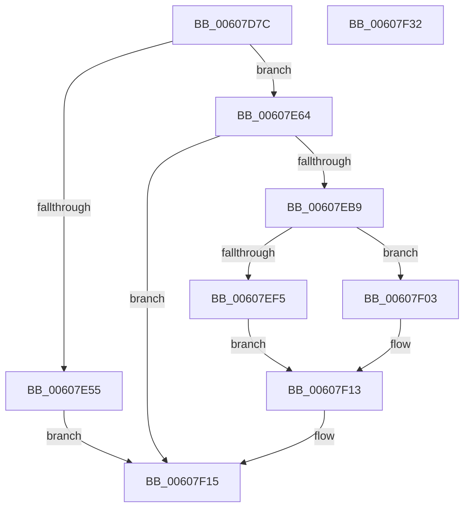

# SepAppIdentityFromPackageInformation

- RVA: `0x00607D7C`–`0x00607F33` (길이 `439` bytes)
- VA: `0x0000000140607D7C`
- 실행 섹션: `.text`
- PDB 이름 있음: `예`; PDB Function 태그: `아니요`
- unwind 정보 RVA: `0x000D0F48`
- 디코드: `111`개 명령, `439/439` bytes 표시
- 미해석 바이트: `0` (있으면 어셈블리에 `.byte`로 보존)

> 이 문서는 커널 이미지의 기계어와 PDB 기호를 분석해 생성했습니다. 4번과 5번은 함수 원형과 자료형을 바이너리 사용 방식에서 추정한 C 해석이며 원본 소스 복구 결과는 아닙니다.

## 1. Dependencies

- 직접 호출 지점: **15**; 고유 호출 대상: **9**
- 직접 호출자로 확인된 함수: **1**
- RIP 상대 이미지 참조: **1**

### Outgoing calls
- `0x00607DBD` → [memset](../6C/memset_function_006C6C40.md) (function, `0x006C6C40`)
- `0x00607DD6` → [memset](../6C/memset_function_006C6C40.md) (function, `0x006C6C40`)
- `0x00607DF3` → [memset](../6C/memset_function_006C6C40.md) (function, `0x006C6C40`)
- `0x00607E4C` → [RtlQueryPackageClaimsEx](../5E/RtlQueryPackageClaimsEx_function_005EDFE8.md) (function, `0x005EDFE8`)
- `0x00607E68` → [SymCryptSha256Init](../51/SymCryptSha256Init_function_0051E2C0.md) (function, `0x0051E2C0`)
- `0x00607E7A` → [SymCryptSha256Append](../51/SymCryptSha256Append_function_0051CB20.md) (function, `0x0051CB20`)
- `0x00607E8F` → [SymCryptSha256Append](../51/SymCryptSha256Append_function_0051CB20.md) (function, `0x0051CB20`)
- `0x00607E9C` → [SymCryptSha256Result](../51/SymCryptSha256Result_function_0051E2F0.md) (function, `0x0051E2F0`)
- `0x00607EB0` → [SepAppIdentityFromHash](SepAppIdentityFromHash_function_006079E4.md) (function, `0x006079E4`)
- `0x00607EBD` → [SymCryptSha256Init](../51/SymCryptSha256Init_function_0051E2C0.md) (function, `0x0051E2C0`)
- `0x00607ECF` → [SymCryptSha256Append](../51/SymCryptSha256Append_function_0051CB20.md) (function, `0x0051CB20`)
- `0x00607EDC` → [SymCryptSha256Result](../51/SymCryptSha256Result_function_0051E2F0.md) (function, `0x0051E2F0`)
- `0x00607EEA` → [SepAppSuiteFromHash](SepAppSuiteFromHash_function_00607F3C.md) (function, `0x00607F3C`)
- `0x00607EFC` → [ExFreePoolWithTag](../../poolcode/B8/ExFreePoolWithTag_function_00B82870.md) (function, `0x00B82870`)
- `0x00607F1F` → [_security_check_cookie](../6A/_security_check_cookie_function_006AC640.md) (function, `0x006AC640`)

### Direct callers
- [SeSetTokenTamperProtection](SeSetTokenTamperProtection_function_00609644.md) at `0x006096AE`

### Static image references
- `0x00607D92` → RVA `0x00E0A740` (`.data`; read)

## 2. Other-region calls and transfers

- 다른 실행 섹션으로 향하는 call: **1**
  - `0x00607EFC` → [ExFreePoolWithTag](../../poolcode/B8/ExFreePoolWithTag_function_00B82870.md) (`.text` → `POOLCODE`)
- 별도 외부 분기/꼬리 이동을 확인하지 못했습니다.

## 3. Assembly (complete function range)

```asm
00607D7C  40 55                           push rbp
00607D7E  53                              push rbx
00607D7F  56                              push rsi
00607D80  57                              push rdi
00607D81  41 56                           push r14
00607D83  48 8D AC 24 B0 FE FF FF         lea rbp, [rsp - 0x150]
00607D8B  48 81 EC 50 02 00 00            sub rsp, 0x250
00607D92  48 8B 05 A7 29 80 00            mov rax, qword ptr [rip + 0x8029a7]
00607D99  48 33 C4                        xor rax, rsp
00607D9C  48 89 85 40 01 00 00            mov qword ptr [rbp + 0x140], rax
00607DA3  4D 8B F0                        mov r14, r8
00607DA6  48 8B F2                        mov rsi, rdx
00607DA9  48 8B D9                        mov rbx, rcx
00607DAC  BF 84 00 00 00                  mov edi, 0x84
00607DB1  44 8B C7                        mov r8d, edi
00607DB4  48 8D 8D B0 00 00 00            lea rcx, [rbp + 0xb0]
00607DBB  33 D2                           xor edx, edx
00607DBD  E8 7E EE 0B 00                  call 0x1406c6c40
00607DC2  33 C0                           xor eax, eax
00607DC4  48 89 7C 24 60                  mov qword ptr [rsp + 0x60], rdi
00607DC9  33 D2                           xor edx, edx
00607DCB  89 45 84                        mov dword ptr [rbp - 0x7c], eax
00607DCE  44 8D 47 F8                     lea r8d, [rdi - 8]
00607DD2  48 8D 4D 80                     lea rcx, [rbp - 0x80]
00607DD6  E8 65 EE 0B 00                  call 0x1406c6c40
00607DDB  33 FF                           xor edi, edi
00607DDD  48 8D 4D 20                     lea rcx, [rbp + 0x20]
00607DE1  33 D2                           xor edx, edx
00607DE3  48 89 7C 24 58                  mov qword ptr [rsp + 0x58], rdi
00607DE8  41 B8 82 00 00 00               mov r8d, 0x82
00607DEE  48 89 7C 24 68                  mov qword ptr [rsp + 0x68], rdi
00607DF3  E8 48 EE 0B 00                  call 0x1406c6c40
00607DF8  48 8D 44 24 70                  lea rax, [rsp + 0x70]
00607DFD  48 89 3E                        mov qword ptr [rsi], rdi
00607E00  48 89 44 24 48                  mov qword ptr [rsp + 0x48], rax
00607E05  4C 8D 8D B0 00 00 00            lea r9, [rbp + 0xb0]
00607E0C  48 89 7C 24 40                  mov qword ptr [rsp + 0x40], rdi
00607E11  48 8D 44 24 50                  lea rax, [rsp + 0x50]
00607E16  48 89 7C 24 38                  mov qword ptr [rsp + 0x38], rdi
00607E1B  45 33 C0                        xor r8d, r8d
00607E1E  48 89 44 24 30                  mov qword ptr [rsp + 0x30], rax
00607E23  33 D2                           xor edx, edx
00607E25  48 8D 45 20                     lea rax, [rbp + 0x20]
00607E29  48 C7 44 24 50 82 00 00 00      mov qword ptr [rsp + 0x50], 0x82
00607E32  48 89 44 24 28                  mov qword ptr [rsp + 0x28], rax
00607E37  48 8B CB                        mov rcx, rbx
00607E3A  48 8D 44 24 60                  lea rax, [rsp + 0x60]
00607E3F  48 89 7C 24 70                  mov qword ptr [rsp + 0x70], rdi
00607E44  48 89 44 24 20                  mov qword ptr [rsp + 0x20], rax
00607E49  49 89 3E                        mov qword ptr [r14], rdi
00607E4C  E8 97 61 FE FF                  call 0x1405edfe8
00607E51  85 C0                           test eax, eax
00607E53  79 0F                           jns 0x140607e64
00607E55  3D 25 02 00 C0                  cmp eax, 0xc0000225
00607E5A  0F 45 F8                        cmovne edi, eax
00607E5D  8B C7                           mov eax, edi
00607E5F  E9 B1 00 00 00                  jmp 0x140607f15
00607E64  48 8D 4D 80                     lea rcx, [rbp - 0x80]
00607E68  E8 53 64 F1 FF                  call 0x14051e2c0
00607E6D  4C 8B 44 24 50                  mov r8, qword ptr [rsp + 0x50]
00607E72  48 8D 55 20                     lea rdx, [rbp + 0x20]
00607E76  48 8D 4D 80                     lea rcx, [rbp - 0x80]
00607E7A  E8 A1 4C F1 FF                  call 0x14051cb20
00607E7F  4C 8B 44 24 60                  mov r8, qword ptr [rsp + 0x60]
00607E84  48 8D 95 B0 00 00 00            lea rdx, [rbp + 0xb0]
00607E8B  48 8D 4D 80                     lea rcx, [rbp - 0x80]
00607E8F  E8 8C 4C F1 FF                  call 0x14051cb20
00607E94  48 8D 55 00                     lea rdx, [rbp]
00607E98  48 8D 4D 80                     lea rcx, [rbp - 0x80]
00607E9C  E8 4F 64 F1 FF                  call 0x14051e2f0
00607EA1  4C 8D 4C 24 58                  lea r9, [rsp + 0x58]
00607EA6  41 B8 01 00 00 00               mov r8d, 1
00607EAC  48 8D 4D 00                     lea rcx, [rbp]
00607EB0  E8 2F FB FF FF                  call 0x1406079e4
00607EB5  85 C0                           test eax, eax
00607EB7  78 5C                           js 0x140607f15
00607EB9  48 8D 4D 80                     lea rcx, [rbp - 0x80]
00607EBD  E8 FE 63 F1 FF                  call 0x14051e2c0
00607EC2  4C 8B 44 24 50                  mov r8, qword ptr [rsp + 0x50]
00607EC7  48 8D 55 20                     lea rdx, [rbp + 0x20]
00607ECB  48 8D 4D 80                     lea rcx, [rbp - 0x80]
00607ECF  E8 4C 4C F1 FF                  call 0x14051cb20
00607ED4  48 8D 55 00                     lea rdx, [rbp]
00607ED8  48 8D 4D 80                     lea rcx, [rbp - 0x80]
00607EDC  E8 0F 64 F1 FF                  call 0x14051e2f0
00607EE1  4C 8D 44 24 68                  lea r8, [rsp + 0x68]
00607EE6  48 8D 4D 00                     lea rcx, [rbp]
00607EEA  E8 4D 00 00 00                  call 0x140607f3c
00607EEF  8B D8                           mov ebx, eax
00607EF1  85 C0                           test eax, eax
00607EF3  79 0E                           jns 0x140607f03
00607EF5  48 8B 4C 24 58                  mov rcx, qword ptr [rsp + 0x58]
00607EFA  33 D2                           xor edx, edx
00607EFC  E8 6F A9 57 00                  call 0x140b82870
00607F01  EB 10                           jmp 0x140607f13
00607F03  48 8B 44 24 58                  mov rax, qword ptr [rsp + 0x58]
00607F08  48 89 06                        mov qword ptr [rsi], rax
00607F0B  48 8B 44 24 68                  mov rax, qword ptr [rsp + 0x68]
00607F10  49 89 06                        mov qword ptr [r14], rax
00607F13  8B C3                           mov eax, ebx
00607F15  48 8B 8D 40 01 00 00            mov rcx, qword ptr [rbp + 0x140]
00607F1C  48 33 CC                        xor rcx, rsp
00607F1F  E8 1C 47 0A 00                  call 0x1406ac640
00607F24  48 81 C4 50 02 00 00            add rsp, 0x250
00607F2B  41 5E                           pop r14
00607F2D  5F                              pop rdi
00607F2E  5E                              pop rsi
00607F2F  5B                              pop rbx
00607F30  5D                              pop rbp
00607F31  C3                              ret
00607F32  CC                              int3
```

## 4. C-style interpretation (structured pseudocode)

```c
__int64 __fastcall SepAppIdentityFromPackageInformation(__int64 a1, __int64 a2, __int64 a3)
{
    __int64 result;
    __int64 v_rdi;
    __int64 v_rsp;
    unsigned __int64 v_stack_m158;
    unsigned __int64 v_stack_m178;
    unsigned int v_stack_m1F4;
    unsigned __int64 v_stack_m1F8;
    unsigned __int64 v_stack_m208;
    unsigned __int64 v_stack_m210;
    unsigned __int64 v_stack_m218;
    unsigned __int64 v_stack_m220;
    unsigned __int64 v_stack_m228;
    unsigned __int64 v_stack_m230;
    unsigned __int64 v_stack_m238;
    unsigned __int64 v_stack_m240;
    unsigned __int64 v_stack_m248;
    unsigned __int64 v_stack_m250;
    unsigned __int64 v_stack_m258;
    unsigned __int64 v_stack_m38;
    unsigned __int64 v_stack_mC8;

    v_rsp = (v_rsp) - (592);
    result = (*(unsigned __int64 *)(v_rip + 8399271)) ^ (v_rsp);
    v_stack_m38 = result;
    a2 = 0;
    result = memset(v_stack_mC8, a2, 132, a4);
    result = 0;
    v_stack_m218 = 132;
    a2 = 0;
    v_stack_m1F4 = 0;
    result = memset(v_stack_m1F8, a2, 132 - 8, a4);
    v_rdi = 0;
    a2 = 0;
    v_stack_m220 = 0;
    v_stack_m210 = 0;
    result = memset(v_stack_m158, a2, 130, a4);
    *(unsigned __int64 *)(a2) = 0;
    v_stack_m230 = v_stack_m208;
    v_stack_m238 = 0;
    v_stack_m240 = 0;
    a3 = 0;
    v_stack_m248 = v_stack_m228;
    a2 = 0;
    v_stack_m228 = 130;
    v_stack_m250 = v_stack_m158;
    v_stack_m208 = 0;
    v_stack_m258 = v_stack_m218;
    *(unsigned __int64 *)(a3) = 0;
    result = RtlQueryPackageClaimsEx(a1, a2, a3, v_stack_mC8);
    if (!sign_flag) goto loc_00607E64;
    if (((unsigned int)(result)) != 0xC0000225ULL) { v_rdi = (unsigned int)(result); }
    goto loc_00607F15;
loc_00607E64:
    result = SymCryptSha256Init(v_stack_m1F8, a2, a3, v_stack_mC8);
    result = SymCryptSha256Append(v_stack_m1F8, v_stack_m158, v_stack_m228, v_stack_mC8);
    result = SymCryptSha256Append(v_stack_m1F8, v_stack_mC8, v_stack_m218, v_stack_mC8);
    result = SymCryptSha256Result(v_stack_m1F8, v_stack_m178, v_stack_m218, v_stack_mC8);
    result = SepAppIdentityFromHash(v_stack_m178, v_stack_m178, 1, v_stack_m220);
    if (sign_flag) goto loc_00607F15;
    result = SymCryptSha256Init(v_stack_m1F8, v_stack_m178, 1, v_stack_m220);
    result = SymCryptSha256Append(v_stack_m1F8, v_stack_m158, v_stack_m228, v_stack_m220);
    result = SymCryptSha256Result(v_stack_m1F8, v_stack_m178, v_stack_m228, v_stack_m220);
    result = SepAppSuiteFromHash(v_stack_m178, v_stack_m178, v_stack_m210, v_stack_m220);
    if (!sign_flag) goto loc_00607F03;
    a2 = 0;
    result = ExFreePoolWithTag(v_stack_m220, a2, v_stack_m210, v_stack_m220);
    goto loc_00607F13;
loc_00607F03:
    *(unsigned __int64 *)(a2) = v_stack_m220;
    *(unsigned __int64 *)(a3) = v_stack_m210;
loc_00607F13:
loc_00607F15:
    a1 = (v_stack_m38) ^ (v_rsp);
    result = _security_check_cookie(a1, a2, v_stack_m210, v_stack_m220);
    v_rsp = (v_rsp) + (592);
    return result;
}
```

## 5. (Beta) C Style

```c
int64_t SepAppIdentityFromPackageInformation(int64_t Arg1, void *Arg2, void *Arg3)
{
    uint8_t *arg2 = (uint8_t *)Arg2;
    uint8_t *arg3 = (uint8_t *)Arg3;

    int64_t result;
    int64_t local_rdi;
    int64_t local_rsp;
    uint64_t v_stack_m158;
    uint64_t v_stack_m178;
    uint32_t v_stack_m1F4;
    uint64_t v_stack_m1F8;
    uint64_t v_stack_m208;
    uint64_t v_stack_m210;
    uint64_t v_stack_m218;
    uint64_t v_stack_m220;
    uint64_t v_stack_m228;
    uint64_t v_stack_m230;
    uint64_t v_stack_m238;
    uint64_t v_stack_m240;
    uint64_t v_stack_m248;
    uint64_t v_stack_m250;
    uint64_t v_stack_m258;
    uint64_t v_stack_m38;
    uint64_t v_stack_mC8;

    local_rsp = (local_rsp) - (592);
    result = (*(uint64_t *)(v_rip + 0x8029A7)) ^ (local_rsp);
    v_stack_m38 = result;
    Arg2 = 0;
    result = memset(v_stack_mC8, Arg2, 132, a4);
    result = 0;
    v_stack_m218 = 132;
    Arg2 = 0;
    v_stack_m1F4 = 0;
    result = memset(v_stack_m1F8, Arg2, 132 - 8, a4);
    local_rdi = 0;
    Arg2 = 0;
    v_stack_m220 = 0;
    v_stack_m210 = 0;
    result = memset(v_stack_m158, Arg2, 130, a4);
    *(uint64_t *)(arg2) = 0;
    v_stack_m230 = v_stack_m208;
    v_stack_m238 = 0;
    v_stack_m240 = 0;
    Arg3 = 0;
    v_stack_m248 = v_stack_m228;
    Arg2 = 0;
    v_stack_m228 = 130;
    v_stack_m250 = v_stack_m158;
    v_stack_m208 = 0;
    v_stack_m258 = v_stack_m218;
    *(uint64_t *)(arg3) = 0;
    result = RtlQueryPackageClaimsEx(Arg1, Arg2, Arg3, v_stack_mC8);
    if (!sign_flag) goto loc_00607E64;
    if (((uint32_t)(result)) != 0xC0000225ULL) { local_rdi = (uint32_t)(result); }
    goto loc_00607F15;
loc_00607E64:
    result = SymCryptSha256Init(v_stack_m1F8, Arg2, Arg3, v_stack_mC8);
    result = SymCryptSha256Append(v_stack_m1F8, v_stack_m158, v_stack_m228, v_stack_mC8);
    result = SymCryptSha256Append(v_stack_m1F8, v_stack_mC8, v_stack_m218, v_stack_mC8);
    result = SymCryptSha256Result(v_stack_m1F8, v_stack_m178, v_stack_m218, v_stack_mC8);
    result = SepAppIdentityFromHash(v_stack_m178, v_stack_m178, 1, v_stack_m220);
    if (sign_flag) goto loc_00607F15;
    result = SymCryptSha256Init(v_stack_m1F8, v_stack_m178, 1, v_stack_m220);
    result = SymCryptSha256Append(v_stack_m1F8, v_stack_m158, v_stack_m228, v_stack_m220);
    result = SymCryptSha256Result(v_stack_m1F8, v_stack_m178, v_stack_m228, v_stack_m220);
    result = SepAppSuiteFromHash(v_stack_m178, v_stack_m178, v_stack_m210, v_stack_m220);
    if (!sign_flag) goto loc_00607F03;
    Arg2 = 0;
    result = ExFreePoolWithTag(v_stack_m220, Arg2, v_stack_m210, v_stack_m220);
    goto loc_00607F13;
loc_00607F03:
    *(uint64_t *)(arg2) = v_stack_m220;
    *(uint64_t *)(arg3) = v_stack_m210;
loc_00607F13:
loc_00607F15:
    Arg1 = (v_stack_m38) ^ (local_rsp);
    result = _security_check_cookie(Arg1, Arg2, v_stack_m210, v_stack_m220);
    local_rsp = (local_rsp) + (592);
    return result;
}
```

### 관측된 메모리 오프셋

구조체 형식이 확인되지 않은 접근은 인자 기준의 오프셋으로만 기록했습니다.

| 기준 인자 | 오프셋 표현 | 폭 (bit) | 접근 |
|---|---:|---:|---|
| `Arg2` | `+ 0x0` | `64` | `W` |
| `Arg3` | `+ 0x0` | `64` | `W` |

## 6. Execution-region graph

[열기: 2D/3D 그래프와 함수 탐색 컨트롤 패널](../../../control-panel.html?section=text&rva=0x00607D7C&view=graph)

- 2D 그래프는 위에서 아래로 흐르고, 3D 그래프는 빈 공간을 드래그해 회전합니다. Shift+드래그는 이동, 휠은 확대·축소, 함수 노드 선택은 대상 보고서 이동입니다.

### Static fallback


