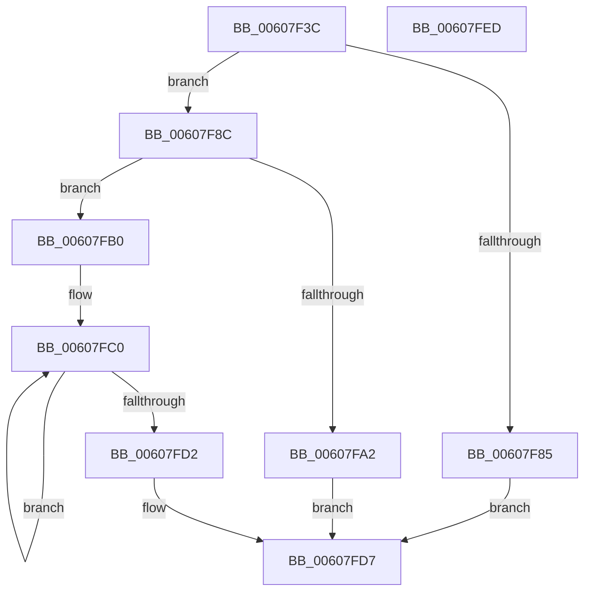

# SepAppSuiteFromHash

- RVA: `0x00607F3C`–`0x00607FEE` (길이 `178` bytes)
- VA: `0x0000000140607F3C`
- 실행 섹션: `.text`
- PDB 이름 있음: `예`; PDB Function 태그: `아니요`
- unwind 정보 RVA: `0x0006F978`
- 디코드: `51`개 명령, `178/178` bytes 표시
- 미해석 바이트: `0` (있으면 어셈블리에 `.byte`로 보존)

> 이 문서는 커널 이미지의 기계어와 PDB 기호를 분석해 생성했습니다. 4번과 5번은 함수 원형과 자료형을 바이너리 사용 방식에서 추정한 C 해석이며 원본 소스 복구 결과는 아닙니다.

## 1. Dependencies

- 직접 호출 지점: **4**; 고유 호출 대상: **4**
- 직접 호출자로 확인된 함수: **1**
- RIP 상대 이미지 참조: **0**

### Outgoing calls
- `0x00607F66` → [RtlLengthRequiredSid](../../page/9C/RtlLengthRequiredSid_function_009CA4D0.md) (function, `0x009CA4D0`)
- `0x00607F78` → [ExAllocatePool2](../../poolcode/B8/ExAllocatePool2_function_00B820F0.md) (function, `0x00B820F0`)
- `0x00607F97` → [RtlInitializeSid](../../page/9E/RtlInitializeSid_function_009EB720.md) (function, `0x009EB720`)
- `0x00607FA7` → [ExFreePoolWithTag](../../poolcode/B8/ExFreePoolWithTag_function_00B82870.md) (function, `0x00B82870`)

### Direct callers
- [SepAppIdentityFromPackageInformation](SepAppIdentityFromPackageInformation_function_00607D7C.md) at `0x00607EEA`

### Static image references
- 디코드된 RIP-relative 메모리 참조가 없습니다.

## 2. Other-region calls and transfers

- 다른 실행 섹션으로 향하는 call: **4**
  - `0x00607F66` → [RtlLengthRequiredSid](../../page/9C/RtlLengthRequiredSid_function_009CA4D0.md) (`.text` → `PAGE`)
  - `0x00607F78` → [ExAllocatePool2](../../poolcode/B8/ExAllocatePool2_function_00B820F0.md) (`.text` → `POOLCODE`)
  - `0x00607F97` → [RtlInitializeSid](../../page/9E/RtlInitializeSid_function_009EB720.md) (`.text` → `PAGE`)
  - `0x00607FA7` → [ExFreePoolWithTag](../../poolcode/B8/ExFreePoolWithTag_function_00B82870.md) (`.text` → `POOLCODE`)
- 별도 외부 분기/꼬리 이동을 확인하지 못했습니다.

## 3. Assembly (complete function range)

```asm
00607F3C  48 8B C4                        mov rax, rsp
00607F3F  48 89 58 08                     mov qword ptr [rax + 8], rbx
00607F43  48 89 70 10                     mov qword ptr [rax + 0x10], rsi
00607F47  48 89 78 18                     mov qword ptr [rax + 0x18], rdi
00607F4B  41 56                           push r14
00607F4D  48 83 EC 20                     sub rsp, 0x20
00607F51  83 60 20 00                     and dword ptr [rax + 0x20], 0
00607F55  48 8B F9                        mov rdi, rcx
00607F58  B9 08 00 00 00                  mov ecx, 8
00607F5D  66 C7 40 24 00 14               mov word ptr [rax + 0x24], 0x1400
00607F63  4D 8B F0                        mov r14, r8
00607F66  E8 65 25 3C 00                  call 0x1409ca4d0
00607F6B  8B D0                           mov edx, eax
00607F6D  B9 00 01 00 00                  mov ecx, 0x100
00607F72  41 B8 53 65 53 69               mov r8d, 0x69536553
00607F78  E8 73 A1 57 00                  call 0x140b820f0
00607F7D  48 8B D8                        mov rbx, rax
00607F80  48 85 C0                        test rax, rax
00607F83  75 07                           jne 0x140607f8c
00607F85  B8 17 00 00 C0                  mov eax, 0xc0000017
00607F8A  EB 4B                           jmp 0x140607fd7
00607F8C  41 B0 08                        mov r8b, 8
00607F8F  48 8D 54 24 48                  lea rdx, [rsp + 0x48]
00607F94  48 8B CB                        mov rcx, rbx
00607F97  E8 84 37 3E 00                  call 0x1409eb720
00607F9C  8B F0                           mov esi, eax
00607F9E  85 C0                           test eax, eax
00607FA0  79 0E                           jns 0x140607fb0
00607FA2  33 D2                           xor edx, edx
00607FA4  48 8B CB                        mov rcx, rbx
00607FA7  E8 C4 A8 57 00                  call 0x140b82870
00607FAC  8B C6                           mov eax, esi
00607FAE  EB 27                           jmp 0x140607fd7
00607FB0  C7 43 08 05 00 00 00            mov dword ptr [rbx + 8], 5
00607FB7  48 8D 4B 0C                     lea rcx, [rbx + 0xc]
00607FBB  BA 07 00 00 00                  mov edx, 7
00607FC0  8B 07                           mov eax, dword ptr [rdi]
00607FC2  48 8D 7F 04                     lea rdi, [rdi + 4]
00607FC6  89 01                           mov dword ptr [rcx], eax
00607FC8  48 8D 49 04                     lea rcx, [rcx + 4]
00607FCC  48 83 EA 01                     sub rdx, 1
00607FD0  75 EE                           jne 0x140607fc0
00607FD2  49 89 1E                        mov qword ptr [r14], rbx
00607FD5  33 C0                           xor eax, eax
00607FD7  48 8B 5C 24 30                  mov rbx, qword ptr [rsp + 0x30]
00607FDC  48 8B 74 24 38                  mov rsi, qword ptr [rsp + 0x38]
00607FE1  48 8B 7C 24 40                  mov rdi, qword ptr [rsp + 0x40]
00607FE6  48 83 C4 20                     add rsp, 0x20
00607FEA  41 5E                           pop r14
00607FEC  C3                              ret
00607FED  CC                              int3
```

## 4. C-style interpretation (structured pseudocode)

```c
__int64 __fastcall SepAppSuiteFromHash(__int64 a1, __int64 a2, __int64 a3)
{
    __int64 result;
    __int64 v_rsp;
    unsigned __int64 v_stack_p10;
    unsigned __int64 v_stack_p18;
    unsigned __int64 v_stack_p20;
    unsigned __int64 v_stack_p8;

    *(unsigned __int64 *)(v_rsp + 8) = v_rbx;
    *(unsigned __int64 *)(v_rsp + 16) = v_rsi;
    *(unsigned __int64 *)(v_rsp + 24) = v_rdi;
    v_rsp = (v_rsp) - (32);
    *(unsigned __int16 *)(v_rsp + 36) = 0x1400ULL;
    result = RtlLengthRequiredSid(8, a2, a3, a4);
    result = ExAllocatePool2(256, (unsigned int)((unsigned int)(result)), (unsigned int)(0x69536553ULL), a4);
    if (result != 0) goto loc_00607F8C;
    goto loc_00607FD7;
loc_00607F8C:
    result = RtlInitializeSid(result, v_stack_p20, 8, a4);
    if (!sign_flag) goto loc_00607FB0;
    a2 = 0;
    result = ExFreePoolWithTag(result, a2, 8, a4);
    goto loc_00607FD7;
loc_00607FB0:
    *(unsigned int *)(result + 8) = 5;
loc_00607FC0:
    *(unsigned int *)(result + 12) = (unsigned int)((unsigned int)(*(unsigned int *)(a1)));
    a2 = (7) - (1);
    if (condition_is_not_equal) goto loc_00607FC0;
    *(unsigned __int64 *)(a3) = result;
    result = 0;
loc_00607FD7:
    v_rsp = (v_rsp) + (32);
    return result;
}
```

## 5. (Beta) C Style

```c
int64_t SepAppSuiteFromHash(void *Arg1, int64_t Arg2, void *Arg3)
{
    uint8_t *arg1 = (uint8_t *)Arg1;
    uint8_t *arg3 = (uint8_t *)Arg3;

    int64_t result;
    int64_t local_rsp;
    uint64_t v_stack_p10;
    uint64_t v_stack_p18;
    uint64_t v_stack_p20;
    uint64_t v_stack_p8;

    *(uint64_t *)(local_rsp + 0x8) = local_rbx;
    *(uint64_t *)(local_rsp + 0x10) = local_rsi;
    *(uint64_t *)(local_rsp + 0x18) = local_rdi;
    local_rsp = (local_rsp) - (32);
    *(uint16_t *)(local_rsp + 0x24) = 0x1400ULL;
    result = RtlLengthRequiredSid(8, Arg2, Arg3, a4);
    result = ExAllocatePool2(256, (uint32_t)((uint32_t)(result)), (uint32_t)(0x69536553ULL), a4);
    if (result != 0) goto loc_00607F8C;
    goto loc_00607FD7;
loc_00607F8C:
    result = RtlInitializeSid(result, v_stack_p20, 8, a4);
    if (!sign_flag) goto loc_00607FB0;
    Arg2 = 0;
    result = ExFreePoolWithTag(result, Arg2, 8, a4);
    goto loc_00607FD7;
loc_00607FB0:
    *(uint32_t *)(result + 0x8) = 5;
loc_00607FC0:
    *(uint32_t *)(result + 0xC) = (uint32_t)((uint32_t)(*(uint32_t *)(arg1)));
    Arg2 = (7) - (1);
    if (condition_is_not_equal) goto loc_00607FC0;
    *(uint64_t *)(arg3) = result;
    result = 0;
loc_00607FD7:
    local_rsp = (local_rsp) + (32);
    return result;
}
```

### 관측된 메모리 오프셋

구조체 형식이 확인되지 않은 접근은 인자 기준의 오프셋으로만 기록했습니다.

| 기준 인자 | 오프셋 표현 | 폭 (bit) | 접근 |
|---|---:|---:|---|
| `Arg1` | `+ 0x0` | `32` | `R` |
| `Arg1` | `+ 0x4` | `64` | `R` |
| `Arg3` | `+ 0x0` | `64` | `W` |

## 6. Execution-region graph

[열기: 2D/3D 그래프와 함수 탐색 컨트롤 패널](../../../control-panel.html?section=text&rva=0x00607F3C&view=graph)

- 2D 그래프는 위에서 아래로 흐르고, 3D 그래프는 빈 공간을 드래그해 회전합니다. Shift+드래그는 이동, 휠은 확대·축소, 함수 노드 선택은 대상 보고서 이동입니다.

### Static fallback


