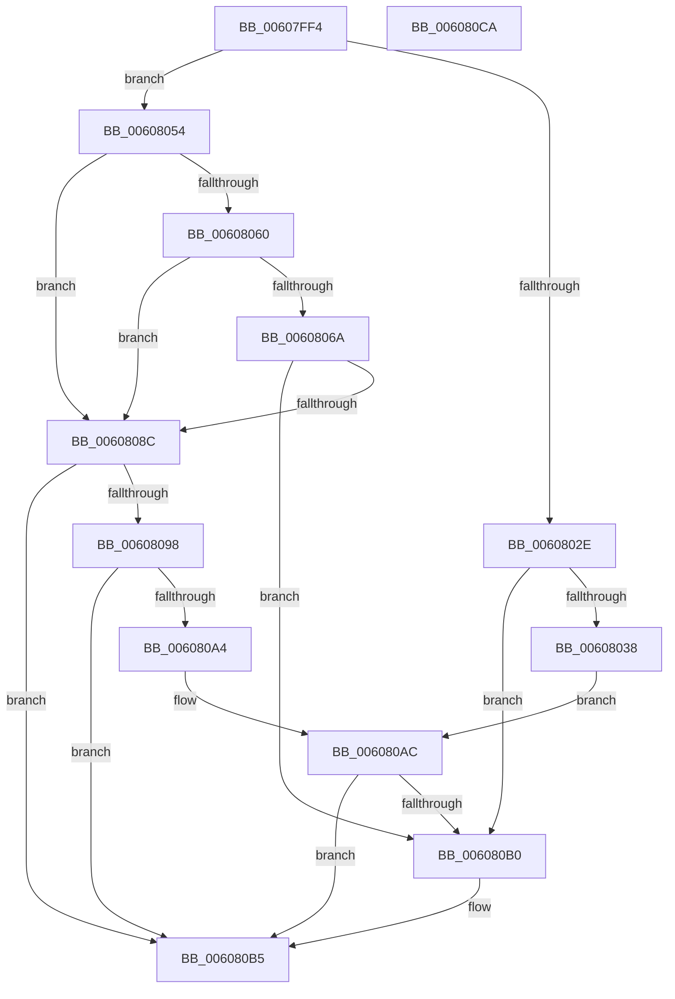

# SepApplyMandatoryAccess

- RVA: `0x00607FF4`–`0x006080CB` (길이 `215` bytes)
- VA: `0x0000000140607FF4`
- 실행 섹션: `.text`
- PDB 이름 있음: `예`; PDB Function 태그: `아니요`
- unwind 정보 RVA: `0x00066400`
- 디코드: `64`개 명령, `215/215` bytes 표시
- 미해석 바이트: `0` (있으면 어셈블리에 `.byte`로 보존)

> 이 문서는 커널 이미지의 기계어와 PDB 기호를 분석해 생성했습니다. 4번과 5번은 함수 원형과 자료형을 바이너리 사용 방식에서 추정한 C 해석이며 원본 소스 복구 결과는 아닙니다.

## 1. Dependencies

- 직접 호출 지점: **6**; 고유 호출 대상: **5**
- 직접 호출자로 확인된 함수: **1**
- RIP 상대 이미지 참조: **0**

### Outgoing calls
- `0x00608025` → [SepSidInToken](../3D/SepSidInToken_function_003D0430.md) (function, `0x003D0430`)
- `0x0060804D` → [SepSidInToken](../3D/SepSidInToken_function_003D0430.md) (function, `0x003D0430`)
- `0x00608057` → [RtlIsValidAntiTamperSid](../5E/RtlIsValidAntiTamperSid_function_005E720C.md) (function, `0x005E720C`)
- `0x00608083` → [SepSidInTokenSidHash](../3C/SepSidInTokenSidHash_function_003C85E0.md) (function, `0x003C85E0`)
- `0x0060808F` → [SepIsTrustLabelSid](SepIsTrustLabelSid_function_00608408.md) (function, `0x00608408`)
- `0x006080A7` → [RtlEqualSid](../40/RtlEqualSid_function_00400AD0.md) (function, `0x00400AD0`)

### Direct callers
- [SepMandatoryAccessCheck](SepMandatoryAccessCheck_function_00608480.md) at `0x006085B0`

### Static image references
- 디코드된 RIP-relative 메모리 참조가 없습니다.

## 2. Other-region calls and transfers

- 다른 실행 섹션으로 향하는 call: **0**
- 별도 외부 분기/꼬리 이동을 확인하지 못했습니다.

## 3. Assembly (complete function range)

```asm
00607FF4  48 8B C4                        mov rax, rsp
00607FF7  48 89 58 08                     mov qword ptr [rax + 8], rbx
00607FFB  48 89 68 10                     mov qword ptr [rax + 0x10], rbp
00607FFF  48 89 70 18                     mov qword ptr [rax + 0x18], rsi
00608003  57                              push rdi
00608004  48 83 EC 30                     sub rsp, 0x30
00608008  48 8D 72 08                     lea rsi, [rdx + 8]
0060800C  C6 40 F0 00                     mov byte ptr [rax - 0x10], 0
00608010  49 8B D8                        mov rbx, r8
00608013  C6 40 E8 00                     mov byte ptr [rax - 0x18], 0
00608017  48 8B EA                        mov rbp, rdx
0060801A  4C 8B C6                        mov r8, rsi
0060801D  45 33 C9                        xor r9d, r9d
00608020  33 D2                           xor edx, edx
00608022  48 8B F9                        mov rdi, rcx
00608025  E8 06 84 DC FF                  call 0x1403d0430
0060802A  84 C0                           test al, al
0060802C  74 26                           je 0x140608054
0060802E  8B 87 C8 00 00 00               mov eax, dword ptr [rdi + 0xc8]
00608034  A8 10                           test al, 0x10
00608036  74 78                           je 0x1406080b0
00608038  C6 44 24 28 00                  mov byte ptr [rsp + 0x28], 0
0060803D  45 33 C9                        xor r9d, r9d
00608040  4C 8B C6                        mov r8, rsi
00608043  C6 44 24 20 01                  mov byte ptr [rsp + 0x20], 1
00608048  33 D2                           xor edx, edx
0060804A  48 8B CF                        mov rcx, rdi
0060804D  E8 DE 83 DC FF                  call 0x1403d0430
00608052  EB 58                           jmp 0x1406080ac
00608054  48 8B CE                        mov rcx, rsi
00608057  E8 B0 F1 FD FF                  call 0x1405e720c
0060805C  84 C0                           test al, al
0060805E  74 2C                           je 0x14060808c
00608060  48 83 BF 98 04 00 00 00         cmp qword ptr [rdi + 0x498], 0
00608068  74 22                           je 0x14060808c
0060806A  48 8D 8F A8 04 00 00            lea rcx, [rdi + 0x4a8]
00608071  C6 44 24 28 00                  mov byte ptr [rsp + 0x28], 0
00608076  45 33 C9                        xor r9d, r9d
00608079  C6 44 24 20 00                  mov byte ptr [rsp + 0x20], 0
0060807E  4C 8B C6                        mov r8, rsi
00608081  33 D2                           xor edx, edx
00608083  E8 58 05 DC FF                  call 0x1403c85e0
00608088  84 C0                           test al, al
0060808A  75 24                           jne 0x1406080b0
0060808C  48 8B CE                        mov rcx, rsi
0060808F  E8 74 03 00 00                  call 0x140608408
00608094  84 C0                           test al, al
00608096  74 1D                           je 0x1406080b5
00608098  48 8B 97 50 04 00 00            mov rdx, qword ptr [rdi + 0x450]
0060809F  48 85 D2                        test rdx, rdx
006080A2  74 11                           je 0x1406080b5
006080A4  48 8B CE                        mov rcx, rsi
006080A7  E8 24 8A DF FF                  call 0x140400ad0
006080AC  84 C0                           test al, al
006080AE  74 05                           je 0x1406080b5
006080B0  8B 45 04                        mov eax, dword ptr [rbp + 4]
006080B3  09 03                           or dword ptr [rbx], eax
006080B5  48 8B 5C 24 40                  mov rbx, qword ptr [rsp + 0x40]
006080BA  48 8B 6C 24 48                  mov rbp, qword ptr [rsp + 0x48]
006080BF  48 8B 74 24 50                  mov rsi, qword ptr [rsp + 0x50]
006080C4  48 83 C4 30                     add rsp, 0x30
006080C8  5F                              pop rdi
006080C9  C3                              ret
006080CA  CC                              int3
```

## 4. C-style interpretation (structured pseudocode)

```c
__int64 __fastcall SepApplyMandatoryAccess(__int64 a1, __int64 a2, __int64 a3, int a4)
{
    __int64 result;
    __int64 v_rsp;
    unsigned __int8 v_stack_m10;
    unsigned __int8 v_stack_m18;
    unsigned __int64 v_stack_p10;
    unsigned __int64 v_stack_p18;
    unsigned __int64 v_stack_p8;

    *(unsigned __int64 *)(v_rsp + 8) = v_rbx;
    *(unsigned __int64 *)(v_rsp + 16) = v_rbp;
    *(unsigned __int64 *)(v_rsp + 24) = v_rsi;
    v_rsp = (v_rsp) - (48);
    *(unsigned __int8 *)(v_rsp - 16) = 0;
    *(unsigned __int8 *)(v_rsp - 24) = 0;
    a4 = 0;
    a2 = 0;
    result = SepSidInToken(a1, a2, a2 + 8, a4);
    if ((unsigned __int8)(result) == 0) goto loc_00608054;
    if ((((unsigned __int8)((unsigned int)(*(unsigned int *)(a1 + 200)))) & (16)) == 0) goto loc_006080B0;
    v_stack_m10 = 0;
    a4 = 0;
    v_stack_m18 = 1;
    a2 = 0;
    result = SepSidInToken(a1, a2, a2 + 8, a4);
    goto loc_006080AC;
loc_00608054:
    result = RtlIsValidAntiTamperSid(a2 + 8, a2, a2 + 8, a4);
    if ((unsigned __int8)(result) == 0) goto loc_0060808C;
    if ((*(unsigned __int64 *)(a1 + 1176)) == 0) goto loc_0060808C;
    v_stack_m10 = 0;
    a4 = 0;
    v_stack_m18 = 0;
    a2 = 0;
    result = SepSidInTokenSidHash(a1 + 1192, a2, a2 + 8, a4);
    if ((unsigned __int8)(result) != 0) goto loc_006080B0;
loc_0060808C:
    result = SepIsTrustLabelSid(a2 + 8, a2, a2 + 8, a4);
    if ((unsigned __int8)(result) == 0) goto loc_006080B5;
    if (*(unsigned __int64 *)(a1 + 1104) == 0) goto loc_006080B5;
    result = RtlEqualSid(a2 + 8, *(unsigned __int64 *)(a1 + 1104), a2 + 8, a4);
loc_006080AC:
    if ((unsigned __int8)(result) != 0) {
        result = *(unsigned int *)(a2 + 4);
    }
    v_rsp = (v_rsp) + (48);
    return result;
}
```

## 5. (Beta) C Style

```c
int64_t SepApplyMandatoryAccess(void *Arg1, void *Arg2, void *Arg3, int32_t Arg4)
{
    uint8_t *arg1 = (uint8_t *)Arg1;
    uint8_t *arg2 = (uint8_t *)Arg2;
    uint8_t *arg3 = (uint8_t *)Arg3;

    int64_t result;
    int64_t local_rsp;
    uint8_t v_stack_m10;
    uint8_t v_stack_m18;
    uint64_t v_stack_p10;
    uint64_t v_stack_p18;
    uint64_t v_stack_p8;

    *(uint64_t *)(local_rsp + 0x8) = local_rbx;
    *(uint64_t *)(local_rsp + 0x10) = local_rbp;
    *(uint64_t *)(local_rsp + 0x18) = local_rsi;
    local_rsp = (local_rsp) - (48);
    *(uint8_t *)(local_rsp - 0x10) = 0;
    *(uint8_t *)(local_rsp - 0x18) = 0;
    Arg4 = 0;
    Arg2 = 0;
    result = SepSidInToken(Arg1, Arg2, Arg2 + 8, Arg4);
    if ((uint8_t)(result) == 0) goto loc_00608054;
    if ((((uint8_t)((uint32_t)(*(uint32_t *)(arg1 + 0xC8)))) & (16)) == 0) goto loc_006080B0;
    v_stack_m10 = 0;
    Arg4 = 0;
    v_stack_m18 = 1;
    Arg2 = 0;
    result = SepSidInToken(Arg1, Arg2, Arg2 + 8, Arg4);
    goto loc_006080AC;
loc_00608054:
    result = RtlIsValidAntiTamperSid(Arg2 + 8, Arg2, Arg2 + 8, Arg4);
    if ((uint8_t)(result) == 0) goto loc_0060808C;
    if ((*(uint64_t *)(arg1 + 0x498)) == 0) goto loc_0060808C;
    v_stack_m10 = 0;
    Arg4 = 0;
    v_stack_m18 = 0;
    Arg2 = 0;
    result = SepSidInTokenSidHash(Arg1 + 1192, Arg2, Arg2 + 8, Arg4);
    if ((uint8_t)(result) != 0) goto loc_006080B0;
loc_0060808C:
    result = SepIsTrustLabelSid(Arg2 + 8, Arg2, Arg2 + 8, Arg4);
    if ((uint8_t)(result) == 0) goto loc_006080B5;
    if (*(uint64_t *)(arg1 + 0x450) == 0) goto loc_006080B5;
    result = RtlEqualSid(Arg2 + 8, *(uint64_t *)(arg1 + 0x450), Arg2 + 8, Arg4);
loc_006080AC:
    if ((uint8_t)(result) != 0) {
        result = *(uint32_t *)(arg2 + 0x4);
    }
    local_rsp = (local_rsp) + (48);
    return result;
}
```

### 관측된 메모리 오프셋

구조체 형식이 확인되지 않은 접근은 인자 기준의 오프셋으로만 기록했습니다.

| 기준 인자 | 오프셋 표현 | 폭 (bit) | 접근 |
|---|---:|---:|---|
| `Arg1` | `+ 0xC8` | `32` | `R` |
| `Arg1` | `+ 0x450` | `64` | `R` |
| `Arg1` | `+ 0x498` | `64` | `R` |
| `Arg1` | `+ 0x4A8` | `64` | `R` |
| `Arg2` | `+ 0x4` | `32` | `R` |
| `Arg2` | `+ 0x8` | `64` | `R` |
| `Arg3` | `+ 0x0` | `32` | `R/W` |

## 6. Execution-region graph

[열기: 2D/3D 그래프와 함수 탐색 컨트롤 패널](../../../control-panel.html?section=text&rva=0x00607FF4&view=graph)

- 2D 그래프는 위에서 아래로 흐르고, 3D 그래프는 빈 공간을 드래그해 회전합니다. Shift+드래그는 이동, 휠은 확대·축소, 함수 노드 선택은 대상 보고서 이동입니다.

### Static fallback


