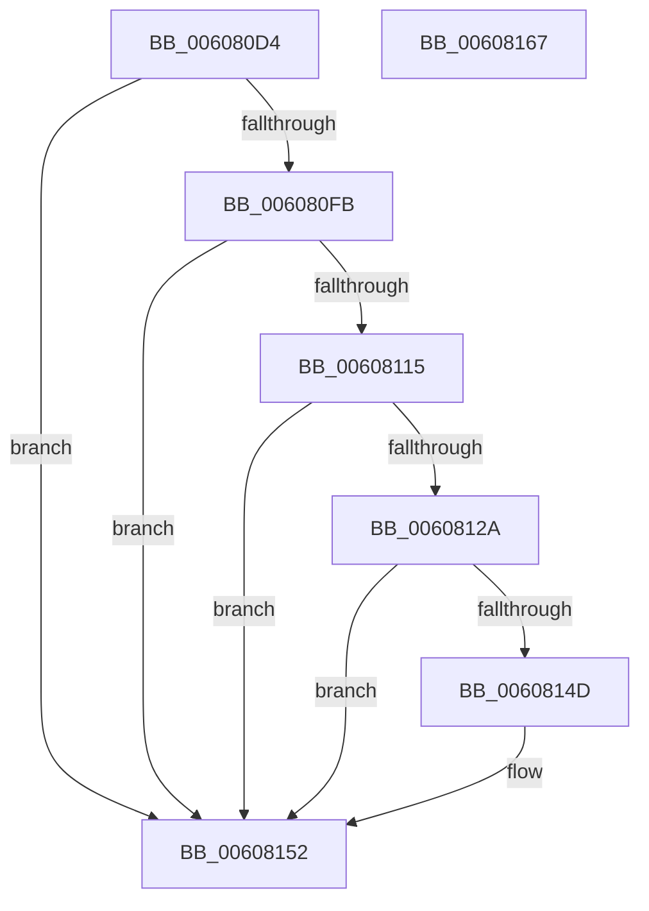

# SepApplyMandatoryAppAccess

- RVA: `0x006080D4`–`0x00608168` (길이 `148` bytes)
- VA: `0x00000001406080D4`
- 실행 섹션: `.text`
- PDB 이름 있음: `예`; PDB Function 태그: `아니요`
- unwind 정보 RVA: `0x00066400`
- 디코드: `43`개 명령, `148/148` bytes 표시
- 미해석 바이트: `0` (있으면 어셈블리에 `.byte`로 보존)

> 이 문서는 커널 이미지의 기계어와 PDB 기호를 분석해 생성했습니다. 4번과 5번은 함수 원형과 자료형을 바이너리 사용 방식에서 추정한 C 해석이며 원본 소스 복구 결과는 아닙니다.

## 1. Dependencies

- 직접 호출 지점: **3**; 고유 호출 대상: **3**
- 직접 호출자로 확인된 함수: **1**
- RIP 상대 이미지 참조: **0**

### Outgoing calls
- `0x0060810C` → [SepSidInToken](../3D/SepSidInToken_function_003D0430.md) (function, `0x003D0430`)
- `0x00608121` → [RtlIsValidAntiTamperSid](../5E/RtlIsValidAntiTamperSid_function_005E720C.md) (function, `0x005E720C`)
- `0x00608144` → [SepSidInTokenSidHash](../3C/SepSidInTokenSidHash_function_003C85E0.md) (function, `0x003C85E0`)

### Direct callers
- [SepMandatoryAccessCheck](SepMandatoryAccessCheck_function_00608480.md) at `0x00608592`

### Static image references
- 디코드된 RIP-relative 메모리 참조가 없습니다.

## 2. Other-region calls and transfers

- 다른 실행 섹션으로 향하는 call: **0**
- 별도 외부 분기/꼬리 이동을 확인하지 못했습니다.

## 3. Assembly (complete function range)

```asm
006080D4  48 8B C4                        mov rax, rsp
006080D7  48 89 58 08                     mov qword ptr [rax + 8], rbx
006080DB  48 89 68 10                     mov qword ptr [rax + 0x10], rbp
006080DF  48 89 70 18                     mov qword ptr [rax + 0x18], rsi
006080E3  57                              push rdi
006080E4  48 83 EC 30                     sub rsp, 0x30
006080E8  48 83 B9 98 04 00 00 00         cmp qword ptr [rcx + 0x498], 0
006080F0  49 8B D8                        mov rbx, r8
006080F3  48 8B FA                        mov rdi, rdx
006080F6  48 8B F1                        mov rsi, rcx
006080F9  74 57                           je 0x140608152
006080FB  4C 8D 42 08                     lea r8, [rdx + 8]
006080FF  C6 40 F0 00                     mov byte ptr [rax - 0x10], 0
00608103  33 D2                           xor edx, edx
00608105  C6 40 E8 00                     mov byte ptr [rax - 0x18], 0
00608109  45 33 C9                        xor r9d, r9d
0060810C  E8 1F 83 DC FF                  call 0x1403d0430
00608111  84 C0                           test al, al
00608113  74 3D                           je 0x140608152
00608115  0F B6 47 09                     movzx eax, byte ptr [rdi + 9]
00608119  48 8D 2C 87                     lea rbp, [rdi + rax*4]
0060811D  48 8D 4D 10                     lea rcx, [rbp + 0x10]
00608121  E8 E6 F0 FD FF                  call 0x1405e720c
00608126  84 C0                           test al, al
00608128  74 28                           je 0x140608152
0060812A  48 8D 8E A8 04 00 00            lea rcx, [rsi + 0x4a8]
00608131  C6 44 24 28 00                  mov byte ptr [rsp + 0x28], 0
00608136  45 33 C9                        xor r9d, r9d
00608139  C6 44 24 20 00                  mov byte ptr [rsp + 0x20], 0
0060813E  4C 8D 45 10                     lea r8, [rbp + 0x10]
00608142  33 D2                           xor edx, edx
00608144  E8 97 04 DC FF                  call 0x1403c85e0
00608149  84 C0                           test al, al
0060814B  74 05                           je 0x140608152
0060814D  8B 47 04                        mov eax, dword ptr [rdi + 4]
00608150  09 03                           or dword ptr [rbx], eax
00608152  48 8B 5C 24 40                  mov rbx, qword ptr [rsp + 0x40]
00608157  48 8B 6C 24 48                  mov rbp, qword ptr [rsp + 0x48]
0060815C  48 8B 74 24 50                  mov rsi, qword ptr [rsp + 0x50]
00608161  48 83 C4 30                     add rsp, 0x30
00608165  5F                              pop rdi
00608166  C3                              ret
00608167  CC                              int3
```

## 4. C-style interpretation (structured pseudocode)

```c
__int64 __fastcall SepApplyMandatoryAppAccess(__int64 a1, __int64 a2, __int64 a3, int a4)
{
    __int64 result;
    __int64 v_rsp;
    unsigned __int8 v_stack_m10;
    unsigned __int8 v_stack_m18;
    unsigned __int64 v_stack_p10;
    unsigned __int64 v_stack_p18;
    unsigned __int64 v_stack_p8;

    *(unsigned __int64 *)(v_rsp + 8) = v_rbx;
    *(unsigned __int64 *)(v_rsp + 16) = v_rbp;
    *(unsigned __int64 *)(v_rsp + 24) = v_rsi;
    v_rsp = (v_rsp) - (48);
    if ((*(unsigned __int64 *)(a1 + 1176)) == 0) goto loc_00608152;
    *(unsigned __int8 *)(v_rsp - 16) = 0;
    a2 = 0;
    *(unsigned __int8 *)(v_rsp - 24) = 0;
    a4 = 0;
    result = SepSidInToken(a1, a2, a2 + 8, a4);
    if ((unsigned __int8)(result) == 0) goto loc_00608152;
    result = RtlIsValidAntiTamperSid(a2 + *(unsigned __int8 *)(a2 + 9) * 4 + 16, a2, a2 + 8, a4);
    if ((unsigned __int8)(result) == 0) goto loc_00608152;
    v_stack_m10 = 0;
    a4 = 0;
    v_stack_m18 = 0;
    a2 = 0;
    result = SepSidInTokenSidHash(a1 + 1192, a2, a2 + *(unsigned __int8 *)(a2 + 9) * 4 + 16, a4);
    if ((unsigned __int8)(result) != 0) {
        result = *(unsigned int *)(a2 + 4);
    }
    v_rsp = (v_rsp) + (48);
    return result;
}
```

## 5. (Beta) C Style

```c
int64_t SepApplyMandatoryAppAccess(void *Arg1, void *Arg2, void *Arg3, int32_t Arg4)
{
    uint8_t *arg1 = (uint8_t *)Arg1;
    uint8_t *arg2 = (uint8_t *)Arg2;
    uint8_t *arg3 = (uint8_t *)Arg3;

    int64_t result;
    int64_t local_rsp;
    uint8_t v_stack_m10;
    uint8_t v_stack_m18;
    uint64_t v_stack_p10;
    uint64_t v_stack_p18;
    uint64_t v_stack_p8;

    *(uint64_t *)(local_rsp + 0x8) = local_rbx;
    *(uint64_t *)(local_rsp + 0x10) = local_rbp;
    *(uint64_t *)(local_rsp + 0x18) = local_rsi;
    local_rsp = (local_rsp) - (48);
    if ((*(uint64_t *)(arg1 + 0x498)) == 0) goto loc_00608152;
    *(uint8_t *)(local_rsp - 0x10) = 0;
    Arg2 = 0;
    *(uint8_t *)(local_rsp - 0x18) = 0;
    Arg4 = 0;
    result = SepSidInToken(Arg1, Arg2, Arg2 + 8, Arg4);
    if ((uint8_t)(result) == 0) goto loc_00608152;
    result = RtlIsValidAntiTamperSid(Arg2 + *(uint8_t *)(arg2 + 0x9) * 4 + 16, Arg2, Arg2 + 8, Arg4);
    if ((uint8_t)(result) == 0) goto loc_00608152;
    v_stack_m10 = 0;
    Arg4 = 0;
    v_stack_m18 = 0;
    Arg2 = 0;
    result = SepSidInTokenSidHash(Arg1 + 1192, Arg2, Arg2 + *(uint8_t *)(arg2 + 0x9) * 4 + 16, Arg4);
    if ((uint8_t)(result) != 0) {
        result = *(uint32_t *)(arg2 + 0x4);
    }
    local_rsp = (local_rsp) + (48);
    return result;
}
```

### 관측된 메모리 오프셋

구조체 형식이 확인되지 않은 접근은 인자 기준의 오프셋으로만 기록했습니다.

| 기준 인자 | 오프셋 표현 | 폭 (bit) | 접근 |
|---|---:|---:|---|
| `Arg1` | `+ 0x498` | `64` | `R` |
| `Arg1` | `+ 0x4A8` | `64` | `R` |
| `Arg2` | `+ 0x0 + rax*4` | `64` | `R` |
| `Arg2` | `+ 0x4` | `32` | `R` |
| `Arg2` | `+ 0x8` | `64` | `R` |
| `Arg2` | `+ 0x9` | `8` | `R` |
| `Arg2` | `+ 0x10` | `64` | `R` |
| `Arg3` | `+ 0x0` | `32` | `R/W` |

## 6. Execution-region graph

[열기: 2D/3D 그래프와 함수 탐색 컨트롤 패널](../../../control-panel.html?section=text&rva=0x006080D4&view=graph)

- 2D 그래프는 위에서 아래로 흐르고, 3D 그래프는 빈 공간을 드래그해 회전합니다. Shift+드래그는 이동, 휠은 확대·축소, 함수 노드 선택은 대상 보고서 이동입니다.

### Static fallback


