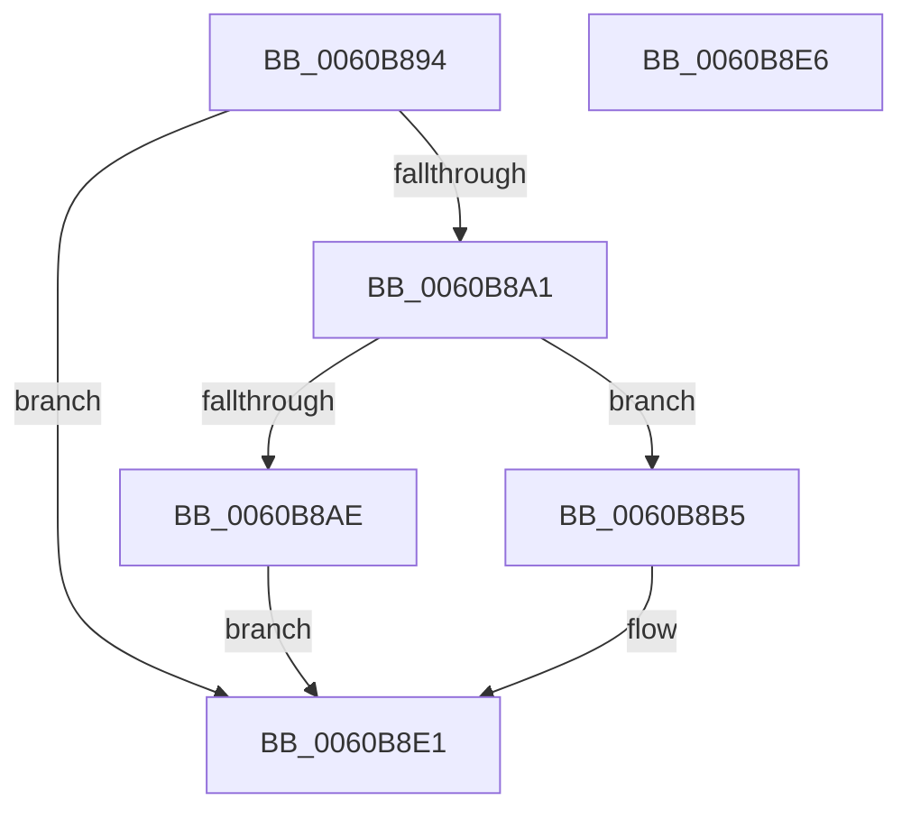

# SepAuditFailedRaisedIrql

- RVA: `0x0060B894`–`0x0060B8E7` (길이 `83` bytes)
- VA: `0x000000014060B894`
- 실행 섹션: `.text`
- PDB 이름 있음: `예`; PDB Function 태그: `아니요`
- unwind 정보 RVA: `0x0005C788`
- 디코드: `19`개 명령, `83/83` bytes 표시
- 미해석 바이트: `0` (있으면 어셈블리에 `.byte`로 보존)

> 이 문서는 커널 이미지의 기계어와 PDB 기호를 분석해 생성했습니다. 4번과 5번은 함수 원형과 자료형을 바이너리 사용 방식에서 추정한 C 해석이며 원본 소스 복구 결과는 아닙니다.

## 1. Dependencies

- 직접 호출 지점: **2**; 고유 호출 대상: **2**
- 직접 호출자로 확인된 함수: **2**
- RIP 상대 이미지 참조: **6**

### Outgoing calls
- `0x0060B8AE` → [SepAuditFailed](../../page/86/SepAuditFailed_function_0086EE20.md) (function, `0x0086EE20`)
- `0x0060B8DC` → [ExQueueWorkItem](../2F/ExQueueWorkItem_function_002F9520.md) (function, `0x002F9520`)

### Direct callers
- [SepAdtLogAuditRecord](../22/SepAdtLogAuditRecord_function_00224B6C.md) at `0x00224D0F`
- [sub_006D6AD0](../6D/Unknown_function_006D6AD0.md) at `0x006D6AF5`

### Static image references
- `0x0060B898` → RVA `0x00E67F1C` (`.data`; read)
- `0x0060B8B5` → RVA `0x00F04CE0` (`.data`; read/write)
- `0x0060B8BD` → RVA `0x0086EE20` (`SepAuditFailed`; read)
- `0x0060B8C4` → RVA `0x00F04CF0` (`.data`; write)
- `0x0060B8CE` → RVA `0x00F04CE0` (`.data`; read)
- `0x0060B8D5` → RVA `0x00F04CF8` (`.data`; write)

## 2. Other-region calls and transfers

- 다른 실행 섹션으로 향하는 call: **1**
  - `0x0060B8AE` → [SepAuditFailed](../../page/86/SepAuditFailed_function_0086EE20.md) (`.text` → `PAGE`)
- 별도 외부 분기/꼬리 이동을 확인하지 못했습니다.

## 3. Assembly (complete function range)

```asm
0060B894  48 83 EC 28                     sub rsp, 0x28
0060B898  80 3D 7D C6 85 00 00            cmp byte ptr [rip + 0x85c67d], 0
0060B89F  74 40                           je 0x14060b8e1
0060B8A1  44 0F 20 C0                     mov rax, cr8
0060B8A5  BA 02 00 00 00                  mov edx, 2
0060B8AA  3A C2                           cmp al, dl
0060B8AC  73 07                           jae 0x14060b8b5
0060B8AE  E8 6D 35 26 00                  call 0x14086ee20
0060B8B3  EB 2C                           jmp 0x14060b8e1
0060B8B5  48 83 25 23 94 8F 00 00         and qword ptr [rip + 0x8f9423], 0
0060B8BD  48 8D 05 5C 35 26 00            lea rax, [rip + 0x26355c]
0060B8C4  48 89 05 25 94 8F 00            mov qword ptr [rip + 0x8f9425], rax
0060B8CB  48 63 C1                        movsxd rax, ecx
0060B8CE  48 8D 0D 0B 94 8F 00            lea rcx, [rip + 0x8f940b]
0060B8D5  48 89 05 1C 94 8F 00            mov qword ptr [rip + 0x8f941c], rax
0060B8DC  E8 3F DC CE FF                  call 0x1402f9520
0060B8E1  48 83 C4 28                     add rsp, 0x28
0060B8E5  C3                              ret
0060B8E6  CC                              int3
```

## 4. C-style interpretation (structured pseudocode)

```c
__int64 __fastcall SepAuditFailedRaisedIrql(int a1)
{
    __int64 result;
    __int64 v_rsp;

    v_rsp = (v_rsp) - (40);
    if ((*(unsigned __int8 *)(v_rip + 8767101)) == 0) goto loc_0060B8E1;
    if (((unsigned __int8)(v_cr8)) >= 2) goto loc_0060B8B5;
    result = SepAuditFailed(a1, 2, a3, a4);
    goto loc_0060B8E1;
loc_0060B8B5:
    *(unsigned __int64 *)(v_rip + 9409573) = v_rip + 2504028;
    *(unsigned __int64 *)(v_rip + 9409564) = (int)(a1);
    result = ExQueueWorkItem(v_rip + 9409547, 2, a3, a4);
loc_0060B8E1:
    v_rsp = (v_rsp) + (40);
    return result;
}
```

## 5. (Beta) C Style

```c
int64_t SepAuditFailedRaisedIrql(int32_t Arg1)
{
    int64_t result;
    int64_t local_rsp;

    local_rsp = (local_rsp) - (40);
    if ((*(uint8_t *)(v_rip + 0x85C67D)) == 0) goto loc_0060B8E1;
    if (((uint8_t)(v_cr8)) >= 2) goto loc_0060B8B5;
    result = SepAuditFailed(Arg1, 2, a3, a4);
    goto loc_0060B8E1;
loc_0060B8B5:
    *(uint64_t *)(v_rip + 0x8F9425) = v_rip + 2504028;
    *(uint64_t *)(v_rip + 0x8F941C) = (int32_t)(Arg1);
    result = ExQueueWorkItem(v_rip + 9409547, 2, a3, a4);
loc_0060B8E1:
    local_rsp = (local_rsp) + (40);
    return result;
}
```

## 6. Execution-region graph

[열기: 2D/3D 그래프와 함수 탐색 컨트롤 패널](../../../control-panel.html?section=text&rva=0x0060B894&view=graph)

- 2D 그래프는 위에서 아래로 흐르고, 3D 그래프는 빈 공간을 드래그해 회전합니다. Shift+드래그는 이동, 휠은 확대·축소, 함수 노드 선택은 대상 보고서 이동입니다.

### Static fallback


