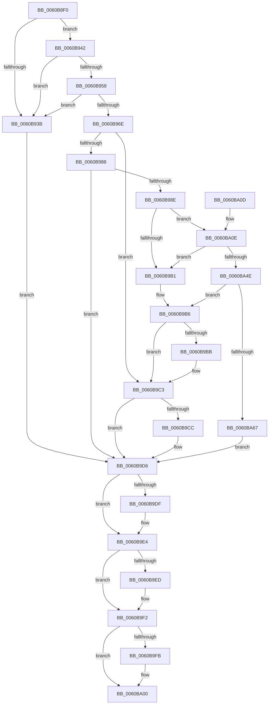

# SepBuildCapPolicyTable

- RVA: `0x0060B8F0`–`0x0060BA6F` (길이 `383` bytes)
- VA: `0x000000014060B8F0`
- 실행 섹션: `.text`
- PDB 이름 있음: `예`; PDB Function 태그: `아니요`
- unwind 정보 RVA: `0x000D1748`
- 디코드: `112`개 명령, `383/383` bytes 표시
- 미해석 바이트: `0` (있으면 어셈블리에 `.byte`로 보존)

> 이 문서는 커널 이미지의 기계어와 PDB 기호를 분석해 생성했습니다. 4번과 5번은 함수 원형과 자료형을 바이너리 사용 방식에서 추정한 C 해석이며 원본 소스 복구 결과는 아닙니다.

## 1. Dependencies

- 직접 호출 지점: **13**; 고유 호출 대상: **9**
- 직접 호출자로 확인된 함수: **1**
- RIP 상대 이미지 참조: **3**

### Outgoing calls
- `0x0060B932` → [SepRegOpenKey](../../page/A3/SepRegOpenKey_function_00A3A6B4.md) (function, `0x00A3A6B4`)
- `0x0060B94F` → [SepRegOpenKey](../../page/A3/SepRegOpenKey_function_00A3A6B4.md) (function, `0x00A3A6B4`)
- `0x0060B965` → [SepRegOpenKey](../../page/A3/SepRegOpenKey_function_00A3A6B4.md) (function, `0x00A3A6B4`)
- `0x0060B97D` → [SepReadAndPopulateCapes](../../page/7A/SepReadAndPopulateCapes_function_007A3CB8.md) (function, `0x007A3CB8`)
- `0x0060B9A0` → [ExAllocatePool2](../../poolcode/B8/ExAllocatePool2_function_00B820F0.md) (function, `0x00B820F0`)
- `0x0060B9BE` → [SepRmDestroyCapTable](../../page/7A/SepRmDestroyCapTable_function_007A4894.md) (function, `0x007A4894`)
- `0x0060B9D1` → [ExFreePoolWithTag](../../poolcode/B8/ExFreePoolWithTag_function_00B82870.md) (function, `0x00B82870`)
- `0x0060B9DF` → [ZwClose](../6A/ZwClose_function_006AD2B0.md) (function, `0x006AD2B0`)
- `0x0060B9ED` → [ZwClose](../6A/ZwClose_function_006AD2B0.md) (function, `0x006AD2B0`)
- `0x0060B9FB` → [ZwClose](../6A/ZwClose_function_006AD2B0.md) (function, `0x006AD2B0`)
- `0x0060BA16` → [memset](../6C/memset_function_006C6C40.md) (function, `0x006C6C40`)
- `0x0060BA3D` → [RtlpCreateHashTable](../48/RtlpCreateHashTable_function_0048C400.md) (function, `0x0048C400`)
- `0x0060BA58` → [SepReadAndInsertCaps](../../page/7A/SepReadAndInsertCaps_function_007A3960.md) (function, `0x007A3960`)

### Direct callers
- [SepRmCapUpdateWrkr](../../page/7A/SepRmCapUpdateWrkr_function_007A46D0.md) at `0x007A46F2`

### Static image references
- `0x0060B91B` → RVA `0x006CD6E0` (` ?? ::FNODOBFM::`string'`; read)
- `0x0060B948` → RVA `0x006CD790` (` ?? ::FNODOBFM::`string'`; read)
- `0x0060B95E` → RVA `0x006CD840` (` ?? ::FNODOBFM::`string'`; read)

## 2. Other-region calls and transfers

- 다른 실행 섹션으로 향하는 call: **8**
  - `0x0060B932` → [SepRegOpenKey](../../page/A3/SepRegOpenKey_function_00A3A6B4.md) (`.text` → `PAGE`)
  - `0x0060B94F` → [SepRegOpenKey](../../page/A3/SepRegOpenKey_function_00A3A6B4.md) (`.text` → `PAGE`)
  - `0x0060B965` → [SepRegOpenKey](../../page/A3/SepRegOpenKey_function_00A3A6B4.md) (`.text` → `PAGE`)
  - `0x0060B97D` → [SepReadAndPopulateCapes](../../page/7A/SepReadAndPopulateCapes_function_007A3CB8.md) (`.text` → `PAGE`)
  - `0x0060B9A0` → [ExAllocatePool2](../../poolcode/B8/ExAllocatePool2_function_00B820F0.md) (`.text` → `POOLCODE`)
  - `0x0060B9BE` → [SepRmDestroyCapTable](../../page/7A/SepRmDestroyCapTable_function_007A4894.md) (`.text` → `PAGE`)
  - `0x0060B9D1` → [ExFreePoolWithTag](../../poolcode/B8/ExFreePoolWithTag_function_00B82870.md) (`.text` → `POOLCODE`)
  - `0x0060BA58` → [SepReadAndInsertCaps](../../page/7A/SepReadAndInsertCaps_function_007A3960.md) (`.text` → `PAGE`)
- 별도 외부 분기/꼬리 이동을 확인하지 못했습니다.

## 3. Assembly (complete function range)

```asm
0060B8F0  40 55                           push rbp
0060B8F2  53                              push rbx
0060B8F3  56                              push rsi
0060B8F4  57                              push rdi
0060B8F5  41 56                           push r14
0060B8F7  48 8B EC                        mov rbp, rsp
0060B8FA  48 83 EC 40                     sub rsp, 0x40
0060B8FE  48 83 22 00                     and qword ptr [rdx], 0
0060B902  4C 8D 45 F0                     lea r8, [rbp - 0x10]
0060B906  48 83 65 F0 00                  and qword ptr [rbp - 0x10], 0
0060B90B  48 8B F2                        mov rsi, rdx
0060B90E  48 83 65 E8 00                  and qword ptr [rbp - 0x18], 0
0060B913  44 8B F1                        mov r14d, ecx
0060B916  48 83 65 E0 00                  and qword ptr [rbp - 0x20], 0
0060B91B  48 8D 0D BE 1D 0C 00            lea rcx, [rip + 0xc1dbe]
0060B922  48 83 65 40 00                  and qword ptr [rbp + 0x40], 0
0060B927  BB 01 02 00 00                  mov ebx, 0x201
0060B92C  83 65 38 00                     and dword ptr [rbp + 0x38], 0
0060B930  8B D3                           mov edx, ebx
0060B932  E8 7D ED 42 00                  call 0x140a3a6b4
0060B937  85 C0                           test eax, eax
0060B939  79 07                           jns 0x14060b942
0060B93B  33 DB                           xor ebx, ebx
0060B93D  E9 94 00 00 00                  jmp 0x14060b9d6
0060B942  4C 8D 45 E8                     lea r8, [rbp - 0x18]
0060B946  8B D3                           mov edx, ebx
0060B948  48 8D 0D 41 1E 0C 00            lea rcx, [rip + 0xc1e41]
0060B94F  E8 60 ED 42 00                  call 0x140a3a6b4
0060B954  85 C0                           test eax, eax
0060B956  78 E3                           js 0x14060b93b
0060B958  4C 8D 45 E0                     lea r8, [rbp - 0x20]
0060B95C  8B D3                           mov edx, ebx
0060B95E  48 8D 0D DB 1E 0C 00            lea rcx, [rip + 0xc1edb]
0060B965  E8 4A ED 42 00                  call 0x140a3a6b4
0060B96A  85 C0                           test eax, eax
0060B96C  78 CD                           js 0x14060b93b
0060B96E  48 8B 4D E8                     mov rcx, qword ptr [rbp - 0x18]
0060B972  4C 8D 4D 40                     lea r9, [rbp + 0x40]
0060B976  4C 8D 45 38                     lea r8, [rbp + 0x38]
0060B97A  41 8B D6                        mov edx, r14d
0060B97D  E8 36 83 19 00                  call 0x1407a3cb8
0060B982  8B D8                           mov ebx, eax
0060B984  85 C0                           test eax, eax
0060B986  78 3B                           js 0x14060b9c3
0060B988  83 7D 38 00                     cmp dword ptr [rbp + 0x38], 0
0060B98C  74 48                           je 0x14060b9d6
0060B98E  BB 40 00 00 00                  mov ebx, 0x40
0060B993  41 B8 53 65 53 70               mov r8d, 0x70536553
0060B999  8B D3                           mov edx, ebx
0060B99B  B9 00 01 00 00                  mov ecx, 0x100
0060B9A0  E8 4B 67 57 00                  call 0x140b820f0
0060B9A5  48 89 45 48                     mov qword ptr [rbp + 0x48], rax
0060B9A9  48 8B F8                        mov rdi, rax
0060B9AC  48 85 C0                        test rax, rax
0060B9AF  75 5D                           jne 0x14060ba0e
0060B9B1  BB 9A 00 00 C0                  mov ebx, 0xc000009a
0060B9B6  48 85 FF                        test rdi, rdi
0060B9B9  74 08                           je 0x14060b9c3
0060B9BB  48 8B CF                        mov rcx, rdi
0060B9BE  E8 D1 8E 19 00                  call 0x1407a4894
0060B9C3  48 8B 4D 40                     mov rcx, qword ptr [rbp + 0x40]
0060B9C7  48 85 C9                        test rcx, rcx
0060B9CA  74 0A                           je 0x14060b9d6
0060B9CC  BA 53 65 53 70                  mov edx, 0x70536553
0060B9D1  E8 9A 6E 57 00                  call 0x140b82870
0060B9D6  48 8B 4D E0                     mov rcx, qword ptr [rbp - 0x20]
0060B9DA  48 85 C9                        test rcx, rcx
0060B9DD  74 05                           je 0x14060b9e4
0060B9DF  E8 CC 18 0A 00                  call 0x1406ad2b0
0060B9E4  48 8B 4D E8                     mov rcx, qword ptr [rbp - 0x18]
0060B9E8  48 85 C9                        test rcx, rcx
0060B9EB  74 05                           je 0x14060b9f2
0060B9ED  E8 BE 18 0A 00                  call 0x1406ad2b0
0060B9F2  48 8B 4D F0                     mov rcx, qword ptr [rbp - 0x10]
0060B9F6  48 85 C9                        test rcx, rcx
0060B9F9  74 05                           je 0x14060ba00
0060B9FB  E8 B0 18 0A 00                  call 0x1406ad2b0
0060BA00  8B C3                           mov eax, ebx
0060BA02  48 83 C4 40                     add rsp, 0x40
0060BA06  41 5E                           pop r14
0060BA08  5F                              pop rdi
0060BA09  5E                              pop rsi
0060BA0A  5B                              pop rbx
0060BA0B  5D                              pop rbp
0060BA0C  C3                              ret
0060BA0D  CC                              int3
0060BA0E  4C 8B C3                        mov r8, rbx
0060BA11  33 D2                           xor edx, edx
0060BA13  48 8B CF                        mov rcx, rdi
0060BA16  E8 25 B2 0B 00                  call 0x1406c6c40
0060BA1B  8B 45 38                        mov eax, dword ptr [rbp + 0x38]
0060BA1E  48 8D 4D 48                     lea rcx, [rbp + 0x48]
0060BA22  89 47 30                        mov dword ptr [rdi + 0x30], eax
0060BA25  45 33 C9                        xor r9d, r9d
0060BA28  48 8B 45 40                     mov rax, qword ptr [rbp + 0x40]
0060BA2C  45 33 C0                        xor r8d, r8d
0060BA2F  48 89 47 38                     mov qword ptr [rdi + 0x38], rax
0060BA33  BA 80 00 00 00                  mov edx, 0x80
0060BA38  48 83 65 40 00                  and qword ptr [rbp + 0x40], 0
0060BA3D  E8 BE 09 E8 FF                  call 0x14048c400
0060BA42  48 8B 7D 48                     mov rdi, qword ptr [rbp + 0x48]
0060BA46  84 C0                           test al, al
0060BA48  0F 84 63 FF FF FF               je 0x14060b9b1
0060BA4E  48 8B 4D E0                     mov rcx, qword ptr [rbp - 0x20]
0060BA52  4C 8B C7                        mov r8, rdi
0060BA55  41 8B D6                        mov edx, r14d
0060BA58  E8 03 7F 19 00                  call 0x1407a3960
0060BA5D  8B D8                           mov ebx, eax
0060BA5F  85 C0                           test eax, eax
0060BA61  0F 88 4F FF FF FF               js 0x14060b9b6
0060BA67  48 89 3E                        mov qword ptr [rsi], rdi
0060BA6A  E9 67 FF FF FF                  jmp 0x14060b9d6
```

## 4. C-style interpretation (structured pseudocode)

```c
__int64 __fastcall SepBuildCapPolicyTable(int a1, __int64 a2)
{
    __int64 result;
    __int64 v_rbx;
    __int64 v_rsp;
    unsigned __int64 v_stack_m38;
    unsigned __int64 v_stack_m40;
    unsigned __int64 v_stack_m48;
    unsigned int v_stack_p10;
    unsigned __int64 v_stack_p18;
    unsigned __int64 v_stack_p20;

    v_rsp = (v_rsp) - (64);
    result = SepRegOpenKey(v_rip + 794046, 513, v_stack_m38, a4);
    if (!sign_flag) goto loc_0060B942;
loc_0060B93B:
    v_rbx = 0;
    goto loc_0060B9D6;
loc_0060B942:
    result = SepRegOpenKey(v_rip + 794177, 0, v_stack_m40, a4);
    if (sign_flag) goto loc_0060B93B;
    result = SepRegOpenKey(v_rip + 794331, 0, v_stack_m48, a4);
    if (sign_flag) goto loc_0060B93B;
    result = SepReadAndPopulateCapes(v_stack_m40, (unsigned int)((unsigned int)((unsigned int)(a1))), v_stack_p10, v_stack_p18);
    if (sign_flag) goto loc_0060B9C3;
    if (v_stack_p10 == 0) goto loc_0060B9D6;
    result = ExAllocatePool2(256, 64, (unsigned int)(0x70536553ULL), v_stack_p18);
    v_stack_p20 = result;
    if (result != 0) goto loc_0060BA0E;
loc_0060B9B1:
loc_0060B9B6:
    if (result != 0) {
        a1 = result;
        result = SepRmDestroyCapTable(a1, 64, (unsigned int)(0x70536553ULL), v_stack_p18);
    }
    if (v_stack_p18 != 0) {
        a2 = 0x70536553ULL;
        result = ExFreePoolWithTag(v_stack_p18, a2, (unsigned int)(0x70536553ULL), v_stack_p18);
    }
    if (v_stack_m48 != 0) {
        result = ZwClose(v_stack_m48, a2, (unsigned int)(0x70536553ULL), v_stack_p18);
    }
    if (v_stack_m40 != 0) {
        result = ZwClose(v_stack_m40, a2, (unsigned int)(0x70536553ULL), v_stack_p18);
    }
    if (v_stack_m38 != 0) {
        result = ZwClose(v_stack_m38, a2, (unsigned int)(0x70536553ULL), v_stack_p18);
    }
    v_rsp = (v_rsp) + (64);
    return (unsigned int)((unsigned int)((unsigned int)(0xC000009AULL)));
loc_0060BA0E:
    a2 = 0;
    result = memset(result, a2, (unsigned int)(0xC000009AULL), v_stack_p18);
    *(unsigned int *)(result + 48) = (unsigned int)((unsigned int)(v_stack_p10));
    a4 = 0;
    a3 = 0;
    *(unsigned __int64 *)(result + 56) = v_stack_p18;
    result = RtlpCreateHashTable(v_stack_p20, 128, a3, a4);
    if ((unsigned __int8)(result) == 0) goto loc_0060B9B1;
    result = SepReadAndInsertCaps(v_stack_m48, (unsigned int)((unsigned int)((unsigned int)(a1))), v_stack_p20, a4);
    if (sign_flag) goto loc_0060B9B6;
    *(unsigned __int64 *)(a2) = v_stack_p20;
    goto loc_0060B9D6;
}
```

## 5. (Beta) C Style

```c
int64_t SepBuildCapPolicyTable(int32_t Arg1, void *Arg2)
{
    uint8_t *arg2 = (uint8_t *)Arg2;

    int64_t result;
    int64_t local_rbx;
    int64_t local_rsp;
    uint64_t v_stack_m38;
    uint64_t v_stack_m40;
    uint64_t v_stack_m48;
    uint32_t v_stack_p10;
    uint64_t v_stack_p18;
    uint64_t v_stack_p20;

    local_rsp = (local_rsp) - (64);
    result = SepRegOpenKey(v_rip + 794046, 513, v_stack_m38, a4);
    if (!sign_flag) goto loc_0060B942;
loc_0060B93B:
    local_rbx = 0;
    goto loc_0060B9D6;
loc_0060B942:
    result = SepRegOpenKey(v_rip + 794177, 0, v_stack_m40, a4);
    if (sign_flag) goto loc_0060B93B;
    result = SepRegOpenKey(v_rip + 794331, 0, v_stack_m48, a4);
    if (sign_flag) goto loc_0060B93B;
    result = SepReadAndPopulateCapes(v_stack_m40, (uint32_t)((uint32_t)((uint32_t)(Arg1))), v_stack_p10, v_stack_p18);
    if (sign_flag) goto loc_0060B9C3;
    if (v_stack_p10 == 0) goto loc_0060B9D6;
    result = ExAllocatePool2(256, 64, (uint32_t)(0x70536553ULL), v_stack_p18);
    v_stack_p20 = result;
    if (result != 0) goto loc_0060BA0E;
loc_0060B9B1:
loc_0060B9B6:
    if (result != 0) {
        Arg1 = result;
        result = SepRmDestroyCapTable(Arg1, 64, (uint32_t)(0x70536553ULL), v_stack_p18);
    }
    if (v_stack_p18 != 0) {
        Arg2 = 0x70536553ULL;
        result = ExFreePoolWithTag(v_stack_p18, Arg2, (uint32_t)(0x70536553ULL), v_stack_p18);
    }
    if (v_stack_m48 != 0) {
        result = ZwClose(v_stack_m48, Arg2, (uint32_t)(0x70536553ULL), v_stack_p18);
    }
    if (v_stack_m40 != 0) {
        result = ZwClose(v_stack_m40, Arg2, (uint32_t)(0x70536553ULL), v_stack_p18);
    }
    if (v_stack_m38 != 0) {
        result = ZwClose(v_stack_m38, Arg2, (uint32_t)(0x70536553ULL), v_stack_p18);
    }
    local_rsp = (local_rsp) + (64);
    return (uint32_t)((uint32_t)((uint32_t)(0xC000009AULL)));
loc_0060BA0E:
    Arg2 = 0;
    result = memset(result, Arg2, (uint32_t)(0xC000009AULL), v_stack_p18);
    *(uint32_t *)(result + 0x30) = (uint32_t)((uint32_t)(v_stack_p10));
    a4 = 0;
    a3 = 0;
    *(uint64_t *)(result + 0x38) = v_stack_p18;
    result = RtlpCreateHashTable(v_stack_p20, 128, a3, a4);
    if ((uint8_t)(result) == 0) goto loc_0060B9B1;
    result = SepReadAndInsertCaps(v_stack_m48, (uint32_t)((uint32_t)((uint32_t)(Arg1))), v_stack_p20, a4);
    if (sign_flag) goto loc_0060B9B6;
    *(uint64_t *)(arg2) = v_stack_p20;
    goto loc_0060B9D6;
}
```

### 관측된 메모리 오프셋

구조체 형식이 확인되지 않은 접근은 인자 기준의 오프셋으로만 기록했습니다.

| 기준 인자 | 오프셋 표현 | 폭 (bit) | 접근 |
|---|---:|---:|---|
| `Arg2` | `+ 0x0` | `64` | `R/W` |
| `Arg2` | `+ 0x0` | `64` | `W` |

## 6. Execution-region graph

[열기: 2D/3D 그래프와 함수 탐색 컨트롤 패널](../../../control-panel.html?section=text&rva=0x0060B8F0&view=graph)

- 2D 그래프는 위에서 아래로 흐르고, 3D 그래프는 빈 공간을 드래그해 회전합니다. Shift+드래그는 이동, 휠은 확대·축소, 함수 노드 선택은 대상 보고서 이동입니다.

### Static fallback


