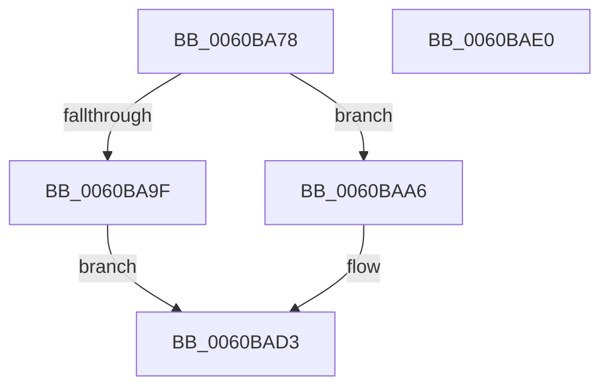

# SepBuildDefaultCape

- RVA: `0x0060BA78`–`0x0060BAE1` (길이 `105` bytes)
- VA: `0x000000014060BA78`
- 실행 섹션: `.text`
- PDB 이름 있음: `예`; PDB Function 태그: `아니요`
- unwind 정보 RVA: `0x0005CAAC`
- 디코드: `28`개 명령, `105/105` bytes 표시
- 미해석 바이트: `0` (있으면 어셈블리에 `.byte`로 보존)

> 이 문서는 커널 이미지의 기계어와 PDB 기호를 분석해 생성했습니다. 4번과 5번은 함수 원형과 자료형을 바이너리 사용 방식에서 추정한 C 해석이며 원본 소스 복구 결과는 아닙니다.

## 1. Dependencies

- 직접 호출 지점: **1**; 고유 호출 대상: **1**
- 직접 호출자로 확인된 함수: **1**
- RIP 상대 이미지 참조: **2**

### Outgoing calls
- `0x0060BA95` → [ExAllocatePool2](../../poolcode/B8/ExAllocatePool2_function_00B820F0.md) (function, `0x00B820F0`)

### Direct callers
- [SepBuildDefaultCap](../../page/7A/SepBuildDefaultCap_function_007A38B8.md) at `0x007A38CD`

### Static image references
- `0x0060BAA6` → RVA `0x00FD8700` (`PAGEDATA`; read)
- `0x0060BAAD` → RVA `0x00FD9CC8` (`PAGEDATA`; read)

## 2. Other-region calls and transfers

- 다른 실행 섹션으로 향하는 call: **1**
  - `0x0060BA95` → [ExAllocatePool2](../../poolcode/B8/ExAllocatePool2_function_00B820F0.md) (`.text` → `POOLCODE`)
- 별도 외부 분기/꼬리 이동을 확인하지 못했습니다.

## 3. Assembly (complete function range)

```asm
0060BA78  48 89 5C 24 08                  mov qword ptr [rsp + 8], rbx
0060BA7D  57                              push rdi
0060BA7E  48 83 EC 20                     sub rsp, 0x20
0060BA82  48 8B F9                        mov rdi, rcx
0060BA85  33 DB                           xor ebx, ebx
0060BA87  B9 00 01 00 00                  mov ecx, 0x100
0060BA8C  41 B8 53 65 53 70               mov r8d, 0x70536553
0060BA92  8D 53 38                        lea edx, [rbx + 0x38]
0060BA95  E8 56 66 57 00                  call 0x140b820f0
0060BA9A  48 85 C0                        test rax, rax
0060BA9D  75 07                           jne 0x14060baa6
0060BA9F  BB 9A 00 00 C0                  mov ebx, 0xc000009a
0060BAA4  EB 2D                           jmp 0x14060bad3
0060BAA6  0F 10 05 53 CC 9C 00            movups xmm0, xmmword ptr [rip + 0x9ccc53]
0060BAAD  48 8B 0D 14 E2 9C 00            mov rcx, qword ptr [rip + 0x9ce214]
0060BAB4  48 89 58 10                     mov qword ptr [rax + 0x10], rbx
0060BAB8  F3 0F 7F 00                     movdqu xmmword ptr [rax], xmm0
0060BABC  48 C7 40 30 01 00 00 00         mov qword ptr [rax + 0x30], 1
0060BAC4  48 89 58 18                     mov qword ptr [rax + 0x18], rbx
0060BAC8  48 89 58 28                     mov qword ptr [rax + 0x28], rbx
0060BACC  48 89 48 20                     mov qword ptr [rax + 0x20], rcx
0060BAD0  48 89 07                        mov qword ptr [rdi], rax
0060BAD3  8B C3                           mov eax, ebx
0060BAD5  48 8B 5C 24 30                  mov rbx, qword ptr [rsp + 0x30]
0060BADA  48 83 C4 20                     add rsp, 0x20
0060BADE  5F                              pop rdi
0060BADF  C3                              ret
0060BAE0  CC                              int3
```

## 4. C-style interpretation (structured pseudocode)

```c
__int64 __fastcall SepBuildDefaultCape(__int64 a1)
{
    __int64 result;
    __int64 v_rbx;
    __int64 v_rsp;
    unsigned __int64 v_stack_p8;

    v_stack_p8 = v_rbx;
    v_rsp = (v_rsp) - (32);
    v_rbx = 0;
    result = ExAllocatePool2(256, v_rbx + 56, (unsigned int)(0x70536553ULL), a4);
    if (result != 0) goto loc_0060BAA6;
    goto loc_0060BAD3;
loc_0060BAA6:
    *(unsigned __int64 *)(result + 16) = (unsigned int)(0xC000009AULL);
    *(unsigned __int64 *)(result) = v_xmm0;
    *(unsigned __int64 *)(result + 48) = 1;
    *(unsigned __int64 *)(result + 24) = (unsigned int)(0xC000009AULL);
    *(unsigned __int64 *)(result + 40) = (unsigned int)(0xC000009AULL);
    *(unsigned __int64 *)(result + 32) = *(unsigned __int64 *)(v_rip + 10281492);
    *(unsigned __int64 *)(a1) = result;
loc_0060BAD3:
    v_rsp = (v_rsp) + (32);
    return (unsigned int)((unsigned int)((unsigned int)(0xC000009AULL)));
}
```

## 5. (Beta) C Style

```c
int64_t SepBuildDefaultCape(void *Arg1)
{
    uint8_t *arg1 = (uint8_t *)Arg1;

    int64_t result;
    int64_t local_rbx;
    int64_t local_rsp;
    uint64_t v_stack_p8;

    v_stack_p8 = local_rbx;
    local_rsp = (local_rsp) - (32);
    local_rbx = 0;
    result = ExAllocatePool2(256, local_rbx + 56, (uint32_t)(0x70536553ULL), a4);
    if (result != 0) goto loc_0060BAA6;
    goto loc_0060BAD3;
loc_0060BAA6:
    *(uint64_t *)(result + 0x10) = (uint32_t)(0xC000009AULL);
    *(uint64_t *)(result) = v_xmm0;
    *(uint64_t *)(result + 0x30) = 1;
    *(uint64_t *)(result + 0x18) = (uint32_t)(0xC000009AULL);
    *(uint64_t *)(result + 0x28) = (uint32_t)(0xC000009AULL);
    *(uint64_t *)(result + 0x20) = *(uint64_t *)(v_rip + 0x9CE214);
    *(uint64_t *)(arg1) = result;
loc_0060BAD3:
    local_rsp = (local_rsp) + (32);
    return (uint32_t)((uint32_t)((uint32_t)(0xC000009AULL)));
}
```

### 관측된 메모리 오프셋

구조체 형식이 확인되지 않은 접근은 인자 기준의 오프셋으로만 기록했습니다.

| 기준 인자 | 오프셋 표현 | 폭 (bit) | 접근 |
|---|---:|---:|---|
| `Arg1` | `+ 0x0` | `64` | `W` |

## 6. Execution-region graph

[열기: 2D/3D 그래프와 함수 탐색 컨트롤 패널](../../../control-panel.html?section=text&rva=0x0060BA78&view=graph)

- 2D 그래프는 위에서 아래로 흐르고, 3D 그래프는 빈 공간을 드래그해 회전합니다. Shift+드래그는 이동, 휠은 확대·축소, 함수 노드 선택은 대상 보고서 이동입니다.

### Static fallback


